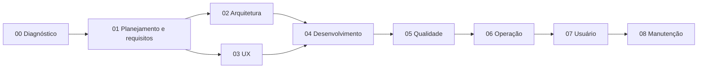
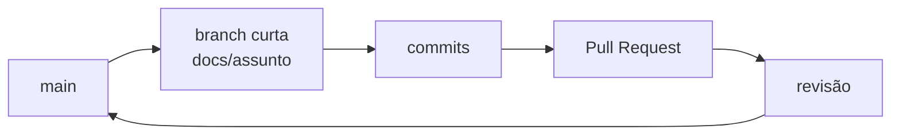

# ♻️ Residuum — documentação do projeto

> Plataforma que premia moradores com pontos por entregar **PET e latas de alumínio** em pontos de coleta, com cooperativas que recolhem o material e um painel de administração.
> Este repositório é a **fonte única** da documentação. Backend e frontend só guardam instruções de instalação.

| | |
|---|---|
| **Prazo informado** | 20/11/2026 (não garante todo o backlog) |
| **Fase** | Adequação da documentação, em andamento · [ver progresso](#-estado-da-documentação) |
| **Código** | [residuum-backend](https://github.com/Residuum-Organization/residuum-backend) · [residuum-frontend](https://github.com/Residuum-Organization/residuum-frontend) |

---

## 🧭 Comece por aqui

Escolha o seu papel. Cada linha leva ao primeiro documento que você precisa.

| Eu sou… | Quero… | Abra |
|---|---|---|
| 🧑‍💼 **Produto** | entender o que será feito e o que ficou de fora | [Visão e escopo](docs/01-planejamento/visao-e-escopo.md) |
| 🧑‍💼 **Produto** | saber quais decisões estão me esperando | [Decisões pendentes](docs/00-diagnostico/decisoes-pendentes.md) |
| 👩‍💻 **Dev** | ver o que o sistema deve fazer | [PRD](docs/01-planejamento/prd-srs.md) → [requisitos por módulo](docs/01-planejamento/requisitos/README.md) |
| 👩‍💻 **Dev** | entender como o sistema é montado | [Arquitetura](docs/02-arquitetura/sad.md) · [modelo de dados](docs/02-arquitetura/modelo-de-dados.md) |
| 👩‍💻 **Dev** | pegar uma tarefa | [Backlog](docs/01-planejamento/backlog/README.md) |
| 👩‍💻 **Dev** | contribuir com código ou documentação | [Como contribuir](CONTRIBUTING.md) |
| 🧪 **QA** | saber o que e como testar | [Plano de testes](docs/05-qualidade/plano-de-testes.md) · [casos](docs/05-qualidade/casos-de-teste.md) |
| 🎨 **UX** | ver as telas e o que está sem desenho | [Índice de telas](docs/03-ux/indice-de-telas.md) |
| 🚀 **Operação** | subir ou publicar o sistema | [Guia de deploy](docs/06-operacao/guia-de-deploy.md) |
| 🙋 **Quem usa o app** | aprender a usar | [Manual do usuário](docs/07-usuario/manual-do-usuario.md) |
| 🆕 **Cheguei agora** | ter a visão geral em 10 minutos | [Visão](docs/01-planejamento/visao-e-escopo.md) → [Arquitetura](docs/02-arquitetura/sad.md) → [Backlog](docs/01-planejamento/backlog/README.md) |

---

## 🗺️ Como a documentação está organizada

As pastas seguem o ciclo de vida do produto, na ordem em que você costuma precisar delas.



| Pasta | Para quê | Documentos | Situação |
|---|---|---|---|
| [`00-diagnostico`](docs/00-diagnostico/) | O que temos e o que falta | [matriz de adequação](docs/00-diagnostico/matriz-de-adequacao.md) · [plano](docs/00-diagnostico/plano-de-adequacao.md) · [decisões pendentes](docs/00-diagnostico/decisoes-pendentes.md) | 🟢 em uso |
| [`01-planejamento`](docs/01-planejamento/) | O que construir e por quê | [visão](docs/01-planejamento/visao-e-escopo.md) · [PRD](docs/01-planejamento/prd-srs.md) · [requisitos](docs/01-planejamento/requisitos/README.md) · [decisões](docs/01-planejamento/decisoes/README.md) · [backlog](docs/01-planejamento/backlog/README.md) | 🟡 revisão |
| [`02-arquitetura`](docs/02-arquitetura/) | Como é montado | [SAD](docs/02-arquitetura/sad.md) · [diagramas](docs/02-arquitetura/diagramas.md) · [dados](docs/02-arquitetura/modelo-de-dados.md) · [ADRs](docs/02-arquitetura/adr/README.md) | 🟡 revisão |
| [`03-ux`](docs/03-ux/) | Telas e protótipos | [índice de telas](docs/03-ux/indice-de-telas.md) | 🟡 revisão |
| [`04-desenvolvimento`](docs/04-desenvolvimento/) | Contratos e convenções | [API](docs/04-desenvolvimento/api.md) · [CONTRIBUTING](CONTRIBUTING.md) | 🔴 esboço |
| [`05-qualidade`](docs/05-qualidade/) | Como garantir que funciona | [plano](docs/05-qualidade/plano-de-testes.md) · [casos](docs/05-qualidade/casos-de-teste.md) | 🔴 esboço |
| [`06-operacao`](docs/06-operacao/) | Publicar e acompanhar | [deploy](docs/06-operacao/guia-de-deploy.md) · [notas de versão](docs/06-operacao/release-notes.md) | 🔴 esboço |
| [`07-usuario`](docs/07-usuario/) | Ensinar a usar | [manual](docs/07-usuario/manual-do-usuario.md) | 🔴 esboço |
| [`08-manutencao`](docs/08-manutencao/) | Como manter tudo isto | [governança](docs/08-manutencao/governanca-da-documentacao.md) | 🔴 esboço |

Legenda: 🟢 em uso · 🟡 em revisão (conteúdo existe, falta validar) · 🔴 esboço (estrutura pronta, faltam informações).

**Pastas antigas** (`planejamento`, `requisitos`, `tecnologia`, `ux`, `visao`, `pesquisa`, `estudos`, `diagnostico`, `historico`) continuam no lugar enquanto os links são migrados. Os arquivos novos indicam a origem no topo.

---

## 📊 Estado da documentação

O plano tem 6 partes, uma por vez, cada uma em um Pull Request. Detalhes em [plano de adequação](docs/00-diagnostico/plano-de-adequacao.md).

| Parte | Tema | Estado |
|---|---|---|
| 1 | Planejamento e requisitos | 🟡 PR aberta, falta validação do produto |
| 2 | Arquitetura e design | 🟡 PR aberta, falta topologia real e wireframes |
| 3 | Desenvolvimento (API, READMEs, contribuição) | ⬜ não iniciada |
| 4 | Qualidade | ⬜ não iniciada |
| 5 | Operação e usuário | ⬜ não iniciada |
| 6 | Manutenção (GitHub Flow, versões) | ⬜ não iniciada |

**O que mais trava hoje:** o produto precisa validar o valor do ponto (5 por unidade), decidir quem confirma o descarte e definir o perfil de responsável pelo ponto. Ver [decisões pendentes](docs/00-diagnostico/decisoes-pendentes.md).

---

## ✏️ Como ler os documentos

Todo documento começa com o mesmo bloco:

> **Estado:** esboço · revisão · definitivo — **Dono:** quem responde por ele — **Fontes:** de onde veio — **Lacunas:** quantas faltam

E usa três marcas para dizer o que ainda falta:

| Marca | Significa |
|---|---|
| `[LACUNA]` | falta informação que não existe nas fontes |
| `[DECISÃO: PD-xxx]` | depende de uma decisão do produto ([lista](docs/01-planejamento/decisoes/README.md)) |
| `[VERIFICAR NO CÓDIGO]` | precisa ser conferido no backend ou frontend |

Para ver **tudo que está pendente** de uma vez:

```bash
grep -rn "LACUNA\|DECISÃO\|VERIFICAR" docs/
```

---

## 🔄 Como atualizar (GitHub Flow)



1. Crie uma branch curta a partir da `main`: `docs/<assunto>`.
2. Edite, faça commits pequenos: `docs(escopo): resumo no imperativo`.
3. Abra um Pull Request e peça revisão de outra pessoa.
4. Mescle e apague a branch. O histórico fica no Git; para voltar a uma versão anterior, use `git revert` do PR.

Regras completas em [CONTRIBUTING.md](CONTRIBUTING.md) e na [governança](docs/08-manutencao/governanca-da-documentacao.md).

**Mudou o código? Atualize o documento no mesmo ciclo.**

---

## 📚 Pesquisa e documentos anteriores

| Preciso… | Abra |
|---|---|
| Ver o documento geral das 93 atividades (original) | [Tasks gerais](docs/planejamento/modulos/tasks-gerais.md) |
| Ver a proposta de Scrum e sprints | [Scrum e sequência](docs/planejamento/modulos/scrum-e-sequencia.md) |
| Entender o mercado, concorrentes e o sistema de pontos | [Índice das pesquisas](docs/pesquisa/README.md) |
| Ver as regras de saldo, vouchers e sorteios | [Regras de saldo](docs/requisitos/regras-de-saldo-vouchers-sorteios.md) |
| Ver as regras de campanhas | [Regras de campanhas](docs/requisitos/regras-de-campanhas.md) |
| Ver o estado das branches do código | [Mapa de branches](docs/tecnologia/mapa-de-branches.md) |
| Consultar versões antigas | [Histórico](docs/historico/README.md) |
| Guia dos documentos anteriores | [Guia completo](docs/README.md) |

---

## ⚠️ Avisos importantes

- Sorteios são **somente de teste** até haver parecer jurídico (Lei 5.768/1971).
- Pontos **não são dinheiro**.
- Este material distingue **requisito**, **proposta**, **teste planejado** e **evidência executada**. Uma demonstração ou uma marcação antiga de "concluído" não comprova que o sistema integrado foi homologado.
