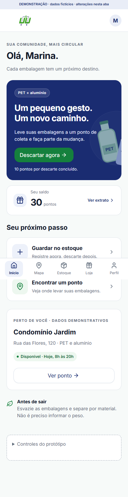

# Residuum — documentação da equipe

Base de trabalho do Residuum: requisitos, atividades, decisões, tecnologia e validação da plataforma de descarte de PET e latas de alumínio.

## Comece aqui

| Preciso… | Abrir |
|---|---|
| Executar ou consultar uma atividade | [Atividades gerais](docs/01-planejamento/01-atividades-gerais.md) · [Fontes por perfil](docs/01-planejamento/02-perfis/README.md) |
| Entender o comportamento esperado | [Requisitos V6](docs/02-produto/02-requisitos-mvp-v6.md) · [Regras de negócio](docs/02-produto/03-regras-de-negocio.md) |
| Resolver uma decisão | [Decisões vinculadas às atividades](docs/01-planejamento/04-decisoes.md) |
| Organizar a entrega | [Entregas por perfil](docs/01-planejamento/06-entregas-por-perfil.md) · [Proposta de sprints](docs/01-planejamento/07-sprints.md) |
| Revisar ou testar | [Fluxo de qualidade](docs/05-qualidade/01-fluxo-e-qualidade.md) · [Casos integrados](docs/05-qualidade/02-testes-integrados.md) |
| Entender o produto e sua base | [Visão](docs/02-produto/01-visao.md) · [Tecnologia](docs/03-tecnologia/README.md) |

O planejamento preserva **93 IDs: 66 atividades de execução e 27 decisões**, incluindo uma decisão de avaliação futura. O compilado é gerado a partir das fichas por perfil; edite as fontes. O quadro da equipe acompanha responsáveis, datas e status.

## Sumário

- [Comece aqui](#comece-aqui)
- [Estrutura e documentos](#estrutura-e-documentos)
- [Consulta e manutenção local](#consulta-e-manutenção-local)
- [Demonstrações e evidências](#demonstrações-e-evidências)
- [Equipe e contribuição](#equipe-e-contribuição)
- [Licença](#licença)

## Estrutura e documentos

```text
.github/                  Templates e verificação automática
scripts/                  Geração e validação da documentação
docs/
├── 01-planejamento/       Atividades, perfis, módulos e decisões
├── 02-produto/            Visão, requisitos e regras
├── 03-tecnologia/         Stack, arquitetura e diagnóstico
├── 04-ux/                 Handoff, demonstrações e evidências
├── 05-qualidade/          Fluxo de revisão e casos integrados
├── 06-pesquisa/           Estudos de negócio e fontes
├── 07-historico/          Documentos anteriores
└── 08-manutencao/         Convenções e migração de caminhos
```

[Guia completo dos documentos](docs/README.md) · [Convenções](docs/08-manutencao/01-convencoes.md) · [Mapa dos caminhos antigos e novos](docs/08-manutencao/02-mapa-de-migracao.md)

## Consulta e manutenção local

Para ler, abra os arquivos no GitHub ou em um editor Markdown. Este repositório contém documentação e ferramentas de manutenção; os procedimentos de execução da aplicação pertencem aos repositórios de frontend e backend referenciados no [diagnóstico](docs/03-tecnologia/03-diagnostico-mvp-v1.md).

Para editar e verificar, use Git e **Node.js 24**, sem instalar pacotes:

```text
node scripts/gerar-atividades.mjs
node scripts/gerar-atividades.mjs --check
node scripts/verificar-documentacao.mjs
node --test scripts/documentacao.test.mjs
```

O primeiro comando atualiza o compilado. Os seguintes verificam consistência e links. As instruções completas estão no [guia de contribuição](CONTRIBUTING.md).

A stack da aplicação examinada inclui React/Vite, FastAPI e PostgreSQL; consulte [stacks e integrações](docs/03-tecnologia/01-stacks-e-integracoes.md) para versões, evidências e limites. Essa referência não confirma o ambiente atualmente implantado.

## Demonstrações e evidências

[Handoff do morador V6](docs/04-ux/01-morador-v6/01-handoff.md) · [Validação registrada](docs/04-ux/01-morador-v6/02-validacao.md) · [Demonstração independente V2](docs/04-ux/02-demonstracao-v2/01-status.md)



A imagem é uma evidência da demonstração V6. Consulte o registro de validação para seu contexto: capturas, testes planejados e demonstrações não comprovam homologação integrada. O prazo informado no planejamento é 20/11/2026, condicionado ao recorte e à capacidade da equipe.

## Equipe e contribuição

Documentação mantida pela equipe Residuum. A autoria de cada alteração permanece no histórico Git; responsáveis nominais pelas entregas são definidos no quadro da equipe.

[Como contribuir](CONTRIBUTING.md) · [Pesquisa de negócio](docs/06-pesquisa/README.md) · [Histórico documental](docs/07-historico/README.md)

## Licença

A definição de licença e titularidade permanece pendente da equipe. Nenhuma licença foi atribuída nesta reorganização; consulte a [pendência de manutenção](docs/08-manutencao/01-convencoes.md#licença).
