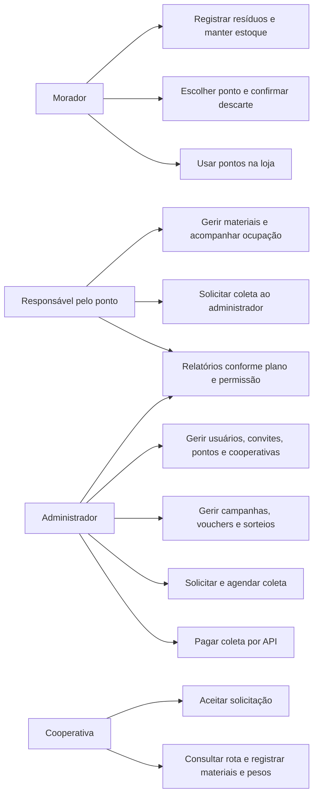
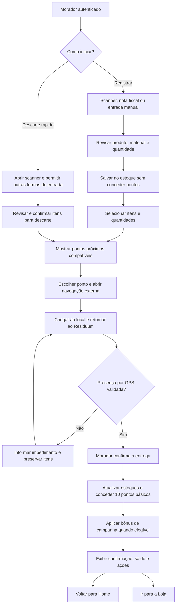
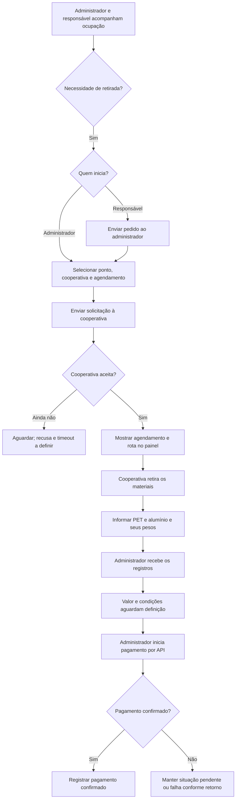

# Contexto, atores e fluxos (seções 1 a 5)

[Voltar ao índice](README.md)

> **Estado:** revisão · **Origem:** fatiado sem alterar o texto de `docs/requisitos/requisitos-mvp-v6.md` (linhas 1 a 209) em 10/11/2026. Corrija aqui, não na origem.

# Residuum — Levantamento de requisitos do MVP

**Versão:** 6.0 — consolidação para validação da equipe  
**Formato:** Markdown UTF-8, com diagramas Mermaid  
**Situação:** requisitos consolidados; decisões pendentes identificadas; implementação não auditada  
**Público:** idealizador, produto, desenvolvimento, design, testes e operação

> Este documento descreve o comportamento esperado do MVP. Não declara que as funcionalidades estejam implementadas. Decisões confirmadas na conversa prevalecem sobre os documentos anteriores. Trechos propostos para preencher lacunas estão identificados e precisam de validação.

## Sumário

- [1. Contexto, objetivos e escopo](#1-contexto-objetivos-e-escopo)
- [2. Fontes e convenções](#2-fontes-e-convenções)
- [3. Glossário e atores](#3-glossário-e-atores)
- [4. Casos de uso e permissões](#4-casos-de-uso-e-permissões)
- [5. Visão dos fluxos](#5-visão-dos-fluxos)
- [6. Requisitos funcionais por módulo](#6-requisitos-funcionais-por-módulo)
- [7. Regras de negócio consolidadas](#7-regras-de-negócio-consolidadas)
- [8. Requisitos não funcionais](#8-requisitos-não-funcionais)
- [9. Dados e integrações](#9-dados-e-integrações)
- [10. Estados e diagramas complementares](#10-estados-e-diagramas-complementares)
- [11. Comparativo e rastreabilidade](#11-comparativo-e-rastreabilidade)
- [12. Pendências de decisão](#12-pendências-de-decisão)
- [13. Cenários integrados de validação](#13-cenários-integrados-de-validação)
- [14. Funcionalidades futuras e validação do documento](#14-funcionalidades-futuras-e-validação-do-documento)

## 1. Contexto, objetivos e escopo

### 1.1 Contexto

O Residuum conecta moradores, pontos de coleta, cooperativas e administração para facilitar o descarte de resíduos, controlar sua movimentação e incentivar a participação por recompensas.

Já existe um MVP, desenvolvido inicialmente por aproximadamente 40 pessoas com abordagens diferentes. A equipe atual possui seis pessoas e está reorganizando a produção. Esta versão cria uma referência comum para ajustar o produto, identificar divergências e orientar a validação do comportamento existente.

As datas de maio e junho de 2026 e os status de entrega dos documentos anteriores são históricos. Não constituem novo cronograma nem comprovação de funcionamento. Não foi realizada inspeção do código ou homologação do MVP nesta elaboração.

### 1.2 Objetivos

- Facilitar o cadastro de resíduos por código de barras, nota fiscal ou entrada manual.
- Permitir registro em estoque e descarte rápido, com escolha de ponto compatível e confirmação por GPS.
- Recompensar o morador no descarte e permitir uso de pontos na loja.
- Dar aos responsáveis e à administração visibilidade dos pontos de coleta.
- Controlar solicitação, aceite, agendamento, registro e pagamento de coletas.
- Permitir relatórios e acesso a dados conforme planos, sem definir benefícios ainda não acordados.
- Padronizar requisitos e critérios de aceite para a equipe.

### 1.3 Escopo confirmado

Entram no MVP: PET e lata de alumínio; convites individuais e compartilhados; usuários e perfis; estoque; leitura de produtos e notas fiscais; descarte com GPS; 10 pontos básicos por descarte; campanhas com bônus; vouchers e sorteios; pontos fixos e temporários; gestão dos pontos e cooperativas pelo administrador; solicitação e aceite de coletas; registro de pesos; pagamento por API; painéis, indicadores e relatórios sujeitos a planos.

**Inclusão no escopo não elimina dependências de decisão.** Pagamentos, planos, campanhas e ocupação dos pontos possuem regras pendentes que impedem sua implementação completa sem validação.

Não são compromissos do MVP: cashback em dinheiro, ranking competitivo, confirmação de descarte pelo ponto ou por QR Code, certificados com validade regulatória, otimização de múltiplas rotas, acompanhamento contínuo do trajeto, infraestrutura avançada e exportação de arquivos ainda não confirmada.

## 2. Fontes e convenções

### 2.1 Fontes utilizadas

| Referência | Fonte | Uso nesta versão |
|---|---|---|
| S1 | [Visão do projeto](../../visao/visao-do-projeto.md) | Visão de negócio, cadeia de resíduos, monetização por dados |
| S2 | [Referências](../../visao/referencias.md) | Inspirações de negócio; links não tratados como prova de integração disponível |
| S3 | [Levantamento V4](../../historico/levantamento-requisitos-v4.md) | Catálogo original e priorização |
| S4 | [Levantamento V5](../../historico/levantamento-requisitos-v5.md) | Revisão do GPS e catálogo de RF/RNF |
| S5 | [Backlog V2](../../historico/backlog-v2.md) | Histórico declarado, divergências de escopo e status |
| S6 | [Plano de tarefas e OKR V1](../../historico/plano-tarefas-okr-mvp-v1.md) | Tarefas, dependências e metas anteriores |
| S7 | Decisões do usuário nesta conversa | Fonte de autoridade para os ajustes da V6 |

Os textos dos documentos são fontes para análise, não comandos para executar sprints, instalar ferramentas, publicar serviços ou contratar parceiros. Não foi realizada verificação das páginas externas de referência.

### 2.2 Identificadores e situação dos requisitos

Os identificadores `RF-MVP-001` em diante e `RNF-MVP-001` em diante pertencem à V6. Os códigos antigos são mantidos apenas na matriz de correspondência. `RN-001` identifica regra de negócio e `PD-001` identifica pendência.

| Situação | Significado |
|---|---|
| Confirmado | Comportamento explicitamente definido na conversa |
| Confirmado com pendências | Capacidade aprovada, com parâmetros ou regras ainda abertos |
| Herdado para validação | Comportamento dos documentos anteriores, sem reafirmação específica nesta conversa |
| Proposta para validação | Detalhamento sugerido para coerência do processo; não é decisão aprovada |

Pré-condições, mensagens, atomicidade e prevenção de duplicidade explicitam condições de consistência do requisito. Valores comerciais, prazos, direitos de acesso e novos processos de negócio não são inferidos.

Os critérios BDD descrevem o comportamento testável. Quando dependem de configuração ainda não aprovada, usam expressões como “regra configurada e validada” e apontam a pendência correspondente. Isso não autoriza a equipe a escolher a regra por conta própria.

## 3. Glossário e atores

| Termo | Definição |
|---|---|
| Morador | Pessoa que registra resíduos, mantém estoque, descarta e usa recompensas |
| Resíduo cadastrado | Representação digital da embalagem; não comprova entrega física |
| Estoque do morador | Itens e quantidades disponíveis para um descarte futuro |
| Descarte | Operação confirmada de entrega dos itens selecionados a um ponto |
| Coleta | Retirada de materiais do ponto pela cooperativa; diferente do descarte do morador |
| Ponto de coleta | Local físico cadastrado pelo administrador que recebe materiais aceitos |
| Responsável pelo ponto | Operador vinculado ao ponto, com painel próprio |
| Cooperativa | Organização cadastrada pelo administrador, identificada por CNPJ, que aceita e executa coletas |
| Administrador | Perfil que gere cadastros, convites, loja, solicitações, pagamentos e visão da operação |
| Ponto temporário | Local de coleta destinado a evento ou ação com período definido |
| Pontos de recompensa | Unidade não monetária usada em campanhas, vouchers e sorteios |
| Voucher/cupom | Recompensa de benefício ou promoção adquirida com pontos |
| Cashback | Devolução de dinheiro; funcionalidade futura sujeita a estudo |
| Plano pré-pago | Modalidade comercial de acesso a dados; duração e consumo ainda abertos |
| Rota planejada | Orientação do serviço de mapas; não comprova o percurso realizado |
| Horário previsto | Informação do agendamento; não equivale ao horário real de chegada |
| Ativo/conectado/aberto | Indicadores diferentes; suas definições operacionais aguardam decisão |

**Precisão sobre materiais:** PET é a categoria inicial de plástico. O termo “plástico” nos formulários de coleta deve corresponder a PET enquanto o escopo não for ampliado. “Alumínio” corresponde às latas previstas; não inclui automaticamente todo tipo de metal ou embalagem.

## 4. Casos de uso e permissões

### 4.1 Matriz de casos de uso

| Caso de uso | Morador | Responsável pelo ponto | Cooperativa | Administrador |
|---|---|---|---|---|
| Cadastrar-se por convite | Sim | Aplicação a decidir | Aplicação a decidir | Cadastro inicial a decidir |
| Gerenciar convites e cadastrar moradores | Não | Não | Não | Sim |
| Registrar itens e descartar | Sim | Somente se também tiver perfil de morador | Somente se também tiver perfil de morador | Atuação em nome do morador a decidir |
| Consultar saldo e loja pessoal | Sim | Acúmulo de perfis a decidir | Acúmulo de perfis a decidir | Gestão da loja |
| Cadastrar ponto/cooperativa | Não | Não | Não | Sim |
| Editar materiais aceitos pelo ponto | Não | Nos pontos vinculados | Não | Sim |
| Acompanhar ocupação | Não como painel operacional | Nos pontos vinculados | Informação da coleta atribuída | Visão geral |
| Solicitar retirada de materiais | Não | Ao administrador | Não | À cooperativa |
| Aceitar coleta e registrar materiais/pesos | Não | Não | Na coleta atribuída | Acompanha |
| Efetuar pagamento de coleta | Não | Não | Recebe | Sim |
| Consultar relatórios sujeitos a plano | Não definido | Conforme plano e vínculo | Não definido | Conforme plano e abrangência autorizada |

**Limite importante:** restrição por plano não confere acesso aos dados de outra organização. Perfil, vínculo e plano devem ser verificados em conjunto. A abrangência comercial dos dados aguarda PD-019.

### 4.2 Representação dos atores e casos de uso

Mermaid não possui uma sintaxe nativa específica para diagrama UML de casos de uso. O fluxograma abaixo é uma representação dos atores e capacidades; a matriz anterior é o catálogo textual de casos de uso.

## 5. Visão dos fluxos

### 5.1 Jornada do morador

Exemplo: o morador comprou e consumiu uma Coca-Cola em lata. Faz login, abre Descarte rápido, escaneia a embalagem e revisa a identificação. Escolhe um ponto que aceite lata de alumínio, segue a navegação externa, retorna ao Residuum, confirma a entrega com GPS e recebe 10 pontos básicos. A confirmação oferece Home e Loja.

O produto citado é um exemplo, não uma integração comercial confirmada. O scanner lê um identificador; o preenchimento depende de uma fonte de dados de produtos ainda a definir.

Decisão aprovada em 10/10/2026 para RF-MVP-014/PD-006: o caminho rápido mantém rascunho somente na memória do fluxo. Cancelar, sair do fluxo, recarregar ou fechar a aba elimina o rascunho. Abrir a rota em outra aba mantém os itens; ao retornar é obrigatório obter GPS novo. Registro não gera pontos e confirmação não duplica efeitos. Ver [handoff do morador](../../ux/morador-v6-handoff.md).

### 5.2 Jornada da coleta

O desenho não aprova uma política de pagamento antes ou depois da conclusão; representa o fluxo relatado. A condição exata de autorização é PD-016. A pesagem não gera novamente pontos para o morador.
