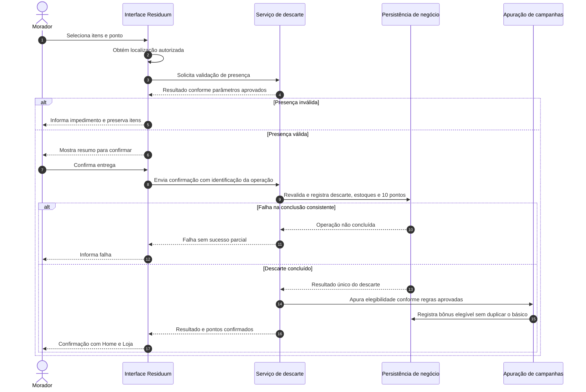

# 9. Dados e integrações

[Voltar ao índice](README.md)

> **Estado:** revisão · **Origem:** fatiado sem alterar o texto de `docs/requisitos/requisitos-mvp-v6.md` (linhas 1308 a 1384) em 10/11/2026. Corrija aqui, não na origem.

### 9.1 Mapa conceitual de informações

Esta tabela indica informação de negócio, não esquema físico de banco. Campos obrigatórios, retenção e formatos devem ser validados nas pendências indicadas.

| Informação | Conteúdo necessário ao processo | Relação e cuidado |
|---|---|---|
| Usuário e acesso | Identificação, contato, perfil, habilitação e vínculos | Pessoa, conta e organização não são necessariamente a mesma entidade |
| Convite | Identificação, modalidade, limite, consumo, validade quando aplicável | Consumo vinculado a cadastro concluído |
| Produto/resíduo | Nome, identificador consultado, material, quantidade e origem da informação | Identificação de produto não comprova entrega física |
| Consulta de nota | Referência e itens importados necessários ao cadastro | Armazenar integralmente a nota requer decisão de privacidade |
| Estoque pessoal | Itens e quantidades disponíveis | Não representa peso medido |
| Descarte | Morador, ponto, itens, quantidades, confirmação e evidência de presença | Origem do crédito básico e eventual bônus |
| Ponto de coleta | Localização, contexto, duração, responsável, aceitação e disponibilidade | Material aceito separado do acumulado |
| Estoque do ponto | Entradas, retiradas e unidade de cada informação | Contagem/estimativa/peso precisam ser distinguidos |
| Cooperativa | CNPJ, identificação, contatos e acessos | Dados do recebedor financeiro dependem da integração |
| Solicitação/coleta | Ponto, cooperativa, solicitante, agendamento, aceite e registros | Pedido do ponto não é solicitação já aceita pela cooperativa |
| Peso coletado | Material, peso, unidade, coleta e autoria | Deve ser vinculado ao ponto e à coleta |
| Ordem de pagamento | Coleta, recebedor, valor, ordem externa e situação | Não deduzir sucesso só do envio |
| Lançamento de pontos | Morador, valor, crédito/débito, origem e referência | Bônus separado do básico e do dinheiro |
| Campanha/sorteio/voucher | Conteúdo, condições, publicação e regras aprovadas | Participação e aquisição são registros próprios |
| Plano e contratação | Modalidade, titular, situação, vigência e benefícios aprovados | Não ampliar permissão por contratação |
| Auditoria | Autor, evento, entidade, data e resultado | Segredos e dados desnecessários não são conteúdo de log comum |

### 9.2 Integrações previstas e limites de especificação

| ID | Integração | Entrada/saída de negócio | Falha esperada | Decisão pendente |
|---|---|---|---|---|
| I01 | Catálogo de produtos por código de barras | Código lido → nome/material quando disponíveis | Permitir complemento manual | PD-004: fonte, cobertura e identificadores |
| I02 | Consulta de nota fiscal | Referência capturada → itens/quantidades disponíveis | Informar falha e permitir manual | PD-004/PD-005: tipo de nota, fonte e leitura |
| I03 | Mapas e navegação | Coordenadas/destino → mapa e rota planejada | Preservar destino e dados da operação | PD-007/PD-017: serviços e origem da rota |
| I04 | Pagamento à cooperativa | Ordem com valor/recebedor → identificador e situação | Manter pendência/falha; conciliar sem duplicar | PD-015/PD-016: valor, provedor e contrato |
| I05 | Mensagens externas | Evento → tentativa e resultado de envio | Painel continua sendo referência do processo | PD-021: canal, destinatário e prazos |
| I06 | Armazenamento/apresentação de mídia | Imagem/vídeo → mídia vinculada à oferta | Não publicar envio inválido/incompleto | PD-024: limites e modo de envio |

**Não há contratos REST/GraphQL definitivos nesta versão.** Rotas como `/discard-session` e `/points/:id/stats` dos documentos anteriores são sugestões técnicas. As interfaces deverão refletir o código existente depois de inspeção. Nenhum provedor foi validado quanto a disponibilidade, preços, cobertura ou condições contratuais neste levantamento.

**Distinção de QR:** ler um identificador de nota, eventualmente codificado em QR conforme a fonte escolhida, é diferente de usar QR do ponto para comprovar presença. A primeira possibilidade pertence à integração de nota a definir; a segunda não faz parte da confirmação atual de descarte.

### 9.3 Sequência da confirmação do descarte

Os participantes são responsabilidades conceituais. O diagrama não determina microserviços, banco específico ou processamento síncrono do bônus. A tecnologia deve manter as garantias de negócio descritas.
