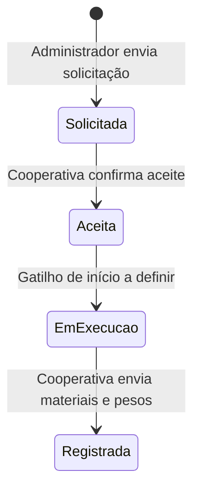
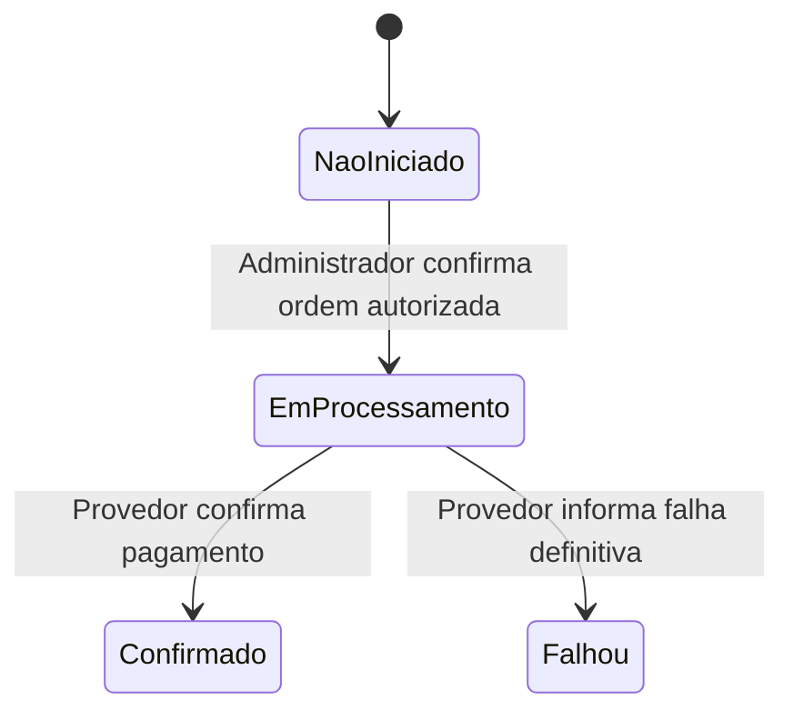
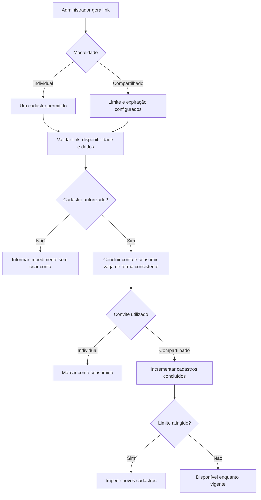
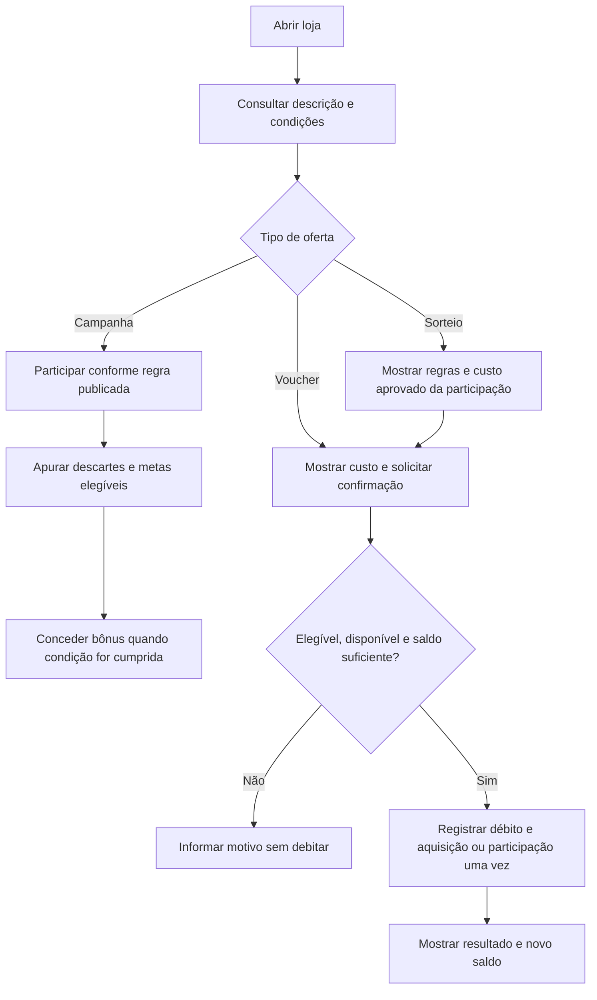
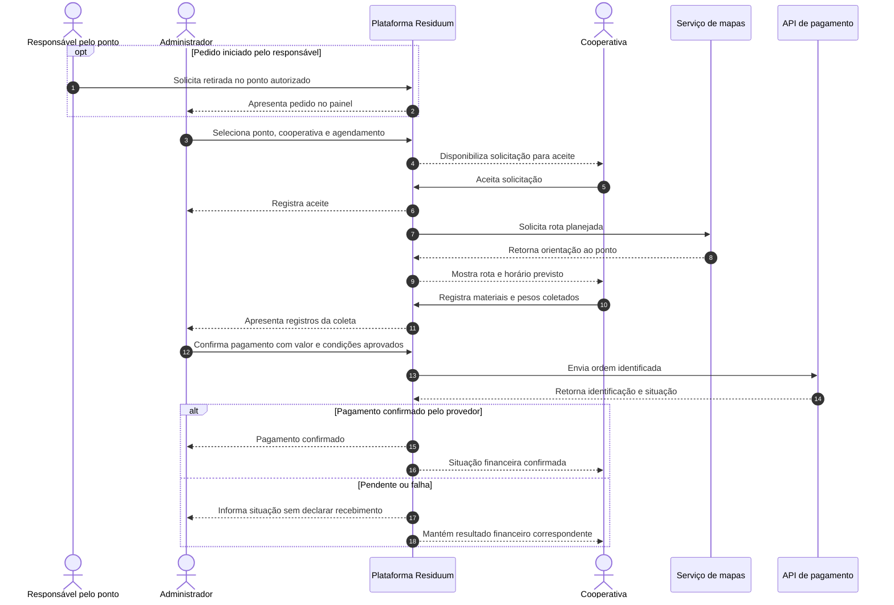

# 10. Estados e diagramas complementares

[Voltar ao índice](README.md)

> **Estado:** revisão · **Origem:** fatiado sem alterar o texto de `docs/requisitos/requisitos-mvp-v6.md` (linhas 1385 a 1502) em 10/11/2026. Corrija aqui, não na origem.

### 10.1 Proposta de estados para validação

**Os nomes abaixo são propostas de modelagem.** A equipe deve validá-los, especialmente nas transições com pendências. Não são enums ou tabelas implementados.

| Objeto | Estado proposto | Significado | Restrição/pendência |
|---|---|---|---|
| Convite individual | Disponível / consumido / expirado | Um uso; expiração se definida | Validade/revogação em PD-001 |
| Convite compartilhado | Disponível / esgotado / expirado | Vagas e validade controladas | Última vaga protegida contra concorrência |
| Descarte | Preparado / aguardando presença / concluído | Seleção não equivale a entrega | Cancelamento e rascunho em PD-006 |
| Solicitação de coleta | Solicitada / aceita | Encaminhamento e decisão da cooperativa | Recusa/timeout em PD-014 |
| Coleta | Em execução / registrada | Retirada e envio de materiais/pesos | Início real e revisão em PD-014/PD-018 |
| Pagamento | Não iniciado / em processamento / confirmado / falhou | Situação financeira separada | Mapeamento depende do provedor |
| Campanha/oferta | Rascunho / publicada / encerrada | Visibilidade e vigência | Alterações e cancelamento em PD-011/PD-012 |
| Ponto | Habilitado / desabilitado | Condição cadastral | Separado de horário e ocupação |
| Ocupação | Disponível / próximo do limite / cheio | Nível de materiais | Cálculo em PD-009 |

### 10.2 Estado operacional da coleta — proposta

Não foram criados caminhos automáticos de recusa, cancelamento ou encerramento por prazo porque não houve definição. O estado financeiro é independente e não é transição desse diagrama.

### 10.3 Estado financeiro — proposta

Uma resposta incerta permanece em conciliação; não se transforma em falha definitiva nem sucesso sem evidência. Nova tentativa, estorno e devolução serão desenhados após PD-016.

### 10.4 Fluxo dos dois tipos de convite

### 10.5 Fluxo da loja e utilização de pontos

Campanhas que cobram pontos também usam a mesma verificação de débito; condições e acúmulo dependem de PD-011. Voucher adquirido não comprova que já foi utilizado no parceiro.

### 10.6 Sequência de solicitação e pagamento da coleta

