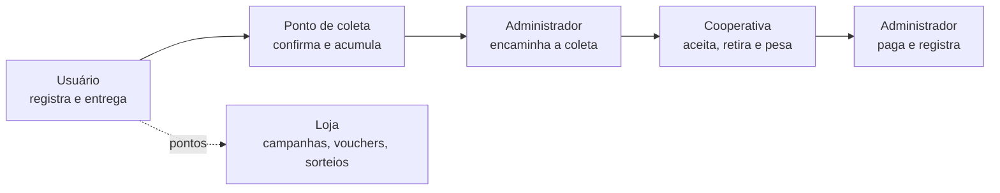

# Visão e Escopo

> **Estado:** revisão · **Dono:** Produto · **Atualizado em:** 11/11/2026
> **Fontes:** [visão original](../visao/visao-do-projeto.md) (mantida como referência), [V6](requisitos/README.md), [regras de saldo, vouchers e sorteios](../requisitos/regras-de-saldo-vouchers-sorteios.md), respostas e complementos da revisão de 11/11/2026 (Vinicius).
> **Pendências:** reunidas em [decisões pendentes](../00-diagnostico/decisoes-pendentes.md) · O código do backend ainda paga 5 pontos por unidade (ver [seção 5](#5-pontos-e-recompensas))

## Resumo

O Residuum é uma plataforma web que **conecta usuários, responsáveis por pontos de coleta, cooperativas e a administração**. O usuário registra embalagens de **PET e latas de alumínio**, entrega num ponto de coleta, comprova a presença por GPS e ganha pontos. A cooperativa retira e pesa o material. O administrador coordena tudo, inclusive o pagamento à cooperativa. O MVP existe e está sendo documentado para a equipe atual de **seis pessoas**.

Este documento diz **o que o produto é, para quem e até onde vai**. O texto longo e completo continua em [visao-do-projeto.md](../visao/visao-do-projeto.md).

## 1. O problema

| Problema | Consequência |
|---|---|
| **Falta de rastreabilidade.** O resíduo "some" no descarte; o usuário não sabe o destino e as empresas não comprovam a logística reversa (PNRS) | Risco legal e de imagem (ESG) |
| **Coleta "no escuro".** Cooperativas não sabem o volume nem o nível de enchimento dos pontos | Viagens inúteis e pontos lotados |
| **Pouco incentivo.** O cidadão não vê valor no resíduo | Baixa adesão à separação correta |
| **Dados ruins na base da cadeia.** O descarte cidadão não chega aos sistemas oficiais (SINIR, MTR) | Dificuldade de gestão e comprovação |

### O problema em números

| Número | O que mostra | Fonte |
|---|---|---|
| **97,3%** | das latas de alumínio foram recicladas no Brasil em 2024. O material **tem mercado** | [ABC do ABC](https://abcdoabc.com.br/latinhas-de-aluminio-recicladas/) |
| **~23%** | de capacidade parada nas recicladoras de PET, por **falta de coleta** (410 mil t recicladas em 2024) | [Dados do problema](../pesquisa/dados-do-problema.md) |
| **33,7%** | da população urbana de Manaus com coleta seletiva (SINISA 2024, último dado publicado) | [Instituto Água e Saneamento](https://www.aguaesaneamento.org.br/municipios-e-saneamento/am/manaus), ver [dados do problema](../pesquisa/dados-do-problema.md) |

**Em uma frase:** o Brasil já recicla quase toda lata e mais da metade do PET, mas a coleta não chega: indústria parada por falta de material e uma capital onde só um terço da população urbana tem coleta seletiva. Detalhes, ressalvas e o que falta confirmar estão em [dados do problema](../pesquisa/dados-do-problema.md).

## 2. A solução

1. **Registro simples.** Três formas, todas começando por um botão **+** no centro da barra de navegação: **código de barras**, **QR Code da nota fiscal** e **cadastro manual**. O **descarte rápido** é o uso dos dois leitores (código de barras e QR Code da nota) para ir direto à escolha do ponto.
2. **Pontos e Loja.** Pontos por descarte, campanhas com bônus, vouchers de parceiros e sorteios.
3. **Pontos organizados.** Pontos fixos e temporários, com responsável, materiais aceitos e sinalização de ocupação.
4. **Coleta coordenada.** O responsável pede, o administrador encaminha, a cooperativa aceita, retira e informa material e peso.
5. **Pagamento controlado.** A Residuum paga a cooperativa **por kg e material** coletado. No piloto, o administrador paga pelo banco e registra o comprovante; o pagamento **por API** entra depois (decidido em 11/11/2026).
6. **Dados por plano.** Relatórios e indicadores conforme plano, perfil e vínculo.

O fluxo completo, passo a passo, está na [seção 4 da visão original](../visao/visao-do-projeto.md#4-fluxo-integrado-do-mvp).

## 3. Quem usa

O perfil que antes se chamava "morador" passa a se chamar **usuário** em todos os documentos, por decisão de 11/11/2026 (é também o nome usado no código, `role = usuario`).

| Perfil | O que faz | Valor |
|---|---|---|
| **Usuário** | Registra resíduos, escolhe ponto, entrega, usa pontos na Loja | Menos esforço e incentivo |
| **Responsável pelo ponto** (vínculo N:N, decidido em 11/11/2026: [PD-023](decisoes/pd-023.md)) | Acompanha materiais e ocupação, edita o que o ponto aceita, pede retirada | Visibilidade e comunicação com a administração |
| **Cooperativa** | Aceita solicitações, vê agenda e rota, registra material e peso | Coletas organizadas e pagamento acompanhado |
| **Administrador** | Gere o teto de contas, pontos, Loja, solicitações, pagamentos e indicadores | Controle da operação em um só lugar |
| **Contratante de dados** | Consulta o que o plano autoriza | Informação para análise (plano único no piloto) |

## 4. Escopo do MVP

### Dentro do escopo

| Área | O que entra |
|---|---|
| Acesso | O usuário **se cadastra normalmente**, sem código, e depois entra como qualquer outro. O controle é um **teto de 500 contas** (configurável; pode subir a **1000**), com **trava de vagas no banco** (*pessimistic locking*: `SELECT ... FOR UPDATE` na linha de vagas). Ao chegar no teto: aviso e lista de espera. Conta excluída devolve a vaga. Decidido em 11/11/2026 e **revisto em 12/11/2026** (o código individual foi descartado). Ver [controle de acesso](../pesquisa/controle-de-acesso.md) |
| Cadastro de resíduos | **Três sistemas**, iniciados por um botão **+** centralizado na barra de navegação. **1) Código de barras:** lê o produto e já preenche o formulário. **2) QR Code da nota fiscal:** traz os itens da nota e os materiais. **3) Manual:** o usuário pode tentar ler o código de barras **quantas vezes quiser**. Cada falha mostra um **aviso vermelho** de erro de leitura; a partir da **2ª falha**, o aviso **recomenda o cadastro manual** (material e quantidade inteira obrigatórios; nome opcional). Decidido em 11/11/2026. Materiais: **PET e lata de alumínio** |
| Descarte rápido | **Não é uma função à parte.** É o uso do **leitor de código de barras** (agiliza um único produto) e do **leitor de QR Code da nota** (traz todos os materiais da nota) para seguir direto à escolha do ponto, sem passar pelo estoque |
| Entrega | Escolha do ponto compatível, navegação externa, **validação de presença por GPS** (libera o envio) e **confirmação pelo operador do ponto** (decidido em 11/11/2026); os pontos saem só depois da confirmação |
| Pontos e Loja | Pontos por descarte, campanhas com bônus, vouchers e **sorteios** (ver limite abaixo) |
| Pontos de coleta | Fixos e temporários, **cadastrados só pelo admin**, com responsável, materiais aceitos, ocupação e **raio de GPS de 100 m ajustável** (decidido em 11/11/2026) |
| Coleta | Pedido, encaminhamento, aceite, agenda e rota, registro de **material e peso** |
| Pagamento | A **Residuum** paga a cooperativa **por kg e material** ([PD-015](decisoes/pd-015.md), [PD-016](decisoes/pd-016.md)). **No piloto: pagamento manual** com comprovante registrado pelo administrador; **API depois**, testada antes em ambiente de teste (decidido em 11/11/2026). O valor por kg de cada material está em [decisões pendentes](../00-diagnostico/decisoes-pendentes.md) |
| Dados | **Plano único no piloto** para relatórios e indicadores; pacotes e preços vêm depois ([PD-019](decisoes/pd-019.md)) |

### Limites já decididos

| Limite | Origem |
|---|---|
| **Sorteios somente de teste**, sem prêmio real, até haver parecer jurídico (Lei 5.768/1971). **1 bilhete por usuário** | Decisão do time de 22/10, confirmada na revisão de 11/11 |
| No MVP os pontos **não são dinheiro** e **não há cashback** (a ideia existe, ver "Evolução") | V6 RN-010 |
| Registrar item ou ler nota **não é descarte** e não dá pontos | V6 RN-004 |
| Rascunho do descarte rápido fica **só na memória** do fluxo | Decisão de UX de 10/10 |
| A pesagem da cooperativa **não** concede pontos de novo ao usuário | V6 RN-016 |
| A **confirmação do operador é final**: descarte confirmado não é estornado; erro posterior vira ajuste manual do admin | Decisão de 11/11/2026 ([PD-010](decisoes/pd-010.md)) |

### Decisões já tomadas

As regras de **campanhas, vouchers e sorteios** foram decididas (ver [campanhas](../requisitos/regras-de-campanhas.md) e [saldo, vouchers e sorteios](../requisitos/regras-de-saldo-vouchers-sorteios.md)). O que ainda está em aberto fica em [decisões pendentes](../00-diagnostico/decisoes-pendentes.md).

### Pesquisas de apoio

| Tema | Documento |
|---|---|
| Capacidade do ponto de coleta e execução da coleta | [capacidade e coleta](../pesquisa/capacidade-e-execucao-da-coleta.md) |
| Controle de quantas pessoas entram | [controle de acesso](../pesquisa/controle-de-acesso.md) |
| Fontes para código de barras e nota fiscal | [fontes](../pesquisa/fontes-de-produtos-e-notas.md) |
| Provedor de pagamento | [provedores](../pesquisa/provedores-de-pagamento.md) |
| Números do problema | [dados do problema](../pesquisa/dados-do-problema.md) |

### Evolução a avaliar (fora do MVP)

**Cashback** (ver abaixo) · pontuação definitiva · ranking · confirmação por QR (PD-027) · certificados com validade regulatória · exportação de arquivos · rotas otimizadas · acompanhamento contínuo · outros materiais além de PET e lata.

**Ideia de cashback (versão futura, não será implementada agora).** O modelo de referência é o do **Méliuz**: o usuário registra seus produtos, vai somando pontos e, ao atingir um mínimo, **converte os pontos em dinheiro real**. Fica registrada como direção de produto. Ela exige estudo de viabilidade, definição da origem dos recursos e do processo de devolução, e **não faz parte do MVP**.

## 5. Pontos e recompensas

**Regra decidida em 11/11/2026 ([PD-010](decisoes/pd-010.md)): 10 pontos básicos por descarte concluído**, por operação, **independentemente da quantidade** de embalagens. Campanhas podem dar pontos extras.

> ✅ **Conflito resolvido em 11/11/2026.** Vale **10 por descarte**; a regra do time de 22/10 (5 por unidade) virou histórico. O **dobro de pontos** das campanhas conta **descartes** (bônus de 10 × N). Descartes do mesmo usuário no mesmo ponto, dentro de **60 minutos**, contam como um só. O código do backend ainda paga 5 por unidade e precisa ser alterado.

## 6. Metas e prazo

| Item | Valor |
|---|---|
| Prazo informado | **20/11/2026** (não garante todo o backlog) |
| Ordem das entregas | usuário → ponto de coleta → cooperativa → administrador |
| Região e pontos do piloto | Ver [piloto inicial](../pesquisa/piloto-inicial.md) e [decisões pendentes](../00-diagnostico/decisoes-pendentes.md) |

### Como medir o sucesso do piloto

**Escala:** 100 usuários, 3 pontos de coleta, 1 cooperativa e 8 semanas. Segue o [piloto inicial](../pesquisa/piloto-inicial.md): poucos pontos, uma ou duas cooperativas, número limitado de usuários, período fechado. **Aprovadas por Vinicius em 11/11/2026.**

| # | Indicador | Como calcular | Meta |
|---|---|---|---|
| 1 | Cadastro | cadastrados ÷ pessoas que abriram a tela de cadastro | **70% ou mais** |
| 2 | Primeiro descarte | cadastrados com 1 descarte confirmado em até 14 dias ÷ cadastrados | **50% ou mais** |
| 3 | Recorrência | usuários com 3 ou mais descartes em 8 semanas ÷ usuários com 1 descarte | **30% ou mais** |
| 4 | Uso de recompensa | usuários que resgataram voucher ou entraram em campanha ÷ usuários com 1 descarte | **25% ou mais** |
| 5 | Tempo até a retirada | do pedido de coleta até a coleta registrada | **até 72 horas** em 80% dos pedidos |
| 6 | Completude dos dados | coletas com ponto, material e peso preenchidos ÷ coletas | **90% ou mais** |
| 7 | Confiabilidade (técnico) | saldos que não batem com os lançamentos; acessos de uma cooperativa a pontos que não são dela | **zero** |

**Critério de sucesso:** o piloto deu certo se atingir **5 das 6 metas de uso (1 a 6) e zero falhas de confiabilidade (7)**.

> ⚠️ **As metas não vêm de dados:** o projeto ainda não tem histórico. Foram aprovadas como ponto de partida e devem ser revistas ao fim do piloto. A meta 2 é a mais importante: diz se as pessoas realmente entregam.

## 7. Glossário

**Usuário** quem usa o app para registrar e entregar (antes chamado de morador) · **Descarte** entrega do material num ponto · **Lote** vários itens enviados juntos · **Registrar** guardar item no estoque do usuário · **Descarte rápido** uso do leitor de código de barras ou do QR Code da nota para entregar sem passar pelo estoque · **Ponto de coleta** local físico de entrega · **Responsável** pessoa que cuida do ponto · **Voucher** cupom de parceiro trocado por pontos · **PD-xxx** pendência de decisão da V6 ([lista](decisoes/README.md)).

## O que falta para fechar

- [ ] Ligar os `[VERIFICAR fonte]` que restam em [dados do problema](../pesquisa/dados-do-problema.md)
- [ ] Alterar o código do backend: 10 pontos por descarte, dobro de pontos em descartes e janela de 60 minutos
- [ ] Marcar a [visão original](../visao/visao-do-projeto.md) como histórico
