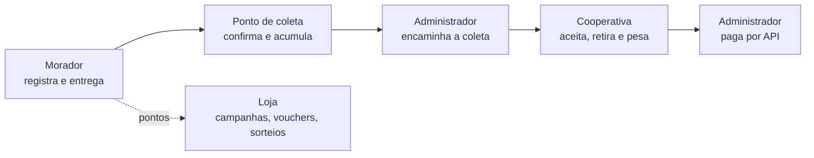

# Visão e Escopo

> **Estado:** revisão (aguardando aprovação do produto) · **Dono:** Produto · **Atualizado em:** 11/11/2026
> **Fontes:** [visão original](../visao/visao-do-projeto.md) (mantida como referência), [V6](requisitos/README.md), [regras de saldo, vouchers e sorteios](../requisitos/regras-de-saldo-vouchers-sorteios.md), respostas e complementos da revisão de 11/11/2026 (Vinicius).
> **Lacunas:** 2 · **Conflito aberto:** valor do ponto (ver [seção 5](#5-pontos-e-recompensas))

## Resumo

O Residuum é uma plataforma web que **conecta moradores, responsáveis por pontos de coleta, cooperativas e a administração**. O morador registra embalagens de **PET e latas de alumínio**, entrega num ponto de coleta, comprova a presença por GPS e ganha pontos. A cooperativa retira e pesa o material. O administrador coordena tudo, inclusive o pagamento à cooperativa. O MVP existe e está sendo documentado para a equipe atual de **seis pessoas**.

Este documento diz **o que o produto é, para quem e até onde vai**. O texto longo e completo continua em [visao-do-projeto.md](../visao/visao-do-projeto.md).

## 1. O problema

| Problema | Consequência |
|---|---|
| **Falta de rastreabilidade.** O resíduo "some" no descarte; o morador não sabe o destino e as empresas não comprovam a logística reversa (PNRS) | Risco legal e de imagem (ESG) |
| **Coleta "no escuro".** Cooperativas não sabem o volume nem o nível de enchimento dos pontos | Viagens inúteis e pontos lotados |
| **Pouco incentivo.** O cidadão não vê valor no resíduo | Baixa adesão à separação correta |
| **Dados ruins na base da cadeia.** O descarte cidadão não chega aos sistemas oficiais (SINIR, MTR) | Dificuldade de gestão e comprovação |

### O problema em números

| Número | O que mostra | Fonte |
|---|---|---|
| **97,3%** | das latas de alumínio foram recicladas no Brasil em 2024. O material **tem mercado** | [ABC do ABC](https://abcdoabc.com.br/latinhas-de-aluminio-recicladas/) |
| **~23%** | de capacidade parada nas recicladoras de PET, por **falta de coleta** (410 mil t recicladas em 2024) | [Dados do problema](../pesquisa/dados-do-problema.md) |
| **33,7%** | da população urbana de Manaus com coleta seletiva (SINISA 2024, último dado publicado) | [Instituto Água e Saneamento](https://www.aguaesaneamento.org.br/municipios-e-saneamento/am/manaus), ver [dados do problema](../pesquisa/dados-do-problema.md) |

**Em uma frase:** o Brasil já recicla quase toda lata e mais da metade do PET, mas a coleta não chega: indústria parada por falta de material e uma capital onde só um terço da população urbana tem coleta seletiva. Detalhes, ressalvas e o que falta confirmar estão em [dados do problema](../pesquisa/dados-do-problema.md).

## 2. A solução

1. **Registro simples.** Três formas, todas começando por um botão **+** no centro da barra de navegação: **código de barras**, **QR Code da nota fiscal** e **cadastro manual**. O **descarte rápido** é o uso dos dois leitores (código de barras e QR Code da nota) para ir direto à escolha do ponto.
2. **Pontos e Loja.** Pontos por descarte, campanhas com bônus, vouchers de parceiros e sorteios.
3. **Pontos organizados.** Pontos fixos e temporários, com responsável, materiais aceitos e sinalização de ocupação.
4. **Coleta coordenada.** O responsável pede, o administrador encaminha, a cooperativa aceita, retira e informa material e peso.
5. **Pagamento controlado.** O administrador paga a cooperativa dentro da plataforma, por API.
6. **Dados por plano.** Relatórios e indicadores conforme plano, perfil e vínculo.

O fluxo completo, passo a passo, está na [seção 4 da visão original](../visao/visao-do-projeto.md#4-fluxo-integrado-do-mvp).

## 3. Quem usa

O perfil que antes se chamava "morador" passa a se chamar **usuário** nesta seção (é também o nome usado no código, `role = usuario`).

| Perfil | O que faz | Valor |
|---|---|---|
| **Usuário** | Registra resíduos, escolhe ponto, entrega, usa pontos na Loja | Menos esforço e incentivo |
| **Responsável pelo ponto** `[DECISÃO: PD-023]` | Acompanha materiais e ocupação, edita o que o ponto aceita, pede retirada | Visibilidade e comunicação com a administração |
| **Cooperativa** | Aceita solicitações, vê agenda e rota, registra material e peso | Coletas organizadas e pagamento acompanhado |
| **Administrador** | Gere convites, pontos, Loja, solicitações, pagamentos e indicadores | Controle da operação em um só lugar |
| **Contratante de dados** | Consulta o que o plano autoriza | Informação para análise (pacotes a definir) |

## 4. Escopo do MVP

### Dentro do escopo

| Área | O que entra |
|---|---|
| Acesso | O usuário **se cadastra normalmente**. O controle de quantas pessoas entram (um número X) ainda está em estudo ([opções pesquisadas](../pesquisa/controle-de-acesso.md)); **por ora, o acesso é liberado por um código** fornecido pela equipe |
| Cadastro de resíduos | **Três sistemas**, iniciados por um botão **+** centralizado na barra de navegação. **1) Código de barras:** lê o produto e já preenche o formulário. **2) QR Code da nota fiscal:** traz os itens da nota e os materiais. **3) Manual:** o usuário pode tentar ler o código de barras **quantas vezes quiser**. Cada falha mostra um **aviso vermelho** de erro de leitura; a partir da **2ª falha**, o aviso **recomenda o cadastro manual** (nome, material, quantidade `[LACUNA: campos do formulário]`). Decidido em 11/11/2026. Materiais: **PET e lata de alumínio** |
| Descarte rápido | **Não é uma função à parte.** É o uso do **leitor de código de barras** (agiliza um único produto) e do **leitor de QR Code da nota** (traz todos os materiais da nota) para seguir direto à escolha do ponto, sem passar pelo estoque |
| Entrega | Escolha do ponto compatível, navegação externa, **validação de presença por GPS**, confirmação |
| Pontos e Loja | Pontos por descarte, campanhas com bônus, vouchers e **sorteios** (ver limite abaixo) |
| Pontos de coleta | Fixos e temporários, responsável, materiais aceitos, ocupação |
| Coleta | Pedido, encaminhamento, aceite, agenda e rota, registro de **material e peso** |
| Pagamento | **Pagamento à cooperativa por API**, iniciado pelo administrador `[DECISÃO: PD-015, PD-016]` |
| Dados | **Planos** (grátis, pré-pago, mensal) para relatórios e indicadores `[DECISÃO: PD-019]` |

### Limites já decididos

| Limite | Origem |
|---|---|
| **Sorteios somente de teste**, sem prêmio real, até haver parecer jurídico (Lei 5.768/1971). **1 bilhete por usuário** | Decisão do time de 22/10, confirmada na revisão de 11/11 |
| No MVP os pontos **não são dinheiro** e **não há cashback** (a ideia existe, ver "Evolução") | V6 RN-010 |
| Registrar item ou ler nota **não é descarte** e não dá pontos | V6 RN-004 |
| Rascunho do descarte rápido fica **só na memória** do fluxo | Decisão de UX de 10/10 |
| A pesagem da cooperativa **não** concede pontos de novo ao morador | V6 RN-016 |

### Decisões já tomadas

As regras de **campanhas, vouchers e sorteios** foram decididas (ver [campanhas](../requisitos/regras-de-campanhas.md) e [saldo, vouchers e sorteios](../requisitos/regras-de-saldo-vouchers-sorteios.md)). Restam só a validação do produto e dois detalhes: o algoritmo da apuração do sorteio e o dono do parecer jurídico.

### Ainda pendente

| O que está pendente | Decisão | Tipo | Situação |
|---|---|---|---|
| **Capacidade do ponto de coleta** e "ponto cheio" | [PD-009](decisoes/pd-009.md) | Estudo e decisão com a operação | **Estudo feito:** [capacidade e coleta](../pesquisa/capacidade-e-execucao-da-coleta.md). Falta decidir |
| **Execução da coleta** (recusa, prazo, coleta parcial) | [PD-014](decisoes/pd-014.md) | Estudo e decisão com a operação | **Estudo feito:** [capacidade e coleta](../pesquisa/capacidade-e-execucao-da-coleta.md). Falta decidir |
| Controle de quantas pessoas entram | — | Pesquisa | **Pesquisa feita:** [controle de acesso](../pesquisa/controle-de-acesso.md); trava de vagas no banco avaliada. Falta confirmar X (metas usam 100) |
| Fonte para código de barras e nota fiscal | [PD-004](decisoes/pd-004.md) | Pesquisa | **Pesquisa feita:** [fontes](../pesquisa/fontes-de-produtos-e-notas.md). Falta **testar** |
| Provedor de pagamento | [PD-015](decisoes/pd-015.md), [PD-016](decisoes/pd-016.md) | Pesquisa | **Pesquisa feita:** [provedores](../pesquisa/provedores-de-pagamento.md). Falta decidir pagador e valor |
| Precisão do GPS | [PD-008](decisoes/pd-008.md) | Teste em campo | Medir no piloto |
| Pacotes e preços dos planos | [PD-019](decisoes/pd-019.md) | Pesquisa e decisão | Falta fazer |

### Evolução a avaliar (fora do MVP)

**Cashback** (ver abaixo) · pontuação definitiva · ranking · confirmação pelo ponto ou QR (PD-027) · certificados com validade regulatória · exportação de arquivos · rotas otimizadas · acompanhamento contínuo · outros materiais além de PET e lata.

**Ideia de cashback (versão futura, não será implementada agora).** O modelo de referência é o do **Méliuz**: o usuário registra seus produtos, vai somando pontos e, ao atingir um mínimo, **converte os pontos em dinheiro real**. Fica registrada como direção de produto. Ela exige estudo de viabilidade, definição da origem dos recursos e do processo de devolução, e **não faz parte do MVP**.

## 5. Pontos e recompensas

**Regra desta visão (definida na revisão de 11/11/2026): 10 pontos básicos por descarte concluído**, como regra provisória até o modelo definitivo. Campanhas podem dar pontos extras.

> ⚠️ **Conflito aberto.** O time registrou em 22/10, em [regras de saldo, vouchers e sorteios](../requisitos/regras-de-saldo-vouchers-sorteios.md), que o valor vigente é **5 pontos por unidade**, e **o código do backend já aplica 5 por unidade**. A decisão de 11/11 para esta visão volta ao texto da V6 (10 por descarte, não por embalagem). Para valer no sistema, é preciso decidir [PD-010](decisoes/pd-010.md) e atualizar regras de saldo, regras de campanhas (dobro de pontos) e o código. Enquanto isso, **a Visão e o código divergem**.

## 6. Metas e prazo

| Item | Valor |
|---|---|
| Prazo informado | **20/11/2026** (não garante todo o backlog) |
| Ordem das entregas | morador → ponto de coleta → cooperativa → administrador |
| Região e pontos do piloto | `[LACUNA]` ver [piloto inicial](../pesquisa/piloto-inicial.md) |

### Como medir o sucesso do piloto

**Escala sugerida:** 100 usuários, 3 pontos de coleta, 1 cooperativa e 8 semanas. Segue o [piloto inicial](../pesquisa/piloto-inicial.md): poucos pontos, uma ou duas cooperativas, número limitado de usuários, período fechado. **Aprovadas por Vinicius em 11/11/2026**; falta a validação formal do produto.

| # | Indicador | Como calcular | Meta |
|---|---|---|---|
| 1 | Cadastro | cadastrados ÷ códigos entregues | **70% ou mais** |
| 2 | Primeiro descarte | cadastrados com 1 descarte confirmado em até 14 dias ÷ cadastrados | **50% ou mais** |
| 3 | Recorrência | usuários com 3 ou mais descartes em 8 semanas ÷ usuários com 1 descarte | **30% ou mais** |
| 4 | Uso de recompensa | usuários que resgataram voucher ou entraram em campanha ÷ usuários com 1 descarte | **25% ou mais** |
| 5 | Tempo até a retirada | do pedido de coleta até a coleta registrada | **até 72 horas** em 80% dos pedidos |
| 6 | Completude dos dados | coletas com ponto, material e peso preenchidos ÷ coletas | **90% ou mais** |
| 7 | Confiabilidade (técnico) | saldos que não batem com os lançamentos; acessos de uma cooperativa a pontos que não são dela | **zero** |

**Critério de sucesso:** o piloto deu certo se atingir **5 das 6 metas de uso (1 a 6) e zero falhas de confiabilidade (7)**.

> ⚠️ **As metas não vêm de dados:** o projeto ainda não tem histórico. Foram aprovadas como ponto de partida e devem ser revistas ao fim do piloto. A meta 2 é a mais importante: diz se as pessoas realmente entregam.

## 7. Glossário

**Usuário** quem usa o app para registrar e entregar (antes chamado de morador) · **Descarte** entrega do material num ponto · **Lote** vários itens enviados juntos · **Registrar** guardar item no estoque do morador · **Descarte rápido** uso do leitor de código de barras ou do QR Code da nota para entregar sem passar pelo estoque · **Ponto de coleta** local físico de entrega · **Responsável** pessoa que cuida do ponto · **Voucher** cupom de parceiro trocado por pontos · **PD-xxx** pendência de decisão da V6 ([lista](decisoes/README.md)).

## O que falta para fechar

- [ ] Produto validar formalmente esta visão (as respostas de 11/11 vieram da revisão de Vinicius)
- [ ] Resolver o conflito dos pontos (10 × 5) em [PD-010](decisoes/pd-010.md)
- [x] Aprovar as **metas do piloto** (seção 6): aprovadas em 11/11/2026, com **100 usuários**
- [ ] Confirmar se **X = 100** (o mesmo número das metas) para o teto de cadastros
- [ ] Escolher a forma de controle de acesso. **Em andamento:** proposta da trava de vagas no banco avaliada como adequada ao lançamento, ver [controle de acesso](../pesquisa/controle-de-acesso.md#proposta-para-o-lançamento-trava-de-vagas-no-banco-vinicius-11112026)
- [x] Tentativas do código de barras: sem limite; aviso vermelho a cada falha; cadastro manual recomendado a partir da 2ª
- [ ] `[LACUNA]` definir os campos do formulário manual
- [x] Estudar a capacidade do ponto (PD-009) e a execução da coleta (PD-014): [estudo feito](../pesquisa/capacidade-e-execucao-da-coleta.md)
- [ ] Decidir PD-009 e PD-014 com a operação (8 decisões listadas no estudo)
- [x] "Morador" vira "usuário" em todos os documentos (decidido em 11/11/2026)
- [x] Coleta seletiva em Manaus: trocado pelo último dado publicado (SINISA 2024, 33,7%)
- [ ] Ligar os `[VERIFICAR fonte]` que restam em [dados do problema](../pesquisa/dados-do-problema.md)
- [ ] Depois de aprovada, marcar a [visão original](../visao/visao-do-projeto.md) como histórico e trocar os "10 pontos" dela conforme a decisão
