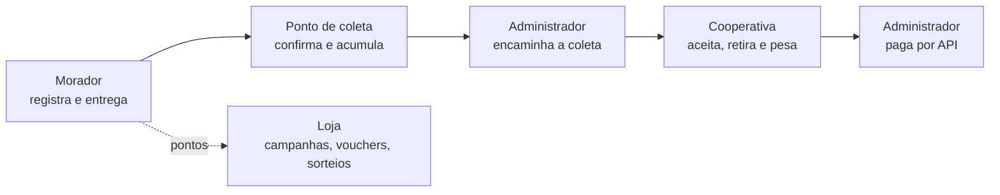

# Visão e Escopo

> **Estado:** revisão (aguardando aprovação do produto) · **Dono:** Produto · **Atualizado em:** 11/11/2026
> **Fontes:** [visão original](../visao/visao-do-projeto.md) (mantida como referência), [V6](requisitos/README.md), [regras de saldo, vouchers e sorteios](../requisitos/regras-de-saldo-vouchers-sorteios.md), respostas da revisão de 11/11/2026 (Vinicius).
> **Lacunas:** 3 · **Conflito aberto:** valor do ponto (ver [seção 5](#5-pontos-e-recompensas))

## Resumo

O Residuum é uma plataforma web que **conecta moradores, responsáveis por pontos de coleta, cooperativas e a administração**. O morador registra embalagens de **PET e latas de alumínio**, entrega num ponto de coleta, comprova a presença por GPS e ganha pontos. A cooperativa retira e pesa o material. O administrador coordena tudo, inclusive o pagamento à cooperativa. O MVP existe e está sendo documentado para a equipe atual de **seis pessoas**.

Este documento diz **o que o produto é, para quem e até onde vai**. O texto longo e completo continua em [visao-do-projeto.md](../visao/visao-do-projeto.md).

## 1. O problema

| Problema | Consequência |
|---|---|
| **Falta de rastreabilidade.** O resíduo "some" no descarte; o morador não sabe o destino e as empresas não comprovam a logística reversa (PNRS) | Risco legal e de imagem (ESG) |
| **Coleta "no escuro".** Cooperativas não sabem o volume nem o nível de enchimento dos pontos | Viagens inúteis e pontos lotados |
| **Pouco incentivo.** O cidadão não vê valor no resíduo | Baixa adesão à separação correta |
| **Dados ruins na base da cadeia.** O descarte cidadão não chega aos sistemas oficiais (SINIR, MTR) | Dificuldade de gestão e comprovação |

## 2. A solução

1. **Descarte simples.** Registrar por código de barras, nota fiscal ou manualmente; ou usar o **descarte rápido**, que vai direto à escolha do ponto.
2. **Pontos e Loja.** Pontos por descarte, campanhas com bônus, vouchers de parceiros e sorteios.
3. **Pontos organizados.** Pontos fixos e temporários, com responsável, materiais aceitos e sinalização de ocupação.
4. **Coleta coordenada.** O responsável pede, o administrador encaminha, a cooperativa aceita, retira e informa material e peso.
5. **Pagamento controlado.** O administrador paga a cooperativa dentro da plataforma, por API.
6. **Dados por plano.** Relatórios e indicadores conforme plano, perfil e vínculo.

O fluxo completo, passo a passo, está na [seção 4 da visão original](../visao/visao-do-projeto.md#4-fluxo-integrado-do-mvp).

## 3. Quem usa

| Perfil | O que faz | Valor |
|---|---|---|
| **Morador** | Registra resíduos, escolhe ponto, entrega, usa pontos na Loja | Menos esforço e incentivo |
| **Responsável pelo ponto** `[DECISÃO: PD-023]` | Acompanha materiais e ocupação, edita o que o ponto aceita, pede retirada | Visibilidade e comunicação com a administração |
| **Cooperativa** | Aceita solicitações, vê agenda e rota, registra material e peso | Coletas organizadas e pagamento acompanhado |
| **Administrador** | Gere convites, pontos, Loja, solicitações, pagamentos e indicadores | Controle da operação em um só lugar |
| **Contratante de dados** | Consulta o que o plano autoriza | Informação para análise (pacotes a definir) |

## 4. Escopo do MVP

### Dentro do escopo

| Área | O que entra |
|---|---|
| Acesso | Cadastro de moradores **por convite** (individual ou compartilhado), geridos pelo administrador |
| Cadastro de resíduos | **Código de barras, nota fiscal e manual** (fonte dos dados ainda pendente, PD-004); materiais **PET e lata de alumínio**; **Registrar** e **Descarte rápido** |
| Entrega | Escolha do ponto compatível, navegação externa, **validação de presença por GPS**, confirmação |
| Pontos e Loja | Pontos por descarte, campanhas com bônus, vouchers e **sorteios** (ver limite abaixo) |
| Pontos de coleta | Fixos e temporários, responsável, materiais aceitos, ocupação |
| Coleta | Pedido, encaminhamento, aceite, agenda e rota, registro de **material e peso** |
| Pagamento | **Pagamento à cooperativa por API**, iniciado pelo administrador `[DECISÃO: PD-015, PD-016]` |
| Dados | **Planos** (grátis, pré-pago, mensal) para relatórios e indicadores `[DECISÃO: PD-019]` |

### Limites já decididos

| Limite | Origem |
|---|---|
| **Sorteios somente de teste**, sem prêmio real, até haver parecer jurídico (Lei 5.768/1971). **1 bilhete por usuário** | Decisão do time de 22/10, confirmada na revisão de 11/11 |
| Pontos **não são dinheiro**; cashback fica fora | V6 RN-010 |
| Registrar item ou ler nota **não é descarte** e não dá pontos | V6 RN-004 |
| Rascunho do descarte rápido fica **só na memória** do fluxo | Decisão de UX de 10/10 |
| A pesagem da cooperativa **não** concede pontos de novo ao morador | V6 RN-016 |

### Detalhamento pendente

Consulta de produtos e notas (PD-004) · precisão do GPS (PD-008) · capacidade e "ponto cheio" (PD-009) · regras de campanhas, vouchers e sorteios (PD-011 a PD-013) · exceções da coleta (PD-014) · valor e provedor de pagamento (PD-015, PD-016) · pacotes e preços dos planos (PD-019).

### Evolução a avaliar (fora do MVP)

Cashback em dinheiro · pontuação definitiva · ranking · confirmação pelo ponto ou QR (PD-027) · certificados com validade regulatória · exportação de arquivos · rotas otimizadas · acompanhamento contínuo · outros materiais além de PET e lata.

## 5. Pontos e recompensas

**Regra desta visão (definida na revisão de 11/11/2026): 10 pontos básicos por descarte concluído**, como regra provisória até o modelo definitivo. Campanhas podem dar pontos extras.

> ⚠️ **Conflito aberto.** O time registrou em 22/10, em [regras de saldo, vouchers e sorteios](../requisitos/regras-de-saldo-vouchers-sorteios.md), que o valor vigente é **5 pontos por unidade**, e **o código do backend já aplica 5 por unidade**. A decisão de 11/11 para esta visão volta ao texto da V6 (10 por descarte, não por embalagem). Para valer no sistema, é preciso decidir [PD-010](decisoes/pd-010.md) e atualizar regras de saldo, regras de campanhas (dobro de pontos) e o código. Enquanto isso, **a Visão e o código divergem**.

## 6. Metas e prazo

| Item | Valor |
|---|---|
| Prazo informado | **20/11/2026** (não garante todo o backlog) |
| Ordem das entregas | morador → ponto de coleta → cooperativa → administrador |
| Metas numéricas do piloto (moradores, entregas, pontos) | `[LACUNA]` não constam nas fontes |
| Região e pontos do piloto | `[LACUNA]` ver [piloto inicial](../pesquisa/piloto-inicial.md) |
| Como medir o sucesso do MVP | `[LACUNA]` definir 3 indicadores |

## 7. Glossário

**Descarte** entrega do material num ponto · **Lote** vários itens enviados juntos · **Registrar** guardar item no estoque do morador · **Descarte rápido** entrega sem passar pelo estoque · **Ponto de coleta** local físico de entrega · **Responsável** pessoa que cuida do ponto · **Voucher** cupom de parceiro trocado por pontos · **PD-xxx** pendência de decisão da V6 ([lista](decisoes/README.md)).

## O que falta para fechar

- [ ] Produto validar formalmente esta visão (as respostas de 11/11 vieram da revisão de Vinicius)
- [ ] Resolver o conflito dos pontos (10 × 5) em [PD-010](decisoes/pd-010.md)
- [ ] `[LACUNA]` metas numéricas do piloto e como medir sucesso
- [ ] `[LACUNA]` resumir em 3 números o problema, a partir de `docs/pesquisa/`
- [ ] Depois de aprovada, marcar a [visão original](../visao/visao-do-projeto.md) como histórico e trocar os "10 pontos" dela conforme a decisão
