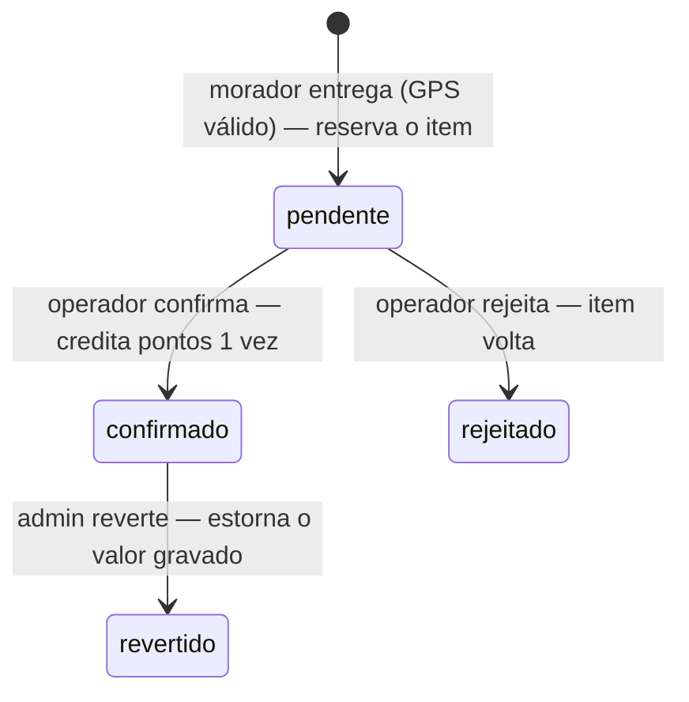
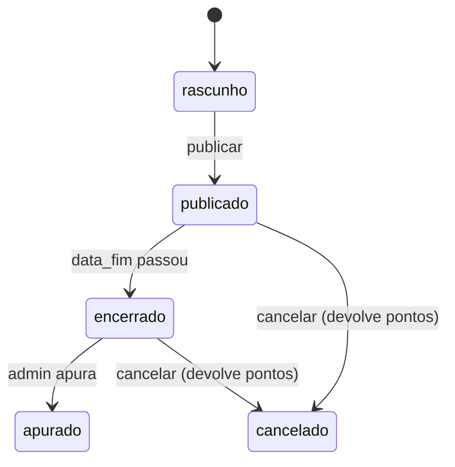
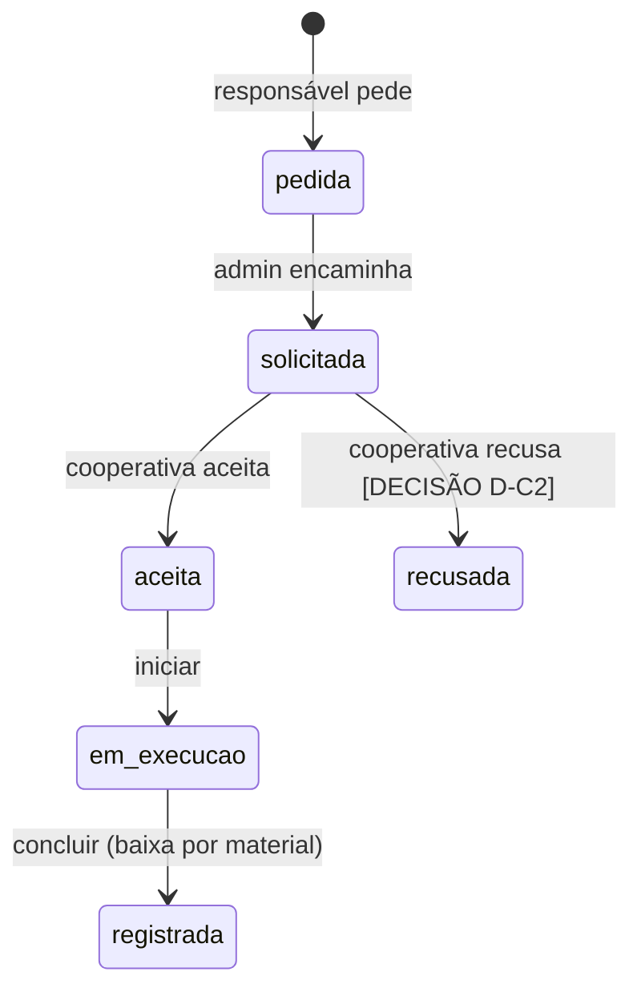
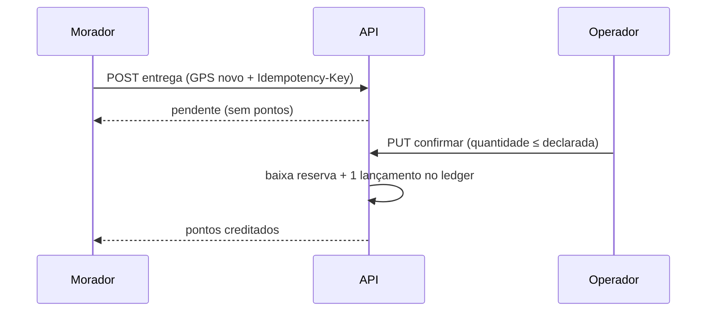

# Diagramas de fluxo e de estado

> **Estado:** esboço · **Dono:** Tecnologia · **Atualizado em:** 10/11/2026
> **Fontes:** propostas S2 (descarte), A1 (sorteio), C4 (coleta), P4 (pedido de coleta).
> Os diagramas mostram o **desenho proposto**, não o comportamento atual. `[DECISÃO: D2]` define o ator da confirmação.

## Resumo

Quatro máquinas de estado explicam quase todas as regras do sistema. Cada transição inválida deve responder **409**.

## 1. Descarte

## 2. Sorteio

## 3. Solicitação de coleta

## 4. Entrega pelo morador (sequência)

## O que falta para fechar

- [ ] Diagrama de contas (convite → ativo → desativado → anonimizado)
- [ ] Diagrama de pagamento `[DECISÃO: D8]`
- [ ] `[VERIFICAR NO CÓDIGO]` estados reais gravados hoje (ex.: `concluida` × `registrada`)
