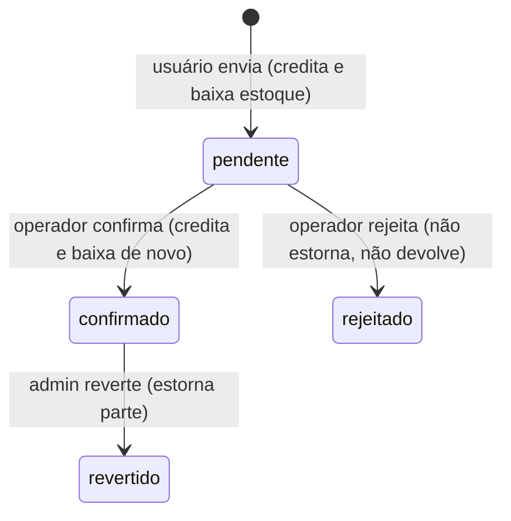
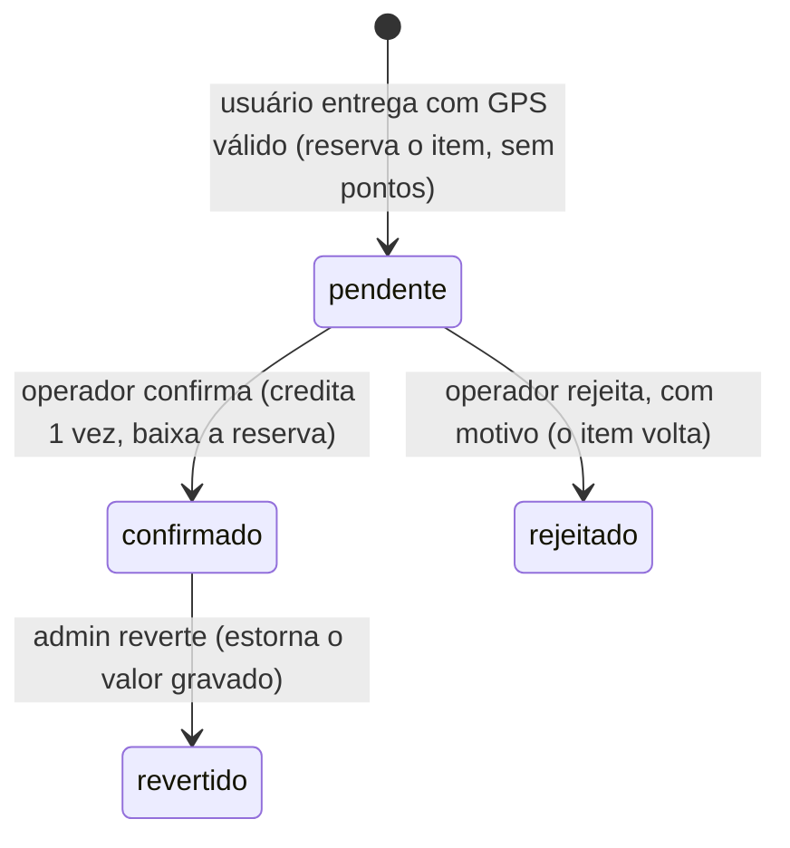
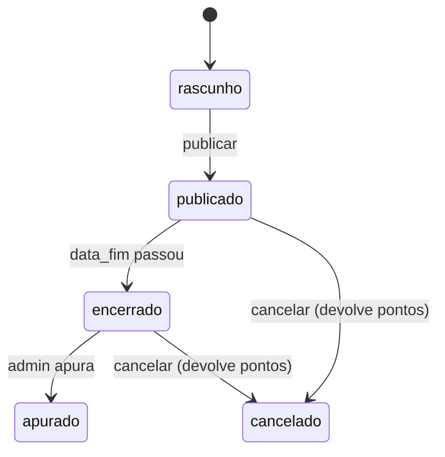
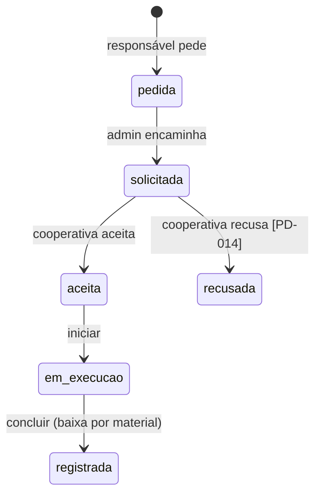
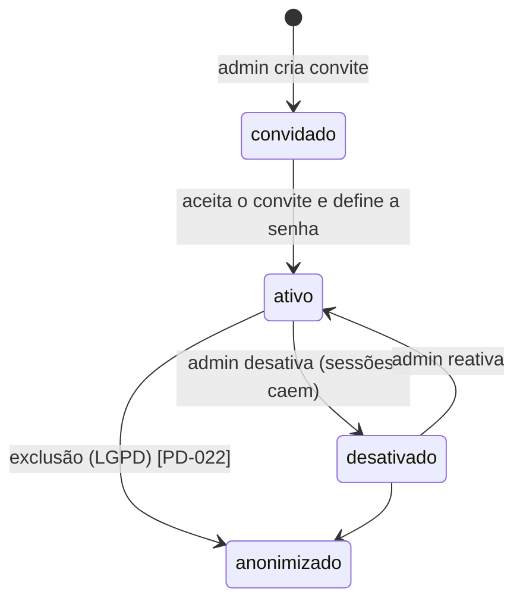
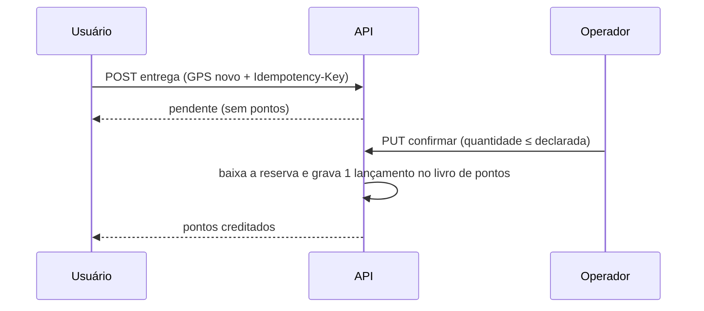
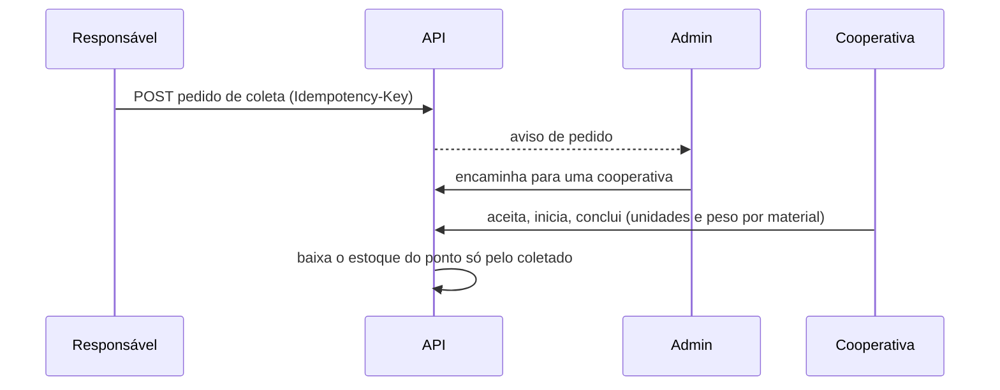

# Diagramas de fluxo e de estado

> **Estado:** revisão · **Dono:** Tecnologia · **Atualizado em:** 10/11/2026
> **Fontes:** estados gravados no código (branch `feature/mor-025-026-vouchers-sorteios`) e propostas S2, A1, C4, P4 das análises. ER em [modelo-de-dados](modelo-de-dados.md).
> **Lacunas:** 3

## Resumo

Cada estado abaixo aparece em dois diagramas: **hoje** (o que o código grava) e **proposto** (o desenho das análises). Os propostos dependem das decisões do produto; o ator da confirmação (operador ou usuário) é a [PD-006 / PD-027](../01-planejamento/decisoes/pd-006.md). Toda transição inválida deve responder **409**.

## 1. Descarte

**Hoje** (valores encontrados no código; `concluido` existe em código sem uso):

**Proposto:**

## 2. Sorteio

**Hoje:** `ativo → encerrado`. O admin encerra por `PUT` e apura antes da data; excluir apaga os bilhetes.

**Proposto:**

## 3. Solicitação de coleta

**Hoje:** `solicitada → aceita → concluida`, e `solicitada → recusada`.

**Proposto:**

## 4. Conta

**Hoje:** uma conta existe ou não. Não há desativar.

**Proposto:**

## 5. Entrega do usuário (sequência proposta)

O fluxo atual está no [SAD](sad.md#fluxo-principal-entrega-do-morador-como-é-hoje).

## 6. Pedido de coleta pelo responsável (sequência proposta)

## O que falta para fechar

- [ ] `[VERIFICAR]` quais transições existem de fato em cada rota (ex.: quem pode `revertido`)
- [ ] `[LACUNA]` diagrama de pagamento (PD-016) e de campanha (adesão → missão → recompensa)
- [ ] `[DECISÃO: PD-006]` ator da confirmação do descarte
