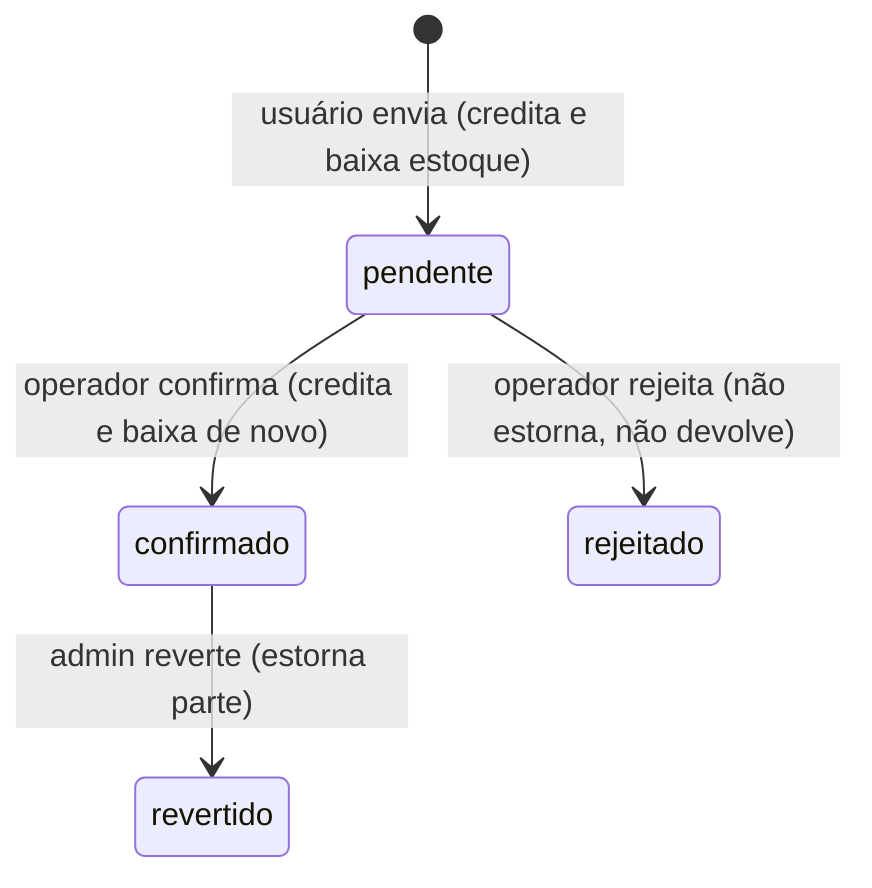
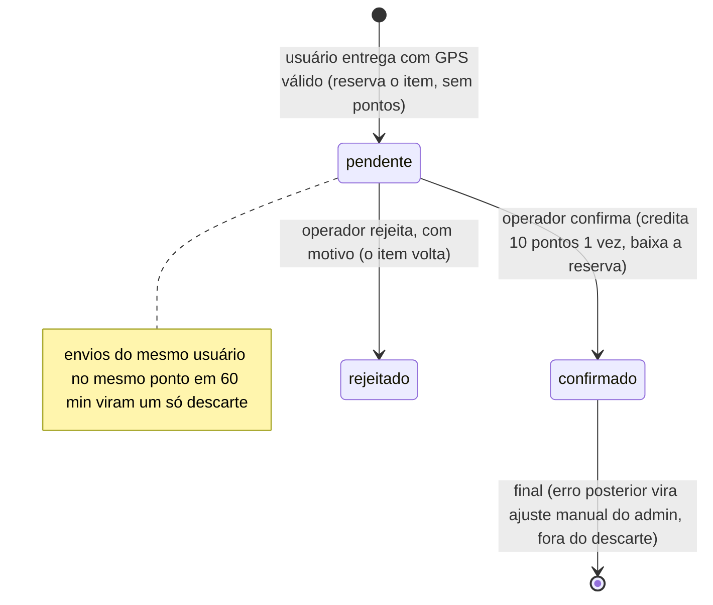
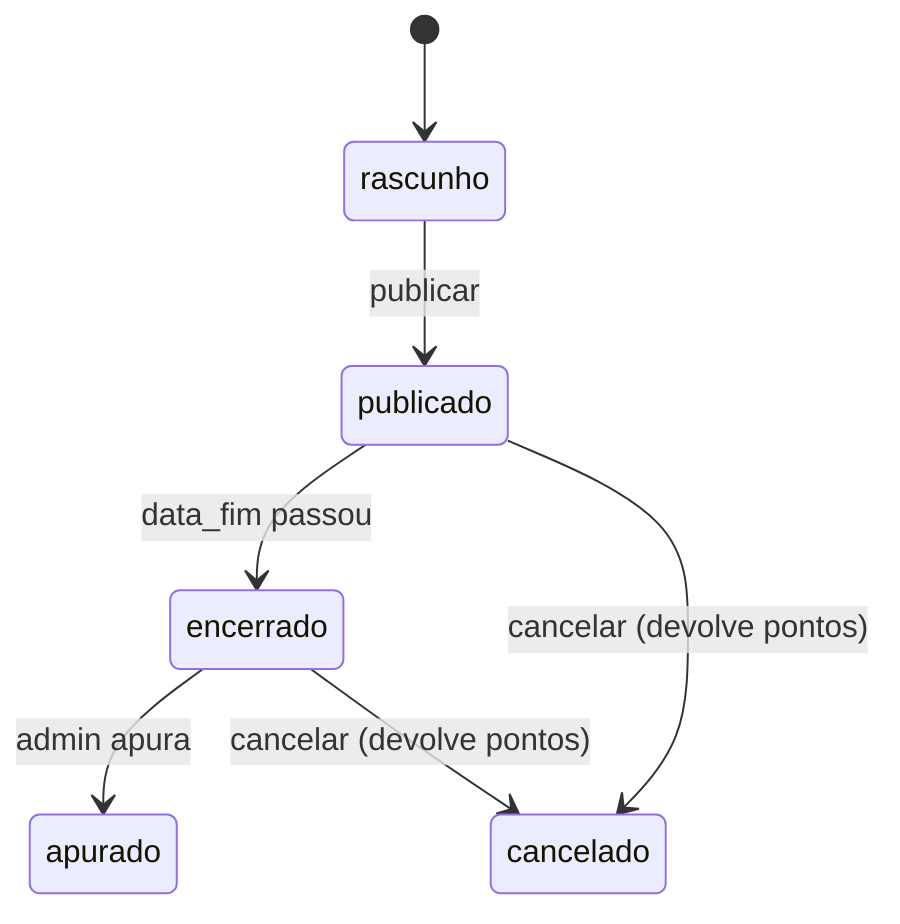
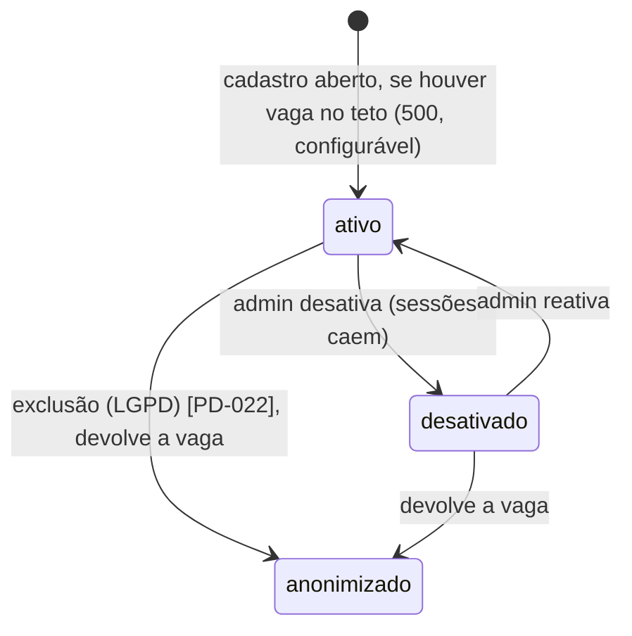
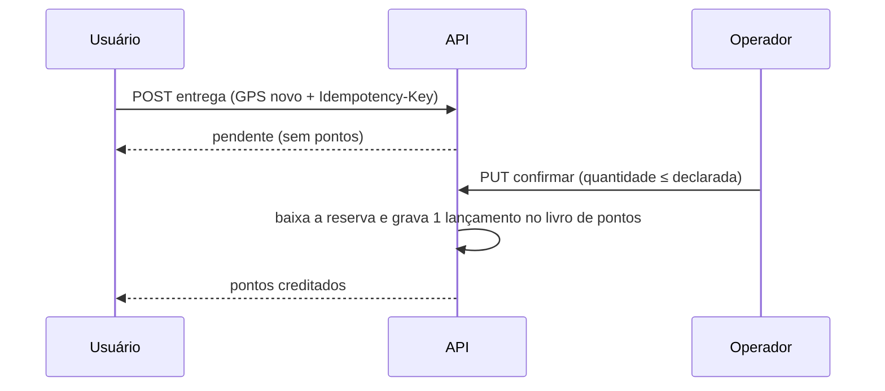
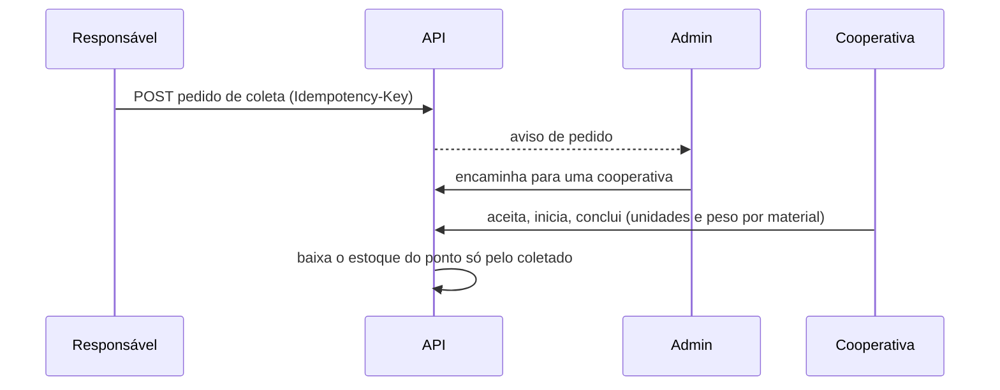
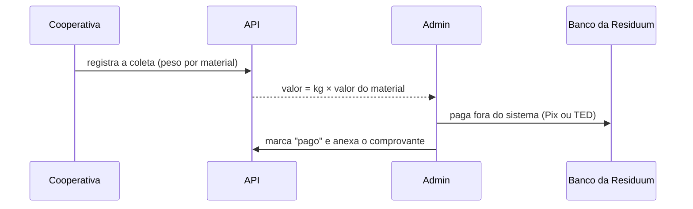
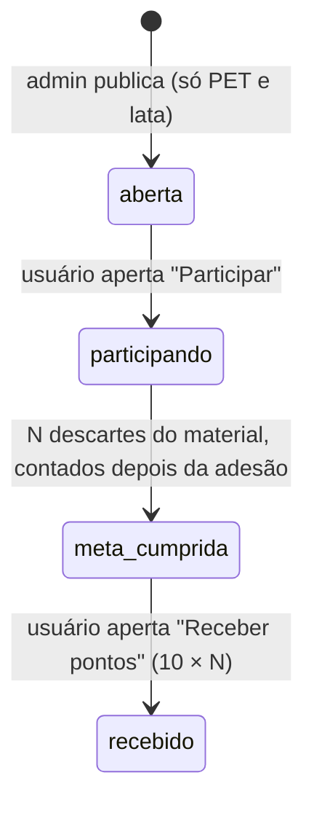

# Diagramas de fluxo e de estado

> **Estado:** revisão · **Dono:** Tecnologia · **Atualizado em:** 13/11/2026
> **Fontes:** estados gravados no código (branch `feature/mor-025-026-vouchers-sorteios`) e propostas S2, A1, C4, P4 das análises. ER em [modelo-de-dados](modelo-de-dados.md).
> **Lacunas:** 3

## Resumo

Cada estado abaixo aparece em dois diagramas: **hoje** (o que o código grava) e **novo desenho** (aprovado). Os novos desenhos seguem as decisões de 11/11/2026: **o operador do ponto confirma** ([PD-006 / PD-027](../01-planejamento/decisoes/pd-006.md)) e **a confirmação é final**, sem estorno ([PD-010](../01-planejamento/decisoes/pd-010.md)). Toda transição inválida deve responder **409**.

## 1. Descarte

**Hoje** (valores encontrados no código; `concluido` existe em código sem uso):

**Novo desenho:**

## 2. Sorteio

**Hoje:** `ativo → encerrado`. O admin encerra por `PUT` e apura antes da data; excluir apaga os bilhetes.

**Novo desenho:**

## 3. Solicitação de coleta

**Hoje:** `solicitada → aceita → concluida`, e `solicitada → recusada`.

**Novo desenho:**

```mermaid
stateDiagram-v2
  [*] --> pedida: responsável pede
  pedida --> solicitada: admin encaminha
  solicitada --> aceita: cooperativa aceita
  solicitada --> recusada: cooperativa recusa, com motivo
  solicitada --> expirada: sem resposta em 48 h, volta ao admin
  aceita --> aceita: cooperativa reagenda (uma vez) e o ponto confirma
  aceita --> em_execucao: cooperativa marca "a caminho"
  solicitada --> cancelada: admin ou cooperativa cancela, com motivo
  aceita --> cancelada: admin ou cooperativa cancela, com motivo
  em_execucao --> cancelada: admin ou cooperativa cancela, com motivo
  em_execucao --> registrada: concluir (baixa só o que levou, por material; o resto fica no ponto)
```

## 4. Conta

**Hoje:** uma conta existe ou não. Não há desativar.

**Novo desenho:**

## 5. Entrega do usuário (sequência)

O fluxo atual está no [SAD](sad.md#fluxo-principal-entrega-do-usuário-como-é-hoje). Envios do mesmo usuário no mesmo ponto em 60 minutos viram **um** descarte e **10 pontos** ([PD-010](../01-planejamento/decisoes/pd-010.md)).

## 6. Pedido de coleta pelo responsável (sequência)

## 7. Pagamento à cooperativa no piloto (decidido em 11/11/2026)

Pagamento por API vem depois ([PD-016](../01-planejamento/decisoes/pd-016.md)). Valor por kg de cada material: `[LACUNA]` ([PD-015](../01-planejamento/decisoes/pd-015.md)).

## 8. Campanha com dobro de pontos (decidido em 11/11/2026)

Descartes no mesmo ponto em 60 minutos contam como **um** na meta. Ver [regras de campanhas](../requisitos/regras-de-campanhas.md).

## O que falta para fechar

- [ ] `[VERIFICAR]` quais transições existem de fato em cada rota (ex.: quem pode `revertido`)
