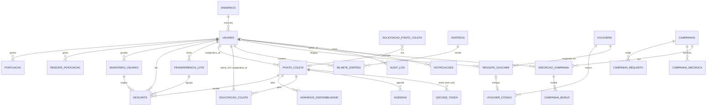

# Modelo de dados

> **Estado:** revisão · **Dono:** Tecnologia · **Atualizado em:** 11/11/2026
> **Fonte:** código do backend, branch `feature/mor-025-026-vouchers-sorteios` (commit `11f0d8e`, 22/10/2026), lido dos arquivos `app/models/*.py` e das 34 migrações Alembic. **Não foi executado contra um banco PostgreSQL.**
> **Lacunas:** 3 · Dicionário de colunas em [dados/](dados/README.md).

## Resumo

O banco tem **27 tabelas** em 5 grupos. Todas as regras de negócio importantes ainda dependem do código, não do banco: poucas tabelas têm restrições únicas ou `CHECK`. As maiores fragilidades são o **saldo de pontos** (sem lançamento com origem nos créditos), o **vínculo do ponto** (um único campo `cooperativa_id` serve a dois papéis) e o uso de **JSON** para estoque e materiais.

**Qual branch é "o banco"?** A `main` do backend parou em 28/07/2026. As tabelas de campanhas, vouchers, sorteios e as colunas de idempotência só existem nas branches de feature (ainda sem PR). Este documento descreve a mais completa. Ver [mapa de branches](../tecnologia/mapa-de-branches.md).

| Onde | Migrações | Cabeça única |
|---|---|---|
| `feature/mor-025-026-vouchers-sorteios` (esta) | 34 | `d3f9b81a6e25` |
| `feature/mor-023-024-campanhas` (checkout local) | 32 | `a41c7e92d5b3` `[VERIFICAR]` |
| `main` | 29 | `c8b2c451f28b` |
| **Banco na Neon** (projeto `residuum-dev`) | — | `c8b2c451f28b`: **igual à `main`** (conferido em 11/11/2026) |

### Conferência com o banco real (11/11/2026)

Lida **só a estrutura** (tabelas e colunas, sem dados) do projeto `residuum-dev` na Neon, PostgreSQL 18:

| Resultado | Detalhe |
|---|---|
| **22 tabelas** (mais `alembic_version`) | Este documento descreve 27, porque segue a branch de feature |
| Faltam no banco | `campanha_requisito`, `campanha_mecanica`, `campanha_bonus`, `voucher_codigo` (só nas branches de feature) e `cooperativa` |
| `descarte` | Ainda tem `ponto_lat` e `ponto_long` (achado 7) e `qrcode_token_id` |
| `campanhas` | Versão antiga: só `pontos_recompensa`, sem requisitos nem mecânicas |
| `ponto_coleta` | Tem `raio_operacao`, `capacidade_maxima` e `status`; ainda não tem vínculo N:N |
| ⚠️ `solicitacao_ponto_coleta` | Tem coluna **`senha_hash`**: o pedido público de ponto guarda senha. Reforça a decisão de remover esse pedido (RN-011) `[VERIFICAR NO CÓDIGO]` |

> O nome do projeto é **`residuum-dev`**. Confirmar se é o mesmo banco usado em produção pela Vercel `[VERIFICAR]`.

## Visão geral (ER)

## Grupos de tabelas

| Grupo | Tabelas | Dicionário |
|---|---|---|
| Pessoas e pontos | `usuario`, `endereco`, `pontuacao`, `resgate_pontuacao`, `audit_log`, `notificacoes` | [pessoas-e-pontos](dados/pessoas-e-pontos.md) |
| Entrega e coleta | `inventario_usuario`, `transferencia_lote`, `descarte`, `ponto_coleta`, `horarios_disponibilidade`, `solicitacao_coleta`, `solicitacao_ponto_coleta`, `agendas`, `estoque`, `qrcode_token`, `cooperativa` | [entrega-e-coleta](dados/entrega-e-coleta.md) |
| Loja | `vouchers`, `voucher_codigo`, `resgate_voucher`, `sorteios`, `bilhete_sorteio`, `campanhas`, `campanha_requisito`, `campanha_mecanica`, `inscricao_campanha`, `campanha_bonus` | [loja](dados/loja.md) |

## Estados gravados hoje

| Entidade | Valores encontrados no código |
|---|---|
| `descarte.status` | `pendente`, `confirmado`, `rejeitado`, `revertido`; `concluido` aparece em código sem uso |
| `transferencia_lote.status` | `pendente` |
| `inventario_usuario.status` | `disponivel`, `em_transferencia`, `finalizado` (o comentário do modelo diz `cancelado`) |
| `ponto_coleta.status` | `ativo`, `cheio`, `inativo` (e o campo `ativo` 0/1 duplica a informação) |
| `solicitacao_coleta.status` | `solicitada`, `aceita`, `concluida`, `recusada` |
| `solicitacao_ponto_coleta.status` | `pendente`, `aprovada`, `rejeitada`, `cancelada` (único com `CHECK`) |
| `sorteios.status` | `ativo`, `encerrado` |
| `vouchers.status` / `resgate_voucher.status` | `ativo`, `inativo` / `ativo` |
| `campanhas.status` | `ativa` (e `encerrada` por exclusão lógica proposta) `[VERIFICAR]` |
| `resgate_pontuacao.origem` | `resgate`, `voucher`, `sorteio` |

Apenas um status tem `CHECK` no banco. Os demais aceitam qualquer texto.

## Regras que o banco já garante

| Regra | Tabela | Mecanismo |
|---|---|---|
| E-mail único | `usuario` | `UNIQUE` |
| 1 bilhete por usuário por sorteio | `bilhete_sorteio` | `UNIQUE (sorteio_id, usuario_id)` |
| Número do bilhete único no sorteio | `bilhete_sorteio` | `UNIQUE (sorteio_id, numero)` |
| Idempotência de bilhete, voucher e lote | `bilhete_sorteio`, `resgate_voucher`, `transferencia_lote` | `UNIQUE (usuario_id, chave_idempotencia)` |
| Código de voucher único no sistema | `voucher_codigo`, `resgate_voucher` | `UNIQUE (codigo)` |
| Uma inscrição por campanha e usuário | `inscricao_campanha` | `UNIQUE` |
| Bônus pago uma vez por mecânica | `campanha_bonus` | `UNIQUE (inscricao_id, mecanica)` |
| Item com código de barras ou sem rótulo | `inventario_usuario` | `CHECK` de identificação |

## Regras que o banco **não** garante

Todas as abaixo dependem só do código (e por isso falham em concorrência ou fora das rotas):

- **Saldo = soma dos lançamentos.** `usuario.pontuacao_total` é um número solto; `pontuacao` não tem origem nem referência.
- **Um crédito por descarte.** Nada impede dois lançamentos para o mesmo descarte.
- **Saldo nunca negativo.** Sem `CHECK`.
- **Quantidades inteiras.** `descarte.quantidade` e `inventario_usuario.quantidade` são `Float`.
- **Materiais válidos.** `tipo_residuo` é texto livre.
- **Uma solicitação de coleta ativa por ponto.** Só no código da rota.
- **Histórico preservado ao apagar.** `sorteios → bilhete_sorteio` e `campanhas → inscricao_campanha → campanha_bonus` apagam em cascata.

## Achados da leitura do código

| # | Achado | Efeito |
|---|---|---|
| 1 | Tabela `cooperativa` (model `Cooperativa`) **não é usada** por nenhuma rota; seu `relationship` aponta para um nome que `PontoColeta` não tem | Código morto que parece cadastro de cooperativa. Cooperativa de verdade é `usuario.role = 'cooperativa'` |
| 2 | `ponto_coleta.cooperativa_id` aponta para `usuario` e serve a cooperativa **e** ao responsável do ponto | Não há vínculo N:N nem separação de papéis (PD-023) |
| 3 | `qrcode_token` existe, mas a V6 proíbe QR (RN-006) e, em 11/11/2026, o QR ficou **fora do MVP** (PD-027) | Dívida técnica; `descarte` e `ponto_coleta` ainda a referenciam |
| 4 | `estoque` guarda total por tipo, sem FK | Sem uso claro nas fontes `[VERIFICAR]` |
| 5 | `ponto_coleta.inventario` e `tipos_residuos_aceitos` são JSON | Sem integridade; estoque do ponto não é consultável por SQL |
| 6 | `solicitacao_coleta.inventario_solicitado` guarda uma "foto" do estoque em JSON | Causa do achado F-04 (zerar pelo snapshot) |
| 7 | `descarte.usuario_id` é nulo-permitido; `descarte` tem coordenadas do ponto copiadas | Dados duplicados que podem divergir do cadastro |
| 8 | Tabelas no plural (`sorteios`, `vouchers`, `campanhas`) e no singular (`usuario`, `descarte`) | Inconsistência de nomes |

## Modelo proposto (resumo)

Colunas e tabelas novas propostas nas análises: ledger em `pontuacao` (origem, referência, chave), `usuario.ativo` e `token_version`, `recuperacao_senha`, `vinculo_operacional`, `coleta_item`, `resultado_sorteio`, `pagamento`, `plano`. Detalhes e justificativas em [ADRs](adr/README.md). Nada disso existe no código.

**Ajustes pelas decisões de 11/11/2026:**

| Proposta | Como fica |
|---|---|
| `convite` | **Descartada** (12/11/2026): não há código de acesso; o cadastro é aberto |
| Teto de contas | Linha de controle com **`vagas_restantes`** (começa em 500, configurável; pode subir a 1000), travada com `SELECT ... FOR UPDATE` no cadastro; volta 1 vaga quando a conta é excluída |
| Lista de espera | Tabela nova **`lista_espera`** (e-mail, data) `[LGPD: consentimento]` |
| `lead_ponto_coleta` | **Descartada**: só o admin cria ponto (RN-011) |
| `vinculo_operacional` | Confirmada: **N:N**, gerida pelo admin (PD-023) |
| `ponto_coleta` | Nova coluna **`raio_gps_m`** (padrão 100); capacidade numa unidade só (ver [estudo](../pesquisa/capacidade-e-execucao-da-coleta.md)) |
| `pontuacao` (ledger) | **10 pontos por descarte**; sem estorno de descarte confirmado; correção por lançamento de ajuste com motivo |
| `descarte` | Agrupar envios do mesmo usuário no mesmo ponto em 60 min (chave de agrupamento) |
| `solicitacao_coleta` | Novos estados `em_execucao` e `cancelada` (com motivo e quem cancelou); `coleta_item` permite coleta parcial |
| `pagamento` | No piloto: valor calculado, data, **comprovante** e quem registrou; sem integração |
| `qrcode_token` | **Remover** (QR fora do MVP) `[DECISÃO da equipe técnica]` |

**Histórico:** antes do Alembic, a equipe de banco de dados modelou o esquema no MySQL Workbench e o converteu para PostgreSQL (maio de 2026; ver o [comparativo do Drive](../00-diagnostico/comparativo-documentos-drive.md)). O banco atual é o das migrações Alembic.

## O que falta para fechar

- [x] Estrutura conferida com o banco da Neon (11/11/2026): igual à `main` (29 migrações, cabeça `c8b2c451f28b`)
- [ ] Conferir de novo quando a branch de feature (34 migrações) for aplicada
- [ ] `[LACUNA]` decidir o que fazer com `cooperativa`, `qrcode_token` e `estoque` (remover ou usar)
- [ ] Atualizar quando a branch for mesclada na `main`
