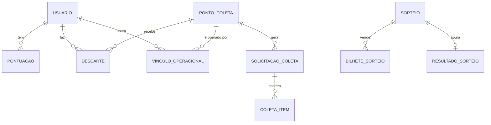

# Modelo de dados

> **Estado:** esboço · **Dono:** Tecnologia · **Atualizado em:** 10/11/2026
> **Fontes:** nomes de tabelas citados nas análises e nas propostas. **Não foi lido o esquema real.**
> **Lacunas:** ER completo `[VERIFICAR NO CÓDIGO: backend/app/models + alembic/versions]`.

## Resumo

Mapa das tabelas citadas hoje e das **novas** propostas. O ER oficial deve ser gerado a partir dos models e das 32 migrações, não escrito à mão.

## Tabelas atuais (citadas nas fontes)

| Grupo | Tabelas |
|---|---|
| Pessoas | `usuario`, `endereco` |
| Pontos | `pontuacao`, `resgate_pontuacao` |
| Entrega | `descarte`, `transferencia_lote`, `inventario_usuario` |
| Locais | `ponto_coleta`, `horarios_disponibilidade`, `qrcode_token` (sem uso) |
| Coleta | `solicitacao_coleta`, `solicitacao_ponto_coleta`, `agendas` |
| Loja | `voucher`, `resgate_voucher`, `sorteios`, `bilhete_sorteio`, `campanhas`, `inscricao_campanha`, `campanha_bonus` |
| Apoio | `audit_log`, `notificacao` |

## Tabelas e colunas propostas

| Novo | Para quê | Solução |
|---|---|---|
| `pontuacao` + origem, referência, chave, estorno | Ledger único | S1 |
| `usuario` + `ativo`, `token_version` | Desativar e revogar sessão | S4 |
| `convite`, `recuperacao_senha` | Cadastro por convite; senha | S4 |
| `vinculo_operacional` | Usuário↔ponto (responsável/cooperativa) | P1 |
| `coleta_item` | Coleta por material | C5 |
| `resultado_sorteio` | Apuração auditável (hash) | A3 |
| `lead_ponto_coleta` | Interesse sem senha | P11 |
| `pagamento`, `pagamento_evento`, `plano`, `assinatura` | Sprint 4 | A13, A14 |

## Relações principais (esboço)

## Regras que o banco deve garantir

- No máximo **1 crédito por descarte**; saldo ≥ 0; chave de idempotência única por usuário.
- Sorteio, campanha e voucher com movimento: `ON DELETE RESTRICT`.

## O que falta para fechar

- [ ] Gerar ER real (ex.: a partir dos models) e colar aqui como Mermaid
- [ ] Dicionário de colunas por tabela
- [ ] `[VERIFICAR NO CÓDIGO]` nomes físicos (singular × plural: `sorteio` × `sorteios`)
