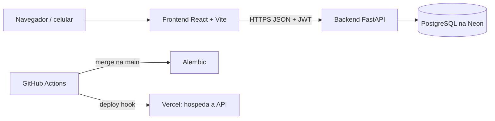

# Pauta da reunião de arquitetura

> **Estado:** revisão · **Dono:** Produto e Tecnologia · **Preparado em:** 11/11/2026 para a reunião de 12/11/2026
> **Fontes:** [regras de negócio](../01-planejamento/requisitos/07-regras-de-negocio-consolidadas.md), [SAD](sad.md), [ADRs](adr/README.md), [diagramas](diagramas.md), [modelo de dados](modelo-de-dados.md), [decisões pendentes](../00-diagnostico/decisoes-pendentes.md), [casos de teste](../05-qualidade/casos-de-teste.md), [estudo de capacidade e coleta](../pesquisa/capacidade-e-execucao-da-coleta.md).
> **Lacunas:** a coluna "Decisão" da seção 5 fica em branco até a reunião.

## Resumo

O produto já decidiu **o que** o sistema faz (seção 1). A arquitetura já aceitou **cinco desenhos** (seção 3). O que falta é combinar **como** construir: ordem, migração do que já existe e 18 perguntas técnicas (seção 5). O código atual ainda faz o contrário de várias regras: paga 5 pontos por unidade, credita duas vezes, não tem teto de contas e deixa qualquer cooperativa operar qualquer ponto (seção 4).

**Objetivo da reunião:** sair com (1) respostas às perguntas da seção 5, (2) a ordem de entrega confirmada e (3) donos e datas.

## Sugestão de roteiro

| Ordem | Assunto | Seção |
|---|---|---|
| 1 | Alinhar as regras decididas (só confirmar, sem reabrir) | 1 |
| 2 | Ver o que muda no código | 4 |
| 3 | Responder as perguntas técnicas, na ordem dos blocos | 5 |
| 4 | Confirmar a ordem de entrega | 7 |
| 5 | Riscos e donos | 8 |

## 1. Regras de negócio decididas

Tudo abaixo foi decidido pelo Vinicius em 11/11/2026, salvo quando indicado. **Não reabrir na reunião**; dúvida de produto vai para a seção 6.

### Pontos e descarte

| Regra | Valor | Fonte |
|---|---|---|
| Pontos por descarte | **10 por descarte concluído** (por operação, não por unidade) | RN-008, [PD-010](../01-planejamento/decisoes/pd-010.md) |
| Janela de agrupamento | Envios do mesmo usuário no mesmo ponto em **60 min** contam como **um** | PD-010 |
| Quem confirma | O **operador do ponto**; o GPS só libera o envio | PD-006 |
| Confirmação | **Final**: sem estorno. Erro vira **ajuste manual do admin, com motivo** | PD-010 |
| Rejeição | O operador rejeita com motivo; o item volta ao estoque do usuário | [diagramas](diagramas.md) |
| Presença | GPS, raio de **100 m**, ajustável por ponto. QR Code fora do MVP | RN-006, PD-008 |
| Pesagem da cooperativa | Não gera nova recompensa ao usuário | RN-016 |
| Materiais | Só **PET e lata de alumínio** | RN-003 |

### Conta e acesso

| Regra | Valor | Fonte |
|---|---|---|
| Entrada | Cadastro **aberto, sem código**. A pessoa cria a conta e depois entra normalmente | decisão de 12/11/2026 |
| Teto | **500 contas**, com trava de vagas no banco. O valor é **configurável** e pode subir para **1000** | [controle de acesso](../pesquisa/controle-de-acesso.md) |
| Sem vaga | Aviso e **lista de espera** | idem |
| Conta excluída | **Anonimiza** (não apaga) e **devolve a vaga** | PD-022 |
| Código de acesso | **Não existe mais** (decisão de 12/11/2026): dava trabalho para gerar e repassar e atrapalhava o cadastro. O único controle é o teto | idem |
| Mesmo e-mail após exclusão | Só recadastra após **30 dias** (D-CT-03) | idem |
| Recuperar senha | Por e-mail | PD-003 (provisório) |

### Cadastro de resíduos

| Regra | Valor | Fonte |
|---|---|---|
| Entradas | Código de barras e QR da nota fiscal, **dentro do MVP**; cadastro manual como alternativa | [fontes](../pesquisa/fontes-de-produtos-e-notas.md) |
| Falha de leitura | Aviso vermelho a cada falha; **manual recomendado a partir da 2ª** | idem |
| Material | **Sugestão automática + confirmação do usuário sempre** | idem |
| Campos do manual | Material e quantidade inteira obrigatórios; nome opcional (D-CT-11) | casos de teste |
| Registrar item | **Não** dá pontos nem é descarte | RN-004 |
| "Descartar agora" | Não é função à parte: é o uso do leitor de código de barras e do leitor de QR da nota | Visão |

### Pontos de coleta e coleta

| Regra | Valor | Fonte |
|---|---|---|
| Quem cria ponto | **Só o admin**; pedido público de ponto sai do código | RN-011 |
| Responsáveis | Vínculo **N:N** com os pontos, gerido pelo admin | PD-023 |
| Ponto cheio | **Bloqueia** a escolha e **sugere outro** | PD-009 |
| Capacidade | **Unidades por material**; alerta aos **80%** (D-CT-05, D-CT-06) | casos de teste |
| Ponto temporário | Ao encerrar fica **inativo**, com histórico (D-CT-07) | RN-021 |
| Pedido de coleta | Responsável pede ao admin; admin encaminha à cooperativa | RN-012 |
| Estados da coleta | solicitada → aceita → **a caminho** → registrada; **cancelada** pelo admin ou cooperativa, com motivo | PD-014 |
| Coleta parcial | **Permitida**: baixa só o que levou, por material | RN-015 |
| Prazo de aceite | **48 h**; sem resposta, expira e volta ao admin (D-CT-08) | casos de teste |
| Reagendamento | A cooperativa propõe **uma vez**; o ponto confirma (D-CT-09) | idem |

### Campanhas, sorteios e pagamento

| Regra | Valor | Fonte |
|---|---|---|
| Dobro de pontos | Meta de **N descartes**, bônus de **10 × N**, pelo botão "Receber pontos" | PD-011 |
| Bônus não recebido | **Se perde** no fim da campanha (D-CT-10) | casos de teste |
| Campanhas | Só PET e lata no início | PD-011 |
| Sorteios | **Só de teste**; 1 bilhete por usuário; cancelar **devolve** os pontos; parecer jurídico adiado | PD-013 |
| Cashback | Ideia **futura**, fora do MVP | RN-010 |
| Pagamento à cooperativa | **A Residuum paga**, por kg e material. **Manual com comprovante no piloto; API depois** | PD-015, PD-016 |
| Ajuste manual | **Não deixa o saldo negativo** (D-CT-01) | casos de teste |

### Piloto

100 usuários, 3 pontos, 1 cooperativa, 8 semanas. Metas na [Visão](../01-planejamento/visao-e-escopo.md). Produção: **API na Vercel**, **PostgreSQL na Neon**.

## 2. Arquitetura hoje

| Item | Hoje |
|---|---|
| Backend | FastAPI, SQLAlchemy 2, Alembic, JWT; **15 grupos de rotas, 111 endpoints** (a API documenta 113) |
| Camadas | `routes` → `services` (regras) → `models`; `dependencies` para papel e acesso ao ponto |
| Frontend | React 18, Vite, TanStack Query, Tailwind, Leaflet, leitor de código de barras |
| Banco | **27 tabelas** na branch de feature; **22** no banco da Neon |
| Permissão | Por **papel**. Cooperativa opera **qualquer** ponto (sem vínculo) |
| Entrega | Merge na `main` roda `alembic upgrade heads` e dispara o deploy. **Sem testes** |
| Testes | 3 arquivos no backend, em SQLite (não testa trava de linha); nenhum no frontend |
| Ambientes | Local e produção. **Sem homologação** |

Detalhes e lacunas: [SAD](sad.md).

## 3. Decisões de arquitetura já aceitas

Aceitas em 11/11/2026. **Nenhuma está implementada.**

| ADR | Decisão | O que muda |
|---|---|---|
| [0001](adr/0001-livro-unico-de-pontos.md) | **Livro único de pontos** | `pontuacao` vira livro-caixa; saldo é cache; banco garante 1 crédito por descarte e saldo ≥ 0 |
| [0002](adr/0002-vinculo-entre-usuario-e-ponto.md) | **Vínculo usuário↔ponto N:N** | Tabela `vinculo_operacional`; permissão = papel + vínculo |
| [0003](adr/0003-idempotencia-nas-escritas.md) | **Idempotência** | Cabeçalho `Idempotency-Key` em toda escrita sensível |
| [0004](adr/0004-estados-no-backend.md) | **Estados no backend** | Tabela de transições; `PUT` nunca muda estado; transição inválida = 409 |
| [0005](adr/0005-conta-com-ciclo-de-vida.md) | **Conta com ciclo de vida** | `ativo`, `token_version`, teto de contas com vagas, anonimização |

## 4. O que muda no código

| Assunto | Hoje | Decidido | Referência |
|---|---|---|---|
| Valor do ponto | 5 por unidade, em `pontuacao_service` | 10 por descarte | ADR-0001 |
| Crédito do descarte | Credita no envio **e** na confirmação (F01) | Credita **uma vez**, na confirmação | ADR-0001 |
| Estorno do descarte | `revertido` pelo admin | Não existe; só ajuste manual com motivo | PD-010 |
| Janela de 60 min | Não existe | Agrupa envios do par usuário+ponto | [pergunta 1](#bloco-a-pontos-e-descarte) |
| Saldo | `pontuacao_total` alterado em 6 lugares | Só um serviço, com trava de linha | ADR-0001 |
| Cadastro | Aberto a qualquer pessoa | Aberto, com teto de contas (500, configurável) | ADR-0005 |
| Sessão | Refresh de 30 dias, sem revogação | `token_version`; desativar derruba sessões | ADR-0005 |
| Permissão no ponto | Qualquer cooperativa opera qualquer ponto | Papel + vínculo N:N | ADR-0002 |
| Cadastro de cooperativa | Público | Só o admin (responde 410) | Onda 0 |
| Pedido público de ponto | Existe e guarda `senha_hash` | Removido | RN-011 |
| `/painel-testes` | Público em produção | Sai da produção | decisão 11/11 |
| Escritas repetidas | Descarte sem chave de idempotência | `Idempotency-Key` em tudo | ADR-0003 |
| Estados | Texto livre; só 1 tabela com `CHECK` | Transições explícitas e `CHECK` | ADR-0004 |
| Coleta | Conclui **zerando** o ponto | Parcial, por material; "a caminho"; cancelada | PD-014 |
| Ponto cheio | Sem bloqueio no descarte | Bloqueia e sugere outro | PD-009 |
| Capacidade | Em kg, estoque em unidades (erro de unidade) | Unidades por material | D-CT-05 |
| GPS | Raio fixo | 100 m, ajustável (`raio_gps_m`) | PD-008 |
| Pagamento | Não existe | Registro manual com comprovante | PD-016 |
| Sorteio | `ativo`/`encerrado` por `PUT`; excluir apaga bilhetes | Rascunho → publicado → apurado/cancelado | ADR-0004 |
| Código morto | `cooperativa`, `qrcode_token`, `estoque` | Remover ou usar | [modelo](modelo-de-dados.md) |

## 5. Perguntas para o arquiteto

A coluna **Proposta** é uma sugestão para abrir a conversa, **não uma decisão**. Preencha **Decisão** na reunião.

### Bloco A: pontos e descarte

| # | Pergunta | Por que importa | Proposta | Decisão |
|---|---|---|---|---|
| 1 | Como funciona a janela de 60 min? Fixa a partir do 1º envio ou deslizante? Agrupa o **descarte** ou só o **crédito**? O operador confirma o grupo ou cada envio? | A meta de campanha e os 10 pontos dependem disso | Janela fixa a partir do 1º envio pendente do par usuário+ponto; um descarte agrupa os itens; o operador confirma o grupo; chave de agrupamento no banco | |
| 2 | O saldo é só cache do livro (ADR-0001)? Como reconciliar os saldos que já foram creditados em dobro? | Pode haver usuários com saldo inflado | Conferir se há usuários reais no banco hoje (provavelmente só teste, `[VERIFICAR]`); se não, zerar e recalcular; se sim, o produto revisa | |
| 3 | O limite diário de 200 unidades por dia (provisório) entra no piloto? Onde fica a regra? | Anti-fraude; ainda não mede | Parâmetro de configuração, desligado no começo | |
| 4 | Como garantir "1 lançamento por descarte" e "saldo ≥ 0" no banco? | Hoje só o código garante | `UNIQUE` por origem+referência e `CHECK (pontuacao_total >= 0)` | |

### Bloco B: conta, acesso e permissões

| # | Pergunta | Por que importa | Proposta | Decisão |
|---|---|---|---|---|
| 5 | A trava de vagas com `SELECT ... FOR UPDATE` funciona com a Neon e a API na Vercel (conexões curtas)? | Duas pessoas não podem pegar a última vaga | Testar com pool em modo transacional; a linha de vagas é consumida na mesma transação do cadastro | |
| 6 | Como migrar `cooperativa_id` (que mistura cooperativa e responsável) para `vinculo_operacional`? | Ligar a regra antes do preenchimento tira o acesso de todos | Escrita dupla por uma versão, *dry-run*, revisão do admin e flag para ligar (ADR-0002) | |
| 7 | Os papéis `ponto_coleta` e `parceiro` viram aliases de `responsavel_ponto`? Por quanto tempo? | O menu e as rotas do front dependem disso | Uma versão de convivência, depois remover | |
| 8 | Quem controla o e-mail de recuperação e de aviso? Qual canal? | ADR-0005 e PD-003 precisam enviar e-mail; PD-021 está aberta | Escolher um provedor simples de e-mail transacional | |
| 9 | CORS aberto (`*`) e refresh de 30 dias: o que fecha agora e o que fica para a 2ª fase (cookie `HttpOnly`)? | Segurança do piloto | CORS com lista de origens já; cookie na 2ª fase | |

### Bloco C: dados e estados

| # | Pergunta | Por que importa | Proposta | Decisão |
|---|---|---|---|---|
| 10 | Estoque do ponto e materiais aceitos hoje são **JSON**. Normalizar (tabela por material, `coleta_item`)? | Capacidade por material, coleta parcial e alerta pedem consulta em SQL | Normalizar: capacidade e estoque por material numa tabela | |
| 11 | Como migrar os status antigos (`concluida`, `ativo`) para os novos, com `CHECK`? | ADR-0004 | Migração em duas etapas: converter os valores e depois criar o `CHECK` | |
| 12 | Tipos: `quantidade` é `Float`; `tipo_residuo` é texto livre. Corrigir já? | Contar unidades inteiras e material válido | Inteiro e `CHECK` nos dois materiais, na mesma migração | |
| 13 | Remover `qrcode_token`, `cooperativa` e `estoque`? | Código morto confunde | Remover as que nenhuma rota usa, depois de conferir | |
| 14 | A anonimização (LGPD) convive com e-mail único? | Recadastro após 30 dias | Trocar o e-mail por um valor anônimo e guardar o hash do original só pelo prazo de 30 dias | |

### Bloco D: integrações

| # | Pergunta | Por que importa | Proposta | Decisão |
|---|---|---|---|---|
| 15 | Código de barras e nota: a consulta fica no backend ou no navegador? Guardamos a nota? | A SEFAZ-AM não tem API oficial gratuita; chaves não podem ir ao cliente | Consulta pelo backend, com cache; guardar só os itens importados. Testes: 50 códigos de barras, 10 notas | |
| 16 | Onde guardar o **comprovante de pagamento** (e mídias, PD-024)? A API na Vercel não guarda arquivos | Sem armazenamento de objetos o comprovante não existe | Armazenamento de objetos (por exemplo, o da própria Vercel ou S3); só o endereço fica no banco `[VERIFICAR]` | |
| 17 | Qual algoritmo do sorteio de teste? | Auditável | `sha256` com semente registrada (proposta das análises) | |

### Bloco E: entrega e ambientes

| # | Pergunta | Por que importa | Proposta | Decisão |
|---|---|---|---|---|
| 18 | Como ficam as branches e as migrações? A `main` tem 29; a branch de feature, 34 | Banco da Neon = `main`; as tabelas de campanha e voucher só existem na feature | Mesclar as features na `main` **antes** das ondas novas, com uma só cabeça do Alembic | |

Também decidir, se sobrar tempo (sem pergunta numerada):

- **Testes:** PostgreSQL de teste em Docker + CI (decidido); o deploy deve **rodar os testes antes** de migrar.
- **Homologação:** hoje não há. Criar uma, ou testar numa cópia (*branch*) do banco da Neon?
- **Banco:** `residuum-dev` é o de produção? A Neon guarda **6 horas**; definir backup e o RPO/RTO (PD-026).
- **Observabilidade:** logs, alertas e segredos (`SECRET_KEY`) estão sem política.
- **Cadastro aberto sem código:** qualquer pessoa ou robô com o endereço do site pode ocupar as vagas do teto. Precisa de limite de tentativas ou captcha no cadastro? E o admin altera o teto por tela ou direto no banco?

## 6. Pendências de produto que travam o desenvolvimento

Não são da arquitetura: precisam do Vinicius ou da operação. Sem elas, algumas telas e regras ficam em valor provisório.

| Pendência | Trava | Valor provisório |
|---|---|---|
| Valor por kg de PET e de lata ([PD-015](../01-planejamento/decisoes/pd-015.md)) | Cálculo do pagamento | Sem valor |
| Faixas de recompensa com 10 pontos por descarte | Loja e vouchers | Manter as atuais |
| Escala do piloto (100 usuários) diante do teto de 500 | Meta e vagas | 100 no piloto, teto 500 |
| Horários, tags e capacidade de cada ponto ([PD-009](../01-planejamento/decisoes/pd-009.md)) | Tela do ponto | Horários por dia; lista fixa de tags |
| Silêncio e reagendamento da coleta ([PD-014](../01-planejamento/decisoes/pd-014.md)) | Estados da coleta | 48 h e uma remarcação |
| Mesma nota pode ser importada de novo? ([PD-005](../01-planejamento/decisoes/pd-005.md)) | Cadastro de resíduos | Sem decisão |
| Parecer jurídico dos sorteios | Qualquer sorteio real | Só de teste |

## 7. Ordem de entrega

Ondas do [backlog](../01-planejamento/backlog-e-historias.md). Cada onda depende das anteriores.

| Onda | Entrega | Por quê |
|---|---|---|
| 0 | Contenção: fechar cadastro público de cooperativa, travar acesso por ponto, sorteio (estados), remover `/pontuacao/resgates` e `/painel-testes` | Riscos críticos, sem depender de decisão |
| 1 | Livro de pontos, fluxo único de confirmação, 10 por descarte, janela de 60 min, idempotência, reconciliação | Base de quase tudo |
| 2 | Vínculo N:N; teto de contas (500, configurável), desativar conta, senha | Destrava os perfis |
| 3 | Materiais PET e lata; front do usuário; cancelar sorteio | Dependem de 1 e 2 |
| 4 | Estados da coleta (parcial, "a caminho", cancelada); campanha e voucher; ponto cheio | Fluxos operacionais |
| 5 | Extrato, disponibilidade, QR removido | Experiência |
| 6 | Pagamento manual, planos, limpeza do legado | Fim do piloto |

**Antes da onda 1:** PostgreSQL de teste no CI e a mescla das branches de feature (pergunta 18).

## 8. Riscos

| Risco | Efeito | Mitigação |
|---|---|---|
| Ligar o vínculo N:N antes do preenchimento | Responsáveis sem acesso | Flag e *dry-run* (ADR-0002) |
| Migração de saldo | Usuário perde pontos já gastos | Revisão do produto antes de ajustar |
| Testes em SQLite | Não pegam concorrência de saldo e vagas | PostgreSQL de teste no CI |
| Deploy automático sem testes | Quebra produção a cada merge | Rodar testes antes de migrar |
| Scanner e GPS em Android de entrada | Entrega travada | Testar nos celulares do piloto; manual após 2 falhas |
| `senha_hash` no pedido público de ponto | Dado sensível exposto | Remover o pedido público (onda 0) |
| Itens do Backlog v2 do Drive (Terraform, criptografia LGPD, backups) | Não aparecem no código | `[VERIFICAR]` com a equipe |

## 9. Inconsistências na documentação para corrigir

Encontradas ao preparar esta pauta. **Não bloqueiam a reunião**, mas o arquiteto pode encontrá-las.

| Onde | Problema | Correção |
|---|---|---|
| [RN-001 e RN-002](../01-planejamento/requisitos/07-regras-de-negocio-consolidadas.md) | Falavam em **convite** | **Corrigido em 12/11:** cadastro aberto com teto de contas |
| RN-017 e RN-018 | Pagamento "por API" e "evidência do provedor" | No piloto é **manual com comprovante**; API depois |
| [Estudo de coleta](../pesquisa/capacidade-e-execucao-da-coleta.md) × [casos de teste](../05-qualidade/casos-de-teste.md) | O estudo propõe **avisar o admin** no silêncio e **campo de data** para reagendar; os casos (D-CT-08 e 09) adotam **expirar em 48 h** e **uma remarcação** | Valem os casos (aprovados); atualizar o estudo |
| [ADR-0005](adr/0005-conta-com-ciclo-de-vida.md) | Previa código de acesso | **Corrigido em 12/11:** sem código; só o teto |
| [SAD](sad.md) | Diz 111 endpoints; a [API](../04-desenvolvimento/api.md) conta 113 | Conferir qual vale |
| Casos D-CT-01 a 11 | Aprovados, mas fora dos requisitos | Registrar nos requisitos e em decisões |

## 10. Onde ler mais

| Quero ver | Abra |
|---|---|
| Todas as regras, requisito por requisito | [Requisitos](../01-planejamento/requisitos/README.md) |
| Estados em diagrama | [Diagramas](diagramas.md) |
| Tabelas e colunas | [Modelo de dados](modelo-de-dados.md) e [dicionário](dados/README.md) |
| Rotas | [API](../04-desenvolvimento/api.md) |
| Como testar cada regra | [Casos de teste](../05-qualidade/casos-de-teste.md) |
| Atividades do backlog | [Backlog](../01-planejamento/backlog/README.md) |

## Anotações da reunião

| Tema | Decisão | Dono | Prazo |
|---|---|---|---|
| | | | |
| | | | |
| | | | |
