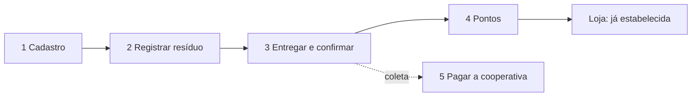
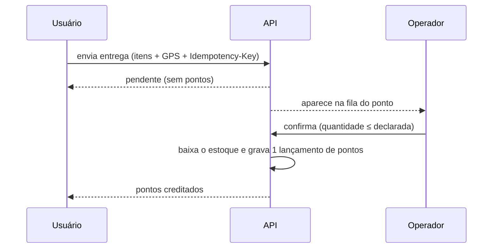

# Pauta da reunião de arquitetura

> **Estado:** revisão · **Dono:** Produto e Tecnologia · **Preparado em:** 12/11/2026
> **Foco:** a jornada central do produto: **cadastrar → registrar o resíduo → entregar e ser confirmado → ganhar pontos → gastar na loja**, mais o pagamento à cooperativa.
> **Pesquisa:** feita por busca na internet em 12/11/2026. **Nada foi testado.** O que está marcado `[VERIFICAR]` precisa de teste antes de virar decisão.
> **Versão completa (regras, 18 perguntas, riscos):** [anexo](pauta-reuniao-arquitetura-completa.md). Use só se sobrar tempo.

## Resumo

A reunião trata de **cinco temas**, nesta ordem. O administrador e a loja ficam de fora: o administrador já está certo e a loja está bem estabelecida. Cada tema traz **o que já está decidido** (não reabrir), **opções de ferramenta** e **perguntas** para o arquiteto. As recomendações são **propostas para a conversa**, não decisões.

| # | Tema | Tempo sugerido |
|---|---|---|
| 1 | Cadastro do usuário e teto de contas | 10 min |
| 2 | Registro do resíduo: código de barras e QR Code da nota | 25 min |
| 3 | Entrega e confirmação | 15 min |
| 4 | Sistema de pontos | 15 min |
| 5 | Pagamento à cooperativa | 15 min |
| | **Total** | **80 min** |

## 1. Cadastro do usuário e teto de contas

**Já decidido:** cadastro **aberto, sem código**; **teto de 500 contas** (configurável, pode subir a 1000) com trava de vagas no banco; conta excluída devolve a vaga; sem vaga, aviso e lista de espera. Detalhes em [controle de acesso](../pesquisa/controle-de-acesso.md).

**Como construir**

| Item | Proposta |
|---|---|
| Trava de vagas | Um único comando `UPDATE ... SET vagas_restantes = vagas_restantes - 1 WHERE vagas_restantes > 0 RETURNING ...`, na **mesma transação** da conta. Se não voltar linha, acabaram as vagas |
| Quem altera o teto | Valor no banco, alterado pelo admin sem novo deploy |
| Contra robôs | Limite de tentativas por endereço e um captcha sem atrito (por exemplo, Cloudflare Turnstile) `[VERIFICAR]`, porque sem código qualquer robô pode ocupar as vagas |

**Perguntas**

1. A trava funciona bem com a **Neon e a API na Vercel** (conexões curtas)? O `UPDATE` único evita segurar a linha por muito tempo.
2. Cadastro **precisa de e-mail verificado** no piloto? Hoje a recuperação de senha por e-mail ainda não existe (PD-003).
3. Qual proteção contra robôs entra já, e qual fica para depois?

## 2. Registro do resíduo: código de barras e QR Code da nota

**Já decidido:** os dois métodos estão **dentro do MVP**; cadastro manual como saída; aviso vermelho a cada falha e manual recomendado a partir da 2ª; o **material (PET ou lata) é sugerido e o usuário confirma sempre**; registrar o item **não** dá pontos. O "descartar agora" é só o uso desses leitores.

### 2.1 Ler o código pela câmera

| Opção | O que se sabe | Limite |
|---|---|---|
| **Leitor nativo do navegador** (`BarcodeDetector`) | Funciona no Chrome para Android (precisa do Google Play Services) | **Safari do iPhone não tem** ([caniuse](https://caniuse.com/mdn-api_barcodedetector)) |
| **`zxing-wasm`** (ZXing em WebAssembly) | Gratuito e funciona nos dois sistemas. Em um benchmark teve 67% de acerto contra 85% de um produto pago ([Dynamsoft](https://www.dynamsoft.com/codepool/benchmark-barcode-reading-javascript-zxing-wasm-dynamsoft-barcode-reader.html), fonte interessada) | Mais lento em celular simples `[VERIFICAR]` |
| **`react-zxing`** (o que o frontend usa hoje) | Já está no código; usa o ZXing em JavaScript, que perdeu manutenção | Risco de ficar parado |
| **SDK pago** (Dynamsoft, Scanbot) | Maior taxa de acerto | Custo e licença |

**Proposta:** usar o leitor nativo quando existir e `zxing-wasm` como alternativa, medindo nos **celulares do piloto**. Pagar por SDK só se a taxa de acerto for ruim.

### 2.2 Descobrir o produto pelo código de barras

| Fonte | O que se sabe | Situação |
|---|---|---|
| **Cache próprio** (tabela de produtos do Residuum) | Cresce a cada item confirmado | Começa vazia; fica mais barata com o tempo |
| **Open Food Facts** | Base aberta e gratuita, sem chave; API documentada ([docs](https://openfoodfacts.github.io/documentation/docs/Product-Opener/api/)) | Cobertura de produtos brasileiros **não confirmada**; testar `[VERIFICAR]` |
| **Cosmos (Bluesoft)** | Token no site do Cosmos; a documentação e os limites da API **não apareceram** na busca | Consultar a Bluesoft `[VERIFICAR]` |
| **GS1 Brasil** (Verified by GS1) | Oficial, com OAuth 2.0 ([manual](https://www.gs1br.org/educacao-e-eventos/Documents/Manual_API_de_Consulta_GS1.pdf)) | Contrato e custo `[VERIFICAR]` |

**Proposta:** consultar nesta ordem: **cache próprio → Open Food Facts → Cosmos → manual**. Guardar o código como **texto**, para não perder zeros à esquerda. Nenhuma fonte diz se a embalagem é **PET ou lata**: a sugestão vem de palavras da descrição ("lata 350 ml", "PET 2 L") e do cache, e o usuário confirma.

### 2.3 Importar a nota fiscal (QR Code)

| O que se sabe | Fonte |
|---|---|
| O QR da NFC-e traz uma URL do tipo `...?p=CHAVE|VERSÃO|AMBIENTE|ID_CSC|HASH`; a **chave de acesso tem 44 dígitos** | [Oobj](https://oobj.com.br/bc/rejeicao-396-como-resolver), [Manual do DANFE NFC-e](https://www.sefaz.rr.gov.br/Manual_do_DANFE_NFC-e_QR_Code.pdf) |
| No Amazonas a consulta é pelo portal da SEFAZ, por chave, QR Code ou CPF do consumidor | [Decreto 34.459/2014](https://www.contabeis.com.br/legislacao/65185/decreto-34459-2014/) |
| **Não há API oficial e gratuita** que devolva os itens. A URL de produção citada varia entre fontes; **captcha não confirmado** | [Infosimples](https://infosimples.com/consultas/sefaz-am-nfce/) |

| Caminho | Vantagem | Risco |
|---|---|---|
| **A. Serviço pago de terceiros** (Infosimples) | Rápido de ligar | Custo por consulta; depende do fornecedor |
| **B. O backend lê a página pública da SEFAZ-AM** | Gratuito | Quebra se o portal mudar; termos de uso; possível captcha |
| **C. Só usar a chave** e pedir os itens ao usuário | Sem dependência externa | Mais trabalho para o usuário |

**Proposta:** testar o caminho **B** em 10 notas reais. Se falhar, ir para **A** no piloto (poucos usuários, custo baixo) e manter **C** como saída. A consulta roda **no backend**, nunca no navegador.

**Perguntas do tema 2**

1. Qual leitor de câmera adotar, e como medir a taxa de acerto nos celulares do piloto?
2. A cascata de fontes está certa? Quem testa os 50 códigos de barras e as 10 notas, e até quando?
3. Guardamos a **chave da nota** para impedir importar a mesma nota duas vezes (PD-005 está aberta)? A nota traz CPF: o que podemos guardar (LGPD)?
4. Qual custo por consulta é aceitável no piloto?

## 3. Entrega e confirmação

**Já decidido:** o usuário só envia a entrega com **GPS dentro de 100 m** do ponto (ajustável); o **operador do ponto confirma** e a confirmação é **final**; o ponto cheio é **bloqueado** e o app sugere outro; envios do mesmo usuário no mesmo ponto em **60 minutos** contam como um.

**Como construir**

| Item | Opções | Proposta |
|---|---|---|
| **Aviso ao operador** | (a) a tela consulta a API a cada poucos segundos; (b) *Server-Sent Events*; (c) notificação push; (d) e-mail ou mensagem | (a) no piloto: simples e funciona na Vercel. Push no iPhone exige instalar o app `[VERIFICAR]` |
| **Validar o GPS** | No celular só; ou também no servidor | No servidor: distância ao ponto, precisão máxima (60 m) e idade da posição (30 s) |
| **Janela de 60 min** | Fixa a partir do 1º envio, ou deslizante | Fixa, por usuário e ponto; os envios viram **um descarte** com vários itens, e o operador confirma o grupo |
| **Reenvio** | Cabeçalho `Idempotency-Key` ([ADR-0003](adr/0003-idempotencia-nas-escritas.md)) | Em todo envio e confirmação |

**Perguntas**

1. A janela de 60 min agrupa o **descarte** ou só o **crédito**? E quem confirma: o grupo ou cada envio?
2. Como o operador **fica sabendo** que há entrega esperando? Polling basta?
3. O GPS pode ser burlado (localização falsa). Qual defesa entra no MVP além do raio e da confirmação do operador?
4. O que acontece com o envio que o operador **nunca** confirma?

## 4. Sistema de pontos

**Já decidido:** **10 pontos por descarte concluído**; sem estorno (erro vira **ajuste manual do admin**, com motivo, sem deixar o saldo negativo); campanha de dobro: meta de N descartes e bônus de **10 × N** pelo botão "Receber pontos"; sorteios só de teste. A loja segue o que já existe.

**Desenho aceito:** [ADR-0001](adr/0001-livro-unico-de-pontos.md), um **livro único de pontos**: cada lançamento tem origem, referência e chave de idempotência; o saldo é um cache alterado só por um serviço, com trava de linha.

| Hoje no código | Decidido |
|---|---|
| 5 pontos por unidade | 10 por descarte |
| Credita no envio **e** na confirmação (duas vezes) | Credita **uma vez**, na confirmação |
| Saldo alterado em 6 lugares | Um serviço só |
| Admin pode "reverter" descarte | Só ajuste manual com motivo |

**Perguntas**

1. Como **reconciliar** os saldos já creditados em dobro? Há usuários reais hoje no banco ou só teste `[VERIFICAR]`?
2. Garantir no banco: **1 lançamento por descarte** (`UNIQUE` por origem e referência) e **saldo ≥ 0** (`CHECK`). Concordamos?
3. O bônus da campanha conta descartes **depois da adesão**; a janela de 60 min conta como um. Isso está claro para a implementação?
4. O limite diário de 200 unidades (provisório) entra no piloto, e onde fica?
5. Os testes precisam rodar em **PostgreSQL** (Docker + CI): o SQLite atual não pega concorrência de saldo.

## 5. Pagamento à cooperativa

**Já decidido:** a **Residuum paga**, por **kg e material**; no piloto o pagamento é **manual, com comprovante registrado no sistema**; a **API vem depois**. O valor por kg de PET e de lata ainda não existe (PD-015).

**Na primeira fase** (manual), o sistema calcula `kg × valor do material`, o admin paga pelo banco e marca "pago" com o comprovante. É preciso uma tabela `pagamento`, **separada do estado da coleta**, e um lugar para guardar o comprovante.

**Para a API** (depois), o que as páginas dos provedores mostram:

| | Asaas | Efí | Mercado Pago |
|---|---|---|---|
| Envia Pix por API | Sim, por chave ou TED | Sim, direto para a chave | Sim, em lote de até 1.000 |
| Resultado | Webhook com `TRANSFER_DONE` e `TRANSFER_FAILED`; guia recomenda webhook ([doc](https://docs.asaas.com/docs/webhook-para-transferencias)) | Webhook informa sucesso ou falha ([doc](https://dev.efipay.com.br/en/docs/api-pix/envio-pagamento-pix/)) | Resposta inicial 202; consulta do lote |
| Ambiente de teste | Sim, simula falha ([doc](https://docs.asaas.com/docs/testing-transfers)) | `[VERIFICAR]` | `[VERIFICAR]` |
| Tarifa do Pix enviado | **Fontes divergem**: 30 grátis por mês e depois cerca de R$ 2,00 `[VERIFICAR]` ([Asaas](https://asaas.com/pix-asaas)) | Não encontrada | Não encontrada |

Bancos tradicionais cobram Pix de empresas: por exemplo, até R$ 10 por envio ([Tecnoblog](https://tecnoblog.net/noticias/pix-custa-ate-r-10-para-clientes-pj-no-itau-bb-e-santander/)).

**Proposta:** nesta fase, só o registro manual. Desenhar já uma **interface única de provedor** (enviar, consultar, receber o aviso), para trocar o provedor depois sem mexer na regra. Cada pagamento guarda a **referência própria** para não pagar duas vezes. Testar o Asaas no ambiente de teste enquanto o piloto roda.

**Perguntas**

1. Onde guardar o **comprovante**? A API na Vercel não guarda arquivos: precisa de um armazenamento de objetos `[VERIFICAR qual]`.
2. O pagamento é **por coleta** ou **por lote** (por exemplo, mensal)?
3. Quando a API entra: depois de quantas coletas por mês? Quem é o dono da conta no provedor?
4. Há exigência legal para uma plataforma pagar terceiros por API (conta digital de parceiro)? `[LACUNA]`

## Decisões para sair da reunião

| # | Decisão | Quem | Prazo |
|---|---|---|---|
| 1 | Proteção contra robôs no cadastro | | |
| 2 | Leitor de código de barras (nativo + WASM ou outro) | | |
| 3 | Ordem das fontes de produto e quem testa | | |
| 4 | Caminho da nota fiscal (B, A ou C) | | |
| 5 | Janela de 60 min: o que agrupa e quem confirma | | |
| 6 | Como o operador é avisado | | |
| 7 | Reconciliação dos saldos antigos | | |
| 8 | Armazenamento do comprovante | | |
| 9 | Pagamento por coleta ou por lote | | |

## Fontes da pesquisa

Busca na internet em 12/11/2026, sem testes: [caniuse: BarcodeDetector](https://caniuse.com/mdn-api_barcodedetector) · [benchmark zxing-wasm](https://www.dynamsoft.com/codepool/benchmark-barcode-reading-javascript-zxing-wasm-dynamsoft-barcode-reader.html) · [Open Food Facts](https://openfoodfacts.github.io/documentation/docs/Product-Opener/api/) · [GS1 Brasil](https://www.gs1br.org/educacao-e-eventos/Documents/Manual_API_de_Consulta_GS1.pdf) · [QR da NFC-e](https://oobj.com.br/bc/rejeicao-396-como-resolver) · [Decreto 34.459/2014](https://www.contabeis.com.br/legislacao/65185/decreto-34459-2014/) · [Infosimples SEFAZ-AM](https://infosimples.com/consultas/sefaz-am-nfce/) · [Asaas: transferências](https://docs.asaas.com/docs/webhook-para-transferencias) · [Efí: envio de Pix](https://dev.efipay.com.br/en/docs/api-pix/envio-pagamento-pix/). Pesquisas anteriores: [fontes de produtos e notas](../pesquisa/fontes-de-produtos-e-notas.md) e [provedores de pagamento](../pesquisa/provedores-de-pagamento.md).
