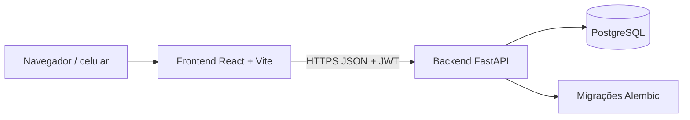

# Arquitetura de Software (SAD)

> **Estado:** esboço · **Dono:** Tecnologia · **Atualizado em:** 10/11/2026
> **Fontes:** `stacks-e-integracoes.md`, `arquitetura-refatoracao-banco.md`, README do backend e do frontend, propostas S1–S10, C1–C11, P1–P13, A1–A14.
> **Lacunas:** 6

## Resumo

Aplicação web em duas partes: **API** (Python/FastAPI + PostgreSQL) e **interface** (React/Vite). A arquitetura atual funciona, mas tem três fragilidades que as propostas corrigem: pontos alterados em 6 lugares, permissão por papel sem vínculo ao ponto, e três fluxos diferentes de confirmação.

## Visão geral

## Stack

| Camada | Tecnologia | Fonte |
|---|---|---|
| Interface | React 18, Vite, Tailwind, Recharts, Leaflet/OpenStreetMap | README front |
| API | FastAPI, SQLAlchemy, Pydantic, Uvicorn | README back |
| Banco | PostgreSQL, Alembic (32 migrações) | repositório |
| Segurança | JWT (python-jose), bcrypt | README back |
| Deploy | Docker, Vercel, GitHub Actions | `deploy.yaml` |

## Organização do backend (`backend/app`)

`routes/` endpoints · `services/` regras · `models/` tabelas · `schemas/` contratos · `dependencies/` autenticação · `core/` segurança.

## Decisões de desenho (propostas)

| # | Decisão | Motivo |
|---|---|---|
| 1 | **Ledger único** (`creditar_pontos`, `estornar_lancamento`) e `pontuacao_total` como cache | Fim do crédito em dobro |
| 2 | **Banco garante regras críticas** (índices únicos parciais, CHECK de saldo ≥ 0) | Não depender só do código |
| 3 | **Idempotência** por `Idempotency-Key` em toda escrita sensível | Reenvio não repete efeito |
| 4 | **Permissão = papel + vínculo ao ponto** (`vinculo_operacional`) | Cooperativa só opera o que é dela |
| 5 | **Estados no backend** para descarte, sorteio, coleta | `PUT` nunca muda estado |
| 6 | **Nada com movimento de pontos é apagado** | Auditoria e LGPD |

Diagramas: [diagramas](diagramas.md) · Tabelas: [modelo-de-dados](modelo-de-dados.md).

## Ambientes

| Ambiente | Situação |
|---|---|
| Local | Docker Compose (banco) + `uvicorn` + `pnpm dev` |
| Homologação | `[LACUNA]` não documentado |
| Produção | Vercel + migração automática ao integrar na `main` |

## Pontos fracos conhecidos

- Testes em SQLite ignoram `FOR UPDATE` e índices parciais → usar PostgreSQL.
- `/painel-testes` público e CORS aberto (`allow_origins=["*"]`).
- Sem limite de tentativas no login; JWT sem revogação.

## O que falta para fechar

- [ ] `[LACUNA]` topologia de infraestrutura (hospedagem do banco, backups)
- [ ] `[LACUNA]` homologação, observabilidade e logs
- [ ] `[VERIFICAR NO CÓDIGO]` versão real de Python (README diz 3.10+, deploy usa 3.11)
- [ ] `[DECISÃO: PD-023]` modelo de vínculo
