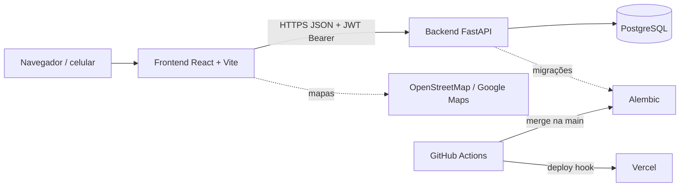
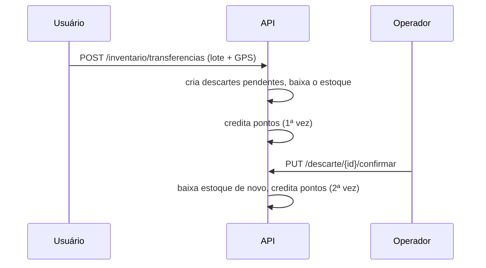

# Arquitetura de Software (SAD)

> **Estado:** revisão · **Dono:** Tecnologia · **Atualizado em:** 10/11/2026
> **Fontes:** código do backend (branch `feature/mor-025-026-vouchers-sorteios`, `11f0d8e`) e do frontend (`package.json`, `App.jsx`, `ci.yml`), [stacks e integrações](../tecnologia/stacks-e-integracoes.md), [mapa de branches](../tecnologia/mapa-de-branches.md), propostas das análises.
> **Lacunas:** 6 · Decisões de arquitetura propostas em [adr/](adr/README.md)

## Resumo

Aplicação web em duas partes: uma **API** (Python/FastAPI + PostgreSQL) e uma **interface** (React/Vite). A API tem **15 grupos de rotas e 111 endpoints**. A arquitetura é simples e adequada ao MVP, mas tem três fragilidades: pontos alterados em vários lugares, permissão por papel sem vínculo ao ponto e três fluxos diferentes de confirmação do descarte. O que **está implantado** (hospedagem, banco, ambientes) não está documentado.

## Visão geral

## Stack (versões do código)

| Camada | Tecnologia | Versão |
|---|---|---|
| API | FastAPI, Uvicorn | 0.115.0, 0.32.0 |
| Dados | SQLAlchemy, Alembic, psycopg2 | 2.0.36, 1.13.3, 2.9.10 |
| Validação | Pydantic, email-validator | 2.9.2, 2.2.0 |
| Segurança | python-jose, passlib, bcrypt | 3.5.0, 1.7.4, 4.0.1 |
| Linguagem | Python | 3.11 (Dockerfile) · 3.12 nos testes · README diz 3.10+ |
| Interface | React, Vite, React Router | 18, `vite`, 7 |
| Estado e formulários | TanStack Query, React Hook Form, Zod, Axios | 4, 7, 3, 1 |
| Visual | Tailwind CSS, Radix UI, Recharts, Lucide | — |
| Mapas e leitura | Leaflet / React-Leaflet, `@react-google-maps/api`, `react-zxing` (código de barras) | — |
| Relatórios | jsPDF + autotable | — |
| Build | pnpm, Node | CI: pnpm 9 / Node 20 · local: pnpm 11 / Node 24 |

## Backend por camadas (`backend/app`)

| Pasta | Papel |
|---|---|
| `routes/` | 15 arquivos de endpoints: `admin` (28), `campanha` (11), `voucher` (11), `sorteio` (10), `inventario_usuario` (8), `ponto_coleta` (8), `cooperativa` (8), `auth` (6), `descarte` (6), demais menores |
| `services/` | Regras: `saldo_service` (débito com trava), `pontuacao_service` (5 pontos por unidade), `campanha_service`, `voucher_service`, `extrato_pontos_service`, `ponto_coleta_service`, `localizacao_service` (GPS), `transferencia_lote_service`, `audit_service`, outros |
| `models/` | 21 arquivos, 27 tabelas — ver [modelo de dados](modelo-de-dados.md) |
| `schemas/` | Contratos Pydantic de entrada e saída |
| `dependencies/` | `get_current_user`, `require_role`, `validar_acesso_operacional_ao_ponto` |
| `core/` | Segurança (JWT), decoradores (`@public`), exceções |

## Autenticação e permissão (como é hoje)

1. Login devolve **access token** e **refresh token** (JWT). O refresh vale 30 dias.
2. Um filtro global exige token em toda rota, exceto as marcadas `@public`.
3. Cada rota restringe por **papel** com `require_role(...)`: `usuario`, `admin`, `cooperativa`, `ponto_coleta`, `parceiro`.
4. Para operar um ponto, `validar_acesso_operacional_ao_ponto` libera `admin` e **qualquer** `cooperativa`; `ponto_coleta` e `parceiro` só o ponto cujo `cooperativa_id` é o seu.

Não há desativação de conta, revogação de sessão, convite nem limite de tentativas.

## Fluxo principal: entrega do usuário (como é hoje)

Os dois créditos e as duas baixas são o defeito F01/F02. O desenho proposto está em [diagramas](diagramas.md) e na [ADR-0001](adr/0001-livro-unico-de-pontos.md).

## Decisões de desenho propostas

| ADR | Decisão | Motivo |
|---|---|---|
| [0001](adr/0001-livro-unico-de-pontos.md) | Livro único de pontos (ledger) | Fim do crédito em dobro |
| [0002](adr/0002-vinculo-entre-usuario-e-ponto.md) | Vínculo usuário↔ponto | Cooperativa só opera o que é dela |
| [0003](adr/0003-idempotencia-nas-escritas.md) | Idempotência em toda escrita sensível | Reenvio não repete efeito |
| [0004](adr/0004-estados-no-backend.md) | Estados com transições explícitas | `PUT` nunca muda estado |
| [0005](adr/0005-conta-com-ciclo-de-vida.md) | Conta com ciclo de vida | Desativar e revogar sessão |

Todas com estado **proposta**: dependem das decisões do produto.

## Ambientes e entrega

| Item | Situação |
|---|---|
| Local | `docker-compose.yml` (banco) + `uvicorn` + `pnpm dev` |
| CI do backend | Só `deploy.yaml`: a cada push na `main` roda `alembic upgrade heads` e chama o deploy hook da Vercel. **Não roda testes** |
| CI do frontend | `ci.yml`: instala, `build` e Prettier (`\|\| true`: falha de formato é ignorada) |
| Testes | 3 arquivos no backend (SQLite em memória); nenhum no frontend |
| Homologação / produção | `[LACUNA]` URLs, banco, backups e quem publica não constam no repositório |

## Riscos e dívidas

- Testes em SQLite ignoram `FOR UPDATE` e índices parciais.
- `/painel-testes` público e CORS aberto (`allow_origins=["*"]`) `[VERIFICAR]`.
- Branches de feature com tabelas novas **ainda não estão na `main`** do backend.
- Código sem uso: tabelas `cooperativa`, `qrcode_token`, `estoque`.

## O que falta para fechar

- [ ] `[LACUNA]` topologia real: onde rodam API, banco e frontend; backups; RPO/RTO (PD-026)
- [ ] `[LACUNA]` observabilidade, logs e alertas
- [ ] `[LACUNA]` política de segredos e rotação do `SECRET_KEY`
- [ ] `[DECISÃO: PD-023]` modelo de vínculo (ADR-0002)
- [ ] `[VERIFICAR]` quais rotas estão ativas na `main` do backend
- [ ] Conciliar versões de Python (3.10/3.11/3.12) e Node/pnpm (CI × local)
