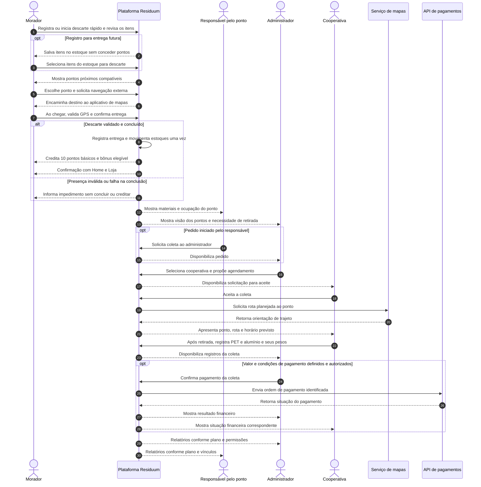

# Projeto Residuum — Problemática e Solução

**Referência de escopo:** [Levantamento de requisitos do MVP — V6](02-requisitos-mvp-v6.md). Esta visão apresenta a proposta de negócio e o funcionamento esperado do produto; o detalhamento dos requisitos e das decisões pendentes permanece na V6.

## 1. Problemática: O Desafio da Gestão de Resíduos e a Logística Reversa

O ciclo atual de descarte e reciclagem de resíduos sólidos apresenta falhas estruturais severas que afetam todos os atores da cadeia. A desconexão entre quem gera o resíduo (cidadão) e quem deve garantir a logística reversa (empresas) gera ineficiências operacionais e passivos ambientais.

- **Falta de Visibilidade e Rastreabilidade (O "Elo Perdido"):** O resíduo reciclável perde sua rastreabilidade no momento do descarte. O morador não tem conhecimento sobre o destino final do material que separa, enquanto as empresas geradoras, obrigadas por lei a dar o destino correto às embalagens (Política Nacional de Resíduos Sólidos - PNRS), não conseguem comprovar efetivamente a logística reversa por falta de dados. O atual Sistema Nacional de Informações sobre a Gestão dos Resíduos Sólidos (SINIR) e o Manifesto de Transporte de Resíduos (MTR) fornecem a base regulatória, mas as informações reais da base da cadeia (o descarte cidadão) não chegam de forma fluída.
- **Operações "No Escuro" (Ineficiência Logística):** Cooperativas e catadores operam com base na reatividade. Sem saber o volume exato de resíduos ou o nível de enchimento dos pontos de coleta (condomínios, supermercados, etc.), ocorrem deslocamentos desnecessários para locais vazios ou atrasos em pontos superlotados. Os pontos de coleta também carecem de dados sobre o que estão descartando.
- **Ausência de Incentivo e Engajamento Popular:** O cidadão não enxerga valor no resíduo sólido. Sem um sistema de recompensas claro, a adesão da população à separação correta dos materiais é baixa.
- **Risco Legal e de Imagem Corporativa:** A falta de rastreabilidade e de um sistema de gestão de dados consolidado representa um risco contínuo para as empresas, que podem sofrer sanções pela não conformidade com a PNRS e comprometer suas métricas ESG perante o mercado e o poder público.

## 2. A Solução Residuum: Descarte Facilitado, Recompensas e Coleta Coordenada

O Residuum propõe uma **plataforma web que conecta moradores, responsáveis pelos pontos de coleta, cooperativas e administração**, organizando o fluxo entre o registro da embalagem, sua entrega no ponto e a retirada pela cooperativa. O MVP começa com **embalagens PET e latas de alumínio**.

A proposta combina facilidade de uso, incentivos e controle operacional. A chamada **“uberização” da coleta** corresponde à solicitação pelo administrador, ao aceite da cooperativa e ao agendamento e acompanhamento pelo sistema. As decisões de encaminhamento permanecem com o administrador.

### 2.1 Descarte simples e cadastro de resíduos com menos esforço

O morador poderá registrar embalagens por leitura do **código de barras do produto**, importação de informações da **nota fiscal** ou preenchimento **manual de nome, material e quantidade**. Os dados recuperados serão apresentados para revisão. Quando a origem não identificar a embalagem com segurança, o morador poderá selecionar PET ou lata manualmente.

A leitura da nota é inspirada na facilidade de uso do Méliuz: reduzir o preenchimento e agilizar o cadastro. A fonte de consulta de notas e produtos ainda precisa ser definida e validada. A leitura, por si só, não comprova entrega física nem concede recompensa.

Existirão duas formas de iniciar o fluxo:

- **Registrar:** incluir os itens no estoque do morador para uma entrega futura.
- **Descarte rápido:** abrir diretamente o scanner, revisar os itens e seguir para a escolha do ponto, sem exigir passagem pela tela de estoque.

O morador também poderá selecionar itens já registrados no estoque. O sistema mostrará pontos próximos compatíveis com os materiais. Após escolher o destino, ele poderá abrir a navegação em um aplicativo externo de mapas. Ao chegar, retornará ao Residuum para validar sua presença por **GPS** e confirmar o descarte.

A confirmação registrará a entrega, movimentará os estoques correspondentes e apresentará o resultado, com opções de voltar para a Home ou acessar a Loja. O controle de entrada de moradores será feito por convites: link individual de uso único ou link compartilhado com expiração e limite de cadastros, geridos pelo administrador.

### 2.2 Engajamento por pontos, campanhas e loja de recompensas

Cada descarte concluído concederá ao morador **10 pontos básicos**, como regra provisória até a definição do sistema definitivo de pontuação. Campanhas poderão oferecer **pontos extras** por produtos ou metas de descarte, de acordo com condições publicadas e ainda sujeitas ao detalhamento das regras.

Na Loja, o morador poderá consultar campanhas vigentes, participar de sorteios e adquirir cupons/vouchers usando pontos. As campanhas explicarão o que precisa ser feito, os itens elegíveis, as metas e o benefício. O administrador será responsável pela gestão de campanhas, vouchers e sorteios, incluindo descrições, imagens e vídeos. Custos, validade, elegibilidade, acúmulo de bônus e condições dos sorteios ainda dependem de decisão.

**Os pontos são recompensas não monetárias.** O cashback em dinheiro permanece como evolução futura, condicionado a estudo de viabilidade, definição da origem dos recursos e do processo de devolução. O objetivo estratégico é avaliar um modelo que gere valor para os participantes da rede; isso não representa promessa de retorno financeiro a todos no MVP.

### 2.3 Pontos de coleta organizados e visibilidade da operação

O administrador cadastrará **pontos fixos e temporários**, seus responsáveis e as cooperativas. Os pontos poderão ser classificados por contexto, como condomínio, residência, loja ou faculdade. Os temporários atenderão eventos ou ações específicas, com período de funcionamento definido.

O responsável terá acesso ao painel de seus pontos para acompanhar materiais acumulados e coletas. Ele e o administrador poderão editar quais materiais cada local aceita. A plataforma deverá evidenciar a ocupação e a necessidade de retirada para ambos.

O método de cálculo da capacidade e de identificação de ponto cheio ainda precisa ser acordado. Quantidade de embalagens, estimativa de ocupação e peso medido são informações diferentes; o peso efetivamente coletado será informado pela cooperativa.

Quando houver necessidade, o responsável poderá solicitar retirada ao administrador. O administrador também poderá iniciar uma solicitação diretamente a partir de sua visão geral da rede.

### 2.4 Coleta sob solicitação, aceite e pagamento controlado

O administrador selecionará o ponto, a cooperativa e o agendamento, enviando a solicitação pelo sistema. A cooperativa precisará **aceitar a coleta**. Seu painel receberá as informações do ponto, o horário previsto e a rota planejada, com integração de mapas prevista com o Google.

Após retirar os materiais, a cooperativa preencherá os formulários com **o tipo de material e seu respectivo peso**: quanto de PET e quanto de alumínio foi coletado. Agendamento e orientação de rota serão fornecidos pela plataforma, sem exigir preenchimento manual desses dados pela cooperativa.

Os registros ficarão disponíveis à administração. O pagamento à cooperativa será iniciado pelo administrador **dentro da plataforma, por API de pagamentos**. Valor, provedor e condições de autorização ainda serão definidos com o idealizador e a equipe. A coleta registrada e o pagamento confirmado serão acompanhados separadamente; a pesagem não concederá novamente os pontos já recebidos pelo morador.

### 2.5 Registros rastreáveis e acesso a dados por planos

Os eventos registrados permitirão relacionar **morador, itens entregues, ponto de coleta, solicitação, cooperativa e pesos coletados**, além de acompanhar pontuação e pagamento. Essa organização busca melhorar a visibilidade da operação e apoiar decisões com dados identificáveis quanto à origem e à unidade de medida.

Os painéis apresentarão indicadores de usuários, pontos e cooperativas. Definições de “ativo”, “conectado” e “aberto”, períodos de medição e demais métricas ainda precisam ser validados.

O modelo comercial prevê **plano grátis, contratação pré-paga e assinatura mensal** para acesso a determinados relatórios e indicadores. Tanto o administrador quanto o responsável pelo ponto terão relatórios sujeitos ao plano, além das permissões de seu perfil e dos vínculos autorizados. Pacotes, preços, titularidade, contratação e acesso operacional mínimo permanecem pendentes. A possibilidade de exportar arquivos também depende dessa definição.

A rastreabilidade do MVP abrange os eventos de descarte e coleta descritos. **Comprovação da reciclagem final e emissão de certificados com validade regulatória são objetivos a avaliar**, pois exigem evidências e processos adicionais ainda não definidos. O registro de GPS indica proximidade; a declaração de descarte ou pesagem não equivale automaticamente à comprovação de todo o ciclo.

### 2.6 Valor esperado para os participantes

| Participante | Como utiliza a solução | Valor esperado |
|---|---|---|
| Morador | Registra resíduos, escolhe ponto, descarta e utiliza pontos na Loja | Menor esforço para participar e incentivo ao descarte correto |
| Responsável pelo ponto | Acompanha materiais, configura aceitação e solicita retirada | Visibilidade sobre o ponto e comunicação com a administração |
| Cooperativa | Aceita solicitações, consulta agendamento/rota e registra pesos | Organização das coletas e acompanhamento do pagamento |
| Administrador | Gere cadastros, convites, Loja, solicitações, pagamentos e indicadores | Controle da operação em uma plataforma comum |
| Contratante de acesso a dados | Consulta os benefícios autorizados pelo plano | Informações para análise, conforme pacote e permissões a definir |

## 3. Como a Solução Responde à Problemática

| Problema apresentado | Resposta do MVP | Limite ou evolução necessária |
|---|---|---|
| Falta de visibilidade e rastreabilidade | Relacionar descarte, ponto, coleta, material e peso registrado | Evidências da reciclagem final e certificados ainda precisam ser definidos |
| Coletas com pouca informação | Painéis dos pontos, sinalização de ocupação, solicitação administrativa, aceite e agendamento | Cálculo de ocupação a definir; não há otimização automática de múltiplas rotas |
| Baixo incentivo ao cidadão | Cadastro simplificado, descarte rápido, pontos e Loja | Modelo definitivo de pontuação e regras das recompensas pendentes |
| Dificuldade de gestão e comprovação | Registros da operação, relatórios e indicadores autorizados | Dados precisam de critérios de qualidade; o MVP não garante conformidade regulatória por si só |

## 4. Fluxo Integrado do MVP

O diagrama de sequência resume a interação entre os participantes. Materiais entregues pelo morador e pesos registrados pela cooperativa são etapas distintas. A necessidade de coleta leva à decisão administrativa; não aciona automaticamente uma cooperativa.

O resultado financeiro pode ser pendente, confirmado ou falha conforme a integração; enviar a ordem não comprova recebimento. O bônus depende da regra e da elegibilidade da campanha, podendo ser apurado separadamente do crédito básico.

## 5. Limites do MVP e Próximas Decisões

O projeto possui um MVP existente e está padronizando sua documentação para a equipe atual de seis pessoas. Esta visão descreve o **comportamento esperado**, sem declarar que todos os recursos já estejam funcionando ou que as promessas futuras estejam validadas.

| Situação | Temas |
|---|---|
| Escopo definido | PET/lata, convites, cadastro e estoque, descarte rápido/GPS, 10 pontos, Loja, pontos fixos/temporários, administração, aceite e registro de coleta, pagamento por API e dados por planos |
| Detalhamento pendente | Consulta de produtos/notas, precisão do GPS, capacidade dos pontos, regras de campanhas/vouchers/sorteios, exceções de coleta, valor/provedor de pagamento e benefícios dos planos |
| Evolução a avaliar | Cashback em dinheiro, pontuação definitiva, ranking, confirmação pelo ponto/QR, certificados, exportações, rotas otimizadas e acompanhamento contínuo |

O detalhamento e as perguntas para validação estão na [seção de pendências da V6](02-requisitos-mvp-v6.md#12-pendências-de-decisão). Ao resolver uma decisão, a equipe deverá manter esta visão e o levantamento coerentes entre si.

## Decisão de experiência do morador — 10/10/2026

No descarte rápido, os itens ficam somente na memória do fluxo até a confirmação. Cancelar, mudar de área, recarregar ou fechar a aba elimina o rascunho; o morador deve usar Registrar se quiser guardar para depois. A rota abre em outra aba e conserva o fluxo, mas a presença precisa de GPS novo ao retornar. Essa decisão, aprovada pelo solicitante, substitui a proposta anterior de gravar automaticamente no estoque. O [handoff](../04-ux/01-morador-v6/01-handoff.md) distingue demonstração, integração real pendente e validação com moradores ainda não realizada.
