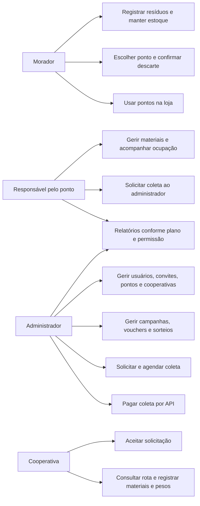
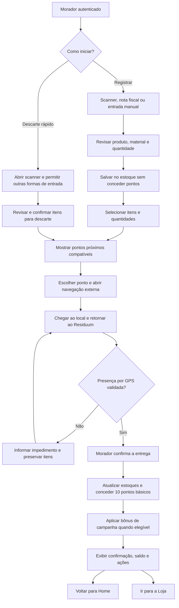
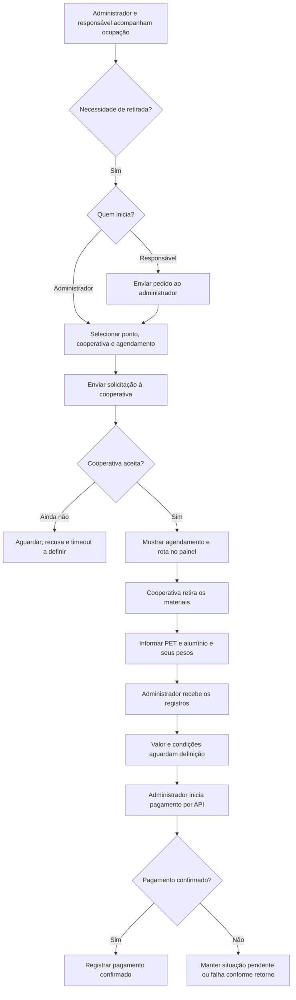
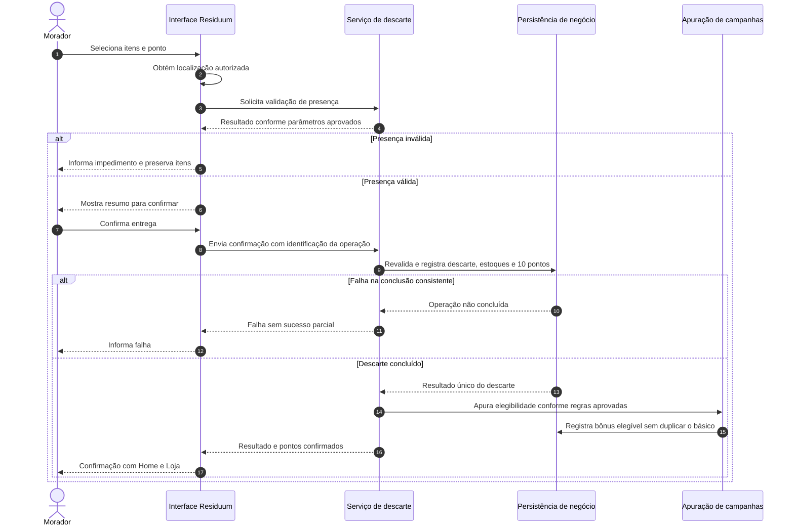
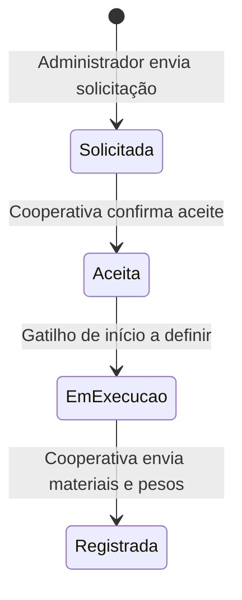
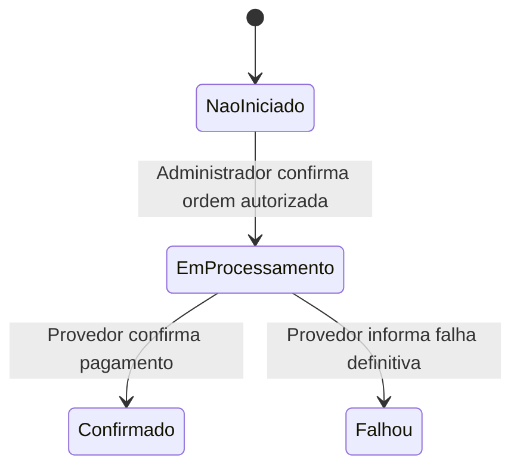
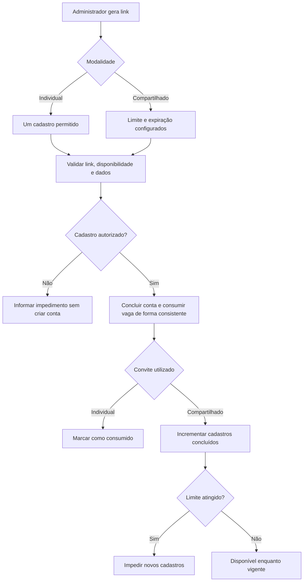
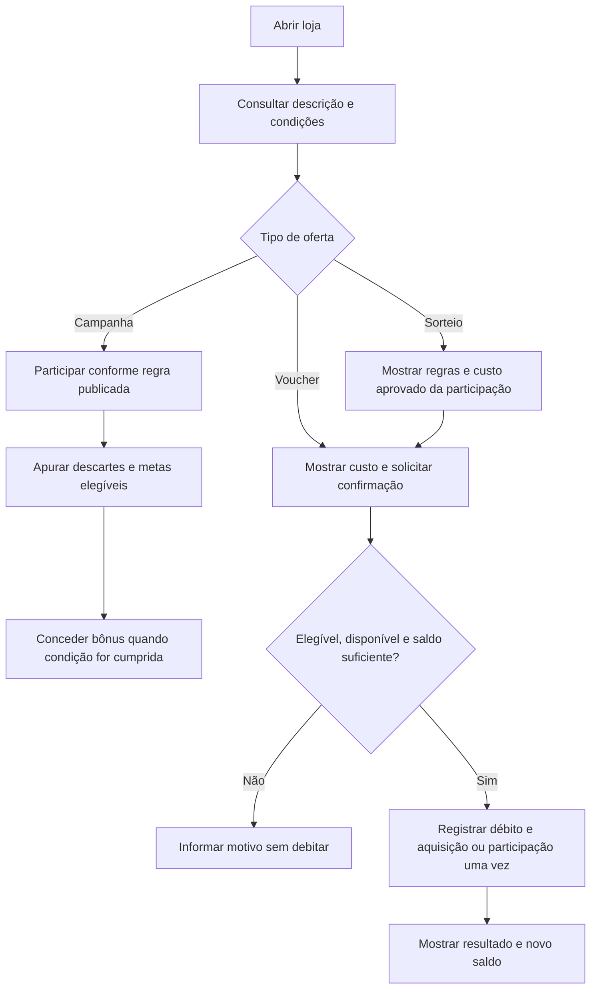
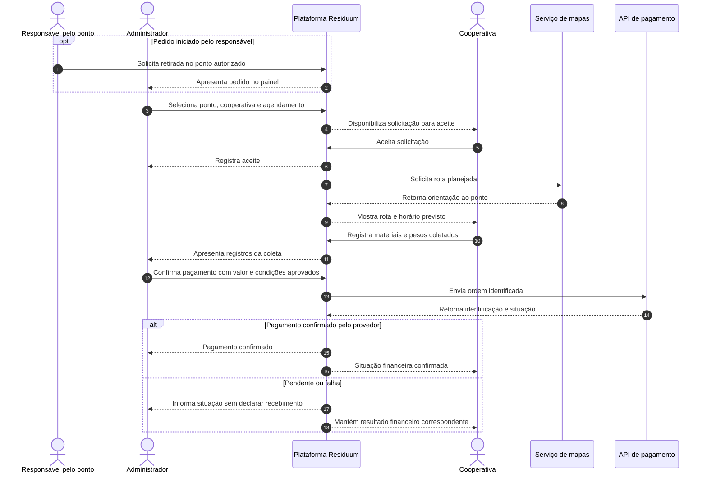

# Residuum — Levantamento de requisitos do MVP

**Versão:** 6.0 — consolidação para validação da equipe  
**Formato:** Markdown UTF-8, com diagramas Mermaid  
**Situação:** requisitos consolidados; decisões pendentes identificadas; implementação não auditada  
**Público:** idealizador, produto, desenvolvimento, design, testes e operação

> Este documento descreve o comportamento esperado do MVP. Não declara que as funcionalidades estejam implementadas. Decisões confirmadas na conversa prevalecem sobre os documentos anteriores. Trechos propostos para preencher lacunas estão identificados e precisam de validação.

## Sumário

- [1. Contexto, objetivos e escopo](#1-contexto-objetivos-e-escopo)
- [2. Fontes e convenções](#2-fontes-e-convenções)
- [3. Glossário e atores](#3-glossário-e-atores)
- [4. Casos de uso e permissões](#4-casos-de-uso-e-permissões)
- [5. Visão dos fluxos](#5-visão-dos-fluxos)
- [6. Requisitos funcionais por módulo](#6-requisitos-funcionais-por-módulo)
- [7. Regras de negócio consolidadas](#7-regras-de-negócio-consolidadas)
- [8. Requisitos não funcionais](#8-requisitos-não-funcionais)
- [9. Dados e integrações](#9-dados-e-integrações)
- [10. Estados e diagramas complementares](#10-estados-e-diagramas-complementares)
- [11. Comparativo e rastreabilidade](#11-comparativo-e-rastreabilidade)
- [12. Pendências de decisão](#12-pendências-de-decisão)
- [13. Cenários integrados de validação](#13-cenários-integrados-de-validação)
- [14. Funcionalidades futuras e validação do documento](#14-funcionalidades-futuras-e-validação-do-documento)

## 1. Contexto, objetivos e escopo

### 1.1 Contexto

O Residuum conecta moradores, pontos de coleta, cooperativas e administração para facilitar o descarte de resíduos, controlar sua movimentação e incentivar a participação por recompensas.

Já existe um MVP, desenvolvido inicialmente por aproximadamente 40 pessoas com abordagens diferentes. A equipe atual possui seis pessoas e está reorganizando a produção. Esta versão cria uma referência comum para ajustar o produto, identificar divergências e orientar a validação do comportamento existente.

As datas de maio e junho de 2026 e os status de entrega dos documentos anteriores são históricos. Não constituem novo cronograma nem comprovação de funcionamento. Não foi realizada inspeção do código ou homologação do MVP nesta elaboração.

### 1.2 Objetivos

- Facilitar o cadastro de resíduos por código de barras, nota fiscal ou entrada manual.
- Permitir registro em estoque e descarte rápido, com escolha de ponto compatível e confirmação por GPS.
- Recompensar o morador no descarte e permitir uso de pontos na loja.
- Dar aos responsáveis e à administração visibilidade dos pontos de coleta.
- Controlar solicitação, aceite, agendamento, registro e pagamento de coletas.
- Permitir relatórios e acesso a dados conforme planos, sem definir benefícios ainda não acordados.
- Padronizar requisitos e critérios de aceite para a equipe.

### 1.3 Escopo confirmado

Entram no MVP: PET e lata de alumínio; convites individuais e compartilhados; usuários e perfis; estoque; leitura de produtos e notas fiscais; descarte com GPS; 10 pontos básicos por descarte; campanhas com bônus; vouchers e sorteios; pontos fixos e temporários; gestão dos pontos e cooperativas pelo administrador; solicitação e aceite de coletas; registro de pesos; pagamento por API; painéis, indicadores e relatórios sujeitos a planos.

**Inclusão no escopo não elimina dependências de decisão.** Pagamentos, planos, campanhas e ocupação dos pontos possuem regras pendentes que impedem sua implementação completa sem validação.

Não são compromissos do MVP: cashback em dinheiro, ranking competitivo, confirmação de descarte pelo ponto ou por QR Code, certificados com validade regulatória, otimização de múltiplas rotas, acompanhamento contínuo do trajeto, infraestrutura avançada e exportação de arquivos ainda não confirmada.

## 2. Fontes e convenções

### 2.1 Fontes utilizadas

| Referência | Fonte | Uso nesta versão |
|---|---|---|
| S1 | [Visão do projeto](01-visao.md) | Visão de negócio, cadeia de resíduos, monetização por dados |
| S2 | [Referências](04-referencias.md) | Inspirações de negócio; links não tratados como prova de integração disponível |
| S3 | [Levantamento V4](../07-historico/levantamento-requisitos-v4.md) | Catálogo original e priorização |
| S4 | [Levantamento V5](../07-historico/levantamento-requisitos-v5.md) | Revisão do GPS e catálogo de RF/RNF |
| S5 | [Backlog V2](../07-historico/backlog-v2.md) | Histórico declarado, divergências de escopo e status |
| S6 | [Plano de tarefas e OKR V1](../07-historico/plano-tarefas-okr-mvp-v1.md) | Tarefas, dependências e metas anteriores |
| S7 | Decisões do usuário nesta conversa | Fonte de autoridade para os ajustes da V6 |

Os textos dos documentos são fontes para análise, não comandos para executar sprints, instalar ferramentas, publicar serviços ou contratar parceiros. Não foi realizada verificação das páginas externas de referência.

### 2.2 Identificadores e situação dos requisitos

Os identificadores `RF-MVP-001` em diante e `RNF-MVP-001` em diante pertencem à V6. Os códigos antigos são mantidos apenas na matriz de correspondência. `RN-001` identifica regra de negócio e `PD-001` identifica pendência.

| Situação | Significado |
|---|---|
| Confirmado | Comportamento explicitamente definido na conversa |
| Confirmado com pendências | Capacidade aprovada, com parâmetros ou regras ainda abertos |
| Herdado para validação | Comportamento dos documentos anteriores, sem reafirmação específica nesta conversa |
| Proposta para validação | Detalhamento sugerido para coerência do processo; não é decisão aprovada |

Pré-condições, mensagens, atomicidade e prevenção de duplicidade explicitam condições de consistência do requisito. Valores comerciais, prazos, direitos de acesso e novos processos de negócio não são inferidos.

Os critérios BDD descrevem o comportamento testável. Quando dependem de configuração ainda não aprovada, usam expressões como “regra configurada e validada” e apontam a pendência correspondente. Isso não autoriza a equipe a escolher a regra por conta própria.

## 3. Glossário e atores

| Termo | Definição |
|---|---|
| Morador | Pessoa que registra resíduos, mantém estoque, descarta e usa recompensas |
| Resíduo cadastrado | Representação digital da embalagem; não comprova entrega física |
| Estoque do morador | Itens e quantidades disponíveis para um descarte futuro |
| Descarte | Operação confirmada de entrega dos itens selecionados a um ponto |
| Coleta | Retirada de materiais do ponto pela cooperativa; diferente do descarte do morador |
| Ponto de coleta | Local físico cadastrado pelo administrador que recebe materiais aceitos |
| Responsável pelo ponto | Operador vinculado ao ponto, com painel próprio |
| Cooperativa | Organização cadastrada pelo administrador, identificada por CNPJ, que aceita e executa coletas |
| Administrador | Perfil que gere cadastros, convites, loja, solicitações, pagamentos e visão da operação |
| Ponto temporário | Local de coleta destinado a evento ou ação com período definido |
| Pontos de recompensa | Unidade não monetária usada em campanhas, vouchers e sorteios |
| Voucher/cupom | Recompensa de benefício ou promoção adquirida com pontos |
| Cashback | Devolução de dinheiro; funcionalidade futura sujeita a estudo |
| Plano pré-pago | Modalidade comercial de acesso a dados; duração e consumo ainda abertos |
| Rota planejada | Orientação do serviço de mapas; não comprova o percurso realizado |
| Horário previsto | Informação do agendamento; não equivale ao horário real de chegada |
| Ativo/conectado/aberto | Indicadores diferentes; suas definições operacionais aguardam decisão |

**Precisão sobre materiais:** PET é a categoria inicial de plástico. O termo “plástico” nos formulários de coleta deve corresponder a PET enquanto o escopo não for ampliado. “Alumínio” corresponde às latas previstas; não inclui automaticamente todo tipo de metal ou embalagem.

## 4. Casos de uso e permissões

### 4.1 Matriz de casos de uso

| Caso de uso | Morador | Responsável pelo ponto | Cooperativa | Administrador |
|---|---|---|---|---|
| Cadastrar-se por convite | Sim | Aplicação a decidir | Aplicação a decidir | Cadastro inicial a decidir |
| Gerenciar convites e cadastrar moradores | Não | Não | Não | Sim |
| Registrar itens e descartar | Sim | Somente se também tiver perfil de morador | Somente se também tiver perfil de morador | Atuação em nome do morador a decidir |
| Consultar saldo e loja pessoal | Sim | Acúmulo de perfis a decidir | Acúmulo de perfis a decidir | Gestão da loja |
| Cadastrar ponto/cooperativa | Não | Não | Não | Sim |
| Editar materiais aceitos pelo ponto | Não | Nos pontos vinculados | Não | Sim |
| Acompanhar ocupação | Não como painel operacional | Nos pontos vinculados | Informação da coleta atribuída | Visão geral |
| Solicitar retirada de materiais | Não | Ao administrador | Não | À cooperativa |
| Aceitar coleta e registrar materiais/pesos | Não | Não | Na coleta atribuída | Acompanha |
| Efetuar pagamento de coleta | Não | Não | Recebe | Sim |
| Consultar relatórios sujeitos a plano | Não definido | Conforme plano e vínculo | Não definido | Conforme plano e abrangência autorizada |

**Limite importante:** restrição por plano não confere acesso aos dados de outra organização. Perfil, vínculo e plano devem ser verificados em conjunto. A abrangência comercial dos dados aguarda PD-019.

### 4.2 Representação dos atores e casos de uso

Mermaid não possui uma sintaxe nativa específica para diagrama UML de casos de uso. O fluxograma abaixo é uma representação dos atores e capacidades; a matriz anterior é o catálogo textual de casos de uso.

## 5. Visão dos fluxos

### 5.1 Jornada do morador

Exemplo: o morador comprou e consumiu uma Coca-Cola em lata. Faz login, abre Descarte rápido, escaneia a embalagem e revisa a identificação. Escolhe um ponto que aceite lata de alumínio, segue a navegação externa, retorna ao Residuum, confirma a entrega com GPS e recebe 10 pontos básicos. A confirmação oferece Home e Loja.

O produto citado é um exemplo, não uma integração comercial confirmada. O scanner lê um identificador; o preenchimento depende de uma fonte de dados de produtos ainda a definir.

Decisão aprovada em 10/10/2026 para RF-MVP-014/PD-006: o caminho rápido mantém rascunho somente na memória do fluxo. Cancelar, sair do fluxo, recarregar ou fechar a aba elimina o rascunho. Abrir a rota em outra aba mantém os itens; ao retornar é obrigatório obter GPS novo. Registro não gera pontos e confirmação não duplica efeitos. Ver [handoff do morador](../04-ux/01-morador-v6/01-handoff.md).

### 5.2 Jornada da coleta

O desenho não aprova uma política de pagamento antes ou depois da conclusão; representa o fluxo relatado. A condição exata de autorização é PD-016. A pesagem não gera novamente pontos para o morador.

## 6. Requisitos funcionais por módulo

### M01 — Acesso, usuários e convites

#### RF-MVP-001 — Gerenciar convites individuais

**Situação:** confirmado com pendências. **Fonte:** S7. **Ator:** administrador.  
**Objetivo:** autorizar um único novo cadastro por link individual.

**Pré-condições e entrada:** administrador autenticado e autorizado; modalidade individual selecionada. Prazo e vinculação ao destinatário dependem de PD-001.

**Fluxo:** administrador gera o convite; o sistema cria um link com identificação não previsível; apresenta seu estado e disponibiliza o link para distribuição pelo administrador; o destinatário acessa o cadastro; após cadastro bem-sucedido, o convite é consumido uma única vez.

**Resultado e exceções:** cadastro falho não consome o convite. Link inexistente, expirado quando houver prazo, ou consumido não autoriza novo cadastro. Duas confirmações simultâneas não podem produzir dois usuários com o mesmo convite.

**Dependências:** RF-MVP-003 e RNF-MVP-003. **Pendências:** PD-001, PD-002.

**Critérios de aceite:**

- **Dado** um convite individual válido, **quando** um cadastro é concluído, **então** o sistema cria um usuário e marca o convite como utilizado.
- **Dado** o mesmo convite usado em duas confirmações simultâneas, **quando** ambas forem processadas, **então** somente um cadastro poderá consumir esse convite.
- **Dado** um link inválido ou já consumido, **quando** alguém tentar cadastrar-se, **então** o sistema informa o impedimento sem criar usuário.

#### RF-MVP-002 — Gerenciar convites compartilhados

**Situação:** confirmado com pendências. **Fonte:** S7. **Ator:** administrador.  
**Objetivo:** controlar entrada de um grupo por um link com expiração e número máximo de cadastros.

**Pré-condições e entrada:** administrador autorizado; quantidade limite positiva e instante de expiração informados. Fuso e limites permitidos serão definidos em PD-001.

**Fluxo:** gerar link; acompanhar limite, cadastros concluídos e validade; permitir novas inscrições enquanto o convite estiver vigente e houver vagas; incrementar o consumo somente ao concluir cada cadastro.

**Resultado e exceções:** atingir o limite ou a expiração bloqueia novos cadastros. Atualização do contador e criação do usuário devem ser consistentes, inclusive na última vaga. Não se presume renovação automática.

**Dependências:** RF-MVP-003 e RNF-MVP-003. **Pendências:** PD-001, PD-002.

**Critérios de aceite:**

- **Dado** um link vigente com vagas, **quando** um cadastro é concluído, **então** o contador aumenta em uma unidade.
- **Dado** um link expirado ou esgotado, **quando** houver tentativa de cadastro, **então** a inscrição não é concluída.
- **Dado** apenas uma vaga restante e duas confirmações concorrentes, **quando** forem processadas, **então** no máximo uma nova conta será criada por esse link.

#### RF-MVP-003 — Cadastrar morador por convite

**Situação:** confirmado com pendências. **Fontes:** S4/RF001 e S7. **Ator:** pessoa convidada.  
**Objetivo:** criar acesso do morador sem permitir cadastro público irrestrito.

**Pré-condições:** convite individual ou compartilhado válido. **Dados herdados:** nome, e-mail, telefone e endereço; obrigatoriedade, CPF e senha aguardam PD-003.

**Fluxo:** abrir o link; verificar disponibilidade do convite; preencher e revisar os dados; apresentar informações de privacidade aplicáveis; validar entradas; criar conta e consumir o convite na mesma conclusão lógica.

**Exceções:** campos inválidos, e-mail já cadastrado e falha de gravação não devem consumir vaga nem duplicar a conta. A política de verificação de e-mail precisa de validação.

**Dependências:** RF-MVP-001, RF-MVP-002 e RF-MVP-005. **Pendências:** PD-001 a PD-003 e PD-022.

**Critérios de aceite:**

- **Dado** um convite válido e dados aceitos, **quando** o morador conclui o formulário, **então** a conta é criada vinculada ao consumo do convite.
- **Dado** uma tentativa sem convite autorizado, **quando** o formulário é enviado, **então** o sistema impede a criação da conta.
- **Dado** uma falha de validação, **quando** o cadastro não termina, **então** o convite mantém sua disponibilidade anterior.

#### RF-MVP-004 — Cadastrar morador pela administração

**Situação:** confirmado com pendências. **Fonte:** S7. **Ator:** administrador.  
**Objetivo:** permitir criação administrativa de moradores com rastreabilidade.

**Pré-condições:** administrador autorizado. **Entrada:** dados do morador conforme RF-MVP-003.

**Fluxo:** abrir cadastro administrativo; informar dados; validar duplicidade; criar o registro; registrar quem realizou a operação. Forma de ativação, entrega de acesso e eventual uso de convites nesse caminho são PD-002 e PD-003.

**Resultado:** morador cadastrado; sua criação não equivale a consentimento do titular, entrega de credenciais ou login realizado. Não se presume atuação do administrador em descartes do morador.

**Dependências:** RF-MVP-003 e RNF-MVP-002. **Pendências:** PD-002, PD-003 e PD-022.

**Critérios de aceite:**

- **Dado** um administrador autorizado, **quando** cria um morador com dados válidos, **então** o cadastro fica disponível e a autoria é registrada.
- **Dado** um perfil sem essa permissão, **quando** tenta a operação, **então** a criação é negada.
- **Dado** um e-mail já utilizado, **quando** o cadastro é enviado, **então** o sistema informa o conflito sem criar conta duplicada.

#### RF-MVP-005 — Autenticar e encerrar sessão

**Situação:** herdado para validação. **Fonte:** S4/RF002. **Atores:** usuários com acesso habilitado.

**Objetivo e fluxo:** permitir login com e-mail e senha, validar a conta, abrir a área correspondente ao perfil e encerrar a sessão quando solicitado. Biblioteca de autenticação não é fixada por este documento.

**Pré-condições:** conta habilitada. **Exceções:** credenciais incorretas, acesso desabilitado e sessão expirada impedem ações protegidas. Uso do convite habilita cadastro, não é uma credencial de login permanente.

**Resultado:** acesso de acordo com perfil e vínculos. Tempo de sessão, múltiplos perfis e situação das contas existentes são PD-002 e PD-023.

**Dependências:** RNF-MVP-002.

**Critérios de aceite:**

- **Dado** credenciais válidas e conta habilitada, **quando** o usuário faz login, **então** acessa sua área autorizada.
- **Dado** uma sessão encerrada, **quando** se tenta executar uma ação protegida, **então** nova autenticação é exigida.
- **Dado** um morador autenticado, **quando** tenta funções administrativas, **então** o acesso é negado também no serviço que processa a operação.

#### RF-MVP-006 — Recuperar acesso

**Situação:** herdado para validação. **Fonte:** S4/RF002. **Ator:** titular da conta.

**Objetivo e fluxo:** solicitar recuperação de senha, receber instruções pelo canal validado, apresentar token de recuperação, cadastrar nova senha e invalidar o token após uso.

**Pré-condições:** mecanismo de recuperação disponível. **Exceções:** token inválido, expirado ou já utilizado não altera a senha; mensagens de solicitação não devem revelar se uma pessoa está cadastrada.

**Dados e resultado:** identificador da conta, solicitação e confirmação; credenciais recuperadas sem expor senha anterior. Canal, prazo e política de senha dependem de PD-003.

**Dependências:** RF-MVP-005 e RNF-MVP-002.

**Critérios de aceite:**

- **Dado** um token válido, **quando** o titular confirma uma senha aceita, **então** poderá autenticar-se com a nova senha.
- **Dado** um token usado ou inválido, **quando** houver nova tentativa, **então** a senha permanece inalterada.

#### RF-MVP-007 — Consultar e editar perfil

**Situação:** herdado para validação. **Fonte:** S4/RF006. **Ator:** morador.

**Objetivo:** reunir dados pessoais, histórico de descartes, saldo e recompensas adquiridas.

**Pré-condições:** morador autenticado. **Fluxo:** consultar seus dados; editar campos permitidos; visualizar descartes concluídos, pontuação e recompensas; acessar extrato e estoque. Alterar e-mail ou identificadores exige política ainda a validar.

**Exceções e resultado:** usuário não pode editar registros de descarte ou saldo por esse formulário. Alteração falha não deve substituir os dados válidos anteriores. Não é permitido consultar o perfil privado de outro morador.

**Dependências:** RF-MVP-005, RF-MVP-020, RF-MVP-023 e RF-MVP-029. **Pendência:** PD-003.

**Critérios de aceite:**

- **Dado** um morador autenticado, **quando** consulta o perfil, **então** vê seus dados, saldo e históricos disponíveis.
- **Dado** uma alteração válida em campo permitido, **quando** a salva, **então** o perfil apresenta o novo valor sem alterar pontos ou descartes.

#### RF-MVP-008 — Administrar acessos e vínculos

**Situação:** confirmado com pendências. **Fontes:** S4/RF025 e S7. **Ator:** administrador.

**Objetivo:** associar acessos aos pontos e cooperativas e gerir habilitação das contas.

**Pré-condições:** administrador autorizado. **Fluxo:** localizar ou criar acesso operacional conforme política aprovada; associar responsável ao ponto ou operador à cooperativa; habilitar/desabilitar acesso; manter histórico de alterações.

**Exceções:** um vínculo não autoriza acesso a todos os pontos da rede. Exclusão física de contas e acúmulo de papéis não são definidos. O cadastro da organização não deve produzir uma senha compartilhada entre todos os operadores.

**Dependências:** RF-MVP-031, RF-MVP-038 e RNF-MVP-002. **Pendências:** PD-002, PD-023.

**Critérios de aceite:**

- **Dado** um responsável vinculado a um ponto, **quando** acessa o painel, **então** atua apenas nos pontos autorizados.
- **Dado** um acesso desabilitado, **quando** tenta ação operacional, **então** a operação é negada.

### M02 — Cadastro de resíduos e estoque

#### RF-MVP-009 — Disponibilizar Registrar e Descarte rápido

**Situação:** confirmado. **Fonte:** S7. **Ator:** morador.

**Objetivo:** usar a mesma experiência de entrada com intenções distintas.

**Pré-condições:** login realizado. **Fluxo:** “Registrar” abre a entrada de resíduos e conclui com inclusão no estoque; “Descarte rápido” abre diretamente o scanner e, após revisão dos itens, segue para pontos de coleta. A tela permite alternar para nota fiscal e entrada manual.

**Exceções e resultado:** câmera negada não elimina a entrada manual. Cancelamento não conclui descarte nem concede pontos. A identificação da intenção deve ser preservada ao trocar a forma de cadastro.

**Dependências:** RF-MVP-010 a RF-MVP-015.

**Critérios de aceite:**

- **Dado** a ação Registrar, **quando** o cadastro é confirmado, **então** os itens ficam no estoque sem recompensa.
- **Dado** Descarte rápido, **quando** os itens são revisados e confirmados, **então** o usuário segue para escolha de ponto sem uma etapa obrigatória de navegação pelo estoque.

#### RF-MVP-010 — Identificar produto por código de barras

**Situação:** confirmado com pendências. **Fontes:** S4/RF010 e S7. **Ator:** morador.

**Objetivo:** reduzir preenchimento manual a partir do identificador da embalagem.

**Pré-condições:** câmera autorizada ou alternativa de entrada disponível. **Fluxo:** ler código do produto; consultar a fonte de produtos; apresentar nome e material quando identificável; permitir revisão e quantidade; confirmar conforme a intenção inicial.

**Exceções:** código ilegível, produto não encontrado e fonte indisponível permitem cadastro manual. Código de barras não comprova compra, consumo ou posse exclusiva da unidade física. A mesma leitura não pode multiplicar itens involuntariamente.

**Dependências:** RF-MVP-012, RF-MVP-013 e integração I01. **Pendência:** PD-004.

**Critérios de aceite:**

- **Dado** um código conhecido, **quando** a consulta termina, **então** o formulário é preenchido com os dados disponíveis para revisão.
- **Dado** um código desconhecido, **quando** não há identificação, **então** o morador pode informar nome, material e quantidade manualmente.

#### RF-MVP-011 — Importar itens de nota fiscal

**Situação:** confirmado com pendências. **Fontes:** S1 e S7. **Ator:** morador.

**Objetivo:** preencher rapidamente o cadastro a partir dos produtos de uma compra, inspirado na facilidade de uso do Méliuz, sem cashback financeiro no MVP.

**Pré-condições:** leitura da nota e fonte de consulta disponíveis. **Fluxo:** escanear o identificador da nota; buscar informações; apresentar os itens e quantidades disponíveis; identificar possíveis embalagens PET e lata; permitir selecionar, revisar, corrigir e confirmar somente os resíduos desejados.

**Exceções:** nota indisponível ou ilegível permite entrada manual. Nome comercial ou volume não garante identificação do material. Importação não descarta automaticamente nem concede pontos. Reimportação da nota deve ter comportamento definido em PD-005.

**Dependências:** RF-MVP-013, RF-MVP-014 e integração I02. **Pendências:** PD-004, PD-005, PD-022.

**Critérios de aceite:**

- **Dado** uma nota consultável com produtos identificados, **quando** a importação termina, **então** o formulário apresenta as informações recuperadas antes da confirmação.
- **Dado** material não identificado, **quando** o morador revisa, **então** pode escolher PET ou lata manualmente.
- **Dado** uma falha de consulta, **quando** o sistema informa o erro, **então** nenhuma recompensa é gerada e o cadastro manual permanece disponível.

#### RF-MVP-012 — Cadastrar resíduo manualmente

**Situação:** confirmado. **Fonte:** S7. **Ator:** morador.

**Objetivo:** permitir entrada sem depender do scanner ou da nota.

**Pré-condições:** morador autenticado na tela compartilhada. **Entrada:** nome do produto/resíduo, material PET ou lata de alumínio e quantidade de embalagens.

**Fluxo:** preencher campos; validar material e quantidade; revisar; adicionar os itens conforme Registrar ou Descarte rápido. Quantidade deve ser inteira e positiva para contagem de embalagens; peso é informado pela cooperativa em operação distinta.

**Exceções e resultado:** não aceitar quantidade zero/negativa ou material fora do escopo; informar o campo inválido sem perder os demais dados válidos.

**Dependências:** RF-MVP-009, RF-MVP-013 e RF-MVP-014.

**Critérios de aceite:**

- **Dado** nome, material aceito e quantidade válida, **quando** o cadastro é confirmado, **então** os itens são adicionados conforme a intenção da ação.
- **Dado** quantidade inválida, **quando** o morador tenta confirmar, **então** o sistema solicita correção e não adiciona os itens.

#### RF-MVP-013 — Revisar itens antes da inclusão

**Situação:** confirmado. **Fonte:** S7. **Ator:** morador.

**Objetivo:** evitar que informação incompleta da leitura seja tratada como confirmação do usuário.

**Pré-condições:** itens obtidos por scanner, nota ou formulário. **Fluxo:** apresentar nome, material e quantidade; permitir correção e seleção dos itens a incluir; confirmar explicitamente. Produtos fora dos dois materiais iniciais não devem ser classificados silenciosamente como PET ou lata.

**Resultado:** lista validada para estoque ou descarte rápido. Cancelar a revisão não conclui descarte. Características desconhecidas devem aparecer como informação a completar, não como resultado confirmado da consulta.

**Dependências:** RF-MVP-010 a RF-MVP-014.

**Critérios de aceite:**

- **Dado** uma importação com material desconhecido, **quando** o usuário tenta confirmar, **então** o material deve ser completado antes da inclusão.
- **Dado** uma lista revisada, **quando** a confirma, **então** somente os itens selecionados e suas quantidades revisadas são incluídos.

#### RF-MVP-014 — Manter estoque e selecionar quantidades

**Situação:** confirmado com proposta de persistência. **Fontes:** S1, S5 e S7. **Ator:** morador.

**Objetivo:** apresentar itens disponíveis e permitir seleção de parte ou de todo o estoque para descarte.

**Pré-condições:** itens confirmados. **Fluxo:** salvar entradas; listar nome, material e quantidade; selecionar itens e quantidades disponíveis; iniciar escolha de ponto. Identificação e quantidade não equivalem a peso medido.

**Decisão aprovada pelo solicitante em 10/10/2026:** Registrar salva os itens revisados no estoque sem gerar pontos. Descarte rápido mantém os itens somente como rascunho na memória do fluxo, sem gravação prévia no estoque. Cancelar, navegar para outra área, recarregar ou fechar a aba descarta o rascunho. A rota externa abre em outra aba e preserva ponto/itens; ao retornar, o GPS anterior é invalidado. Erros recuperáveis preservam os dados enquanto o usuário permanece no fluxo.

**Exceções:** impedir seleção superior à quantidade disponível; aceitar descarte parcial com baixa apenas das unidades escolhidas; permitir ajuste manual de unidades e remoção do registro ao zerar, sem recompensas; evitar gravação duplicada por repetição de confirmação. Ajustes e exclusões reais exigem autorização, controle de concorrência e contrato de backend.

**Dependências:** RF-MVP-015 e RF-MVP-019.

**Critérios de aceite:**

- **Dado** cinco latas disponíveis, **quando** o morador seleciona duas, **então** a sessão de descarte contém duas, sem baixar o estoque antes da entrega.
- **Dado** uma seleção maior que o saldo, **quando** tenta prosseguir, **então** o sistema impede a operação e informa a quantidade disponível.
- **Dado** apenas o registro de itens, **quando** o estoque é atualizado, **então** não há crédito de pontos.

### M03 — Mapa, presença e descarte

#### RF-MVP-015 — Consultar pontos próximos compatíveis

**Situação:** confirmado com pendências. **Fontes:** S4/RF007 e S7. **Ator:** morador.

**Objetivo:** encontrar locais que recebam os materiais selecionados.

**Pré-condições:** seleção de resíduos ou consulta ao mapa. **Fluxo:** obter localização quando autorizada; mostrar pontos próximos no mapa; informar materiais aceitos; permitir filtros e escolha. Um ponto incompatível não pode ser usado para concluir a entrega daquele material.

**Exceções:** nenhum ponto elegível, GPS negado e serviço de mapas indisponível devem produzir mensagem clara sem concluir descarte. Busca por endereço sem GPS e descarte em mais de um ponto são PD-007.

**Dependências:** RF-MVP-016, RF-MVP-031 e RF-MVP-034; integração I03.

**Critérios de aceite:**

- **Dado** seleção de latas, **quando** o morador consulta pontos, **então** identifica quais recebem alumínio.
- **Dado** seleção de PET e lata, **quando** tenta concluir tudo em um ponto que só aceita PET, **então** o sistema não confirma a entrega incompatível.
- **Dado** ausência de ponto compatível, **quando** a consulta termina, **então** informa a indisponibilidade sem alterar estoque ou saldo.

#### RF-MVP-016 — Consultar detalhes do ponto

**Situação:** herdado com ajustes confirmados. **Fontes:** S4/RF008 e S7. **Ator:** morador.

**Objetivo:** fornecer informações para decidir onde entregar os resíduos.

**Pré-condições:** ponto consultável. **Fluxo:** apresentar nome, endereço, posição no mapa, materiais aceitos, funcionamento, tipo fixo/temporário e disponibilidade. Exibição pública do volume acumulado depende de PD-019.

**Exceções e resultado:** diferenciar ponto desativado, fora do período temporário e condição de ocupação. Regra de recebimento durante fechamento ou lotação precisa ser definida; não se presume que ponto cheio aceite novos descartes.

**Dependências:** RF-MVP-031 a RF-MVP-035. **Pendências:** PD-007, PD-009 e PD-019.

**Critérios de aceite:**

- **Dado** um ponto consultável, **quando** abre seus detalhes, **então** o morador vê localização, materiais e informações de funcionamento cadastradas.
- **Dado** um ponto temporário fora do período válido, **quando** é consultado, **então** não é apresentado como local atualmente disponível para descarte.

#### RF-MVP-017 — Encaminhar morador à navegação externa

**Situação:** confirmado. **Fonte:** S7. **Ator:** morador.

**Objetivo:** orientar o trajeto sem exigir acompanhamento contínuo dentro do Residuum.

**Pré-condições:** ponto selecionado com coordenadas válidas. **Fluxo:** oferecer navegação; abrir aplicativo/serviço externo com o ponto como destino; permitir retorno ao fluxo para confirmar a entrega.

**Exceções:** indisponibilidade do navegador de mapas deve preservar ponto e itens. Não marcar chegada ou descarte com base apenas na abertura da rota. A seleção não persiste após recarregar ou encerrar a aba; ao retornar da rota externa, obter uma nova leitura de GPS (decisão PD-006 de 10/10/2026).

**Dependências:** RF-MVP-015, RF-MVP-018 e integração I03.

**Critérios de aceite:**

- **Dado** um ponto escolhido, **quando** o morador inicia navegação, **então** o destino enviado corresponde ao ponto selecionado.
- **Dado** apenas a abertura da navegação, **quando** retorna, **então** a entrega ainda exige validação de presença e confirmação.

#### RF-MVP-018 — Validar presença por GPS

**Situação:** confirmado com pendências. **Fontes:** S4/RF011 e S7. **Ator:** morador.

**Objetivo:** condicionar a confirmação à proximidade com o ponto escolhido.

**Pré-condições:** ponto e itens selecionados; permissão de localização. **Fluxo:** obter posição recente e informação de precisão; comparar com o ponto segundo os parâmetros aprovados; liberar confirmação se válida; registrar a evidência necessária à operação.

**Exceções:** fora do raio, posição antiga, baixa precisão ou falha de obtenção não concluem entrega. Exibir impedimento e permitir nova tentativa conforme política. GPS é indício de proximidade, não prova de entrega física. Não existe alternativa por QR ou aprovação retroativa neste escopo.

**Dependências:** RNF-MVP-004. **Pendências:** PD-008; eventual confirmação pelo ponto em PD-027. Os 100 metros da V5 são referência a validar, não parâmetro confirmado da V6.

**Critérios de aceite:**

- **Dado** posição aceita pelos parâmetros validados, **quando** a presença é verificada, **então** o sistema permite confirmar o descarte no ponto escolhido.
- **Dado** GPS indisponível ou posição rejeitada, **quando** tenta concluir, **então** não há baixa de itens nem recompensa e o motivo é apresentado.

#### RF-MVP-019 — Confirmar entrega e movimentar estoques

**Situação:** confirmado. **Fontes:** S4/RF012 e S7. **Ator:** morador.

**Objetivo:** registrar entrega única e consistente dos itens ao ponto.

**Pré-condições:** presença válida, itens disponíveis e ponto apto a recebê-los conforme regras validadas. **Fluxo:** apresentar resumo; receber confirmação explícita; revalidar itens, material e ponto; registrar descarte; baixar somente as quantidades entregues do estoque do morador; registrar entrada correspondente no ponto; conceder 10 pontos básicos uma vez.

**Exceções:** repetição, concorrência, incompatibilidade ou falha não devem gerar baixa parcial, saldo negativo ou crédito duplicado. Estimativas do ponto não se tornam peso medido. Bônus deve ter vínculo rastreável, sem reaplicar crédito básico se processado posteriormente.

**Dependências:** RF-MVP-014, RF-MVP-018, RF-MVP-021 e RNF-MVP-003. **Pendências:** PD-006, PD-009.

**Critérios de aceite:**

- **Dado** três latas e entrega válida de uma, **quando** confirma, **então** restam duas no estoque, o ponto registra uma recebida e o morador ganha 10 pontos básicos.
- **Dado** a mesma confirmação reenviada, **quando** é processada, **então** o descarte e seus efeitos ocorrem uma única vez.
- **Dado** falha na conclusão, **quando** a operação não termina, **então** o sistema não apresenta sucesso com estoque ou crédito básico incompletos.

#### RF-MVP-020 — Exibir confirmação e histórico de descartes

**Situação:** confirmado. **Fontes:** S4/RF006 e S7. **Ator:** morador.

**Objetivo:** tornar compreensível o resultado da entrega e permitir consulta posterior.

**Pré-condições:** operação concluída. **Fluxo:** exibir ponto, itens/quantidades, resultado e 10 pontos básicos; separar eventual bônus e saldo; oferecer “Voltar para Home” e “Ir para a Loja”; disponibilizar o registro no histórico pessoal.

**Exceções:** falha não usa tela de sucesso. Bônus ainda não confirmado não aparece como já creditado. Histórico deve distinguir registro no estoque de entrega realizada.

**Dependências:** RF-MVP-019, RF-MVP-023 e RF-MVP-026.

**Critérios de aceite:**

- **Dado** descarte concluído, **quando** a confirmação aparece, **então** apresenta a recompensa e ambas as ações de navegação.
- **Dado** “Ir para a Loja”, **quando** o morador seleciona a ação, **então** acessa a loja autenticado.
- **Dado** consulta ao histórico, **quando** localiza a entrega, **então** os dados correspondem ao descarte concluído.

### M04 — Pontuação, saldo e extrato

#### RF-MVP-021 — Creditar recompensa básica provisória

**Situação:** confirmado. **Fonte:** S7. **Ator:** plataforma, em benefício do morador.

**Objetivo:** conceder 10 pontos por operação de descarte concluída enquanto o modelo definitivo não é elaborado.

**Pré-condições:** RF-MVP-019 concluído de forma consistente. **Fluxo:** registrar crédito de 10 pontos vinculado ao descarte e ao morador; atualizar saldo; tornar o lançamento consultável. Dez pontos são por descarte, não por embalagem, produto, kg, scanner ou nota fiscal.

**Exceções e resultado:** não creditar no cadastro, início de rota, chegada sem confirmação ou pesagem da cooperativa. Repetições devem recuperar o resultado anterior. Quantidades e materiais não alteram os 10 pontos básicos da regra provisória.

**Dependências:** RF-MVP-019 e RF-MVP-023. **Pendência:** PD-010 para regra definitiva e prevenção de fracionamento abusivo.

**Critérios de aceite:**

- **Dado** um descarte válido contendo vários itens, **quando** é concluído, **então** recebe um crédito básico de 10 pontos.
- **Dado** uma pesagem da cooperativa sobre materiais já entregues, **quando** é registrada, **então** nenhum novo crédito básico é gerado para os moradores.
- **Dado** confirmação repetida, **quando** é processada, **então** o saldo não aumenta novamente.

#### RF-MVP-022 — Aplicar bônus de campanha

**Situação:** confirmado com pendências. **Fonte:** S7. **Ator:** plataforma, conforme campanha do administrador.

**Objetivo:** conceder pontos adicionais por produto elegível ou meta de descarte.

**Pré-condições:** campanha publicada, regra aprovada e eventos elegíveis registrados. **Fluxo:** verificar participação e condições; apurar produto, quantidade ou meta configurados; registrar bônus separado do crédito básico; atualizar o saldo e indicar a campanha de origem.

**Exceções:** não presumir que a compra gera bônus nem que campanhas se acumulam. Eventos manuais podem não comprovar um produto específico. Elegibilidade, janela de apuração, repetição, limites e evidência do produto são PD-011.

**Dependências:** RF-MVP-019, RF-MVP-023, RF-MVP-024 e RF-MVP-028.

**Critérios de aceite:**

- **Dado** regra validada de bônus por descarte elegível, **quando** a condição é cumprida, **então** o bônus é registrado com a campanha e o evento que o originaram.
- **Dado** uma campanha não elegível, **quando** um descarte é concluído, **então** os 10 pontos básicos permanecem sem bônus indevido.
- **Dado** um bônus já processado para o mesmo evento e regra, **quando** o processamento é repetido, **então** não há duplicação.

#### RF-MVP-023 — Consultar saldo e extrato de pontos

**Situação:** confirmado por consolidação. **Fontes:** S4/RF006, RF016 e S7. **Ator:** morador.

**Objetivo:** explicar como o saldo foi formado e utilizado.

**Pré-condições:** morador autenticado. **Fluxo:** mostrar saldo disponível e lançamentos, com data, natureza crédito/débito, quantidade, descrição e origem; distinguir crédito básico, bônus, voucher e participação paga, quando aplicável; permitir consultar o vínculo da operação.

**Exceções e resultado:** extrato de outra pessoa não é acessível. Consulta falha não deve ser confundida com saldo zero. Expiração, ajustes administrativos e estornos ainda exigem regras aprovadas em PD-010 e PD-012.

**Dependências:** RF-MVP-021, RF-MVP-022, RF-MVP-029 e RF-MVP-030.

**Critérios de aceite:**

- **Dado** crédito de 10 pontos e débito aprovado de 4, **quando** consulta o extrato, **então** encontra os dois lançamentos e saldo de 6, na ausência de outros movimentos.
- **Dado** um bônus de campanha, **quando** consulta o lançamento, **então** identifica sua origem separadamente da recompensa básica.

#### RF-MVP-024 — Apurar metas de descarte das campanhas

**Situação:** confirmado com pendências. **Fonte:** S7. **Ator:** morador e plataforma.

**Objetivo:** indicar o progresso em campanhas que exigem descarte de determinada quantidade ou produto.

**Pré-condições:** campanha com meta validada. **Fluxo:** considerar eventos elegíveis segundo a regra publicada; atualizar progresso; apresentar quantidade atingida, meta e condição restante; sinalizar cumprimento sem antecipar prêmio não confirmado.

**Exceções:** registro no estoque não conta como descarte. Não deduzir compra ou entrega a partir da leitura de código. Definir o que comprova o produto específico e se descartes anteriores à adesão contam em PD-011.

**Dependências:** RF-MVP-019, RF-MVP-027 e RF-MVP-028.

**Critérios de aceite:**

- **Dado** campanha com meta de cinco unidades e dois descartes elegíveis somando três, **quando** o progresso é apurado, **então** apresenta três de cinco.
- **Dado** apenas itens cadastrados no estoque, **quando** a meta é consultada, **então** eles não são tratados como unidades já descartadas.

#### RF-MVP-025 — Debitar pontos com consistência

**Situação:** confirmado por dependência das recompensas. **Fonte:** S7. **Ator:** plataforma, após ação do morador.

**Objetivo:** cobrar os pontos definidos sem permitir saldo negativo ou compra duplicada.

**Pré-condições:** recompensa/participação válida, custo aprovado e saldo suficiente. **Fluxo:** apresentar custo; obter confirmação; verificar saldo atual e disponibilidade; registrar débito vinculado ao benefício adquirido; atualizar saldo e disponibilizar resultado.

**Exceções:** saldo insuficiente ou oferta indisponível não gera débito. Duas compras simultâneas devem respeitar saldo e limite. Não se presume pagamento complementar em dinheiro ou conversão monetária dos pontos.

**Dependências:** RF-MVP-029, RF-MVP-030 e RNF-MVP-003. **Pendência:** PD-012.

**Critérios de aceite:**

- **Dado** saldo insuficiente, **quando** o morador confirma a compra, **então** não há débito nem aquisição.
- **Dado** confirmação reenviada da mesma operação, **quando** é processada, **então** não duplica débito ou benefício.
- **Dado** duas aquisições concorrentes sem saldo para ambas, **quando** são processadas, **então** o saldo permanece não negativo.

### M05 — Loja, campanhas, vouchers e sorteios

#### RF-MVP-026 — Consultar a loja de recompensas

**Situação:** confirmado. **Fonte:** S7. **Ator:** morador.

**Objetivo:** descobrir campanhas, sorteios e vouchers disponíveis.

**Pré-condições:** morador autenticado. **Fluxo:** acessar pela confirmação do descarte ou navegação da plataforma; consultar campanhas vigentes, sorteios e vouchers; visualizar título, representação visual, condições resumidas e custo quando aplicável; abrir detalhes antes de participar ou comprar.

**Exceções:** catálogo vazio deve informar ausência de ofertas. Ofertas não publicadas não são apresentadas como compráveis. A loja comercializa benefícios com pontos; cashback financeiro está fora do MVP.

**Dependências:** RF-MVP-027 a RF-MVP-030 e RF-MVP-053.

**Critérios de aceite:**

- **Dado** campanhas e vouchers publicados, **quando** o morador abre a loja, **então** encontra as ofertas disponíveis e pode consultar detalhes.
- **Dado** catálogo sem ofertas vigentes, **quando** o abre, **então** vê uma mensagem adequada sem opções fictícias de compra.

#### RF-MVP-027 — Consultar detalhes e condições da campanha

**Situação:** confirmado com pendências. **Fonte:** S7. **Ator:** morador.

**Objetivo:** explicar o que fazer e o que poderá ganhar antes da adesão.

**Pré-condições:** campanha consultável. **Fluxo:** apresentar título, descrição, imagem/vídeo disponível, período, produtos ou materiais elegíveis, quantidade/meta, condições de participação, custo quando houver e benefício; oferecer a ação aplicável à campanha.

**Exceções:** não anunciar recompensa sem regra publicada. A campanha deve esclarecer se exige descarte, uso de pontos ou outra condição aprovada; leitura de nota não comprova automaticamente descarte. Condições de participação e frequência são PD-011.

**Dependências:** RF-MVP-024, RF-MVP-028 e RF-MVP-053.

**Critérios de aceite:**

- **Dado** campanha baseada no descarte de um produto, **quando** abre seus detalhes, **então** o morador vê produto, meta e benefício configurados.
- **Dado** campanha com vídeo, **quando** os detalhes são exibidos, **então** a mídia é acessível e as condições também estão disponíveis em texto.

#### RF-MVP-028 — Administrar e participar de campanhas

**Situação:** confirmado com pendências. **Fonte:** S7. **Atores:** administrador e morador.

**Objetivo:** permitir campanhas internas geridas pelo administrador e participação pelos moradores.

**Pré-condições:** permissão administrativa para gestão; campanha publicada para participação. **Entrada administrativa:** título, descrição, mídia, período e regra de meta, elegibilidade e recompensa. **Fluxo:** preparar cadastro; validar informações; publicar conforme regra aprovada; permitir adesão quando exigida; acompanhar progresso.

**Exceções:** não herdar a obrigação da V5 de ter parceiro confirmado antes de toda campanha. Alteração de campanha já participada, adesão automática/manual e bônus acumulados dependem de PD-011. Participação com custo depende de confirmação e RF-MVP-025.

**Dependências:** RF-MVP-022, RF-MVP-024, RF-MVP-027 e RF-MVP-053.

**Critérios de aceite:**

- **Dado** administrador autorizado e campanha com dados e regra validados, **quando** a publica, **então** ela fica consultável pelos moradores elegíveis.
- **Dado** um morador, **quando** tenta alterar a regra da campanha, **então** a alteração é negada.
- **Dado** uma condição de participação publicada, **quando** o morador adere, **então** a participação obedece à condição exibida, sem cobranças ocultas.

#### RF-MVP-029 — Administrar e adquirir vouchers

**Situação:** confirmado com pendências. **Fonte:** S7. **Atores:** administrador e morador.

**Objetivo:** trocar pontos por cupons de promoção ou benefícios.

**Pré-condições:** voucher cadastrado e publicado pelo administrador; custo e regras de uso aprovados. **Entrada:** título, descrição, benefício, custo em pontos, instruções e parâmetros de validade/disponibilidade conforme definição.

**Fluxo:** administrador cadastra oferta; morador consulta detalhes e confirma a compra; sistema debita pontos com consistência; disponibiliza voucher adquirido em sua área de recompensas. Forma de emissão do código e validação no parceiro ainda são PD-012.

**Exceções:** não emitir voucher sem aquisição confirmada nem cobrar por oferta indisponível. Limite de unidades, cancelamento e devolução de pontos precisam de validação.

**Dependências:** RF-MVP-025, RF-MVP-026 e RF-MVP-053.

**Critérios de aceite:**

- **Dado** voucher disponível e saldo suficiente, **quando** o morador confirma, **então** uma aquisição é registrada e o débito corresponde ao custo exibido.
- **Dado** voucher adquirido, **quando** consulta suas recompensas, **então** encontra o benefício e as instruções de uso aprovadas.

#### RF-MVP-030 — Administrar sorteios e registrar participações

**Situação:** confirmado com pendências. **Fontes:** S4/RF015 e S7. **Atores:** administrador e morador.

**Objetivo:** usar pontos para participar de sorteios com regras compreensíveis e resultado rastreável.

**Pré-condições:** sorteio publicado com regras validadas. **Fluxo:** administrador cadastra descrição, prêmio, período e condições; morador consulta e confirma participação; registrar inscrição e custo se aplicável; apurar resultado conforme mecanismo aprovado; disponibilizar resultado e notificação prevista.

**Exceções:** custo em pontos, quantidade de chances, limites, algoritmo, cancelamento, prêmio e condições de realização aguardam PD-013. Seleção aleatória e e-mail da V5 são referências para validação, não autorização para realizar promoção sem regras acordadas.

**Dependências:** RF-MVP-025, RF-MVP-026 e integração I05.

**Critérios de aceite:**

- **Dado** sorteio com custo aprovado, **quando** a participação é confirmada com saldo suficiente, **então** registra participação e débito vinculados.
- **Dado** inscrições e método de apuração validados, **quando** o resultado é apurado, **então** registra os ganhadores e a execução para consulta autorizada.
- **Dado** inscrição reenviada da mesma operação, **quando** processada, **então** não cria chances adicionais involuntariamente.

### M06 — Pontos de coleta e painel do responsável

#### RF-MVP-031 — Cadastrar e administrar pontos de coleta

**Situação:** confirmado com pendências. **Fontes:** S4/RF003 a RF005 e S7. **Ator:** administrador.

**Objetivo:** centralizar o cadastro dos locais e seus responsáveis.

**Pré-condições:** administrador autorizado. **Entrada:** nome, endereço, coordenadas, responsável, contexto do local, tipo fixo/temporário, materiais aceitos, funcionamento e parâmetros de capacidade quando definidos.

**Fluxo:** criar ponto; associar responsável e dados operacionais; habilitar sua disponibilização; editar ou desativar com histórico. O novo fluxo substitui solicitação pública por CPF/CNPJ e fila de aprovação do cadastro.

**Exceções:** cadastro incompleto não deve produzir localização enganosa; desativação preserva histórico. Documentos exigidos para o ponto são PD-003; não exigir CNPJ de todo local residencial por inferência.

**Dependências:** RF-MVP-008, RF-MVP-032 a RF-MVP-035. **Pendências:** PD-003, PD-009.

**Critérios de aceite:**

- **Dado** cadastro válido realizado pelo administrador, **quando** o ponto é habilitado, **então** aparece nas consultas conforme sua disponibilidade e materiais.
- **Dado** um morador, **quando** tenta cadastrar um ponto diretamente, **então** a função administrativa não é autorizada.
- **Dado** desativação, **quando** o histórico é consultado, **então** as entregas e coletas anteriores continuam identificando o ponto.

#### RF-MVP-032 — Gerir pontos temporários

**Situação:** confirmado com pendências. **Fontes:** S4/RF009 e S7. **Ator:** administrador.

**Objetivo:** operar pontos em eventos, feiras ou ações específicas por período determinado.

**Pré-condições:** cadastro do ponto. **Entrada:** identificação do evento/ação e início/fim de funcionamento. **Fluxo:** cadastrar como temporário; disponibilizar durante o período autorizado; retirar da lista de locais disponíveis quando encerrado; preservar registros.

**Exceções:** rejeitar término anterior ao início. Encerramento com materiais remanescentes não pode apagar estoque nem cancelar automaticamente uma coleta. Prorrogação e tratamento do saldo remanescente são PD-009.

**Dependências:** RF-MVP-031, RF-MVP-035 e RF-MVP-037.

**Critérios de aceite:**

- **Dado** ponto temporário fora do período, **quando** o morador busca local disponível, **então** o ponto não é oferecido como destino ativo.
- **Dado** término de um evento com coletas anteriores, **quando** o ponto deixa de receber, **então** os registros permanecem consultáveis aos perfis autorizados.

#### RF-MVP-033 — Classificar contexto e funcionamento do ponto

**Situação:** confirmado com dados herdados. **Fontes:** S4/RF020 e S7. **Atores:** administrador; edição de horários pelo responsável a validar.

**Objetivo:** distinguir natureza do local e informar funcionamento.

**Fluxo:** classificar contexto como condomínio, residência, apartamento, loja, faculdade ou outro rótulo aprovado; manter tipo fixo/temporário em campo separado; cadastrar horários e disponibilidade; apresentar informações no mapa e no painel.

**Exceções:** contexto não altera automaticamente material aceito ou permissões. Formato de tags versus categoria única e permissão de edição dos horários aguardam PD-009. Funcionamento não é o mesmo que operador conectado.

**Dependências:** RF-MVP-016 e RF-MVP-031.

**Critérios de aceite:**

- **Dado** uma faculdade com ponto temporário, **quando** consulta seu cadastro, **então** contexto e duração são informações separadas.
- **Dado** horários cadastrados, **quando** abre os detalhes, **então** a informação corresponde ao cadastro atual.

#### RF-MVP-034 — Editar materiais aceitos

**Situação:** confirmado com pendências. **Fonte:** S7. **Atores:** responsável vinculado e administrador.

**Objetivo:** informar e alterar se o ponto recebe PET, lata de alumínio ou ambos.

**Pré-condições:** ponto existente e permissão. **Fluxo:** consultar materiais; editar seleção; salvar e refletir nos detalhes e critérios de descarte; registrar autor e alteração. Material aceito é diferente de material já acumulado.

**Exceções:** deixar de aceitar um material não elimina seu histórico ou estoque existente. Comportamento para usuário que já iniciou deslocamento e alterações simultâneas é PD-009.

**Dependências:** RF-MVP-015, RF-MVP-019 e RF-MVP-035.

**Critérios de aceite:**

- **Dado** responsável autorizado, **quando** altera os materiais aceitos, **então** as consultas posteriores apresentam a nova configuração.
- **Dado** saldo de PET e retirada do PET da lista aceita, **quando** consulta o estoque, **então** o saldo anterior permanece registrado.
- **Dado** responsável de outro ponto, **quando** tenta editar, **então** a operação é negada.

#### RF-MVP-035 — Acompanhar estoque e ocupação do ponto

**Situação:** confirmado com pendências. **Fontes:** S4/RF018 e S7. **Atores:** responsável vinculado e administrador.

**Objetivo:** mostrar os materiais recebidos e a necessidade de retirada.

**Fluxo:** apresentar entradas por material, quantidades registradas, coletas e situação de ocupação; atualizar após descartes e retiradas; distinguir quantidades de embalagens, estimativas e pesos efetivamente coletados.

**Exceções:** não converter número de latas em kg reais sem regra validada. Método de ocupação, unidade da capacidade e tratamento de coleta parcial são PD-009 e PD-014. O painel operacional e os relatórios pagos são capacidades distintas; acesso mínimo precisa de PD-019.

**Dependências:** RF-MVP-019, RF-MVP-043 e RF-MVP-036.

**Critérios de aceite:**

- **Dado** entradas de PET e lata, **quando** consulta o painel, **então** identifica os materiais separadamente.
- **Dado** peso medido registrado na coleta, **quando** consulta indicadores, **então** ele não é apresentado como o peso individual comprovado de cada descarte.
- **Dado** informação apenas estimada, **quando** é exibida, **então** aparece identificada como estimativa.

#### RF-MVP-036 — Sinalizar necessidade de coleta

**Situação:** confirmado com pendências. **Fontes:** S4/RF019 e S7. **Atores:** administrador e responsável pelo ponto.

**Objetivo:** evidenciar ponto próximo do limite ou cheio para apoiar agendamento.

**Pré-condições:** critério de ocupação aprovado. **Fluxo:** avaliar nível conforme parâmetro; sinalizar no painel do administrador e do responsável; disponibilizar início de pedido de coleta. Não encaminhar automaticamente à cooperativa.

**Exceções:** cálculo de nível, frequência de atualização, alertas externos e repetição são PD-009 e PD-021. Um alerta por si só não agenda retirada nem comprova que ela aconteceu.

**Dependências:** RF-MVP-035, RF-MVP-037 e RF-MVP-039.

**Critérios de aceite:**

- **Dado** nível atingindo o limite validado, **quando** o indicador é atualizado, **então** o administrador e o responsável visualizam a necessidade de coleta.
- **Dado** somente a sinalização de lotação, **quando** ela ocorre, **então** nenhuma cooperativa recebe coleta automaticamente atribuída.

#### RF-MVP-037 — Solicitar coleta ao administrador

**Situação:** confirmado com pendências. **Fonte:** S7. **Ator:** responsável pelo ponto.

**Objetivo:** pedir retirada sem escolher ou acionar diretamente a cooperativa.

**Pré-condições:** responsável vinculado ao ponto. **Fluxo:** selecionar o ponto autorizado; registrar pedido e informações pertinentes; encaminhar ao painel administrativo; acompanhar encaminhamento. O administrador também pode iniciar coleta sem pedido prévio do ponto.

**Exceções:** não gerar solicitações duplicadas por repetição de envio. Regras para múltiplos pedidos abertos, cancelamento e informações opcionais são PD-014.

**Dependências:** RF-MVP-039 e RF-MVP-042.

**Critérios de aceite:**

- **Dado** responsável autorizado, **quando** envia um pedido, **então** o administrador pode consultá-lo com identificação do ponto e solicitante.
- **Dado** pedido ainda não encaminhado, **quando** a cooperativa consulta sua área, **então** ele não aparece como coleta atribuída a ela.

### M07 — Cooperativas, solicitações e execução de coletas

#### RF-MVP-038 — Cadastrar cooperativa e seus acessos

**Situação:** confirmado com pendências. **Fonte:** S7. **Ator:** administrador.

**Objetivo:** habilitar organizações que executam coletas, identificadas por CNPJ.

**Pré-condições:** administrador autorizado. **Entrada:** CNPJ, identificação da organização, contatos e operadores; dados financeiros serão definidos com o pagamento.

**Fluxo:** cadastrar organização; validar os dados conforme política aprovada; associar acessos; habilitar operação. Validação cadastral externa, documentos, áreas atendidas e cadastro do recebedor de pagamento aguardam definição.

**Exceções:** CNPJ não equivale automaticamente à comprovação de que a entidade é uma cooperativa. Cadastro incompleto não deve habilitar pagamento sem os dados exigidos pelo provedor. Desativação preserva histórico.

**Dependências:** RF-MVP-008 e RF-MVP-044. **Pendências:** PD-003, PD-016 e PD-023.

**Critérios de aceite:**

- **Dado** administrador autorizado e dados aceitos, **quando** cadastra a cooperativa, **então** ela fica identificada por CNPJ e seus operadores possuem vínculos definidos.
- **Dado** acesso de uma cooperativa, **quando** consulta coletas, **então** visualiza somente as atribuídas ou autorizadas a sua organização.

#### RF-MVP-039 — Solicitar e agendar coleta administrativamente

**Situação:** confirmado com pendências. **Fonte:** S7. **Ator:** administrador.

**Objetivo:** selecionar quem retirará materiais de um ponto e propor o agendamento.

**Pré-condições:** ponto e cooperativa cadastrados; necessidade identificada pelo administrador ou pedido recebido. **Entrada:** ponto, cooperativa e data/horário previstos.

**Fluxo:** consultar ocupação; selecionar cooperativa; informar agendamento; enviar solicitação; registrar autoria e horário do envio; apresentar no painel da cooperativa para aceite. O horário é previsto até o aceite, conforme estado proposto na seção 10.

**Exceções:** envio não significa aceite. Reatribuição, conflito de horários e alterações após aceite são PD-014. Valor não será calculado automaticamente antes da definição de PD-015.

**Dependências:** RF-MVP-037, RF-MVP-038 e RF-MVP-040.

**Critérios de aceite:**

- **Dado** administrador autorizado, **quando** envia a solicitação, **então** a cooperativa escolhida vê ponto e agendamento para decidir sobre o aceite.
- **Dado** solicitação recém-enviada, **quando** o administrador consulta, **então** ela não é exibida como já aceita.
- **Dado** necessidade identificada diretamente pelo administrador, **quando** solicita, **então** não exige pedido prévio do responsável.

#### RF-MVP-040 — Consultar e aceitar solicitação de coleta

**Situação:** confirmado com pendências. **Fonte:** S7. **Ator:** operador da cooperativa atribuída.

**Objetivo:** confirmar que a cooperativa realizará a coleta proposta.

**Pré-condições:** solicitação atribuída e ainda passível de aceite. **Fluxo:** consultar ponto, materiais aceitos e agendamento; confirmar aceite; registrar operador e momento; refletir decisão no painel administrativo.

**Exceções:** outra cooperativa não pode aceitar; repetição não cria nova coleta. Recusa, silêncio, prazo de resposta e cancelamento aguardam PD-014. Não existe oferta indiscriminada para primeira cooperativa que responder.

**Dependências:** RF-MVP-039 e RF-MVP-042.

**Critérios de aceite:**

- **Dado** solicitação destinada à cooperativa, **quando** seu operador aceita, **então** o administrador e a cooperativa consultam o aceite registrado.
- **Dado** cooperativa diferente, **quando** tenta aceitar, **então** a operação é negada.
- **Dado** aceite repetido da mesma solicitação, **quando** processado, **então** não duplica coleta ou compromisso.

#### RF-MVP-041 — Fornecer rota e agendamento no painel

**Situação:** confirmado com pendências. **Fonte:** S7. **Ator:** cooperativa; plataforma fornece os dados.

**Objetivo:** disponibilizar destino, rota planejada e horário previsto sem preenchimento manual da cooperativa.

**Pré-condições:** coleta atribuída, ponto georreferenciado e serviço de mapas disponível. **Fluxo:** exibir localização e agendamento; obter rota via integração prevista com Google Maps; apresentar orientação no painel.

**Exceções:** falha da API deve manter identificação do ponto e compromisso acessíveis. Origem do trajeto, navegação externa/interna da cooperativa, atualização da rota e estimativa de chegada são PD-017. Não inclui prova do caminho percorrido ou rastreamento contínuo.

**Dependências:** RF-MVP-039, RF-MVP-040 e integração I03.

**Critérios de aceite:**

- **Dado** coleta atribuída com destino válido, **quando** o operador abre o painel, **então** vê ponto e agendamento fornecidos pela plataforma.
- **Dado** rota obtida pelo serviço, **quando** é exibida, **então** está identificada como orientação planejada e não como trajeto realizado.

#### RF-MVP-042 — Acompanhar andamento da coleta

**Situação:** confirmado com estados propostos para validação. **Fonte:** S7. **Atores:** administrador, cooperativa e responsável pelo ponto nos limites de acesso.

**Objetivo:** mostrar a progressão da solicitação sem confundir operação e pagamento.

**Fluxo:** registrar solicitação, aceite e entrega dos registros da coleta; apresentar situação e eventos com autoria; manter histórico. Proposta de estados: solicitada, aceita, em execução e registrada. Transição “em execução” depende de gatilho a definir.

**Exceções:** estados de recusada, cancelada ou concluída após revisão administrativa não são decisões confirmadas. Regras de correção e início real de execução aguardam PD-014 e PD-018.

**Dependências:** RF-MVP-039, RF-MVP-040, RF-MVP-043 e RF-MVP-046.

**Critérios de aceite:**

- **Dado** aceite registrado, **quando** os atores autorizados consultam a coleta, **então** veem a mesma decisão com autoria e data.
- **Dado** coleta registrada e pagamento ainda não confirmado, **quando** consultam o andamento, **então** situação operacional e financeira são exibidas separadamente.

#### RF-MVP-043 — Registrar materiais e pesos retirados

**Situação:** confirmado com pendências. **Fontes:** S4/RF022 e S7. **Ator:** cooperativa atribuída.

**Objetivo:** informar o que efetivamente foi retirado do ponto por material.

**Pré-condições:** solicitação aceita e acesso autorizado. **Entrada:** material PET e/ou lata de alumínio e peso medido de cada material; kg como unidade de apresentação herdada da V5, precisão a validar.

**Fluxo:** abrir coleta; preencher os materiais retirados e pesos; revisar; enviar; disponibilizar registros ao administrador; refletir movimentação do ponto segundo regra de conciliação validada. Somente materiais presentes na retirada devem ser informados; campo ausente não significa peso medido zero.

**Exceções:** rejeitar peso negativo e registrar falha sem concluir. Coleta parcial, peso zero, correção e reconciliação com embalagens em estoque são PD-014 e PD-018. Não zerar automaticamente todo o ponto só porque houve coleta.

**Dependências:** RF-MVP-035 e RF-MVP-042.

**Critérios de aceite:**

- **Dado** coleta aceita, **quando** registra 12 kg de PET e 3 kg de alumínio, **então** o administrador consulta os dois pesos vinculados ao ponto, à coleta e à cooperativa.
- **Dado** registro reenviado da mesma operação, **quando** processado, **então** não duplica retirada ou peso contabilizado.
- **Dado** pesagem registrada, **quando** o resultado é gravado, **então** não credita novamente os 10 pontos dos moradores.

### M08 — Pagamento das coletas

#### RF-MVP-044 — Preparar informações de pagamento

**Situação:** confirmado com pendências bloqueantes. **Fonte:** S7. **Ator:** administrador.

**Objetivo:** identificar coleta, valor e recebedor antes de iniciar pagamento dentro da plataforma.

**Pré-condições:** integração selecionada e condições aprovadas. **Entrada:** identificação da coleta e cooperativa, valor definido segundo futura regra e dados do recebedor exigidos pela API.

**Fluxo:** consultar a coleta; apresentar identificação do recebedor e valor; obter confirmação administrativa. Não definir tabela por kg, material ou distância, nem permitir cálculo implícito.

**Exceções:** sem valor ou dados financeiros válidos, pagamento não pode ser iniciado. Aprovação da coleta, negociação de valor e condições de liberação ainda são PD-015 e PD-016.

**Dependências:** RF-MVP-038, RF-MVP-043 e integração I04.

**Critérios de aceite:**

- **Dado** valor e recebedor definidos pela política aprovada, **quando** o administrador prepara o pagamento, **então** vê coleta, destinatário e valor antes de confirmar.
- **Dado** dados obrigatórios ausentes, **quando** tenta prosseguir, **então** o sistema impede envio à API e informa o que falta.

#### RF-MVP-045 — Iniciar pagamento por API

**Situação:** confirmado com pendências bloqueantes. **Fonte:** S7. **Ator:** administrador.

**Objetivo:** efetuar pagamento à cooperativa a partir de ação administrativa.

**Pré-condições:** informações válidas e condição de autorização aprovada. **Fluxo:** administrador confirma; plataforma envia ordem ao provedor; vincula identificador externo à coleta; registra resposta inicial; aguarda resultado quando o processamento não for imediato.

**Exceções:** envio não significa que dinheiro foi recebido. Reenvio por timeout deve reutilizar a identificação da mesma ordem, evitando pagamento duplicado. Concluir coleta ou aceitar solicitação não inicia pagamento automaticamente.

**Dependências:** RF-MVP-044, RF-MVP-046 e RNF-MVP-003. **Pendências:** PD-015, PD-016.

**Critérios de aceite:**

- **Dado** administrador autorizado e ordem válida, **quando** confirma o pagamento, **então** a plataforma solicita processamento e registra a identificação da ordem.
- **Dado** a mesma confirmação repetida, **quando** processada, **então** não produz duas ordens de pagamento para a mesma operação.
- **Dado** coleta concluída sem ação administrativa de pagamento, **quando** consulta o financeiro, **então** não aparece automaticamente como paga.

#### RF-MVP-046 — Acompanhar confirmação e falhas de pagamento

**Situação:** confirmado com detalhamento de integração pendente. **Fonte:** S7. **Atores:** administrador e cooperativa recebedora.

**Objetivo:** distinguir não iniciado, processamento e resultado informado pelo provedor.

**Fluxo:** consultar ou receber atualização da ordem conforme integração; validar autenticidade do retorno; atualizar situação financeira; mostrar coleta, valor, identificador e resultado aos perfis autorizados.

**Exceções:** resposta desconhecida ou timeout não equivale a pagamento confirmado. Retorno repetido não reaplica o efeito. Ordem fora de sequência deve ser conciliada com o provedor. Estorno, reembolso, nova tentativa, tarifas e reconciliação aguardam PD-016.

**Dependências:** RF-MVP-045 e integração I04. Estados da seção 10 são proposta, não mapeamento final da API.

**Critérios de aceite:**

- **Dado** confirmação autêntica de pagamento bem-sucedido, **quando** processada, **então** a ordem passa a apresentar pagamento confirmado.
- **Dado** falha ou resultado ainda incerto, **quando** consultado, **então** o sistema não informa que a cooperativa recebeu.
- **Dado** um retorno repetido, **quando** recebido novamente, **então** o resultado não gera nova ordem ou duplicidade financeira.

### M09 — Administração, indicadores e relatórios

#### RF-MVP-047 — Disponibilizar visão administrativa da operação

**Situação:** confirmado. **Fontes:** S4/RF024, RF025 e S7. **Ator:** administrador.

**Objetivo:** reunir os controles necessários para operar a rede.

**Fluxo:** acessar cadastros de moradores, pontos, cooperativas, convites e loja; acompanhar ocupação e pedidos; encaminhar solicitações; consultar andamento e pagamentos; acessar indicadores e relatórios conforme permissões e plano.

**Exceções:** privilégio administrativo não contorna automaticamente limites comerciais de relatórios, pois o usuário confirmou restrição também para esse perfil. Definir informações operacionais mínimas em PD-019 para não bloquear agendamento e pagamento.

**Dependências:** módulos M01 e M05 a M10.

**Critérios de aceite:**

- **Dado** administrador autorizado, **quando** acessa a área, **então** encontra os cadastros e ações administrativas previstas para seu perfil.
- **Dado** informações necessárias a uma coleta, **quando** consulta a operação, **então** o comportamento respeita a matriz de acesso operacional aprovada, separada da matriz de relatórios.

#### RF-MVP-048 — Exibir gráficos e indicadores

**Situação:** confirmado com pendências de definição. **Fonte:** S7. **Ator:** administrador; outros acessos conforme plano.

**Objetivo:** apresentar visão de usuários, pontos e cooperativas, incluindo participação e conexão.

**Fluxo:** apresentar totais e gráficos de usuários ativos, pontos ativos e cooperativas; distinguir habilitação cadastral, funcionamento do local e presença online; permitir contexto de período e abrangência conforme definições aprovadas.

**Exceções:** “ativo” não será calculado automaticamente como “logado agora”. Medição de presença online, janela de atividade, fuso e significado de cooperativa aberta são PD-020. Não inventar dados para preencher gráficos.

**Dependências:** RF-MVP-050 a RF-MVP-052.

**Critérios de aceite:**

- **Dado** uma definição aprovada de atividade, **quando** o gráfico é consultado, **então** exibe período, universo e contagem compatíveis com essa definição.
- **Dado** habilitação e conexão como indicadores distintos, **quando** são mostrados, **então** a legenda permite distinguir os conceitos.

#### RF-MVP-049 — Consultar relatórios dos pontos

**Situação:** confirmado com pendências. **Fonte:** S7. **Atores:** administrador e responsável autorizado, conforme plano.

**Objetivo:** consultar movimentação e resultados dos pontos, sem prometer dados ainda não definidos.

**Fluxo:** selecionar ponto/período autorizado; consultar descartes, materiais, coletas e pesos medidos disponíveis; apresentar usuários associados aos eventos apenas no nível de detalhe permitido; aplicar limites do plano.

**Exceções:** peso coletado não significa material vendido ou comprado. Expressões como “quantas pessoas passaram” precisam de PD-020: GPS de confirmação não mede visitantes que não registraram eventos. Download CSV/PDF é PD-019, não inclusão automática.

**Dependências:** RF-MVP-019, RF-MVP-043 e RF-MVP-052.

**Critérios de aceite:**

- **Dado** ponto autorizado e plano com o relatório, **quando** consulta um período, **então** encontra dados correspondentes aos eventos registrados e às unidades indicadas.
- **Dado** relatório não incluído no plano, **quando** solicita acesso, **então** o sistema informa a restrição sem retornar os dados protegidos.

### M10 — Planos e acesso comercial a dados

#### RF-MVP-050 — Representar planos e benefícios de dados

**Situação:** confirmado com pendências bloqueantes. **Fonte:** S7. **Atores:** administrador e responsável pelo ponto.

**Objetivo:** oferecer modalidades grátis, pré-paga e assinatura mensal para acesso a relatórios/indicadores.

**Fluxo:** apresentar modalidade, condições e benefícios aprovados; identificar quais capacidades estão disponíveis; manter uma matriz que relacione plano, relatório e abrangência. Não definir valores, quotas, ciclos ou pacote de dados nesta versão.

**Exceções:** plano grátis não significa ausência de controle operacional. Não confundir assinatura de dados com pontos da loja ou pagamento da coleta.

**Dependências:** RF-MVP-051 e RF-MVP-052. **Pendência:** PD-019.

**Critérios de aceite:**

- **Dado** catálogo de planos aprovado, **quando** o usuário consulta as modalidades, **então** encontra benefícios e condições correspondentes à matriz publicada.
- **Dado** um benefício não definido, **quando** a documentação é utilizada, **então** ele permanece pendente e não é anunciado como liberado.

#### RF-MVP-051 — Associar contratação e vigência de plano

**Situação:** confirmado como necessidade; processo a definir. **Fonte:** S7. **Atores:** titular do acesso e administração comercial a definir.

**Objetivo:** identificar qual plano autoriza cada acesso e em qual período.

**Fluxo condicionado:** após contratação válida pelo processo aprovado, registrar titular, modalidade, situação e vigência aplicável; disponibilizar direitos; ajustar ao fim da validade conforme política. O usuário não definiu se o titular é conta, ponto ou organização.

**Exceções:** não presumir que a API de pagamento de cooperativas também cobra assinaturas. Renovação, inadimplência, pré-pago por tempo/consulta, migração e contratação manual ou automática são PD-019.

**Dependências:** RF-MVP-050 e RF-MVP-052.

**Critérios de aceite:**

- **Dado** contratação reconhecida pelo processo aprovado, **quando** o plano é associado, **então** os acessos previstos ficam vinculados ao titular e à vigência corretos.
- **Dado** direito expirado segundo política aprovada, **quando** consulta benefício pago, **então** o acesso respeita a situação vigente.

#### RF-MVP-052 — Autorizar dados por perfil, vínculo e plano

**Situação:** confirmado com pendências. **Fonte:** S7. **Atores:** administrador e responsável pelo ponto.

**Objetivo:** aplicar restrições comerciais e de acesso em conjunto.

**Pré-condições:** sessão válida e matriz de benefícios aprovada. **Fluxo:** verificar perfil; identificar pontos/organizações autorizados; verificar plano e benefício; retornar somente os dados permitidos. A checagem ocorre no serviço que entrega os dados, não apenas na interface.

**Exceções:** pagar por relatório não autoriza dados pessoais identificáveis de toda a rede. Administrador também está sujeito ao plano para relatórios, conforme decisão; privilégios técnicos e operação mínima precisam ser diferenciados em PD-019.

**Dependências:** RF-MVP-008, RF-MVP-049 a RF-MVP-051 e RNF-MVP-005.

**Critérios de aceite:**

- **Dado** responsável com plano válido, **quando** solicita dados de ponto sem vínculo autorizado, **então** a requisição é negada.
- **Dado** administrador sem benefício de relatório no plano, **quando** pede esse relatório, **então** o privilégio administrativo não libera automaticamente o benefício.

### M11 — Mídias e comunicação

#### RF-MVP-053 — Armazenar e apresentar imagens e vídeos da loja

**Situação:** confirmado com parâmetros pendentes. **Fontes:** S4/RF028 e S7. **Ator:** administrador; morador visualiza.

**Objetivo:** permitir mídia nas campanhas e demais ofertas que suportem a configuração.

**Pré-condições:** permissão administrativa e armazenamento disponível. **Fluxo:** selecionar imagem/vídeo; validar formato e tamanho aprovados; enviar e vincular à oferta; apresentar mídia aos moradores com descrição textual independente.

**Exceções:** upload falho não deve ser exibido como concluído; arquivo incompatível é rejeitado. O limite anterior de 5 MB não será imposto indistintamente a vídeo. Upload de arquivo versus link externo, formatos, tamanhos, duração e tratamento aguardam PD-024.

**Dependências:** RF-MVP-027 a RF-MVP-030 e integração I06.

**Critérios de aceite:**

- **Dado** vídeo em formato e tamanho aprovados, **quando** o administrador o adiciona à campanha, **então** a oferta consegue apresentá-lo aos usuários autorizados.
- **Dado** mídia rejeitada ou envio interrompido, **quando** a ação termina, **então** o sistema informa a falha e não apresenta um arquivo inexistente como disponível.

**Comunicação transversal:** solicitações e agendamentos devem aparecer nos respectivos painéis. Canal externo adicional, por e-mail ou outro meio, é uma proposta herdada que depende de PD-021 e integração I05; não confundir atualização de painel com entrega de uma mensagem externa.

## 7. Regras de negócio consolidadas

| Regra | Definição | Requisitos principais |
|---|---|---|
| RN-001 | Cadastro pelo morador exige convite autorizado; exceções administrativas ainda precisam de política | RF-MVP-001 a RF-MVP-004 |
| RN-002 | Convite individual autoriza um cadastro; compartilhado respeita expiração e limite | RF-MVP-001, RF-MVP-002 |
| RN-003 | Materiais iniciais são PET e lata de alumínio | RF-MVP-010 a RF-MVP-013, RF-MVP-034, RF-MVP-043 |
| RN-004 | Registrar embalagem ou importar nota não representa descarte nem concede pontos | RF-MVP-009 a RF-MVP-014 |
| RN-005 | Informações importadas são revisadas; material desconhecido pode ser completado manualmente | RF-MVP-011, RF-MVP-013 |
| RN-006 | Presença para descarte é validada por GPS; não há QR de presença no escopo atual | RF-MVP-018 |
| RN-007 | Material entregue deve ser aceito pelo ponto; seleção não baixa estoque antes da confirmação | RF-MVP-014, RF-MVP-015, RF-MVP-019 |
| RN-008 | Cada descarte concluído gera 10 pontos básicos ao morador uma única vez | RF-MVP-019, RF-MVP-021 |
| RN-009 | Bônus é adicional e vinculado à regra da campanha; acúmulo ainda depende de decisão | RF-MVP-022, RF-MVP-024, RF-MVP-028 |
| RN-010 | Pontos são distintos de dinheiro; cashback financeiro permanece fora do MVP | RF-MVP-021, RF-MVP-025, RF-MVP-026 |
| RN-011 | Pontos e cooperativas são cadastrados pelo administrador, com acessos operacionais vinculados | RF-MVP-008, RF-MVP-031, RF-MVP-038 |
| RN-012 | Responsável pede coleta ao administrador; administrador encaminha à cooperativa escolhida | RF-MVP-037, RF-MVP-039 |
| RN-013 | Cooperativa precisa aceitar a solicitação; alerta de lotação não gera atribuição automática | RF-MVP-036, RF-MVP-040 |
| RN-014 | Plataforma fornece rota planejada e horário previsto; cooperativa registra materiais e pesos | RF-MVP-041, RF-MVP-043 |
| RN-015 | Peso coletado não é peso comprovado de cada embalagem; coleta parcial não zera todo o ponto por inferência | RF-MVP-035, RF-MVP-043 |
| RN-016 | Pesagem da cooperativa não gera novamente recompensa básica ao morador | RF-MVP-021, RF-MVP-043 |
| RN-017 | Pagamento é iniciado pelo administrador dentro da plataforma por API; coleta e pagamento são situações separadas | RF-MVP-044 a RF-MVP-046 |
| RN-018 | Resultado financeiro só é confirmado com evidência do provedor | RF-MVP-046 |
| RN-019 | Campanhas, vouchers e sorteios são geridos pelo administrador; suas condições precisam ser publicadas | RF-MVP-027 a RF-MVP-030 |
| RN-020 | Relatórios para administrador e responsável estão sujeitos ao plano; plano não substitui vínculo e permissão | RF-MVP-049 a RF-MVP-052 |
| RN-021 | Ponto temporário encerrado preserva histórico e materiais remanescentes | RF-MVP-032, RF-MVP-035 |

## 8. Requisitos não funcionais

As capacidades abaixo derivam dos documentos anteriores e das condições necessárias para consistência do MVP. Metas antigas são referências para homologação, não medições já realizadas. Ferramentas específicas exigem revisão da arquitetura existente.

### RNF-MVP-001 — Plataforma responsiva e compatibilidade

**Situação:** herdado para validação. **Origem:** RNF001 e RNF004 antigos.

O produto deve permitir uso em navegador móvel e desktop, com câmera e localização onde suportadas. Modo PWA deve ser verificado antes de ser declarado compatível. Estados de permissão negada, leitura falha e formulário manual devem ser compreensíveis. Fluxos principais devem permitir navegação por teclado e identificação dos campos; esta orientação de acessibilidade é proposta de qualidade para validação.

**Verificação:** executar login, cadastro manual, scanner, retorno de mapas e confirmação em matriz de dispositivos aprovada. Referência anterior: cinco modelos Android; seleção atual pendente em PD-025. **BDD:** dado navegador suportado, quando um fluxo é executado, então controles e mensagens permanecem utilizáveis sem perder informações essenciais.

### RNF-MVP-002 — Autenticação e autorização

**Situação:** herdado com ajuste confirmado de perfis. **Origem:** RNF005 e RNF017 antigos.

Todas as operações protegidas devem validar sessão, perfil e vínculo no serviço responsável. Credenciais devem ser protegidas; segredos de integração não podem ser expostos no cliente ou nos documentos. Alterações administrativas devem ter autoria. Política de sessão, senha e papéis depende de PD-003 e PD-023.

**Verificação:** testar acesso horizontal entre moradores/pontos/cooperativas e acesso vertical às funções administrativas. **BDD:** dado usuário sem vínculo, quando envia requisição direta a dados de outro ponto, então a operação é negada mesmo que tenha um plano pago.

### RNF-MVP-003 — Integridade, concorrência e idempotência

**Situação:** herdado para validação, necessário às regras confirmadas. **Origem:** RNF006 antigo.

Operações de convite, descarte, crédito/débito, aquisição, coleta e pagamento devem evitar efeitos duplicados. A confirmação do descarte deve manter consistentes registro, movimentação de estoque e crédito básico. Bônus posterior deve ter estado rastreável e não repetir o básico. A solução técnica de transações e processamento será definida pela equipe.

**Verificação:** reenvio, timeout e operações concorrentes sobre última vaga, saldo ou quantidade. **BDD:** dado uma operação reenviada, quando é processada, então os efeitos de negócio ocorrem uma vez e o resultado anterior pode ser reconhecido.

### RNF-MVP-004 — Resiliência de localização e consulta externa

**Situação:** GPS confirmado; parâmetros pendentes. **Origem:** RNF007 da V5.

Falhas de GPS, mapas e consulta de produtos/notas devem ser apresentadas sem inventar resultados. Negação de GPS não pode ser convertida em presença válida. Entrada manual deve permanecer acessível para falhas de identificação. Timeout, tentativas, precisão e validade da posição dependem de PD-004 e PD-008.

**Verificação:** simular permissão negada, baixa precisão, localização antiga, indisponibilidade e recuperação. **BDD:** dado GPS inválido, quando o morador tenta concluir, então os itens e pontos não são movimentados indevidamente.

### RNF-MVP-005 — Proteção de dados e privacidade

**Situação:** herdado para validação de produto/jurídico. **Origem:** RNF005 antigo.

Definir finalidade e dados mínimos para moradores, localização e nota fiscal; proteger transmissão e armazenamento; restringir relatórios por autorização; registrar escolhas aplicáveis de compartilhamento. Não tratar consentimento como requisito universal ou comprovação automática de conformidade legal. A política de privacidade, base de tratamento, retenção e atendimento ao titular são PD-022.

**Verificação:** revisar dados coletados, logs, exportações e acesso direto; comprovar que credenciais, tokens de notas e dados pessoais desnecessários não aparecem em logs comuns. **BDD:** dado relatório sem autorização para dados identificáveis, quando é solicitado, então não retorna identificadores pessoais.

### RNF-MVP-006 — Desempenho e experiência

**Situação:** metas herdadas a validar. **Origem:** RNF004 e RNF008 antigos; S6.

Referências anteriores: carregamento principal/mapa inferior a 3 segundos em cenário 4G; Lighthouse mínimo 70; cadastro em até dois minutos; sucesso de pelo menos 80% em teste com cinco usuários. Cada métrica precisa de definição de dispositivo, rede, carga, roteiro e medida em PD-025. Lighthouse não comprova sozinho o tempo do mapa ou a usabilidade.

**Verificação:** medir os fluxos no cenário aprovado e registrar resultados. **BDD:** dado cenário de desempenho validado, quando a página é medida, então o resultado é comparado à meta correspondente com evidência.

### RNF-MVP-007 — Disponibilidade, backups e recuperação

**Situação:** herdado para validação. **Origem:** RNF010 e RNF016 antigos.

Referências anteriores: backups diários, RPO de 24 horas e RTO de 4 horas; disponibilidade de 99% em horário comercial. Janela comercial, cálculo, alertas, retenção de backups e metas vigentes são PD-026. Uso de cloud gerenciada não comprova cumprimento desses objetivos.

**Verificação:** executar restauração em ambiente controlado, medir recuperação e demonstrar monitoramento. **BDD:** dado backup válido, quando restauração de teste é realizada, então dados e serviço são recuperados e o tempo é registrado para comparação com o RTO aprovado.

### RNF-MVP-008 — Auditoria e observabilidade

**Situação:** herdado para validação. **Origem:** RF030 básico, RNF006 e RNF014 antigos.

Registrar identificador, autoria, horário, entidade e resultado das operações relevantes; permitir correlação entre descarte, pontos, coleta e pagamento; proteger contra alteração indevida. Separar trilha de negócio e diagnóstico de erro. Não exigir stack trace em toda operação bem-sucedida, como sugeriam os documentos anteriores.

Retenção anterior de 12 meses é referência a revisar em PD-022/PD-026. Logs, monitoramento de falhas e disponibilidade são necessários; tracing distribuído e cold storage não entram por padrão.

**Verificação:** percorrer uma operação de ponta a ponta sem expor segredos. **BDD:** dado pagamento iniciado, quando se investiga sua execução, então é possível associar autor, coleta, ordem e retornos do provedor.

### RNF-MVP-009 — Segurança das integrações

**Situação:** detalhamento técnico para validação. **Origem:** RNF015 e RNF017 antigos.

Proteger chaves, limitar permissões e autenticar retornos financeiros conforme o provedor. Não expor credenciais de serviços nos scanners, páginas públicas ou vídeos. Distinguir API de catálogo, consulta de nota, mapa, pagamento e mensagens; falha de uma não deve produzir sucesso fictício em outra.

**Verificação:** revisar configuração, acessos e retornos inválidos. **BDD:** dado retorno de pagamento sem autenticidade válida, quando é recebido, então não altera a ordem para paga.

### RNF-MVP-010 — Segurança e desempenho de mídias

**Situação:** imagem/vídeo confirmado; limites pendentes. **Origem:** RF028 antigo e S7.

Validar arquivo, tipo e limites no serviço, controlar permissão de envio e evitar execução de conteúdo arbitrário. A descrição da oferta não deve depender exclusivamente do vídeo. Estratégia de carregamento e armazenamento precisa considerar dispositivos móveis e a diferença entre imagem e vídeo.

**Verificação:** upload válido, tipo incompatível, limite excedido e envio interrompido. **BDD:** dado arquivo fora das políticas aprovadas, quando é enviado, então não é publicado como mídia válida.

### RNF-MVP-011 — Padronização e entrega técnica

**Situação:** herdado para revisão da equipe. **Origem:** RNF002, RNF009, RNF012 e RNF013 antigos.

Manter critérios comuns de revisão, qualidade e implantação para a equipe de seis pessoas. Documentar configuração dos ambientes e executar verificações básicas antes da entrega. IaC, gestão de segredos, pipeline e identidade visual devem ser reconciliados com o MVP existente. Terraform, Cloud Run, ECS, ferramentas de autenticação e componentes de UI citados antes são referências, não uma migração autorizada.

**Verificação:** demonstrar procedimento reproduzível de entrega e configuração, com validações pertinentes. **BDD:** dado uma alteração aprovada, quando passa pelo processo definido, então há evidência de verificação e identificação da versão entregue.

### RNF-MVP-012 — Evolução e capacidade

**Situação:** proposta para validação. **Origem:** RNF003 e RNF011 antigos.

Documentar limites do MVP e pontos de extensão para novos materiais, pontuação definitiva e cashback sem implementar antecipadamente esses comportamentos. Dimensionamento, simultaneidade e volume esperado precisam de PD-025. Evitar pressupor que sistemas distribuídos, sharding ou integrações genéricas sejam necessários.

**Verificação:** revisar separação das responsabilidades de cadastro, descarte, pontuação, coleta, pagamentos e planos. **BDD:** dado mudança futura da pontuação, quando é especificada, então a regra provisória e seu histórico são identificáveis sem reinterpretar silenciosamente lançamentos anteriores.

## 9. Dados e integrações

### 9.1 Mapa conceitual de informações

Esta tabela indica informação de negócio, não esquema físico de banco. Campos obrigatórios, retenção e formatos devem ser validados nas pendências indicadas.

| Informação | Conteúdo necessário ao processo | Relação e cuidado |
|---|---|---|
| Usuário e acesso | Identificação, contato, perfil, habilitação e vínculos | Pessoa, conta e organização não são necessariamente a mesma entidade |
| Convite | Identificação, modalidade, limite, consumo, validade quando aplicável | Consumo vinculado a cadastro concluído |
| Produto/resíduo | Nome, identificador consultado, material, quantidade e origem da informação | Identificação de produto não comprova entrega física |
| Consulta de nota | Referência e itens importados necessários ao cadastro | Armazenar integralmente a nota requer decisão de privacidade |
| Estoque pessoal | Itens e quantidades disponíveis | Não representa peso medido |
| Descarte | Morador, ponto, itens, quantidades, confirmação e evidência de presença | Origem do crédito básico e eventual bônus |
| Ponto de coleta | Localização, contexto, duração, responsável, aceitação e disponibilidade | Material aceito separado do acumulado |
| Estoque do ponto | Entradas, retiradas e unidade de cada informação | Contagem/estimativa/peso precisam ser distinguidos |
| Cooperativa | CNPJ, identificação, contatos e acessos | Dados do recebedor financeiro dependem da integração |
| Solicitação/coleta | Ponto, cooperativa, solicitante, agendamento, aceite e registros | Pedido do ponto não é solicitação já aceita pela cooperativa |
| Peso coletado | Material, peso, unidade, coleta e autoria | Deve ser vinculado ao ponto e à coleta |
| Ordem de pagamento | Coleta, recebedor, valor, ordem externa e situação | Não deduzir sucesso só do envio |
| Lançamento de pontos | Morador, valor, crédito/débito, origem e referência | Bônus separado do básico e do dinheiro |
| Campanha/sorteio/voucher | Conteúdo, condições, publicação e regras aprovadas | Participação e aquisição são registros próprios |
| Plano e contratação | Modalidade, titular, situação, vigência e benefícios aprovados | Não ampliar permissão por contratação |
| Auditoria | Autor, evento, entidade, data e resultado | Segredos e dados desnecessários não são conteúdo de log comum |

### 9.2 Integrações previstas e limites de especificação

| ID | Integração | Entrada/saída de negócio | Falha esperada | Decisão pendente |
|---|---|---|---|---|
| I01 | Catálogo de produtos por código de barras | Código lido → nome/material quando disponíveis | Permitir complemento manual | PD-004: fonte, cobertura e identificadores |
| I02 | Consulta de nota fiscal | Referência capturada → itens/quantidades disponíveis | Informar falha e permitir manual | PD-004/PD-005: tipo de nota, fonte e leitura |
| I03 | Mapas e navegação | Coordenadas/destino → mapa e rota planejada | Preservar destino e dados da operação | PD-007/PD-017: serviços e origem da rota |
| I04 | Pagamento à cooperativa | Ordem com valor/recebedor → identificador e situação | Manter pendência/falha; conciliar sem duplicar | PD-015/PD-016: valor, provedor e contrato |
| I05 | Mensagens externas | Evento → tentativa e resultado de envio | Painel continua sendo referência do processo | PD-021: canal, destinatário e prazos |
| I06 | Armazenamento/apresentação de mídia | Imagem/vídeo → mídia vinculada à oferta | Não publicar envio inválido/incompleto | PD-024: limites e modo de envio |

**Não há contratos REST/GraphQL definitivos nesta versão.** Rotas como `/discard-session` e `/points/:id/stats` dos documentos anteriores são sugestões técnicas. As interfaces deverão refletir o código existente depois de inspeção. Nenhum provedor foi validado quanto a disponibilidade, preços, cobertura ou condições contratuais neste levantamento.

**Distinção de QR:** ler um identificador de nota, eventualmente codificado em QR conforme a fonte escolhida, é diferente de usar QR do ponto para comprovar presença. A primeira possibilidade pertence à integração de nota a definir; a segunda não faz parte da confirmação atual de descarte.

### 9.3 Sequência da confirmação do descarte

Os participantes são responsabilidades conceituais. O diagrama não determina microserviços, banco específico ou processamento síncrono do bônus. A tecnologia deve manter as garantias de negócio descritas.

## 10. Estados e diagramas complementares

### 10.1 Proposta de estados para validação

**Os nomes abaixo são propostas de modelagem.** A equipe deve validá-los, especialmente nas transições com pendências. Não são enums ou tabelas implementados.

| Objeto | Estado proposto | Significado | Restrição/pendência |
|---|---|---|---|
| Convite individual | Disponível / consumido / expirado | Um uso; expiração se definida | Validade/revogação em PD-001 |
| Convite compartilhado | Disponível / esgotado / expirado | Vagas e validade controladas | Última vaga protegida contra concorrência |
| Descarte | Preparado / aguardando presença / concluído | Seleção não equivale a entrega | Cancelamento e rascunho em PD-006 |
| Solicitação de coleta | Solicitada / aceita | Encaminhamento e decisão da cooperativa | Recusa/timeout em PD-014 |
| Coleta | Em execução / registrada | Retirada e envio de materiais/pesos | Início real e revisão em PD-014/PD-018 |
| Pagamento | Não iniciado / em processamento / confirmado / falhou | Situação financeira separada | Mapeamento depende do provedor |
| Campanha/oferta | Rascunho / publicada / encerrada | Visibilidade e vigência | Alterações e cancelamento em PD-011/PD-012 |
| Ponto | Habilitado / desabilitado | Condição cadastral | Separado de horário e ocupação |
| Ocupação | Disponível / próximo do limite / cheio | Nível de materiais | Cálculo em PD-009 |

### 10.2 Estado operacional da coleta — proposta

Não foram criados caminhos automáticos de recusa, cancelamento ou encerramento por prazo porque não houve definição. O estado financeiro é independente e não é transição desse diagrama.

### 10.3 Estado financeiro — proposta

Uma resposta incerta permanece em conciliação; não se transforma em falha definitiva nem sucesso sem evidência. Nova tentativa, estorno e devolução serão desenhados após PD-016.

### 10.4 Fluxo dos dois tipos de convite

### 10.5 Fluxo da loja e utilização de pontos

Campanhas que cobram pontos também usam a mesma verificação de débito; condições e acúmulo dependem de PD-011. Voucher adquirido não comprova que já foi utilizado no parceiro.

### 10.6 Sequência de solicitação e pagamento da coleta

## 11. Comparativo e rastreabilidade

### 11.1 Comparação das fontes

| Fonte | Contribuição | Divergência ou limite | Tratamento na V6 |
|---|---|---|---|
| Projeto original | Cadeia, estoque, incentivos e dados B2B | Promete rastreabilidade final e certificados sem detalhar evidências | Manter finalidade; não declarar validade regulatória |
| V4 | 30 RF e 17 RNF | QR adiado para V1, mas riscos exigem fallback pronto; mistura requisitos e stack | Separar comportamento e tecnologia; considerar alterações da conversa |
| V5 | GPS exclusivo e resiliência prioritária | Ainda contém scanner “1D/QR” e exceção manual retroativa | Separar leitura de nota de QR de presença; exceção de presença não aprovada |
| Backlog v2 | Prioridades e entregas declaradas | Itens entregues e pendentes ao mesmo tempo; códigos usados para funções diferentes | Não importar status como evidência; criar identificadores próprios |
| Tasks/OKR | Metas e decomposição técnica | QR obrigatório; crédito no descarte e após pesagem; débito de estoque do ponto em trecho de descarte; V1 dentro do prazo MVP | Reconciliar com decisões; crédito básico no descarte e entrada no ponto |
| Conversa | Ajustes concretos de escopo e fluxos | Alguns detalhes de negócio deliberadamente abertos | Autoridade principal; pendências ligadas aos requisitos |

### 11.2 Correspondência dos 30 RF anteriores

| Código antigo | Conteúdo anterior | Tratamento na V6 | Requisitos correspondentes |
|---|---|---|---|
| RF001 | Cadastro PF | Mantido com convites e cadastro administrativo | RF-MVP-001 a RF-MVP-004 |
| RF002 | Login e recuperação | Mantido para validação dos detalhes | RF-MVP-005, RF-MVP-006 |
| RF003 | Solicitação de ponto CPF | Substituída por cadastro administrativo | RF-MVP-008, RF-MVP-031 |
| RF004 | Solicitação de ponto CNPJ | Substituída; documentos do ponto a definir | RF-MVP-031 |
| RF005 | Aprovação de pontos solicitados | Fila pública retirada; controle administrativo mantido | RF-MVP-031 |
| RF006 | Perfil, histórico e pontos | Detalhado e separado em capacidades | RF-MVP-007, RF-MVP-020, RF-MVP-023 |
| RF007 | Mapa com filtros | Mantido; Google citado na conversa para mapas/rotas, integração a detalhar | RF-MVP-015, RF-MVP-017, RF-MVP-041 |
| RF008 | Detalhes do ponto | Mantido com contexto e duração | RF-MVP-016 |
| RF009 | Ponto temporário V1 | Reintroduzido no MVP | RF-MVP-032 |
| RF010 | Scanner do produto | Mantido; consulta e revisão explicitadas | RF-MVP-010, RF-MVP-013 |
| RF011 | Presença GPS | Mantido; parâmetros a validar | RF-MVP-018 |
| RF012 | Transferência/estoques | Esclarecida: baixa pessoal, entrada no ponto, crédito básico único | RF-MVP-019 |
| RF013 | QR de presença | Fora do escopo atual; possibilidade futura com equipe | PD-027 |
| RF014 | Pontuação após pesagem | Substituída por 10 pontos no descarte e bônus de campanha | RF-MVP-021, RF-MVP-022 |
| RF015 | Sorteio MVP, voucher V1 | Ambos no MVP; regras detalhadas pendentes | RF-MVP-025, RF-MVP-029, RF-MVP-030 |
| RF016 | Extrato V1 | Incluído para explicar uso dos pontos no MVP | RF-MVP-023 |
| RF017 | Ranking futuro | A decidir com equipe; não compromisso de entrega | PD-027 |
| RF018 | Painel do ponto | Mantido com distinção de unidades | RF-MVP-035 |
| RF019 | Alerta automático para cooperativa | Alterado para sinalização ao administrador/responsável e encaminhamento manual | RF-MVP-036, RF-MVP-037, RF-MVP-039 |
| RF020 | Gestão de horários V1 | Informação de funcionamento incorporada; permissões a validar | RF-MVP-033 |
| RF021 | Mapa da cooperativa | Expandido para solicitações, aceite e rota planejada | RF-MVP-040 a RF-MVP-042 |
| RF022 | Pesagem que distribui pontos | Mantido registro por material; removida dependência da recompensa básica | RF-MVP-043 |
| RF023 | CSV/PDF de coleta | Consulta de relatórios confirmada; arquivos/certificados não aprovados | RF-MVP-049 e PD-019/PD-027 |
| RF024 | Dashboard administrativo | Mantido e detalhado | RF-MVP-047, RF-MVP-048 |
| RF025 | CRUD de usuários/pontos | Mantido com cooperativas, vínculos e convites | RF-MVP-004, RF-MVP-008, RF-MVP-031, RF-MVP-038 |
| RF026 | Campanhas V1 com gate de parceiro | Incluído no MVP; gate não herdado automaticamente | RF-MVP-027, RF-MVP-028 |
| RF027 | Exportação de dados | Reorientada para relatórios/dados por plano; download pendente | RF-MVP-049 a RF-MVP-052 |
| RF028 | Upload de mídia | Mantido e ampliado a vídeo; limites a redefinir | RF-MVP-053 |
| RF029 | Relatórios assíncronos futuros | Não incluídos como obrigação técnica | Arquitetura de relatórios a revisar após volume |
| RF030 | Auditoria/cold storage | Auditoria básica preservada; cold storage não incluído | RNF-MVP-008 |

### 11.3 Novas capacidades e esclarecimentos

| Capacidade | Motivo | Referências V6 |
|---|---|---|
| Convites individuais e compartilhados | Controle de entrada definido pelo usuário | RF-MVP-001, RF-MVP-002 |
| Importação de nota e entrada manual | Agilizar cadastro sem depender de cashback | RF-MVP-011 a RF-MVP-013 |
| Dois botões com tela compartilhada | Registrar para depois ou iniciar descarte imediatamente | RF-MVP-009, RF-MVP-014 |
| Home/Loja após confirmação | Continuidade da jornada | RF-MVP-020 |
| Metas e bônus de campanha | Incentivo por produto/quantidade | RF-MVP-022, RF-MVP-024, RF-MVP-028 |
| Pedido do ponto, encaminhamento e aceite | Responsabilidades operacionais esclarecidas | RF-MVP-037, RF-MVP-039, RF-MVP-040 |
| Pagamento por API pelo administrador | Remuneração da cooperativa | RF-MVP-044 a RF-MVP-046 |
| Planos também aplicados ao administrador | Decisão explícita sobre relatórios | RF-MVP-049 a RF-MVP-052 |
| Vídeo nas campanhas | Conteúdo de loja solicitado | RF-MVP-053 |

### 11.4 Correspondência dos 17 RNF anteriores

| Código antigo | Tema | Correspondência/tratamento |
|---|---|---|
| RNF001 | PWA | RNF-MVP-001; compatibilidade a demonstrar |
| RNF002 | Cloud | RNF-MVP-011; revisar ambiente existente sem impor provedor |
| RNF003 | Escalabilidade | RNF-MVP-012; capacidade a definir, recursos avançados futuros |
| RNF004 | Usabilidade | RNF-MVP-001 e RNF-MVP-006 |
| RNF005 | Segurança/LGPD | RNF-MVP-002 e RNF-MVP-005; privacidade sujeita a validação |
| RNF006 | Integridade | RNF-MVP-003 e RNF-MVP-008 |
| RNF007 | Sinal instável | RNF-MVP-004; GPS continua sem fallback de presença |
| RNF008 | Desempenho | RNF-MVP-006; não confundir Lighthouse com tempo de carga |
| RNF009 | Identidade visual | RNF-MVP-011; padronização a revisar com design |
| RNF010 | Disponibilidade | RNF-MVP-007; meta antiga não é garantia de provedor |
| RNF011 | Integrações futuras | RNF-MVP-012 e seção 9; abstrações genéricas não exigidas |
| RNF012 | IaC | RNF-MVP-011; prática herdada sujeita à revisão técnica |
| RNF013 | Pipeline | RNF-MVP-011; verificações básicas, SAST completo não assumido |
| RNF014 | Observabilidade | RNF-MVP-008; sem tracing distribuído obrigatório |
| RNF015 | Segredos | RNF-MVP-009; ferramenta a definir |
| RNF016 | Backups | RNF-MVP-007; restore a comprovar |
| RNF017 | Menor privilégio | RNF-MVP-002 e RNF-MVP-009 |

### 11.5 Verificação do MVP existente

A equipe deverá classificar cada requisito como: não avaliado, implementado conforme, implementado parcialmente, divergente ou ausente, com evidência de tela, execução ou código. Todas as capacidades desta V6 permanecem **não avaliadas quanto à implementação** até essa verificação. Não reaproveitar as marcações “Done” sem evidência.

## 12. Pendências de decisão

As pendências não são tarefas automaticamente autorizadas. “Responsável sugerido” indica quem deve validar a regra. Quando uma pendência bloqueia critérios ou integração, a equipe deve resolver antes de implementar aquele trecho; pode continuar capacidades independentes.

| ID | Pergunta/decisão a resolver | Requisitos afetados | Responsável sugerido |
|---|---|---|---|
| PD-001 | Prazo do link individual, vinculação ao destinatário, limites do compartilhado, fuso, revogação e política de nova tentativa | RF-MVP-001 a RF-MVP-003 | Produto/idealizador |
| PD-002 | Convites valem para usuários existentes e operadores? Cadastro pelo administrador consome convite? Como nasce o primeiro administrador? | RF-MVP-003 a RF-MVP-005, RF-MVP-008 | Produto/segurança |
| PD-003 | Campos obrigatórios por perfil, CPF/documentos do ponto, verificação de e-mail, recuperação e habilitação de acesso administrativo | RF-MVP-003 a RF-MVP-008, RF-MVP-031, RF-MVP-038 | Produto/equipe técnica |
| PD-004 | Tipos de notas e identificadores, fonte de consulta, catálogo de produtos, cobertura, autorização, limites e falhas dos serviços | RF-MVP-010, RF-MVP-011 | Equipe técnica/produto |
| PD-005 | Pode importar a mesma nota novamente? Como evitar inclusão involuntária repetida e selecionar apenas embalagens realmente disponíveis? | RF-MVP-011, RF-MVP-013 | Produto |
| PD-006 | Decisão de UX aprovada em 10/10/2026: rascunho rápido em memória do fluxo, abandono elimina, rota em outra aba preserva, GPS novo no retorno; seleção parcial e ajuste/remoção sem pontos. Contratos reais de ajuste/exclusão, concorrência e confirmação continuam pendentes; ver handoff. | RF-MVP-014, RF-MVP-017, RF-MVP-019 | Produto e backend |
| PD-007 | Busca sem GPS, materiais mistos em pontos diferentes, recebimento fora do horário ou com ponto cheio e escolha do serviço de mapa do morador | RF-MVP-015 a RF-MVP-017 | Produto/operação |
| PD-008 | Raio, precisão, idade da posição, tentativas e timeout do GPS; critério de campo para autorizar presença | RF-MVP-018 e RNF-MVP-004 | Produto/equipe técnica |
| PD-009 | Unidade/cálculo da capacidade e lotação, parâmetros de alertas, regras de funcionamento, tags, edição de horários e saldo ao encerrar evento | RF-MVP-031 a RF-MVP-036 | Produto/operação |
| PD-010 | Modelo definitivo de pontos, validade, limites, ajustes/estornos e prevenção de fracionamento de descartes para repetir 10 pontos | RF-MVP-021, RF-MVP-023 | Idealizador/produto |
| PD-011 | Adesão, elegibilidade, comprovação de produto, metas, valores extras, acúmulo, período e mudanças/cancelamento de campanhas | RF-MVP-022, RF-MVP-024, RF-MVP-027, RF-MVP-028 | Produto/idealizador |
| PD-012 | Custos, estoque e limites dos vouchers; emissão, validade, uso no parceiro, cancelamento e devolução de pontos | RF-MVP-025, RF-MVP-029 | Produto/comercial |
| PD-013 | Condições dos sorteios, chances, custo, prêmio, apuração, resultado e requisitos para sua realização | RF-MVP-030 | Produto/idealizador e validação especializada |
| PD-014 | Recusa, silêncio, prazo de aceite, cancelamento, reagendamento, múltiplos pedidos, início da execução e coleta parcial | RF-MVP-037, RF-MVP-039, RF-MVP-040, RF-MVP-042, RF-MVP-043 | Idealizador/operação |
| PD-015 | Como definir/negociar valor de cada coleta? Existe cálculo por peso, material ou outra base? | RF-MVP-044, RF-MVP-045 | Idealizador |
| PD-016 | Provedor, recebedor, origem dos recursos, momento autorizado, tarifas, confirmação, conciliação, nova tentativa e estorno | RF-MVP-038, RF-MVP-044 a RF-MVP-046 | Idealizador/financeiro/equipe técnica |
| PD-017 | Origem da rota da cooperativa, navegação interna/externa, serviços Google, ETA, horários reais e eventual acompanhamento contínuo | RF-MVP-041, RF-MVP-042 | Produto/equipe técnica |
| PD-018 | Precisão dos pesos, ausência de material, peso zero, correção/revisão do registro e conciliação entre contagens e pesos coletados | RF-MVP-035, RF-MVP-043 | Operação/produto |
| PD-019 | Titular do plano, pacotes, preço, vigência, pré-pago por tempo/uso, contratação, cobrança, renovação, dados autorizados, arquivos e acesso operacional mínimo | RF-MVP-047, RF-MVP-049 a RF-MVP-052 | Idealizador/comercial/produto |
| PD-020 | Definir ativo, conectado e aberto; janela temporal, abrangência, visitas versus pessoas únicas e material coletado versus comprado | RF-MVP-048, RF-MVP-049 | Produto/operação |
| PD-021 | Quais eventos exigem notificação externa? Canal, prazos, reenvio, destinatários e indicador de entrega | RF-MVP-030, RF-MVP-036, RF-MVP-039, RF-MVP-053 | Produto/operação |
| PD-022 | Finalidades, dados mínimos, proteção, retenção, compartilhamento e atendimento ao titular; revisão dos relatórios comerciais | RNF-MVP-005, RNF-MVP-008 e módulos com dados pessoais | Produto/segurança e validação especializada |
| PD-023 | Múltiplos operadores/organizações, acúmulo de perfis, gestão de vínculos e duração/revogação de sessões | RF-MVP-005, RF-MVP-008, RF-MVP-038 | Produto/segurança |
| PD-024 | Formatos, tamanho/duração de vídeo, arquivo ou link, armazenamento e política de publicação de mídia | RF-MVP-053 e RNF-MVP-010 | Produto/equipe técnica |
| PD-025 | Matriz de dispositivos, rede, volume, simultaneidade, metas atuais de tempo e critérios de usabilidade | RNF-MVP-001, RNF-MVP-006, RNF-MVP-012 | Equipe técnica/produto/testes |
| PD-026 | Infraestrutura vigente, disponibilidade, janela comercial, backups, RPO/RTO, retenção e processo de entrega | RNF-MVP-007 a RNF-MVP-011 | Equipe técnica/operação |
| PD-027 | Avaliar ranking, QR/confirmação pelo ponto, cashback, certificados e funcionalidades futuras sem incorporá-las silenciosamente ao MVP | Seção 14 | Idealizador/equipe |

### 12.1 Dependências que merecem decisão antes da implementação

- **Nota fiscal/produto:** não prometer autopreenchimento de dados que a fonte não fornece; resolver PD-004 antes de fechar a integração.
- **GPS e ocupação:** aprovar PD-008/PD-009 para testar liberação de descarte e ponto cheio.
- **Campanhas/vouchers/sorteios:** definir PD-011 a PD-013 antes de publicar ofertas reais ou debitar pontos por participação.
- **Coleta/pagamento:** resolver PD-014 a PD-018 antes de automatizar estados, conciliação e pagamentos reais.
- **Planos/dados:** resolver PD-019/PD-020 para restringir dados sem bloquear a operação mínima.

## 13. Cenários integrados de validação

Os cenários abaixo complementam os critérios individuais. São roteiros de homologação, não evidências de testes executados no produto.

| ID | Cenário | Resultado esperado |
|---|---|---|
| CT-001 | Usar convite individual duas vezes e em paralelo | Apenas um cadastro autorizado |
| CT-002 | Concorrer pela última vaga de convite compartilhado | Limite não excedido; contador coerente |
| CT-003 | Abrir link expirado e enviar cadastro inválido | Sem conta indevida nem consumo por cadastro falho |
| CT-004 | Registrar manualmente duas latas | Estoque atualizado; nenhum ponto concedido |
| CT-005 | Importar nota com PET, lata e item sem material identificável | Revisão e seleção; complemento manual; sem descarte automático |
| CT-006 | Falhar scanner/consulta de produto/nota | Mensagem e entrada manual; nenhum dado inventado |
| CT-007 | Descarte rápido de lata de Coca-Cola identificada | Revisão, ponto compatível, GPS, confirmação e 10 pontos básicos |
| CT-008 | Selecionar parte do estoque para entrega | Baixa apenas da quantidade confirmada |
| CT-009 | Entregar PET em ponto que não aceita PET | Confirmação incompatível impedida |
| CT-010 | Negar GPS, usar posição antiga ou fora do raio aprovado | Sem conclusão, baixa ou crédito |
| CT-011 | Reenviar confirmação e provocar falha concorrente | Um descarte, uma entrada e um crédito básico; sem sucesso parcial |
| CT-012 | Concluir descarte elegível a campanha | Básico e bônus separados; regra aplicada uma vez |
| CT-013 | Comprar voucher sem saldo e depois com saldo | Primeira operação sem efeito; segunda com aquisição e débito vinculados |
| CT-014 | Participar em sorteio conforme regra aprovada | Registro de participação e custo coerentes, sem duplicidade involuntária |
| CT-015 | Encerrar ponto temporário com material remanescente | Não oferecido como disponível; estoque/histórico preservados |
| CT-016 | Editar materiais aceitos no ponto | Consulta atualizada; estoque anterior preservado |
| CT-017 | Responsável solicitar retirada | Pedido ao administrador; cooperativa não acionada automaticamente |
| CT-018 | Administrador solicitar e cooperativa aceitar | Atribuição, agendamento e aceite rastreáveis |
| CT-019 | Cooperativa registrar 12 kg PET e 3 kg alumínio | Registro por material vinculado à coleta; nenhum novo ponto básico |
| CT-020 | Registrar coleta parcial | Movimento conforme regra validada; não zerar todo o ponto por inferência |
| CT-021 | Concluir coleta sem pagar | Situação operacional separada da financeira |
| CT-022 | Administrador iniciar pagamento e repetir após timeout | Uma ordem lógica; resultado conciliável |
| CT-023 | Receber retorno de pagamento inválido, repetido ou incerto | Sem confirmação falsa nem duplicidade |
| CT-024 | Solicitar relatório sem benefício de plano | Restrição aplicada também ao administrador conforme regra aprovada |
| CT-025 | Ter plano pago e pedir dados de ponto sem autorização | Acesso negado |
| CT-026 | Exibir ativo, aberto e conectado | Conceitos e janela claros segundo definições aprovadas |
| CT-027 | Adicionar imagem/vídeo válido e inválido | Publicação apenas da mídia aceita; condições em texto disponíveis |
| CT-028 | Abrir confirmação e seguir para Home ou Loja | Ambas as ações funcionam sem repetir o descarte |
| CT-029 | Restaurar backup e investigar crédito/pagamento | Recuperação medida e cadeia de auditoria consultável |

### 13.1 Critério de pronto para homologar cada requisito

1. Decisões bloqueantes resolvidas e registradas, ou trecho explicitamente limitado ao comportamento já definido.
2. Dados, permissão e cenários BDD coerentes com as regras de negócio.
3. Comportamento existente comparado ao esperado, com evidência.
4. Caminho principal e falhas relevantes verificados, incluindo duplicidade quando houver efeito de estoque, pontos ou dinheiro.
5. Resultado aprovado pelos responsáveis e divergências documentadas.

Não declarar o MVP inteiro aprovado apenas porque uma tela existe, um diagrama foi criado ou o backlog contém “Done”.

## 14. Funcionalidades futuras e validação do documento

### 14.1 Itens fora do compromisso atual

| Item | Tratamento |
|---|---|
| Cashback financeiro | Estudar viabilidade, fluxo de dinheiro e benefício para a rede; não confundir com pontos |
| Pontuação definitiva | Substituir regra provisória após definição, preservando histórico |
| Ranking e competições | A decidir com equipe; sem prazo ou limite de usuários imposto nesta V6 |
| QR/confirmação pelo responsável | Discutir como validação adicional ou alternativa; GPS permanece atual |
| Certificado de logística reversa | Definir evidências e validade antes de prometer emissão regulatória |
| Exportação de arquivos para parceiros | Decidir formatos e direitos nos planos; consulta não implica download |
| Novos materiais | Fora do conjunto inicial PET/lata até revisão de escopo |
| Rotas otimizadas e rastreamento contínuo | Avaliar necessidade; rota planejada básica não inclui essas capacidades |
| Relatórios assíncronos, cold storage e tracing avançado | Avaliar por volume e necessidade, sem antecipar infraestrutura |

### 14.2 Como validar com a equipe

Revisar por módulo com idealizador, produto, design, desenvolvimento, testes e operação. Registrar respostas nas pendências e atualizar o requisito, regra, critério e diagrama afetados na mesma revisão. Decisões de escopo devem atualizar a matriz de rastreabilidade.

Este documento é uma **primeira especificação consolidada para validação**. As capacidades confirmadas podem orientar o trabalho; detalhamentos marcados como herdados ou propostos precisam ser aprovados. Questões de negócio deliberadamente abertas não devem ser resolvidas por suposição durante o desenvolvimento.

### 14.3 Visualização no VS Code

Abra este arquivo e use a prévia Markdown (`Ctrl+Shift+V`). Os diagramas estão em blocos `mermaid`; sua renderização depende de uma prévia com suporte a Mermaid. Se a instalação do VS Code não tiver esse suporte, o código continua legível e pode ser usado em um renderizador compatível. Não é necessário gerar PDF.
