# Entrega de design do Residuum

> **Estado:** revisão · **Dono:** UX · **Atualizado em:** 14/11/2026
> **Arquivo de design:** `residuum-v7.figcraft`, feito no **FigCraft** (não no Figma). Os desenhos são exportados em **SVG** para o Figma.
> **Fontes:** o próprio arquivo (reorganizado, ampliado e conferido em 13 e 14/11/2026), `revisao-geral.md`, os três índices de correções e o diário do FigCraft, em `tmp/figcraft/`.

## 1. O que está sendo entregue

Uma revisão de design completa do app, em três perfis, com **o antes e o depois** de cada tela e as regras de negócio decididas em 11 e 12/11/2026 aplicadas.

| Item | Quantidade |
|---|---|
| Perfis | 4: Usuário, Responsável pelo ponto, Cooperativa e Administrador |
| Módulos | 19 |
| Telas novas (depois) | 234: **celular 77**, **tablet 75**, **computador 82** (todos os perfis em cada tamanho) |
| Telas de estado (vazio, carregando, erro) | **72**: 36 no celular e 36 no tablet, 3 telas por perfil |
| Capturas do app atual (antes) | 36, nas páginas de comparativo |
| Notas de correção (erro, por quê, como fica) | 33 |
| Componentes reutilizáveis | 6 conjuntos com variantes (botão, campo, selo, estado da tela, item de lista, barra inferior) |
| Fluxos clicáveis | 23 |
| Documentos | Este, mais um por perfil: [Usuário](prototipo/usuario.md), [Responsável e Cooperativa](prototipo/cooperativa-e-ponto.md), [Administrador](prototipo/administrador.md) |

## 2. Princípios de design

| Princípio | Na prática |
|---|---|
| **Familiar** (lei de Jakob) | O app se comporta como os que a pessoa já conhece: um nome só para cada coisa ("Usuário", nunca "morador" ou "cidadão") |
| **Poucas escolhas** (lei de Hick) | Menos opções por tela; ação principal sempre à vista |
| **Fácil de tocar** (lei de Fitts) | Alvos de toque de **48 px** (mínimo 44 px) |
| **Informação em blocos** (lei de Miller) | Agrupar o que a pessoa precisa guardar na memória |
| **Resposta rápida** (lei de Doherty) | Toda espera ou falha tem aviso claro e próximo passo |
| **Acessível** (WCAG AA) | Texto com contraste de pelo menos **4,5 para 1**; estado sempre por texto **e** ícone, nunca só por cor |

## 3. Fundamentos do design system

Os fundamentos ficam na página **Tokens e componentes** do arquivo. Os valores vêm do código do frontend (`src/index.css`); as marcas "novo" são ajustes feitos no protótipo.

### Cores

| Papel | Valor | Observação |
|---|---|---|
| Primária | `#1A2C71` | Botões principais, títulos, menu ativo |
| Primária escura | `#121D4D` | Fundos escuros |
| Acento verde | `#2EA44F` | Só em ilustração e barras: contraste de 3,2 para 1 com branco |
| **Verde de botão (novo)** | `#1E7A3A` | Botão de confirmação com texto branco: contraste de **5,4 para 1** |
| Erro | `#C53030` | Perigo e rejeição |
| Aviso (texto) | `#8A5A12` | Estados "aguardando" |
| Superfície / borda | `#F6F8FA` / `#DDE5EE` | Fundo das telas e contornos |
| Texto / texto apagado | `#111827` / `#5F6B7A` | O apagado tem 5,4 para 1 |
| **Placeholder (novo)** | `#6B7686` | Contraste de **4,6 para 1** (o antigo, `#94A3B8`, tinha 2,6) |

A comparação de azul, verde, logo, menu e avisos está na página **Para decidir** do arquivo; as decisões ficam em [decisões pendentes](../00-diagnostico/decisoes-pendentes.md).

### Tipografia (Inter)

| Estilo | Tamanho e peso |
|---|---|
| Título | 26 / 700 |
| Subtítulo | 20 / 700 |
| Corpo | 16 / 400 |
| Legenda | 13 / 500 (mínimo) |

### Componentes

| Componente | Regra |
|---|---|
| **Botão primário** | Azul, texto branco, uma por tela |
| **Botão de confirmação** | Verde `#1E7A3A`, para ações que concluem (confirmar entrega, receber pontos) |
| **Botão secundário** | Contorno azul |
| **Botão de perigo** | Contorno vermelho, sempre separado da ação segura |
| **Campo** | Rótulo sempre visível acima; placeholder `#6B7686` |
| **Selos de estado** | **Aberto** (verde), **Aguardando** (âmbar), **Cheio** (vermelho): sempre com ícone e texto. "Quase cheio" aos 80% |
| **Modal** | Título, o impacto em uma frase, ação segura preenchida e ação destrutiva separada com borda vermelha |
| **Aviso de apoio** | Itálico, 13 px, `#5F6B7A` (5,4 para 1) |
| **Menu do Administrador** | Lateral, em 3 grupos: Operação, Pessoas e ofertas, Governança |
| **Barra do celular** | Inferior. Usuário: Início, Mapa, **+** (centro), Loja e Perfil. Responsável: Painel, Entregas, Conferência, Pedir coleta e Mais. Cooperativa: Painel, Coletas, Locais, Avulso e Conta. Administrador: Painel, Pontos, Coletas, Pagamentos e Mais |
| **Estado da tela** | Três versões para toda lista: **vazio** (explica e oferece a ação), **carregando** (blocos cinza) e **erro** (aviso vermelho com "Tentar de novo") |

### Biblioteca de componentes

A página **8 · Tokens e componentes** tem, abaixo dos fundamentos, a biblioteca (criada em 14/11) com **6 conjuntos de componentes** e suas variantes. As telas já desenhadas ainda **não usam** esses componentes; eles servem para as telas novas e para os estados.

| Conjunto | Variantes |
|---|---|
| Botão | Primário, Verde, Secundário, Perigo, Desabilitado |
| Campo | Normal, Foco, Erro |
| Selo | Ok, Atenção, Erro, Info, Neutro |
| Estado da tela | Vazio, Carregando, Erro, Sucesso |
| Item de lista | Normal, Alerta |
| Barra inferior | Responsável, Cooperativa, Administrador |

## 4. Como o arquivo está organizado

O arquivo `residuum-v7.figcraft` tem **9 páginas**, separadas **por tamanho de tela**. As páginas 2, 3 e 4 trazem **só as telas novas, de todos os perfis**; o antigo com as correções fica nas páginas de comparativo.

| # | Página | Conteúdo |
|---|---|---|
| 1 | Comece aqui | Três cartões: celular, tablet e computador |
| 2 | Celular · 390 px | **77 telas** dos 4 perfis, clicáveis, mais **36 telas de estado** (blocos "ESTADOS" à esquerda) |
| 3 | Tablet · 768 px | **75 telas** dos 4 perfis, mais **36 telas de estado** (blocos "ESTADOS" à esquerda) |
| 4 | Computador · 1440 px | **82 telas**: 38 nativas e as adaptadas do celular, em 1440 × 900 |
| 5 | Comparativo · Celular | **Antigo em cima** (captura com a nota de erro logo abaixo) e **novo embaixo** (cópia da tela nova) |
| 6 | Comparativo · Tablet | O tablet não tem antigo (o app atual não tem layout de tablet); mostra o novo com notas |
| 7 | Comparativo · Computador | Antigo em cima e novo embaixo |
| 8 | Tokens e componentes | Cores, tipografia e a biblioteca de componentes |
| 9 | Para decidir (comparar) | 5 quadros de comparação |

Os comparativos ainda **não incluem** as telas novas de administrador, responsável e cooperativa no celular e no tablet (só as que têm captura do antigo).

**Nomes dos quadros:** `ANTES · USU · U05 · Início`, `DEPOIS · USU · U05 · Início`, `NOTA · USU · U05 · Correções`. As siglas são **USU** (usuário), **PONTO**, **COOP** e **ADM**.

## 5. Módulos e telas

### Perfil Usuário (celular, 390 × 844)

Detalhe de cada tela: [usuario.md](prototipo/usuario.md).

| Módulo | Telas | O que resolve |
|---|---|---|
| **1 · Acesso e conta** | U01, U02, U02b, U02c, U04, U04b | Entrar, criar conta (cadastro aberto), vagas esgotadas com lista de espera, recuperar senha |
| **2 · Início e registro de resíduo** | U05 a U10 | Botão **+** com três formas: código de barras, QR da nota e manual; falha de leitura com aviso vermelho e manual recomendado a partir da 2ª |
| **3 · Estoque e entrega** | U12 a U16 | Meu estoque, descarte em 3 passos, GPS de 100 m e entrega enviada |
| **4 · Mapa e extrato** | U17, U18 | Pontos com estado (aberto, quase cheio, cheio) e extrato com 10 pontos por descarte |
| **5 · Loja, sorteios e campanhas** | U19 a U22b | Campanhas, sorteios de teste, compra de bilhete, bônus pelo botão "Receber pontos" |
| **6 · Perfil** | U23, U24 | Dados e sair da conta |

| Antes | Depois |
|---|---|
| 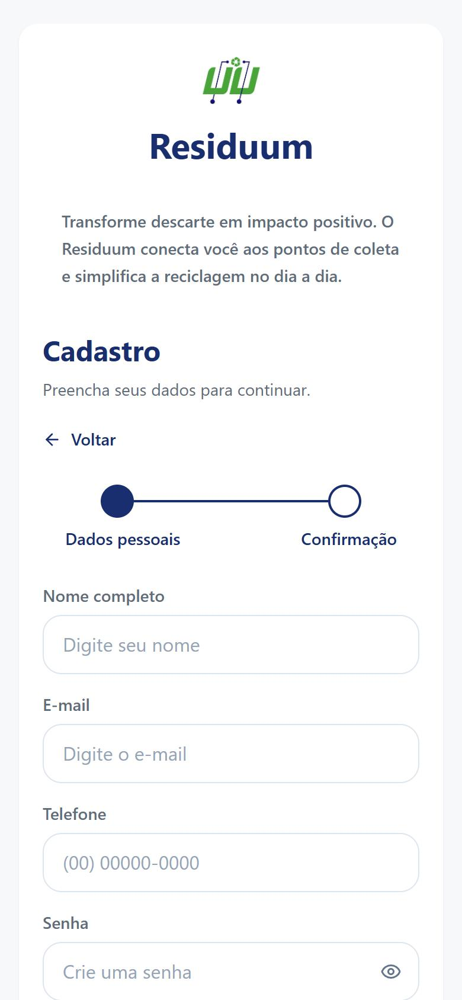 | 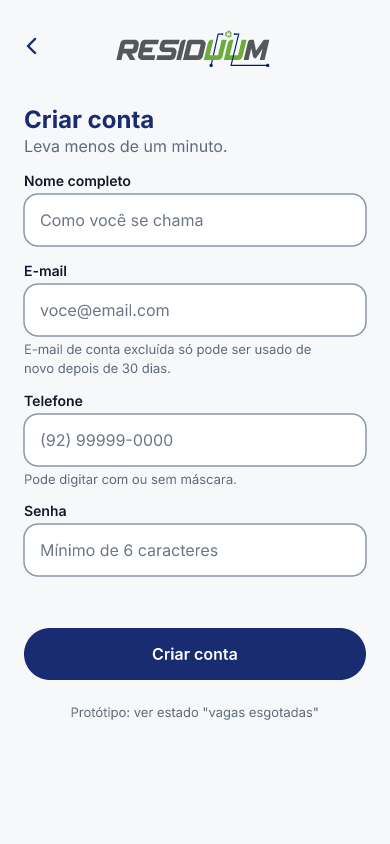 |

**Cadastro (U02):** o cadastro é aberto, sem código; menos campos por tela e aviso quando as vagas acabam.

| Leitura do código | Falha de leitura (2ª) | Fora do raio de 100 m |
|---|---|---|
| 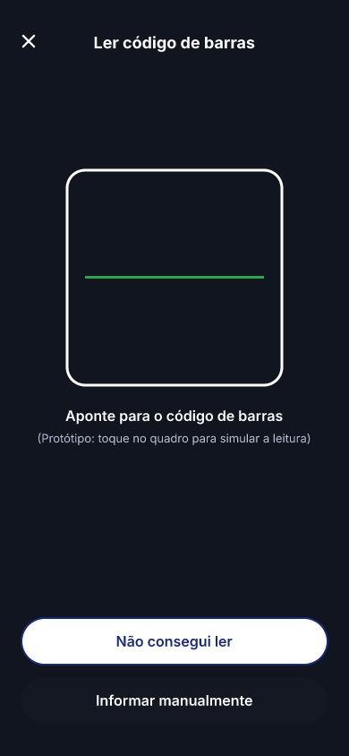 | 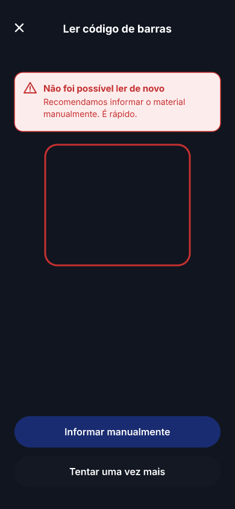 | 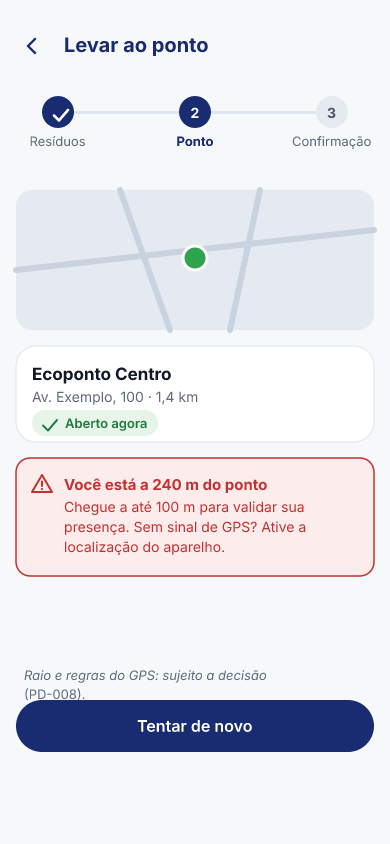 |

**Registro e entrega:** cada falha mostra um aviso vermelho; a partir da 2ª, o app recomenda o cadastro manual. Fora de 100 m do ponto, a entrega não é liberada.

### Perfis Responsável pelo ponto e Cooperativa (computador e celular)

Detalhe de cada tela: [cooperativa-e-ponto.md](prototipo/cooperativa-e-ponto.md).

| Módulo | Telas | O que resolve |
|---|---|---|
| **1 · Responsável: painel e entregas** | P01, P01c, P02, P02b, P08 | Painel, entregas a receber, confirmar (10 pontos, final) e rejeitar com motivo |
| **2 · Responsável: conferência, pontos e relatórios** | P03 a P05 | Conferência de descartes, pontos dos usuários e relatórios |
| **3 · Responsável: pedir coleta** | P06, P07 | Pedir coleta e acompanhar os estados |
| **4 · Cooperativa: painel e locais** | C01, C02 | Painel e pontos atendidos |
| **5 · Cooperativa: solicitações de coleta** | C03 a C06 | Aceitar, recusar com motivo e cancelar (admin e cooperativa) |
| **6 · Responsável no celular** | MP1 a MP4 | Entregas, pedido e conta |
| **7 · Cooperativa no celular** | MC1 a MC9 | Coleta "a caminho", registro por material (parcial) e lançamento avulso |

| Antes | Depois |
|---|---|
| 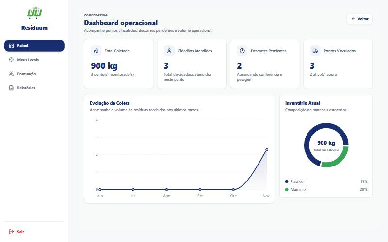 | 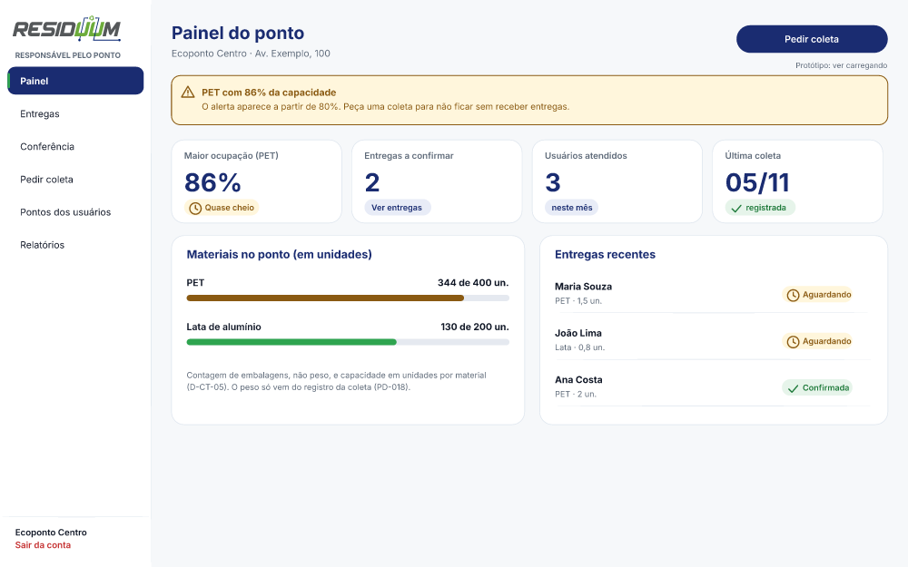 |

**Painel do ponto (P01):** unidades no lugar de kg, estados com texto e ícone e a ação "Pedir coleta" à vista.

| Solicitação aceita (C04b) | Registrar retirada (MC4) | Revisar (MC5) |
|---|---|---|
| 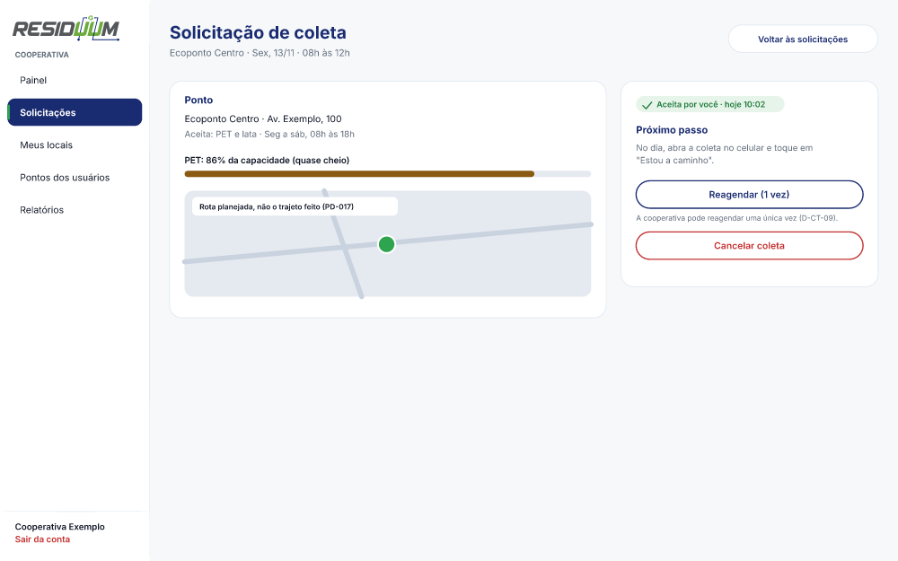 | 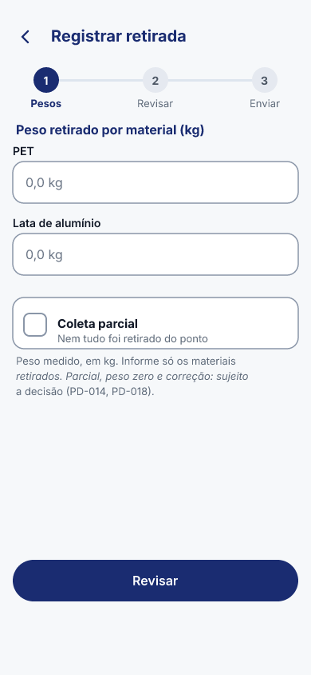 | 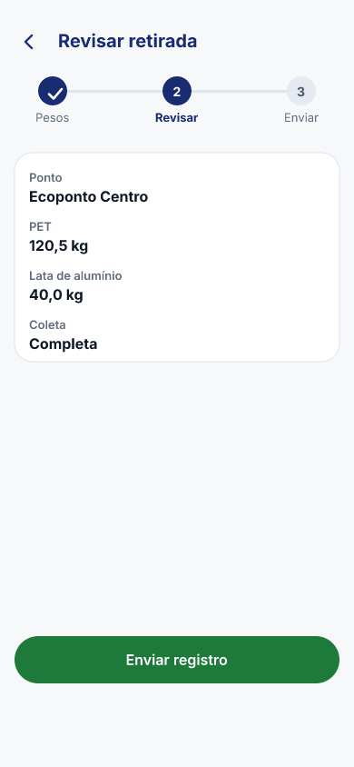 |

**Coleta:** a cooperativa aceita em até 48 h, marca "a caminho" e informa o que levou, por material. A coleta parcial é permitida.

### Perfil Administrador (computador, 1440 × 900)

Detalhe de cada tela: [administrador.md](prototipo/administrador.md).

| Módulo | Telas | O que resolve |
|---|---|---|
| **1 · Painel, usuários e vagas** | A01, A02, A02b, A02c, A02d | Painel, teto de contas, ajuste de pontos com motivo e lista de espera |
| **2 · Pontos e coletas** | A03, A03b, A04, A04b | Criar ponto (só o admin), raio do GPS, capacidade por material, solicitar coleta |
| **3 · Pagamento manual** | A05, A05b, A05c | Registrar o pagamento com comprovante, por kg e material |
| **4 · Campanhas** | A06, A06b, A07, A07b, A08 | Criar, excluir e acompanhar campanhas |
| **5 · Sorteios e vouchers** | A09, A09b | Sorteios de teste e cancelamento que devolve os pontos |
| **6 · Conferência e relatórios** | A10, A11 | Validar descartes, relatórios e auditoria |

| Painel (A01) | Teto de contas (A02b) |
|---|---|
| 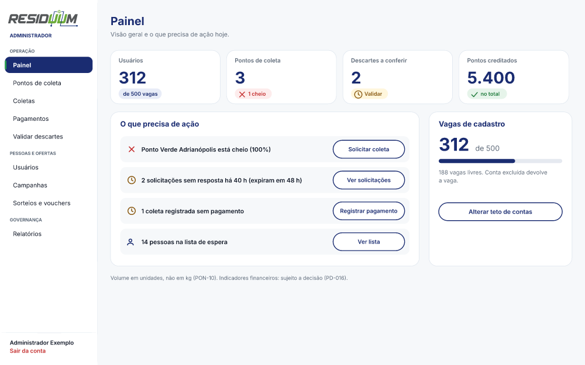 | 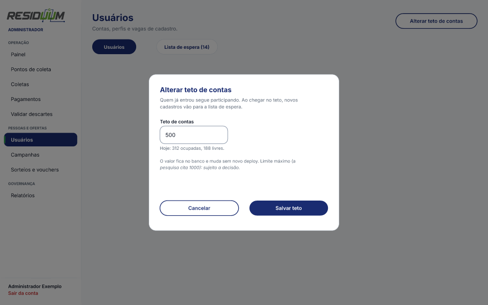 |

| Pagamento manual (A05b) | Cancelar sorteio (A09b) |
|---|---|
| 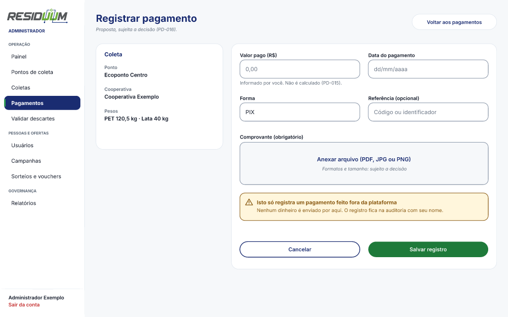 | 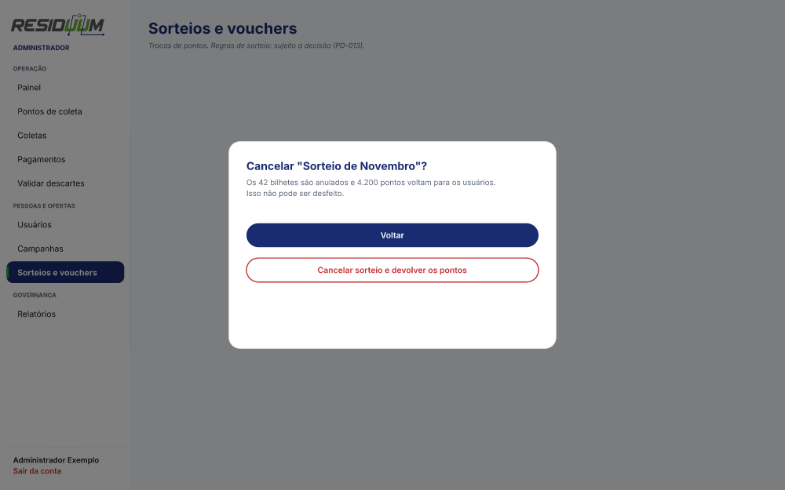 |

## 6. Os 23 fluxos

Um fluxo é um caminho de telas que se percorre clicando, no modo apresentação. A jornada central, **cadastrar, registrar o resíduo, entregar, ser confirmado, ganhar pontos e gastar na loja**, passa pelos fluxos do Usuário e pelo do Responsável, que confirma a entrega.

Em 14/11 o arquivo passou de 12 para **23 fluxos**: os 12 originais e **11 novos** (administrador, responsável e cooperativa no celular e no tablet). A tabela abaixo lista os 12 originais; os novos seguem o mesmo padrão, com o sufixo "(celular)" ou "(tablet)" no nome.

| Perfil | Fluxo | Começa em |
|---|---|---|
| Usuário | Entrar e usar o app | U01 Login |
| Usuário | Criar conta (cadastro aberto) | U02 Criar conta |
| Usuário | Adicionar resíduo e levar ao ponto | U05 Início |
| Usuário | Loja, sorteio e campanha | U19 Loja |
| Responsável | Painel, entregas e pedir coleta | P01 Painel do ponto |
| Cooperativa | Painel e solicitações | C01 Painel da cooperativa |
| Responsável (celular) | Entregas e pedido | MP1 Entregas a receber |
| Cooperativa (celular) | Da coleta aceita ao registro | MC1 Coletas |
| Administrador | Painel, usuários e vagas | A01 Painel |
| Administrador | Pontos e coletas | A03 Pontos de coleta |
| Administrador | Pagamento manual | A05 Pagamentos |
| Administrador | Campanhas e sorteios | A06 Campanhas |

Os diagramas dos caminhos de cada perfil estão nos documentos por perfil.

## 7. Para o desenvolvimento (handoff)

| Item | Regra |
|---|---|
| **Tokens** | Cores e tipografia da seção 3. Os ajustes marcados "novo" (verde de botão e placeholder) precisam entrar em `src/index.css` |
| **Rotas** | Cada tela do app atual tem sua rota no [índice de telas](indice-de-telas.md); cada quadro do arquivo leva a rota no nome do "antes" |
| **Regras de negócio** | Estão em [decisões pendentes](../00-diagnostico/decisoes-pendentes.md) (seção "Já decidido"); cada nota de correção cita a PD ou a decisão que a originou |
| **Telas removidas** | `/campanha-heineken`, `/cadastro-ponto-coleta`, `/empresa`, `/confirmacao` e a aba "Solicitações pendentes" de `/admin-pontos` |
| **Estados** | Desenhados em 14/11 para 3 telas de cada perfil, no celular e no tablet (vazio, carregando e erro); os textos são **propostas**, sujeitas a aprovação. As demais telas e o computador ainda não têm estados |
| **Dados** | Todos os dados do protótipo são fictícios |

## 8. Como abrir, apresentar e exportar

1. Abra `tmp/figcraft/residuum-v7.figcraft` no aplicativo **FigCraft**. A pasta `tmp/` **não está no repositório**; ao trocar de computador, leve-a em ZIP.
2. Comece pela página **1 · Comece aqui**, entre no **modo apresentação** e siga os 23 fluxos. As ligações foram conferidas por consulta, mas **o modo apresentação ainda não foi testado com cliques reais**.
3. Para o Figma: selecione os quadros **DEPOIS** e use **Exportar**, formato **SVG**. O texto sai como contorno (não editável); para manter o texto editável, exporte com texto como `<text>` e instale a fonte **Inter**. No Figma, arraste os `.svg` para a área de trabalho. `[VERIFICAR]` a importação não foi testada.
4. O SVG leva só o **desenho**: não leva ligações de clique, componentes nem variáveis. Os SVG que existem em `tmp/figcraft/svg*` são de 12/11 (v6): **exporte de novo**.

Arquivos de apoio em `tmp/figcraft/`: `residuum-v7-por-perfil.figcraft` (organização anterior, por perfil), `residuum-v8.figcraft` (intermediário), `residuum-v7-antes-da-reorganizacao.figcraft`, `residuum-v6.figcraft`, `revisao-geral.md`, três índices de correções, `logo/`, `export/` e `screenshots/`. As **imagens** deste documento estão em [prototipo/img](prototipo/img/).

## 9. Estado da entrega e limites

| Item | Situação |
|---|---|
| Estrutura (9 páginas: tamanhos, comparativos, tokens, para decidir) | ✅ Feita em 13/11 e ampliada em 14/11 |
| Telas e fluxos | ✅ Celular 77, tablet 75 e computador 82 telas, de todos os perfis; 23 fluxos |
| Erro, por quê e como fica | ✅ Em uma nota logo abaixo de cada captura do antigo (páginas de comparativo) |
| Três larguras por tela | ✅ Os 4 perfis têm celular, tablet e computador desenhados (seção 10) |
| Navegação alinhada | ✅ Responsável (5 itens) e cooperativa (5 itens) iguais nas telas antigas e novas |
| Quantidades | ✅ Em unidades inteiras ("1 un.") em todas as telas; as notas de correção mantêm o exemplo antigo |
| Biblioteca de componentes | ✅ 6 conjuntos com variantes; as telas existentes ainda não usam instâncias |
| Estados de vazio, erro e carregando | 🟡 72 telas (3 por perfil, celular e tablet); falta o computador e as demais telas. Textos são propostas |
| Comparativos | 🟡 Sem as telas novas de administrador, responsável e cooperativa no celular e no tablet |
| Modo apresentação | ⬜ Não testado com cliques reais |
| Exportação dos SVG do v7 e importação no Figma | ⬜ Pendente |
| Itens sem destino | O item "Conta" da cooperativa no celular não leva a tela; alguns itens do menu do tablet levam às telas antigas em coluna central |
| Fora do desenho | Aba "Vouchers", passo 3 de nova campanha, detalhe completo da campanha, landing |
| Toque | O menu lateral do Administrador (40 px) e "Editar" e "Mais" nas tabelas ficaram abaixo de 44 px |
| Capturas "antes" de 1440 px | Baixa resolução (800 × 500, esticadas) |

## 10. Três larguras

Os 4 perfis existem em **três tamanhos**, cada um em sua página: **celular (390 × 844)**, **tablet (768 × 1024)** e **computador (1440 × 900)**.

| Tamanho | Como é desenhado |
|---|---|
| Celular | Barra inferior (5 itens por perfil), cartões no lugar de tabelas, botões de 44 px ou mais |
| Tablet | Menu lateral de 208 px, conteúdo em 1 ou 2 colunas. O usuário segue a coluna central de 390 px, com margens |
| Computador | Menu lateral e tabelas, em 1440 × 900 |

**Estados:** os blocos "ESTADOS" das páginas de celular e tablet trazem vazio, carregando e erro de 3 telas por perfil.

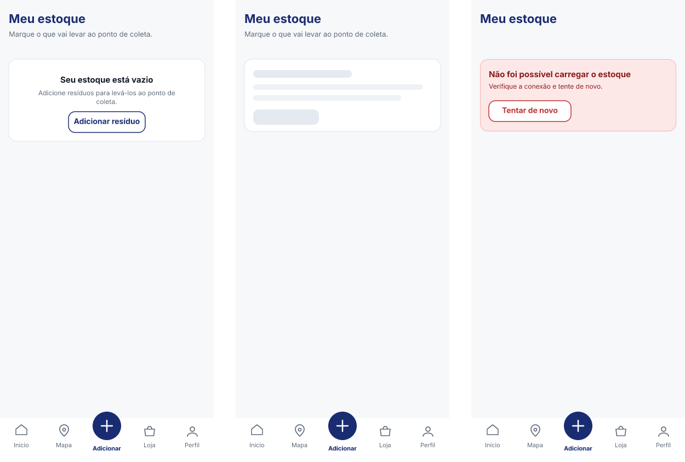

**Limites:** algumas telas antigas do tablet (Entregas, Pedir coleta, Solicitações da cooperativa) ainda usam a coluna central e não o menu lateral; as cópias nas páginas de tablet e computador mostram a barra nova, mas sem links.
