# Protótipo FigCraft: perfil Usuário (celular)

[Voltar ao protótipo](../prototipo-figcraft.md)

> **Estado:** revisão · **Dono:** UX · **Atualizado em:** 13/11/2026
> **Arquivo:** `residuum-v7.figcraft`, página **Usuário (390 px)** · **Tamanho das telas:** celular, 390 × 844
> **Fontes:** `indice-correcoes-usuario.md` e `revisao-geral.md` do FigCraft; as regras vêm das decisões de 11 e 12/11/2026.

## Resumo

O perfil Usuário tem **31 telas** desenhadas, em **4 fluxos**. Em cada tela o protótipo mostra o **antes** (captura do app atual), o **depois** (novo desenho, clicável) e uma **nota** com o erro, o porquê e como ficou. As telas do perfil que não entraram nesta etapa estão no fim.

## Os fluxos (caminhos)

Os diagramas mostram o **caminho esperado** entre as telas. As ligações exatas de clique estão no arquivo FigCraft e ainda não foram testadas em modo apresentação.

### Fluxo 1: entrar e usar o app

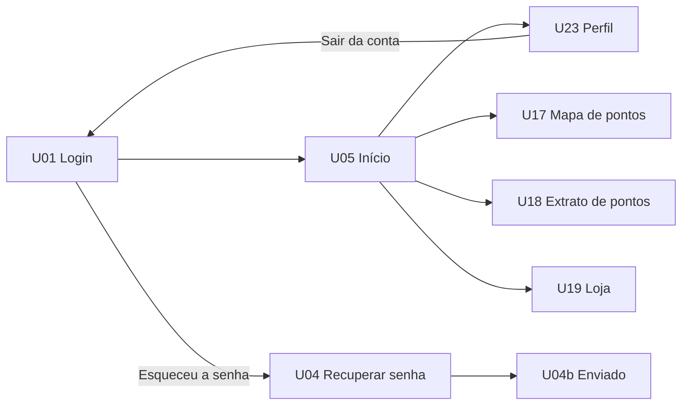

### Fluxo 2: criar conta (cadastro aberto)

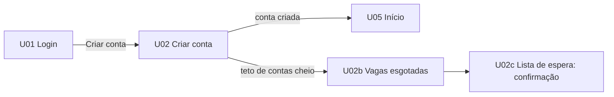

### Fluxo 3: adicionar resíduo e levar ao ponto

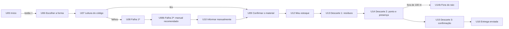

### Fluxo 4: loja, sorteio e campanha

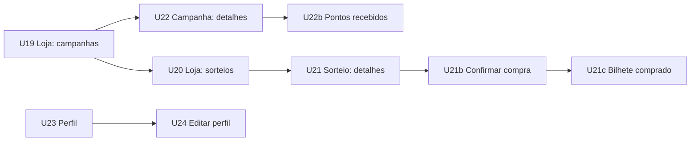

## As 31 telas

| Quadro | Tela |
|---|---|
| U01 · U02 · U02b · U02c | Login · criar conta · vagas esgotadas · lista de espera |
| U04 · U04b | Recuperar senha · e-mail enviado |
| U05 | Início |
| U06 · U07 · U08 · U08b · U09 · U10 | Adicionar resíduo: escolher a forma, leitura, falhas, material, manual |
| U12 · U12b | Meu estoque · item adicionado |
| U13 · U14 · U14b · U15 · U16 | Descarte em 3 passos, fora do raio e entrega enviada |
| U17 · U18 | Mapa de pontos · extrato |
| U19 · U20 · U21 · U21b · U21c · U22 · U22b | Loja, sorteios, campanhas |
| U23 · U24 | Perfil · editar perfil |

## Antes e depois, tela por tela

Cada bloco traz o **antes** e o **depois** lado a lado e, abaixo, as correções: **Erro** (o que estava errado), **Por quê** (a lei de UX que explica; veja o [glossário](../prototipo-figcraft.md#as-leis-de-ux-em-uma-frase)) e **Como fica**.

### U01 Login

*Rota no app atual: `/login`*

| Antes (app atual) | Depois (novo desenho) |
|---|---|
| 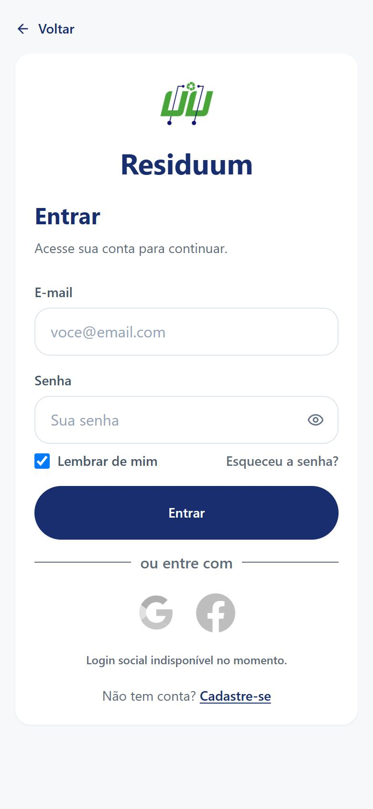 | 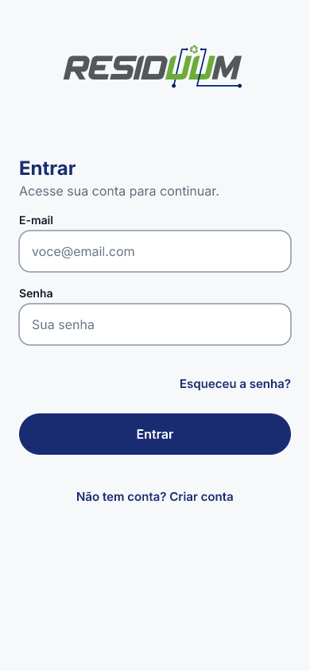 |

- **C01** · Jakob, Hick · UX
  - **Erro:** Botões Google e Facebook em cinza, sem função, com o aviso "Login social indisponível".
  - **Por quê:** Jakob: ícone de login social é padrão e o usuário espera que funcione; um ícone que não responde quebra a expectativa. Hick: opções sem uso aumentam a decisão.
  - **Como fica:** Removidos os botões sociais e o aviso. Ficam e-mail, senha e Entrar.
- **C02** · Fitts, WCAG AA · UX
  - **Erro:** "Esqueceu a senha?" e "Cadastre-se" são links de texto com cerca de 20 px de altura. O placeholder usa slate-400 (#94A3B8, contraste 2,6:1 sobre branco).
  - **Por quê:** Fitts: alvos de toque pequenos geram erro de clique (mínimo 44 px). WCAG AA exige 4,5:1 em texto pequeno.
  - **Como fica:** Links com área de toque de 48 px de altura. Placeholder em #6B7686 (4,6:1) e rótulo sempre visível acima do campo.

### U02 Criar conta (cadastro aberto)

*Rota no app atual: `/cadastro`*

| Antes (app atual) | Depois (novo desenho) |
|---|---|
| 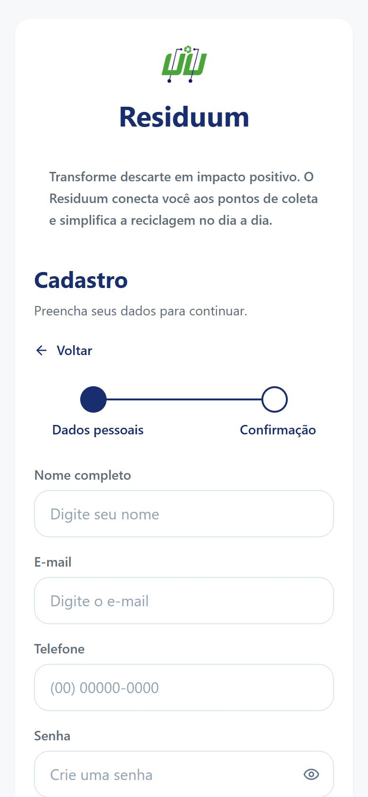 | 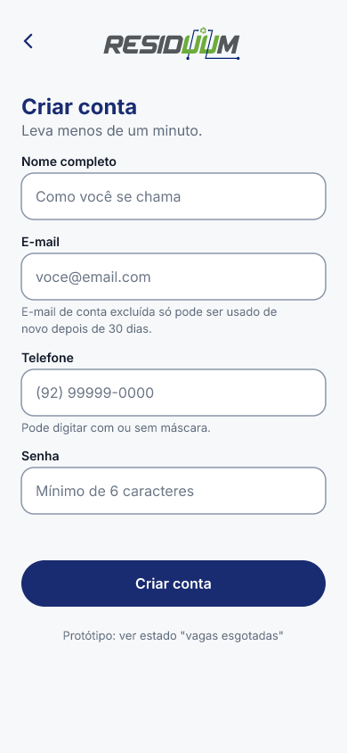 |

- **C03** · Hick, Miller · UX + decisão de 12/11 (PD-001 e PD-002 revistos: cadastro aberto, sem código)
  - **Erro:** Parágrafo de apresentação antes dos campos, botão "Voltar" solto e indicador de 2 etapas para 4 campos. Não há aviso quando as vagas acabam.
  - **Por quê:** Hick: etapa extra e texto antes do formulário atrasam o cadastro. Miller: 4 campos cabem agrupados em uma tela. Decisão de 12/11: o código individual foi descartado; o cadastro é aberto, com teto de 500 contas (pode subir a 1000), aviso e lista de espera quando lotar. Conta excluída devolve a vaga.
  - **Como fica:** Uma tela "Criar conta" com 4 campos e a logo oficial. Teto cheio: aviso "As vagas acabaram" e lista de espera por e-mail (U02b, U02c). Regra de e-mail excluído (30 dias) como dica no campo (D-CT-03).

### U04 Recuperar senha

*Rota no app atual: `/recuperar-senha`*

| Antes (app atual) | Depois (novo desenho) |
|---|---|
| 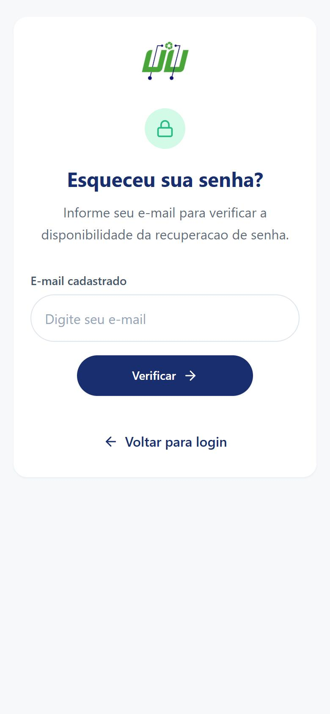 | 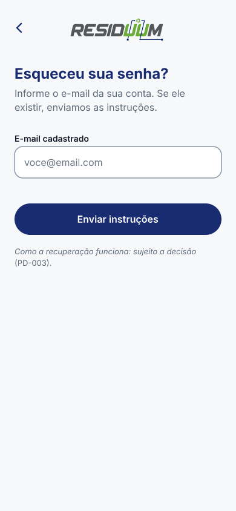 |

- **C04** · Jakob, Doherty · UX (PD-003)
  - **Erro:** Texto "verificar a disponibilidade da recuperacao" (sem acento) e botão "Verificar" que só mostra um aviso.
  - **Por quê:** Jakob: recuperar senha segue o padrão "informe o e-mail, receba instruções". Doherty: o usuário precisa de resposta clara do resultado.
  - **Como fica:** Título e texto corrigidos, botão "Enviar instruções" e tela de retorno "Confira seu e-mail" (U04b).

### U05 Início

*Rota no app atual: `/inicio`, `/inicio e todas as telas do Usuário`*

| Antes (app atual) | Depois (novo desenho) |
|---|---|
| 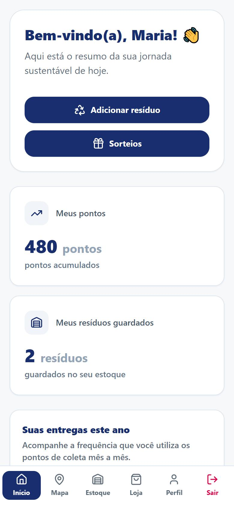 | 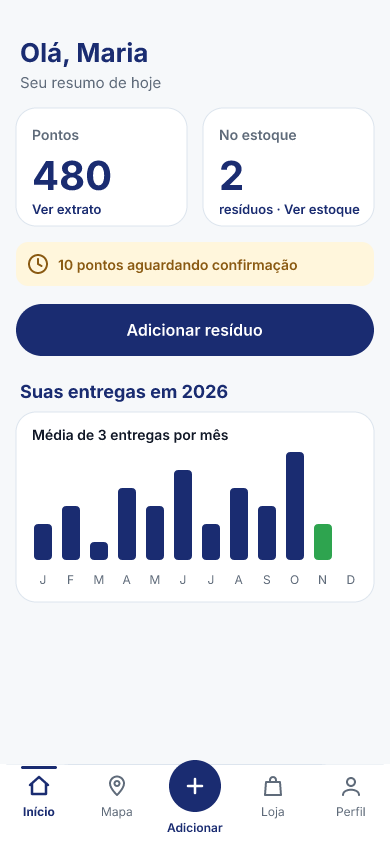 |

- **C05** · Miller, Hick · UX
  - **Erro:** Cinco blocos empilhados: boas-vindas, dois botões azuis iguais (Adicionar resíduo e Sorteios), cartão de pontos e cartão de estoque. O gráfico fica abaixo da dobra.
  - **Por quê:** Miller: agrupar números relacionados em cards lado a lado. Hick: dois botões primários idênticos competem; a ação principal é adicionar resíduo.
  - **Como fica:** Pontos e estoque lado a lado, cada um clicável (extrato e estoque). Um único botão primário. Sorteios saem da Início e ficam na Loja.
- **C06** · Jakob, Hick, Fitts · UX + decisão 11/11 (Visão)
  - **Erro:** Barra inferior com 6 itens, incluindo "Sair" em vermelho ao lado de Perfil. O estoque ocupa um dos 6 espaços.
  - **Por quê:** Jakob: apps usam 4 a 5 destinos e ação de sair dentro do perfil. Hick: menos itens, escolha mais rápida. Fitts: "Sair" colado a Perfil causa toque acidental.
  - **Como fica:** Barra com 4 destinos e botão "+" no centro (código de barras, QR da nota, manual). Sair vai para o Perfil. Item ativo marcado por texto em negrito, ícone e traço superior, não só pela cor.
- **C07** · WCAG AA · UX
  - **Erro:** A palavra "pontos" ao lado do número usa text-slate-400 (#94A3B8): contraste 2,6:1. "pontos" aparece três vezes no mesmo cartão.
  - **Por quê:** WCAG AA exige 4,5:1 para texto pequeno. Repetição obriga a ler mais.
  - **Como fica:** Cartão com "Pontos" no rótulo e só o número grande. Textos de apoio em #5F6B7A (5,4:1).

### U10 Informar manualmente

*Rota no app atual: `/cadastrar-residuo`*

| Antes (app atual) | Depois (novo desenho) |
|---|---|
| 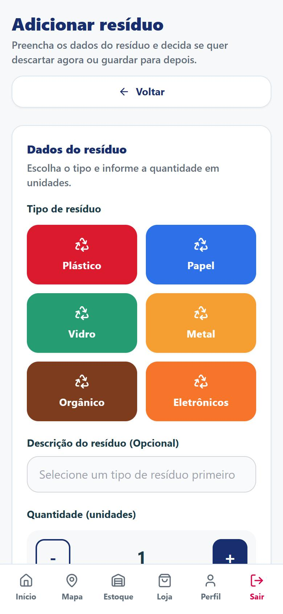 | 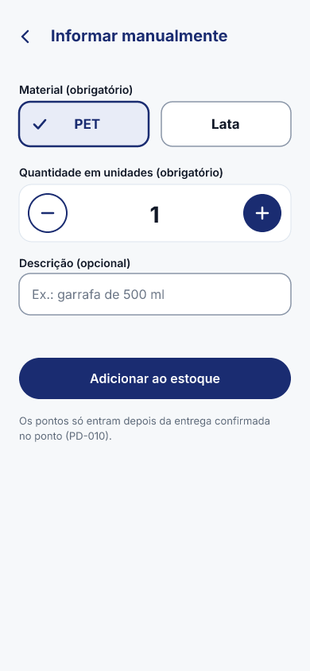 |

- **C08** · Hick, Jakob, Postel · UX + decisão 11/11 (PD-004)
  - **Erro:** Seis botões coloridos (vermelho, azul, verde, laranja, marrom) com o mesmo ícone de reciclagem. Seleção só pela cor. Botão "Voltar" ocupa a largura toda.
  - **Por quê:** Hick: seis materiais para um MVP de PET e lata. Jakob: cor sem significado padrão não identifica material. Postel: aceitar a escolha e confirmar o material.
  - **Como fica:** Duas opções, PET e lata, com texto e marca de seleção. Voltar vira seta no cabeçalho. Fluxo novo: "+" abre código de barras, QR ou manual; a leitura sempre pede confirmar o material.

### U08 Falha de leitura (1ª)

*Rota no app atual: `leitura do código (tela nova)`*

| Antes (app atual) | Depois (novo desenho) |
|---|---|
|  | 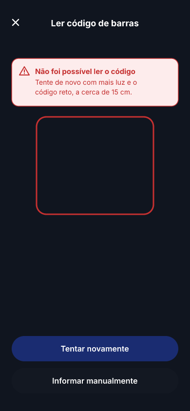 |

- **C09** · Doherty · Decisão 11/11 (PD-004)
  - **Erro:** Não existe tela de leitura com aviso de falha.
  - **Por quê:** Doherty: a falha precisa de feedback imediato e claro, com próximo passo.
  - **Como fica:** Aviso vermelho a cada falha (U08). A partir da 2ª falha, recomenda o modo manual (U08b).

### U12 Meu estoque

*Rota no app atual: `/meu-estoque`*

| Antes (app atual) | Depois (novo desenho) |
|---|---|
| 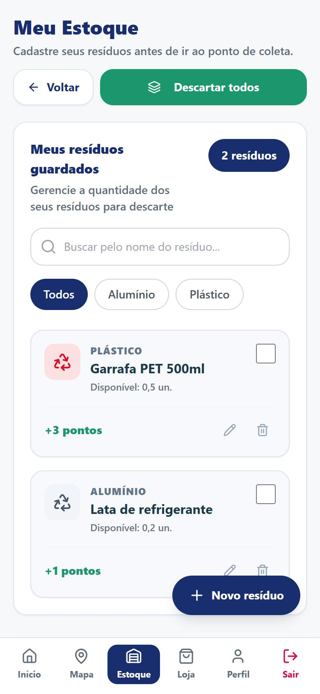 | 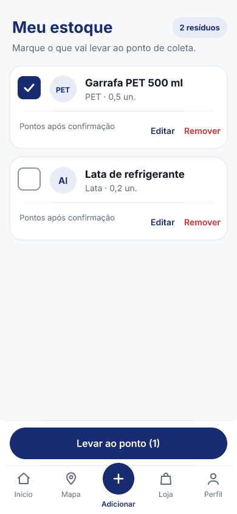 |

- **C10** · Fitts · UX
  - **Erro:** Ícones de editar e excluir com 32 px (h-8 w-8). Botão flutuante "Novo resíduo" cobre as ações do 2º item.
  - **Por quê:** Fitts: alvos abaixo de 44 px e sobrepostos aumentam erro, e excluir é destrutivo.
  - **Como fica:** Ações "Editar" e "Remover" em texto com 48 px de altura. Sem botão flutuante: adicionar fica no "+" da barra.
- **C11** · Hick, Miller · UX
  - **Erro:** Botão "Descartar todos" sempre em destaque, busca e filtros para 2 itens, e "+3 pontos" em item ainda não entregue.
  - **Por quê:** Hick: ação em massa sem seleção induz erro; busca e filtros em lista curta são ruído. Miller: lista curta dispensa filtro.
  - **Como fica:** Marcar itens e barra fixa "Levar ao ponto (n)". Sem busca nem filtros. O texto de pontos por item sai (ver C12).
- **C12** · sem lei (decisão) · Decisão 11/11 (PD-010)
  - **Erro:** Mostra "+N pontos" por item não entregue.
  - **Por quê:** Decisão de 11/11: os 10 pontos só aparecem depois da confirmação do operador. (Mudança de regra, não é achado de UX.)
  - **Como fica:** Texto "Pontos após a entrega confirmada" no lugar do valor.

### U13 Descarte - 1 Resíduos

*Rota no app atual: `/validacao-presenca`*

| Antes (app atual) | Depois (novo desenho) |
|---|---|
| 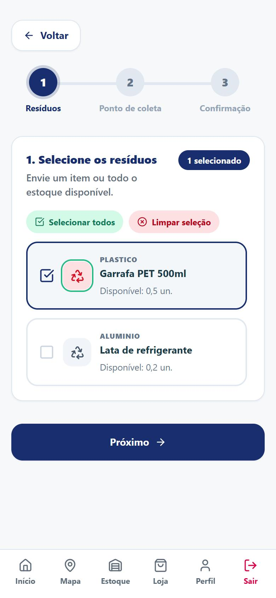 | 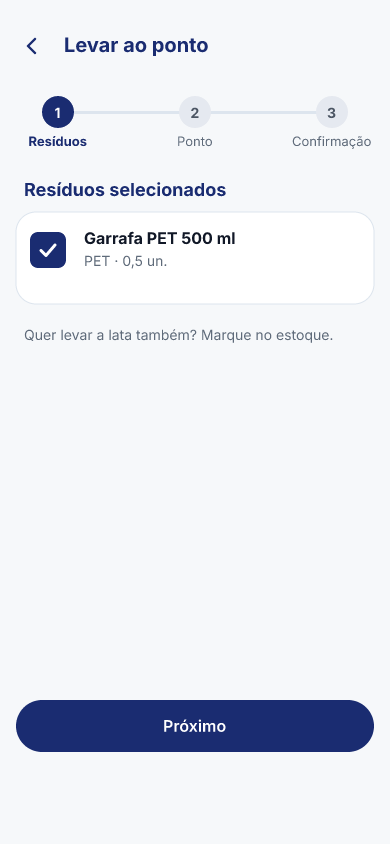 |

- **C13** · Fitts, Miller, WCAG AA · UX
  - **Erro:** Rótulos "PLASTICO" e "ALUMINIO" sem acento em caixa alta de 12 px. Checkbox de 24 px. Botões "Selecionar todos" e "Limpar seleção" coloridos em verde e vermelho.
  - **Por quê:** Fitts: checkbox pequeno. Miller: dois controles de seleção para 2 itens. WCAG: texto 12 px em caixa alta cinza tem leitura ruim.
  - **Como fica:** Etapas 1 a 3 com texto, itens já escolhidos no estoque, alvo de 48 px, rótulos com acento e sem os atalhos de seleção.

### U14 Descarte - 2 Ponto e presença

*Rota no app atual: `/validacao-presenca (passo 2)`*

| Antes (app atual) | Depois (novo desenho) |
|---|---|
|  | 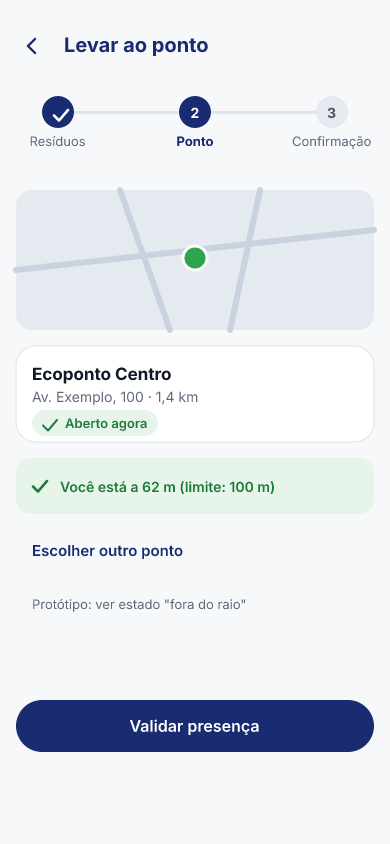 |

- **C14** · Doherty · Decisão 11/11 (PD-008)
  - **Erro:** Passo 2 trava sem GPS (F08) e não há raio definido na tela.
  - **Por quê:** Doherty: o usuário precisa saber distância e o que fazer. Decisão: raio de 100 m.
  - **Como fica:** Mostra "62 m (limite 100 m)". Fora do raio (U14b): erro com instrução.

### U16 Entrega enviada

*Rota no app atual: `/transferencia-concluida`*

| Antes (app atual) | Depois (novo desenho) |
|---|---|
| 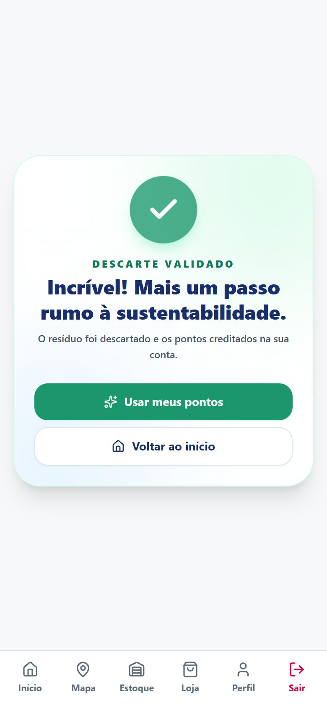 | 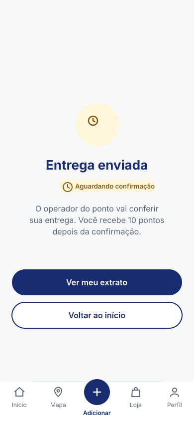 |

- **C15** · Doherty · Decisão 11/11 (PD-010)
  - **Erro:** Diz "Descarte validado" e "pontos creditados", mas os pontos só entram depois do operador confirmar. Botão verde emerald-600 com texto branco (3,8:1).
  - **Por quê:** Doherty: feedback correto do estado. Decisão: 10 pontos só depois da confirmação. WCAG: 3,8:1 abaixo de 4,5:1.
  - **Como fica:** Título "Entrega enviada" com selo "Aguardando confirmação" e ícone de relógio. Botão primário "Ver meu extrato". Verde de botões escurecido para #1E7A3A (5,4:1).

### U17 Mapa de pontos

*Rota no app atual: `/mapa`*

| Antes (app atual) | Depois (novo desenho) |
|---|---|
| 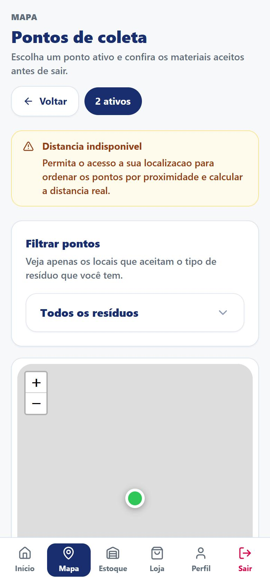 | 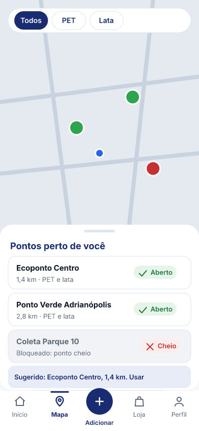 |

- **C16** · Jakob, Miller · UX + decisão 11/11 (PD-009)
  - **Erro:** Aviso amarelo de GPS, filtro e título ocupam a tela antes do mapa (o mapa só aparece abaixo da dobra). Textos sem acento ("Distancia indisponivel", "localizacao"). Não mostra ponto cheio.
  - **Por quê:** Jakob: mapas mostram o mapa primeiro e a lista em folha inferior. Miller: lista curta de pontos com estado em texto. Decisão: ponto cheio bloqueado e sugestão de outro.
  - **Como fica:** Mapa em tela cheia, filtro em chips (Todos, PET, Lata) e folha com a lista. Ponto "Cheio" em texto e ícone, bloqueado, com sugestão de ponto compatível.

### U18 Extrato de pontos

*Rota no app atual: `/extrato`*

| Antes (app atual) | Depois (novo desenho) |
|---|---|
| 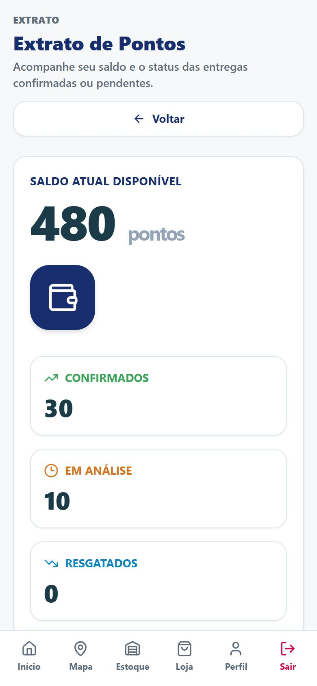 | 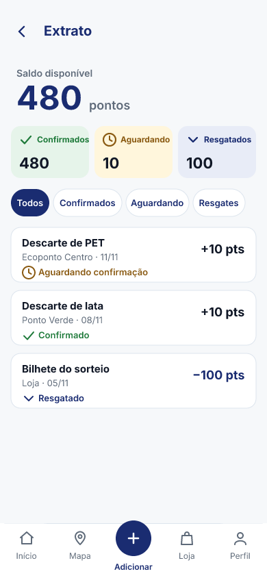 |

- **C17** · Miller, Fitts · UX + decisão 11/11 (PD-010)
  - **Erro:** Saldo com 48 px e ícone de carteira gigante abaixo; três cartões empilhados (Confirmados, Em análise, Resgatados) empurram a lista para fora da tela. Botão "Voltar" de largura total.
  - **Por quê:** Miller: três totais lado a lado se leem de uma vez. Fitts: o botão grande ocupa espaço sem ajudar.
  - **Como fica:** Saldo compacto, três totais em linha com ícone e texto, abas de filtro e lista. Pontos de entrega pendentes aparecem como "Aguardando confirmação" (PD-010).

### U19 Loja - Campanhas

*Rota no app atual: `/loja`*

| Antes (app atual) | Depois (novo desenho) |
|---|---|
| 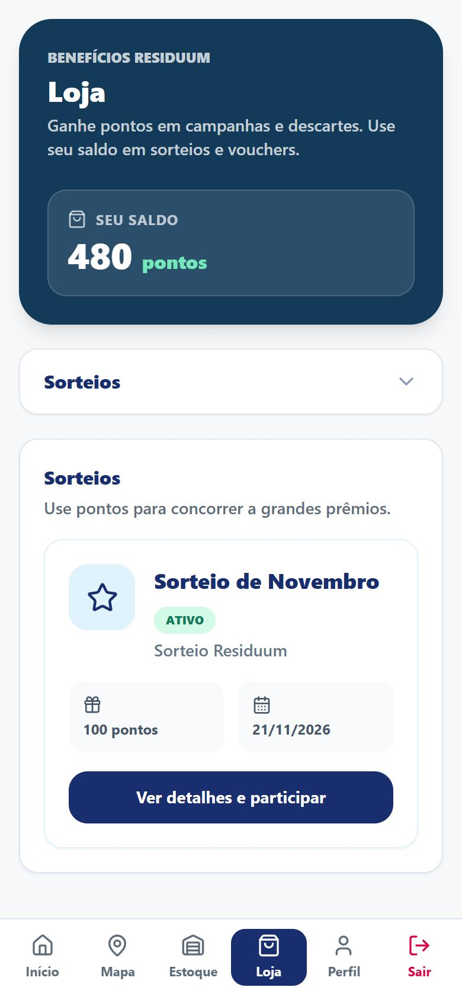 | 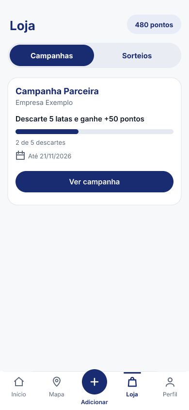 |

- **C18** · Jakob, Hick · UX
  - **Erro:** Para trocar entre Campanhas e Sorteios há um seletor que mostra "Sorteios" e repete o mesmo título no cartão abaixo. Cabeçalho azul ocupa 1/3 da tela. Texto "grandes prêmios".
  - **Por quê:** Jakob: duas seções irmãs usam abas, não lista suspensa. Hick: um toque a menos para trocar de seção. "Grandes prêmios" promete o que ainda não foi decidido (PD-013).
  - **Como fica:** Abas "Campanhas" e "Sorteios" fixas, saldo em selo no topo e texto "Troque pontos por bilhetes dos sorteios".

### U21 Sorteio - detalhes

*Rota no app atual: `/sorteios/:id`*

| Antes (app atual) | Depois (novo desenho) |
|---|---|
|  | 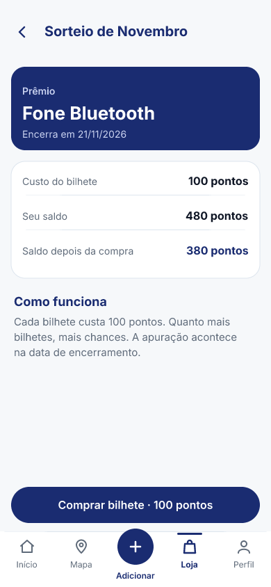 |

- **C19** · Jakob · UX (F17)
  - **Erro:** A compra do bilhete debita pontos sem confirmar o valor.
  - **Por quê:** Jakob: compras pedem confirmação com valor e saldo depois.
  - **Como fica:** Resumo com custo, saldo e saldo depois, e folha "Confirmar compra" (U21b) antes de gastar.

### U22 Campanha - detalhes

*Rota no app atual: `/loja/campanhas/:id`*

| Antes (app atual) | Depois (novo desenho) |
|---|---|
| 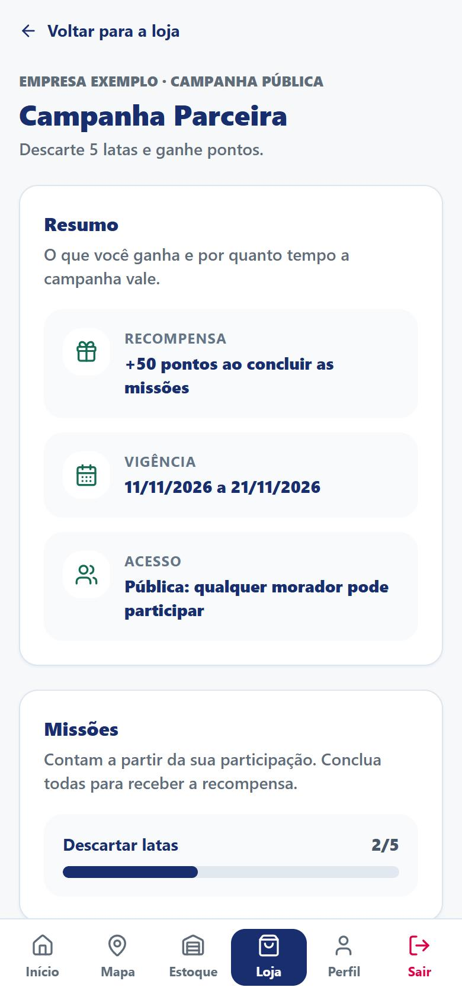 | 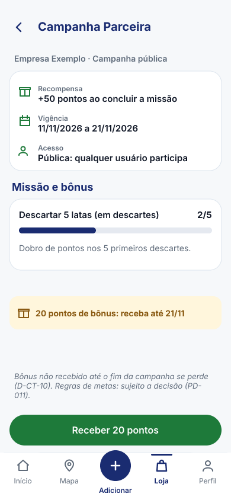 |

- **C20** · Miller, Fitts · UX + decisão 11/11 (PD-011)
  - **Erro:** Três cartões de informação empilhados (Recompensa, Vigência, Acesso) deslocam a missão para baixo. Sem botão de receber pontos. Texto "qualquer morador".
  - **Por quê:** Miller: agrupar três fatos relacionados em um card. Fitts: ação principal fixa ao alcance do polegar. Decisão: meta em descartes, botão "Receber pontos" e aviso de bônus.
  - **Como fica:** Um card com três linhas, missão em descartes, aviso de bônus esperando e botão fixo "Receber 20 pontos". "Usuário" no lugar de "morador".

### U23 Perfil

*Rota no app atual: `/perfil`*

| Antes (app atual) | Depois (novo desenho) |
|---|---|
| 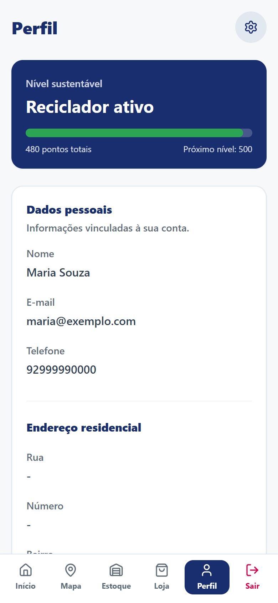 | 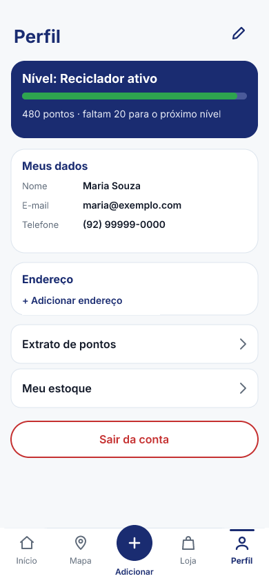 |

- **C21** · Miller, Jakob · UX
  - **Erro:** Cinco campos de endereço aparecem como "-" mesmo vazios. Não há "Sair" (ele está na barra de navegação).
  - **Por quê:** Miller: dados vazios em lista longa viram ruído; agrupar em cards. Jakob: sair fica no perfil.
  - **Como fica:** Cards "Meus dados" e "Endereço" (estado vazio com "Adicionar endereço"), atalhos para extrato e estoque, e botão "Sair da conta".

## Telas novas, só com o depois

Estas telas não existem no app atual, por isso não têm "antes".

| **U06** Adicionar, escolher forma | **U07** Leitura do código | **U08b** Falha de leitura (2ª) |
|---|---|---|
| 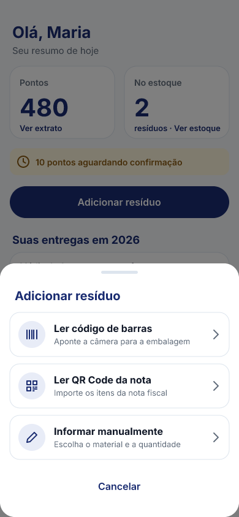 | 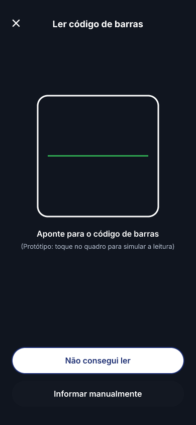 | 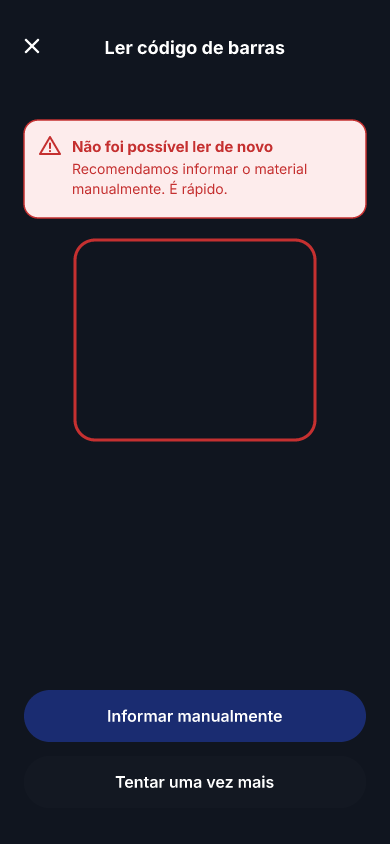 |

| **U09** Confirmar o material | **U12b** Meu estoque, item adicionado | **U14b** Descarte 2, fora do raio |
|---|---|---|
| 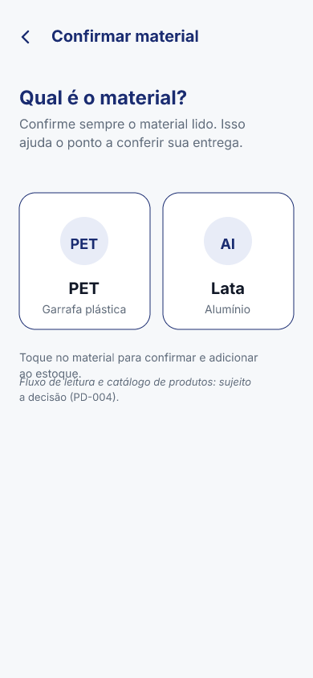 | 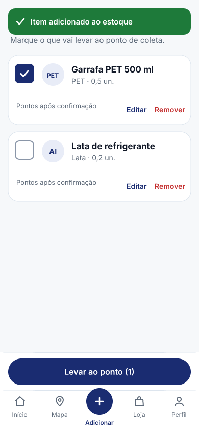 | 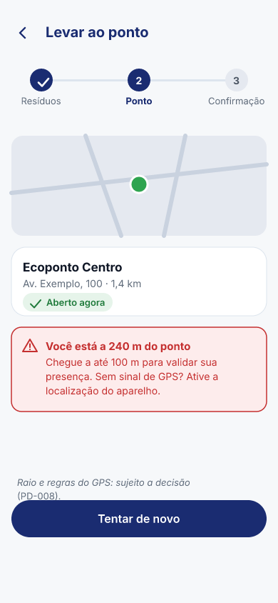 |

| **U15** Descarte 3, confirmação | **U20** Loja, sorteios | **U21b** Sorteio, confirmar compra |
|---|---|---|
| 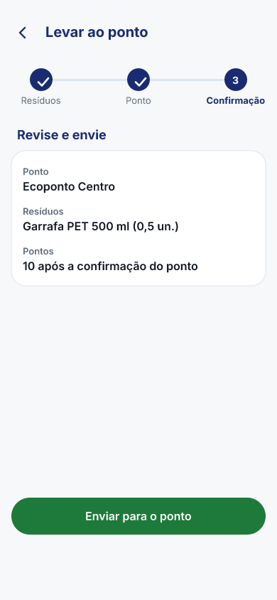 | 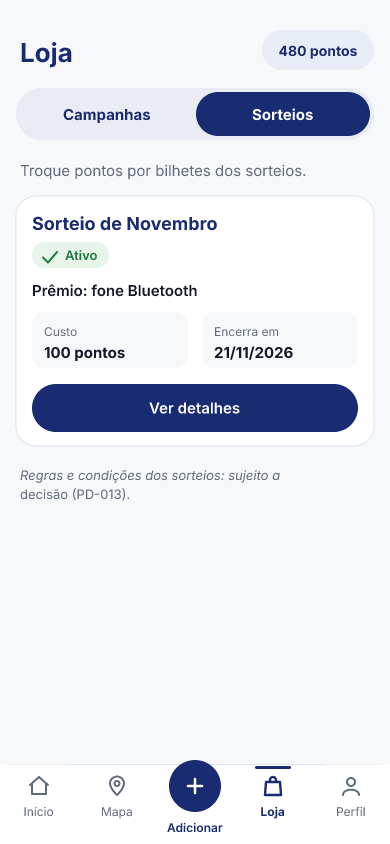 | 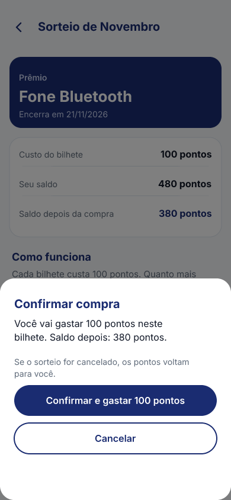 |

| **U21c** Sorteio, bilhete comprado | **U22b** Campanha, pontos recebidos | **U24** Editar perfil |
|---|---|---|
| 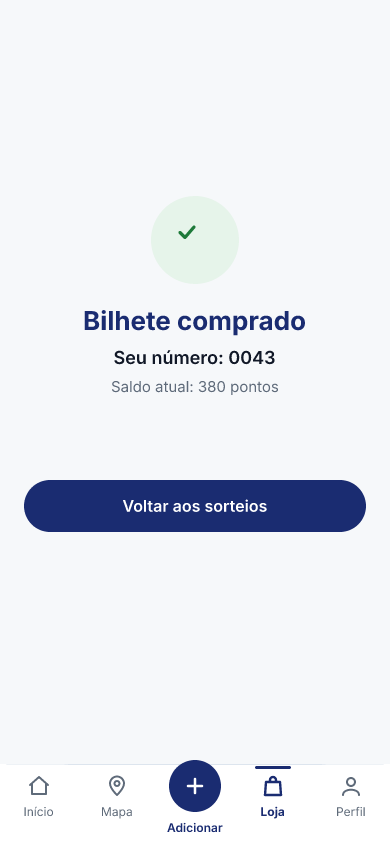 | 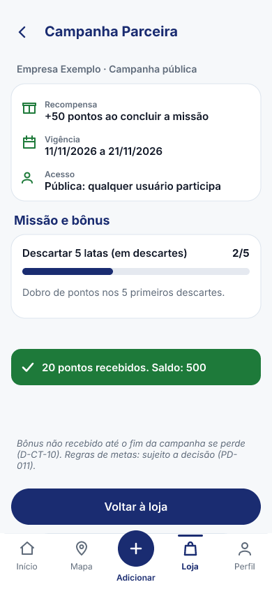 | 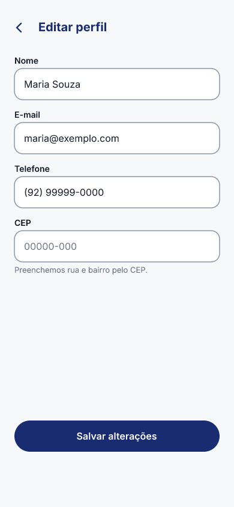 |

| **U02b** Teto cheio, lista de espera | **U02c** Lista de espera, confirmação | **U04b** Recuperar senha, enviado |
|---|---|---|
| 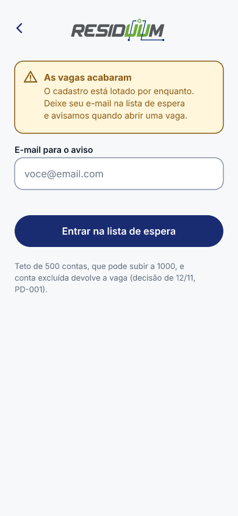 | 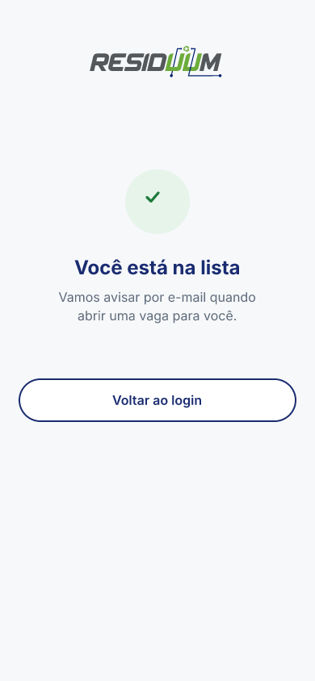 | 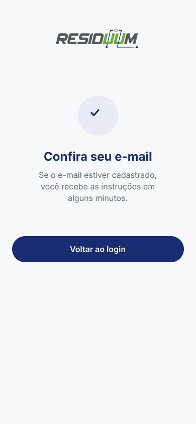 |

## De onde vêm as telas novas

Estas telas não existem no app atual; foram desenhadas a partir das regras decididas.

| Quadro | Tela | Regra de origem |
|---|---|---|
| U02b, U02c | Teto de contas cheio: aviso "As vagas acabaram", lista de espera e confirmação | Cadastro aberto com teto (12/11) |
| U06 | Folha do botão "+": código de barras, QR da nota, manual | Visão |
| U07, U08, U08b | Leitura do código, falha (1ª) e falha (2ª, recomenda o manual) | PD-004 |
| U09 | Confirmar o material (PET ou lata) | PD-004 |
| U04b | Retorno da recuperação de senha | PD-003 |
| U12b | Estoque com aviso de item adicionado | Só UX |
| U14b | Fora do raio de 100 m | PD-008 |
| U15 | Descarte, passo 3: confirmação | Só UX |
| U20 | Loja: sorteios | PD-013 |
| U21b, U21c | Confirmar compra do bilhete e bilhete comprado | PD-013 |
| U22b | Pontos do bônus recebidos | PD-011 |
| U24 | Editar perfil | Só UX |

## Telas do perfil que não entraram

Landing (`/`, com FAQ que promete caridade, ingressos e pontos por kg), `/welcome`, `/boas-vindas`, `/certificado-coleta` (sem requisito), `/acesso-negado` e `/logout`. Foram **removidas** do protótipo as telas `/campanha-heineken`, `/cadastro-ponto-coleta`, `/empresa` e `/confirmacao`, que não fazem parte do perfil Usuário.

## Pontos a observar

- Em **U13** o desenho mostra "0,5 un." de PET, e a regra de quantidade inteira (achado F23) pede unidades inteiras. O dado é fictício do protótipo; vale conferir ao implementar.
- Os dados de todas as telas são **fictícios** (nomes como "Maria Souza" e e-mails `@exemplo.com`).
- Só foram vistos os estados com dados; vazio, erro e carregando não foram desenhados de forma sistemática.
