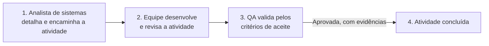
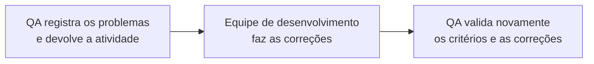
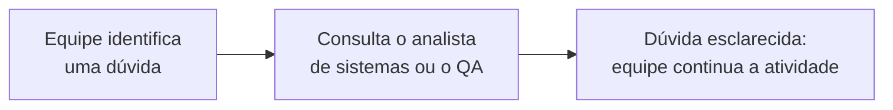

# Residuum — fluxo das tasks e definição de conclusão

[Guia das tasks](../01-planejamento/README.md) · [Documento geral](../01-planejamento/01-atividades-gerais.md)

Fonte editável das orientações compartilhadas de desenvolvimento, revisão, QA e evidências.

## Fluxo de atividades: desenvolvimento, QA e conclusão

Os diagramas seguem da **esquerda para a direita**. O primeiro mostra a entrega aprovada; os seguintes explicam correções e dúvidas.

### Caminho principal

### Quando o QA encontrar problemas

O QA registra o resultado esperado, o observado e as evidências do problema. **Se a nova validação aprovar, a atividade é concluída. Se ainda houver problemas, retorna ao desenvolvimento e passa por nova validação após a correção.** Esse ciclo se repete até atender os critérios e a definição de conclusão.

### Quando houver dúvidas durante o desenvolvimento

Dúvidas que alterem requisitos ou regras devem ter a decisão registrada e os critérios atualizados antes da implementação do trecho afetado. Quando uma dúvida impedir o avanço, registrar o bloqueio e a pessoa responsável por esclarecê-la; os trechos independentes podem continuar.

### Responsabilidades e conclusão

O analista detalha e esclarece requisitos; a equipe organiza a execução; a entrega passa por revisão e QA. Critérios atendidos e evidências registradas permitem concluir a atividade. Problemas retornam ao desenvolvimento e são validados novamente após correção. Dúvidas podem ser esclarecidas com analista ou QA durante todo o processo.

Preservar a definição comum de conclusão: revisão, critérios verificados, permissões e dados coerentes, falhas relevantes testadas e documentação/evidências associadas à versão. Critérios de aceite permanecem específicos da atividade. Uma decisão documental não conclui a implementação dependente.

## Evidências anteriores e decisões posteriores

Os casos vinculados às tasks são planejados, inclusive verificações documentais de decisões. Evidência exigida está separada de resultado produzido. Os testes anteriores da [demonstração do morador](../04-ux/01-morador-v6/02-validacao.md) não homologam o backend integrado; o [diagnóstico](../03-tecnologia/03-diagnostico-mvp-v1.md) tem versões e limites próprios; o [teste com moradores](../04-ux/01-morador-v6/03-teste-com-usuarios.md) permanece sem sessões humanas executadas.

A decisão de 10/10/2026 foi incorporada: descarte rápido usa rascunho em memória, abandono elimina os itens sem gravar no estoque, rota externa em outra aba preserva o fluxo e o retorno exige GPS novo. Falhas recuperáveis preservam itens enquanto a pessoa permanece no fluxo. PD-006 continua parcial para contratos reais, concorrência e confirmação. Parâmetros GPS demonstrativos e regras comerciais pendentes não foram transformados em políticas aprovadas.
