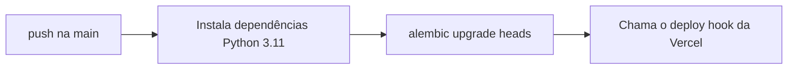

# Guia de deploy

> **Estado:** esboço · **Dono:** Tecnologia · **Atualizado em:** 10/11/2026
> **Fontes:** `backend/.github/workflows/deploy.yaml`, `frontend/.github/workflows/ci.yml`, Dockerfiles, `.env.example`.
> **Lacunas:** 7. Nada aqui foi executado do zero.

## Resumo

O backend tem um fluxo automático: ao integrar na `main`, roda as migrações e dispara o deploy na Vercel. Não há ambiente de homologação documentado nem plano de reversão.

## Fluxo atual do backend

Segredos usados: `DATABASE_URL`, `VERCEL_DEPLOY_HOOK_URL`.

## Rodar localmente

| Parte | Passos |
|---|---|
| Banco | `docker compose up -d` no backend |
| API | copiar `.env.example` → `.env`; instalar `requirements.txt`; `alembic upgrade head`; subir com `uvicorn` |
| Front | `pnpm install` e `pnpm dev` |

`[VERIFICAR NO CÓDIGO]` comandos exatos e portas; testar do zero e anotar.

## Ambientes

| Ambiente | URL | Banco | Quem publica |
|---|---|---|---|
| Local | localhost | Docker | cada dev |
| Homologação | `[LACUNA]` | `[LACUNA]` | `[LACUNA]` |
| Produção | `[LACUNA]` | `[LACUNA]` | CI na `main` |

## Variáveis e flags

| Nome | Para quê | Padrão proposto |
|---|---|---|
| `DATABASE_URL`, `SECRET_KEY` | Banco e assinatura do JWT | trocar o placeholder "troque…" |
| `ENV` | Desliga `/painel-testes` em produção | `production` |
| Origens permitidas (CORS) | Lista no lugar de `*` | `[LACUNA]` |
| `EXIGIR_CONVITE` | Cadastro só com convite | ligado no piloto `[DECISÃO: D6]` |
| `SORTEIOS_SOMENTE_TESTE` | Todo sorteio é de teste | **ligado** até o parecer jurídico |
| `GPS_RAIO_M`, `GPS_PRECISAO_MAX_M`, `GPS_IDADE_MAX_S` | Política de presença | 100 / 60 / 30 `[DECISÃO: PD-008]` |
| `LANCAMENTO_AVULSO_ATIVO` | Lançamento avulso da cooperativa | desligado |
| `AUTZ_POR_VINCULO` | Permissão por vínculo | ligar após o backfill |

## Checklist antes de publicar

- [ ] Migração testada subindo e descendo, em cópia do banco
- [ ] Backup do banco feito
- [ ] `SECRET_KEY` real; `/painel-testes` fechado; CORS restrito
- [ ] `SORTEIOS_SOMENTE_TESTE` ligada (aviso no log de subida)
- [ ] Reconciliação de saldos revisada pelo produto, se houver

## Reverter

`[LACUNA]` não há procedimento. Proposta: `alembic downgrade -1` (migrações aditivas), reverter o commit e reenviar o deploy hook.

## O que falta para fechar

- [ ] Ambiente de homologação e URLs
- [ ] Deploy do front (há `vercel.json`) `[VERIFICAR]`
- [ ] CI de testes antes do deploy
- [x] O workflow roda `alembic upgrade heads` (plural); na branch `feature/mor-025-026-vouchers-sorteios` há **uma só cabeça** (`d3f9b81a6e25`) em 34 migrações. `[VERIFICAR]` na `main` do backend
