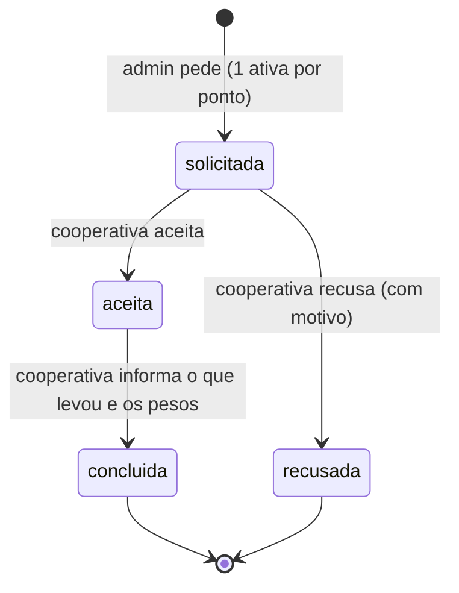
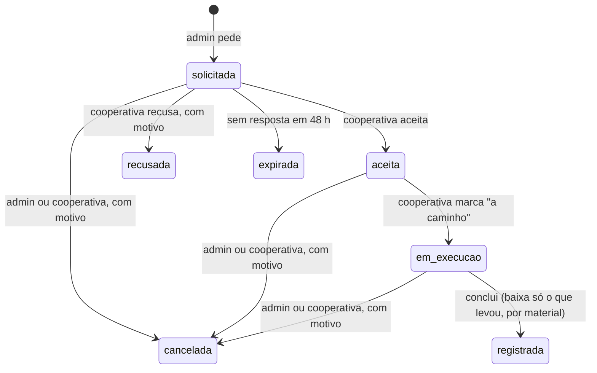

# Estudo: capacidade do ponto (PD-009) e execução da coleta (PD-014)

[Voltar ao índice de pesquisas](README.md)

> **Estado:** revisão · **Dono:** Produto e operação · **Atualizado em:** 13/11/2026
> **Natureza:** análise a partir das fichas [PD-009](../01-planejamento/decisoes/pd-009.md) e [PD-014](../01-planejamento/decisoes/pd-014.md) e do código do backend (branch `feature/mor-025-026-vouchers-sorteios`, commit `11f0d8e`, só leitura). Não houve teste em campo.

## Resumo

- **Capacidade (PD-009):** o código já tem capacidade, percentual de ocupação, alerta a partir de 80% e o estado "cheio". Há um **erro de unidade**: a capacidade está em **kg** e o estoque do ponto em **unidades**. Decidido: **unidades por material**.
- **Execução da coleta (PD-014):** o código já tem pedir, aceitar, recusar e concluir. Decididos: **prazo de aceite de 48 h**, **cancelamento**, **reagendamento (uma vez)**, **"a caminho"** e **coleta parcial**.
- Decisões em aberto: [decisões pendentes](../00-diagnostico/decisoes-pendentes.md).

## Parte 1: capacidade do ponto

### O que o código faz hoje

| Item | Como está | Onde |
|---|---|---|
| Capacidade | `capacidade_maxima`, número opcional, comentado como **"kg"** | `app/models/ponto_coleta.py` |
| Estoque do ponto | `inventario`, contado em **unidades** por material | `app/routes/cooperativa.py` |
| Ocupação | `estoque ÷ capacidade × 100`, ou seja **unidades ÷ kg** | `app/services/dashboard_ponto_coleta_service.py` |
| Alerta | lista pontos com ocupação **≥ 80%** | `GET /admin/pontos-coleta/alertas` |
| Estado do ponto | `ativo`, `cheio`, `inativo`, trocado **à mão** | `app/routes/ponto_coleta.py` |
| Ao concluir a coleta | o estoque do material coletado é zerado e o ponto volta a `ativo` | `app/routes/cooperativa.py` |
| Ponto cheio recebe descarte? | não foi encontrado bloqueio | — |

> ⚠️ **Erro de unidade.** Um ponto com capacidade 100 (kg) e 100 latas aparece **100% cheio**, mas 100 latas pesam bem menos que 100 kg.

### O que foi decidido

| Pergunta | Decisão |
|---|---|
| Unidade da capacidade | **Unidades por material**, mais a marcação manual de "cheio" que já existe. O peso fica para a pesagem da cooperativa. Corrigir o comentário "kg" no código (12/11/2026) |
| Percentual do alerta | **80%**; **cheio aos 100%** (12/11/2026) |
| Ponto cheio aceita descarte? | **Bloqueia a escolha do ponto e sugere outro compatível** (11/11/2026) |
| Ponto temporário ao encerrar | Passa a **inativo**; o histórico fica (12/11/2026) |

Opções que foram comparadas para a unidade: unidades por material, peso (kg), volume (litros do coletor) e marcação manual. A escolha por unidades casa com o que o app já conta.

## Parte 2: execução da coleta

### O que o código faz hoje

| Item | Como está |
|---|---|
| Pedido | Só o administrador pede; **uma solicitação ativa por ponto** |
| Recusa | Existe, com motivo. Depois de recusar, o admin pode pedir de novo |
| Conclusão | **Só integral**: zera o estoque de todos os materiais do pedido |
| Lançamento direto | A cooperativa pode lançar peso sem pedido; o código usa a **própria cooperativa como admin** |
| Sem estado para | prazo de aceite, cancelamento, reagendamento, "em rota", coleta parcial |

### O que foi decidido

| Pergunta | Decisão |
|---|---|
| Prazo de aceite e silêncio | **48 h**; sem resposta, a solicitação **expira** e volta ao admin (12/11/2026) |
| Reagendamento | A cooperativa propõe nova data **uma vez**; o ponto confirma (12/11/2026) |
| Recusa | Mantida, com motivo obrigatório |
| Cancelamento | **Admin e cooperativa**, com motivo, antes da conclusão. Novo estado `cancelada` (11/11/2026) |
| Início da execução | Estado novo **"a caminho"** (`em_execucao`), marcado pela cooperativa (11/11/2026) |
| Coleta parcial | **Permitida**: a cooperativa informa o que levou, por material, e o resto continua no estoque do ponto (11/11/2026) |
| Vários pedidos | Mantém **1 ativo por ponto** |

### Como fica

## Impacto no código

- Trocar o comentário e o uso de `capacidade_maxima` para unidades por material.
- Bloquear a escolha de ponto `cheio` no fluxo de descarte e sugerir outro.
- Novos estados `em_execucao`, `cancelada` e `expirada` em `solicitacao_coleta`, com tarefa agendada para a expiração de 48 h.
- Coleta parcial: baixar o estoque só pelo coletado, por material.
- Ajustar o lançamento direto da cooperativa para não gravar a cooperativa como `admin_id`.

Nada disso foi alterado: este repositório só tem documentação.
