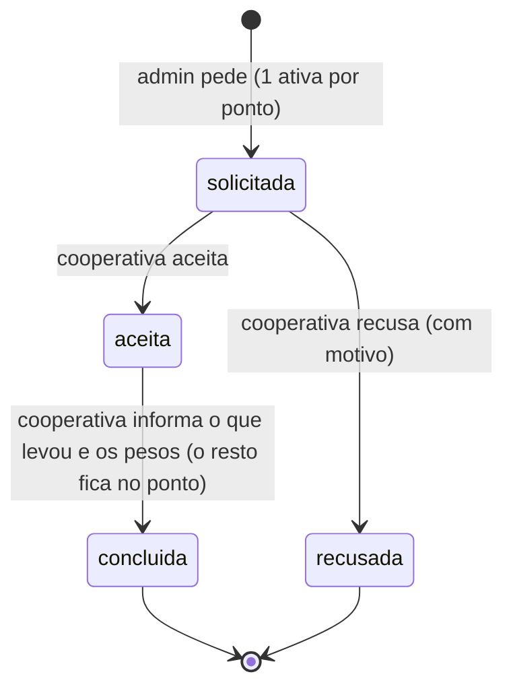
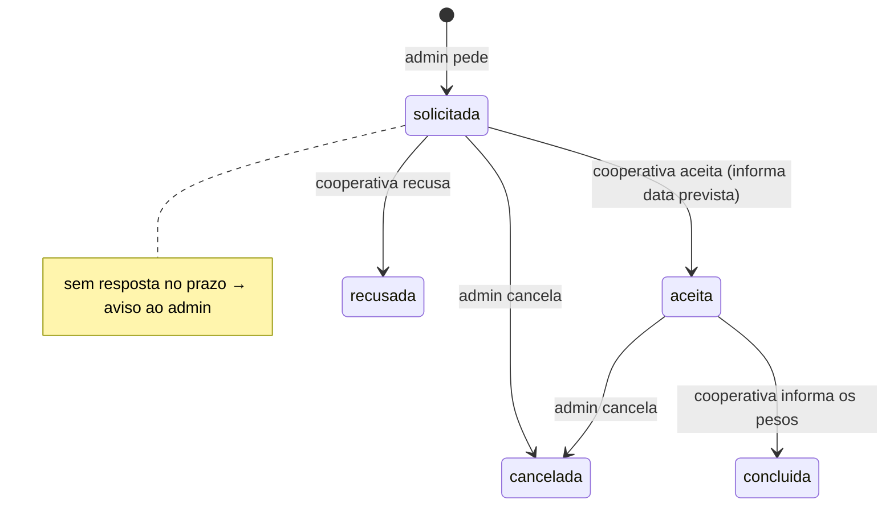

# Estudo: capacidade do ponto (PD-009) e execução da coleta (PD-014)

[Voltar ao índice de pesquisas](README.md)

> **Estado:** revisão · **Dono:** Produto e operação · **Elaborado em:** 11/11/2026
> **Natureza:** **análise de opções**, a partir das fichas [PD-009](../01-planejamento/decisoes/pd-009.md) e [PD-014](../01-planejamento/decisoes/pd-014.md) e do código do backend (branch `feature/mor-025-026-vouchers-sorteios`, commit `11f0d8e`, só leitura). Não houve teste em campo. **Nenhuma opção está decidida**: as recomendações são propostas para a reunião com a operação.

## Resumo

- **Capacidade (PD-009):** o código já tem capacidade, percentual de ocupação, alerta a partir de 80% e o estado "cheio". Mas há um **erro de unidade**: a capacidade está em **kg** e o estoque do ponto em **unidades**. A primeira decisão é escolher **uma unidade só**.
- **Execução da coleta (PD-014):** o código já tem pedir, aceitar, recusar e concluir. Faltam **prazo de aceite**, **cancelamento**, **reagendamento** e **coleta parcial**. Para o piloto, a proposta é ficar com o mínimo e tratar o resto **por telefone ou mensagem**, registrando em observação.

## Parte 1: capacidade do ponto (PD-009)

### O que o código faz hoje

| Item | Como está | Onde |
|---|---|---|
| Capacidade | `capacidade_maxima`, número opcional, comentado como **"kg"** | `app/models/ponto_coleta.py` |
| Estoque do ponto | `inventario`, contado em **unidades** por material | `app/routes/cooperativa.py` (abate "unidades") |
| Ocupação | `estoque ÷ capacidade × 100`, ou seja **unidades ÷ kg** | `app/services/dashboard_ponto_coleta_service.py` |
| Alerta | lista pontos com ocupação **≥ 80%** (valor padrão, ajustável na chamada) | `GET /admin/pontos-coleta/alertas` |
| Estado do ponto | `ativo`, `cheio`, `inativo`, trocado **à mão** | `app/routes/ponto_coleta.py` |
| Ao concluir a coleta | o estoque do material coletado é zerado e o ponto volta a `ativo` | `app/routes/cooperativa.py` |
| Ponto cheio recebe descarte? | **não foi encontrado bloqueio** no código | — |

> ⚠️ **Erro de unidade.** Um ponto com capacidade 100 (kg) e 100 latas aparece **100% cheio**, mas 100 latas pesam bem menos que 100 kg. O alerta de 80% fica sem sentido até isso ser corrigido.

### Opções para a unidade da capacidade

| # | Opção | Vantagem | Desvantagem |
|---|---|---|---|
| A | **Unidades por material** (ex.: até N garrafas PET e N latas) | Bate com o que o app já conta; fácil de explicar ao responsável | PET e lata ocupam espaços diferentes; precisa de um limite por material |
| B | **Peso (kg)** | É o que a cooperativa mede e o que entra no pagamento | O app não sabe o peso na entrega, só depois da pesagem; seria uma estimativa |
| C | **Volume (litros do coletor)** | É o limite físico real do ponto | Exige converter cada embalagem em volume (tabela de referência) |
| D | **Manual:** o responsável marca "cheio" | Simples, já existe | Depende de alguém olhar; sem alerta automático |

**Proposta para o piloto:** **A + D**. Capacidade em **unidades, por material**, com alerta automático, e o responsável continua podendo marcar "cheio" à mão. O peso fica para a pesagem da cooperativa (que já existe). Corrigir o comentário "kg" no código.

### Outras perguntas do PD-009

| Pergunta | Opções | Proposta |
|---|---|---|
| Percentual do alerta | fixo para todos ou por ponto | **Fixo no piloto** (o código usa 80%); revisar com os dados do piloto |
| Quem recebe o alerta | administrador, responsável, cooperativa | **Administrador e responsável** (é o admin quem encaminha a coleta) |
| Ponto cheio aceita descarte? | bloquear, avisar, aceitar | **Bloquear a escolha do ponto e sugerir outro compatível**, para o usuário não chegar a um ponto lotado |
| Horário de funcionamento | livre ou com horários por dia | **Horários por dia**, editáveis pelo responsável e pelo admin `[DECISÃO]` |
| Tags (etiquetas) do ponto | lista livre ou fixa | **Lista fixa curta** definida pelo admin `[DECISÃO: quais]` |
| Ponto temporário (evento) ao encerrar com material dentro | pedir coleta antes; transferir para outro ponto; descartar | **Exigir coleta antes de encerrar**; o ponto fica `inativo` só depois |

## Parte 2: execução da coleta (PD-014)

### O que o código faz hoje

| Item | Como está |
|---|---|
| Pedido | Só o administrador pede; **uma solicitação ativa por ponto** (`solicitada` ou `aceita`) |
| Recusa | Existe, com motivo. Depois de recusar, o admin pode pedir de novo (a outra ou à mesma) |
| Conclusão | **Só integral**: zera o estoque de todos os materiais do pedido e grava os pesos |
| Lançamento direto | A cooperativa pode lançar peso sem pedido; o código cria uma solicitação já `concluida` usando a **própria cooperativa como admin** (atalho a revisar) |
| Sem estado para | prazo de aceite, cancelamento, reagendamento, "em rota", coleta parcial |

### Perguntas do PD-014, opções e proposta

| Pergunta | Opções | Proposta para o piloto |
|---|---|---|
| **Silêncio** (cooperativa não responde) | expirar sozinho; avisar o admin; nada | **Avisar o admin** depois de um prazo; o admin decide `[DECISÃO: prazo]` |
| **Prazo de aceite** | horas fixas; sem prazo | Prazo único, a definir com a cooperativa. A meta 5 do piloto (**retirada em até 72 h**) dá o teto |
| **Recusa** | já existe | Manter. Motivo obrigatório (já é) |
| **Cancelamento** | só admin; admin e cooperativa; ninguém | ✅ **Decidido em 11/11/2026: admin e cooperativa**, antes da conclusão, com motivo. Novo estado `cancelada` |
| **Reagendamento** | estado próprio; campo de data; fora do sistema | **Campo "data prevista"** na solicitação, editável pela cooperativa; sem estado novo |
| **Vários pedidos** | 1 por ponto; vários | **Manter 1 ativo por ponto** (já é assim) |
| **Início da execução** ("a caminho") | estado novo; nada | ✅ **Decidido em 11/11/2026: estado novo "a caminho"** (`em_execucao`), marcado pela cooperativa |
| **Coleta parcial** | permitir; não permitir | ✅ **Decidido em 11/11/2026: permitida.** A cooperativa informa o que levou, **por material**, e o resto continua no estoque do ponto. Hoje o código **zera tudo** e precisa mudar |
| Lançamento direto da cooperativa | manter; tirar; marcar como tal | **Manter, mas marcar a origem** ("lançamento direto"), sem usar a cooperativa como admin |

### Como ficaria (proposta)

## O que precisa ser decidido (lista para a reunião)

| # | Decisão | Quem | Ficha |
|---|---|---|---|
| 1 | Unidade da capacidade (unidades, kg, litros ou manual) | Produto e operação | PD-009 |
| 2 | Capacidade de cada ponto do piloto | Operação (medir o coletor) | PD-009 |
| 3 | Percentual do alerta e quem recebe | Produto | PD-009 |
| 4 | Ponto cheio bloqueia o descarte? | Produto | PD-009 |
| 5 | Horários e tags | Produto | PD-009 |
| 6 | Prazo de aceite e o que fazer no silêncio | Operação e cooperativa | PD-014 |
| 7 | ~~Quem pode cancelar~~ **decidido: admin e cooperativa** (11/11/2026) | Produto | PD-014 |
| 8 | ~~Coleta parcial~~ **decidido: permitida** (11/11/2026) | Produto e cooperativa | PD-014 |

## Impacto no código (para quando decidir)

- Trocar o comentário e o uso de `capacidade_maxima` para a unidade escolhida (ou criar capacidade por material).
- Bloquear a escolha de ponto `cheio` no fluxo de descarte, se aprovado.
- Novo estado `cancelada` e campo de data prevista em `solicitacao_coleta`.
- Ajustar o lançamento direto da cooperativa para não gravar a cooperativa como `admin_id`.

Nada disso foi alterado: este repositório só tem documentação.
