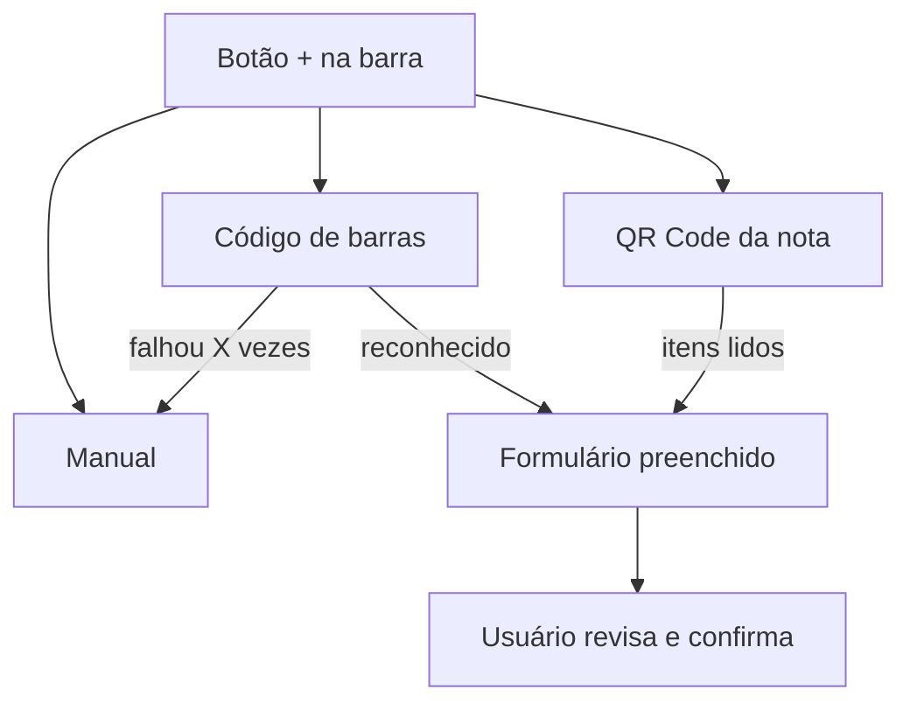

# Pesquisa — fontes de dados para código de barras e nota fiscal

[Voltar ao índice de pesquisas](README.md)

> **Estado:** revisão · **Dono:** Produto e Tecnologia · **Pesquisado em:** 11/11/2026 (busca na internet)
> **Pergunta ([PD-004](../01-planejamento/decisoes/pd-004.md)):** de onde vêm as informações do produto (código de barras) e dos itens da nota fiscal (QR Code)?
> **Cuidado:** são resultados de busca. **Nenhuma API foi testada.** O que está marcado `[VERIFICAR]` precisa de teste antes de virar decisão.

## Resumo

- **Código de barras:** existem catálogos de produtos e um serviço oficial da GS1 Brasil, mas nenhum foi confirmado como gratuito e pronto para uso. Precisa de teste.
- **QR Code da nota fiscal:** o QR leva ao portal de consulta da SEFAZ do Amazonas. **Não encontrei API pública e oficial que devolva os itens da nota.** Existem serviços pagos de terceiros.
- **Problema maior:** nem o código de barras nem a nota dizem de que **material** é a embalagem (PET ou lata). Esse vínculo precisa ser criado por regra do Residuum.

## Fluxo previsto

## 1. Código de barras (GTIN)

| Fonte | O que encontrei | Situação |
|---|---|---|
| **GS1 Brasil, API de Consulta / Verified by GS1** | Autenticação OAuth 2.0, token válido por 3 horas, consulta por GTIN de 14 dígitos; acesso conforme contrato e limites ([manual](https://www.gs1br.org/educacao-e-eventos/Documents/Manual_API_de_Consulta_GS1.pdf)) | Oficial. Provável custo e contrato `[VERIFICAR]` |
| **Cosmos (Bluesoft)** | Catálogo com mais de 25 milhões de itens, NCM e categoria ([app](https://apps.apple.com/br/app/bluesoft-cosmos/id1036307593)) | **API não confirmada** nos resultados; consultar a documentação da Bluesoft |
| **NT 2022.001 (SEFAZ)** | Web service oficial de consulta de GTIN ([nota técnica](https://inventti.com.br/wp-content/uploads/2022/05/NT2022.001_v1.00-WS-Consulta-GTIN.pdf)) | Voltado a quem emite nota fiscal eletrônica |
| **Open Food Facts** | Não apareceu na busca | Cobertura de produtos brasileiros desconhecida `[VERIFICAR]` |
| **Catálogo de terceiros** (ex.: SI5 Global) | Plano gratuito de 100 consultas por dia, segundo um autor no TabNews ([post](https://www.tabnews.com.br/dhoneshost/como-consultar-ncm-e-cest-pelo-codigo-de-barras-via-api-gratis-com-exemplos)) | Não oficial |

**Dica técnica:** guardar o GTIN como texto para não perder zeros à esquerda, e manter o cadastro manual como saída quando a consulta não achar o produto.

## 2. QR Code da nota fiscal (NFC-e)

| Item | O que encontrei |
|---|---|
| O QR Code | Leva à página de consulta da nota; o documento oficial é o [Manual do DANFE NFC-e e QR Code](https://www.sefaz.rr.gov.br/Manual_do_DANFE_NFC-e_QR_Code.pdf) (versão 2.00, com o hash) |
| Portal da SEFAZ-AM | Consulta em `sistemas.sefaz.am.gov.br/nfceweb/formConsulta.do` ([lista de URLs](https://blog.tecnospeed.com.br/urls-de-consulta-da-chave-da-nfc-e-lista-completa-e-atualizada/)) |
| API oficial com os itens | **Não encontrada.** Também não confirmei se o portal tem captcha ou exige login |
| Serviços de terceiros | A [Infosimples](https://infosimples.com/consultas/sefaz-am-nfce/) vende consulta à SEFAZ-AM, paga, como leitura do portal (não é API oficial) |

**Riscos:** depender de leitura do portal pode quebrar se ele mudar, pode violar os termos de uso e pode exigir captcha `[VERIFICAR com a SEFAZ-AM]`. Uma nota fiscal também traz dados do consumidor; isso entra na LGPD ([PD-022](../01-planejamento/decisoes/pd-022.md)).

## 3. Descobrir o material (PET ou lata)

Nenhuma fonte acima informa se a embalagem é PET ou lata. Opções, **ainda sem teste**:

| Opção | Ideia | Limite |
|---|---|---|
| Palavras da descrição | "refri 2L", "lata 350ml" | Erra com frequência |
| Tabela do Residuum | Cadastro próprio de produtos conhecidos, que cresce com o uso | Começa vazia |
| Sempre confirmar | O usuário revisa o material de cada item | Mais atrito; é o que a V6 já prevê (RF-013) |

**Recomendação para o piloto:** usar as três em conjunto, com **confirmação do usuário sempre**.

## Decisões e testes necessários

| Item | Tipo |
|---|---|
| Qual fonte de GTIN usar (GS1, Cosmos, outra) | Teste com 50 produtos reais de Manaus + contato comercial |
| Se é possível ler os itens da nota da SEFAZ-AM | Teste técnico e consulta à SEFAZ |
| Como classificar o material | Decisão de produto |
| Valor de X tentativas até o cadastro manual | Decisão de produto |

## O que falta para fechar

- [ ] Testar a consulta de 50 códigos de barras comuns em Manaus em pelo menos duas fontes
- [ ] Testar a leitura de 10 notas reais da SEFAZ-AM
- [ ] Contatar GS1 Brasil e Bluesoft sobre acesso e custo
- [ ] Registrar o resultado em [PD-004](../01-planejamento/decisoes/pd-004.md)
