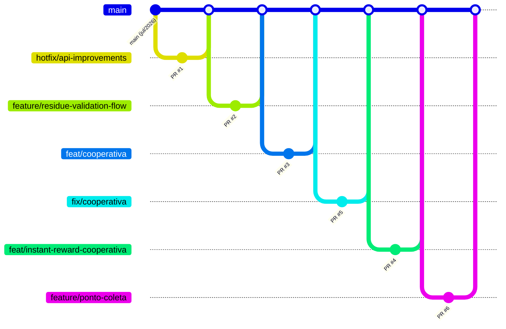

# Mapa de branches e status de desenvolvimento

Foto de **2026-10-21**, gerada com `git` e `gh` a partir de `origin` dos repositórios `residuum-backend` e `residuum-frontend`. Este arquivo é um retrato: o estado atual está no GitHub e no quadro do Miro (ver [Uso do Kanban](../planejamento/kanban-miro.md)).

## Resumo

- Os dois repositórios têm uma única linha de integração: **`main`**. Tudo entra por Pull Request.
- **Todos os 10 PRs abertos até hoje estão mergeados** (6 no backend, 4 no frontend). Não há PR aberto.
- A última atividade em `main` foi em **2026-07-28** nos dois repositórios. Nada foi integrado desde então.
- Quase todo o desenvolvimento é de uma pessoa (`daviPeter07`: 36 de 53 commits no backend e 166 de 257 no frontend). Há contribuições de outros nomes, principalmente no frontend antes de julho.
- Duas branches remotas têm commits que **não estão em `main`**. Nenhuma precisa ser aproveitada (ver "Branches com commits fora de main").

## Convenções (do README do frontend)

- Integração em `main` só por Pull Request, com revisão.
- Prefixos: `feature/`, `feat/`, `fix/`, `bugfix/`, `hotfix/`.
- Commits em Conventional Commits: `feat(ui): ...`, `fix(api): ...`.

## Backend — `residuum-backend`

`main` está em `11670c5` (2026-07-28). 53 commits. CI: só `deploy.yaml`; **não há workflow de testes**.

| Branch remota | Último commit | Autor | Atrás / à frente de main | Estado | PR |
|---|---|---|---|---|---|
| `main` | 2026-07-28 | — | — | integração | — |
| `feature/ponto-coleta-e-melhorias-coleta` | 2026-07-28 | daviPeter07 | 1 / 0 | mergeada | #6 |
| `feat/instant-reward-cooperativa` | 2026-07-24 | daviPeter07 | 6 / **1** | mergeada (#4), 1 commit posterior fora de main | #4 |
| `feat/cooperativa` | 2026-07-23 | Davi Peterson Matos Conde | 16 / 0 | mergeada | #3 |
| `fix/cooperativa` | 2026-07-23 | Eugenio - Home | 13 / 0 | mergeada | #5 |
| `feature/residue-validation-flow` | 2026-07-17 | daviPeter07 | 21 / 0 | mergeada | #2 |
| `hotfix/api-improvements-and-fixes` | 2026-07-15 | daviPeter07 | 27 / 0 | mergeada | #1 |

Ordem de integração em `main`: #1 → #2 → #3 → #5 → #4 → #6.

## Frontend — `residuum-frontend`

`main` está em `4f41b13` (2026-07-28). 257 commits. CI: `ci.yml` (o CI ignora falhas de formatação, ver [Stacks e integrações](stacks-e-integracoes.md)).

| Branch remota | Último commit | Autor | Atrás / à frente de main | Estado | PR |
|---|---|---|---|---|---|
| `main` | 2026-07-28 | — | — | integração | — |
| `feature/ponto-coleta-e-melhorias-coleta` | 2026-07-28 | daviPeter07 | 1 / 0 | mergeada | #4 |
| `feat/cooperativa-dashboard` | 2026-07-24 | daviPeter07 | 8 / 0 | mergeada | #3 |
| `feat/ux-simplification-morador` | 2026-07-23 | daviPeter07 | 17 / 0 | mergeada | #2 |
| `feature/residue-store-ux` | 2026-07-17 | daviPeter07 | 40 / **1** | mergeada (#1), 1 commit posterior fora de main | #1 |

Ordem de integração em `main` (desde junho): PRs #15–#20 vindos de `quely78/*` (integração de estoque, pontos, recompensas, base visual) → #1 → #2 → #3 → #4 deste repositório.

## Branches com commits fora de main

| Repositório | Branch | Commit | Conteúdo | Situação |
|---|---|---|---|---|
| backend | `feat/instant-reward-cooperativa` | `226fd38` (2026-07-24) | adiciona `from datetime import datetime, timezone` em `app/routes/inventario_usuario.py` | **Obsoleto**: `main` já tem esse import (linha 3). Não é preciso integrar. |
| frontend | `feature/residue-store-ux` | `b852748` (2026-07-17) | `style(store)`: remove gradientes em `LojaPage.jsx` (1 linha) | Não integrado e **desatualizado** (40 commits atrás). Se o visual sem gradiente for desejado, refazer sobre `main`. |

## Trabalho em andamento (não está no GitHub)

Branches locais criadas em 2026-10-21 para as tasks de M05. Ainda **sem push e sem PR**.

| Repositório | Branch | Base | Task | Estado |
|---|---|---|---|---|
| frontend | `feature/mor-022-loja-recompensas` | `main` (`4f41b13`) | TSK-MOR-022 (Consultar a loja) | alterações em `src/pages/LojaPage.jsx`, ainda sem commit |

Quando uma branch for publicada, atualize esta tabela ou mova a linha para as tabelas acima.

## Mapa visual



O gráfico mostra o backend. O frontend segue o mesmo desenho com os PRs #1 a #4.

## Como atualizar este mapa

```bash
git fetch --all --prune
# branches remotas com data e autor
git for-each-ref refs/remotes/origin --format='%(refname:short) | %(committerdate:short) | %(authorname) | %(subject)'
# quanto cada branch está atrás/à frente de main
git rev-list --left-right --count origin/main...origin/<branch>
# commits que ainda não estão em main
git log origin/main..origin/<branch> --oneline
# PRs
gh pr list --state all --limit 50
```

Antes de começar uma task: rode os comandos acima, veja se alguma branch remota toca os mesmos arquivos e parta sempre de `main` atualizada.
